<div align="center">


**Carrera**: Ingeniería de Software

**Periodo**: 2026-20

**Curso**: Diseño de Experimentos

**NRC**: 9112

**Profesor**: Lennin Percy Cenas Vasquez

**Informe deL Trabajo Final**

**Startup**: Foundex

**Producto**: ArquiTech

**Integrantes**:

Chacaliaza Minaya, Eduardo Fabian - U202324129

Espino Rossi, Victor Manuel - U202411567

Garcia Cerpa, Braden Raid - u202415618

Mendoza Moreano, Mariel Lucero - u20231a418

Quispe Barzola, Fabricio Fabian - U202320442

**Septiembre, 2026**

</div>

<div style="page-break-before: always;"></div>


# Registro de Versiones del Informe

| Versión |   Fecha    | Autor                             | Descripción de modificación                                                                                                                                                                                                                                                                                                                        |
| :-----: | :--------: | :-------------------------------- | :------------------------------------------------------------------------------------------------------------------------------------------------------------------------------------------------------------------------------------------------------------------------------------------------------------------------------------------------- |
|   1.0   | 14/09/2026 | Mendoza Moreano, Mariel Lucero    | <span style="display:block; text-align:justify;">Elaboración de las secciones 1.1.1 Descripción de la Startup, 1.1.2 Perfiles de integrantes del equipo, 1.2.1 Antecedentes y problemática, 1.2.2 Lean UX Process, 2.3.1 User Personas, 2.3.2 User Task Matrix, 4.7 Web Applications Prototyping y 4.8 Domain-Driven Software Architecture.</span> |
|   1.1   | 14/09/2026 | Chacaliaza Minaya, Eduardo Fabian | <span style="display:block; text-align:justify;">Elaboración de las secciones 1.3 Segmentos objetivo, 2.1.1 Análisis competitivo, 2.1.2 Estrategias y tácticas frente a competidores, 3.3 Product Backlog, 4.3 Landing Page UI Design y 4.4 Mobile Applications UX/UI Design.</span>                                                               |
|   1.2   | 14/09/2026 | Quispe Barzola, Fabricio Fabian   | <span style="display:block; text-align:justify;">Elaboración de las secciones 2.2.1 Diseño de entrevistas, 2.2.2 Registro de entrevistas, 2.2.3 Análisis de entrevistas, 3.2 User Stories, 4.9 Software Object-Oriented Design, 4.10 Database Design y 5.1 Software Configuration Management.</span>                                               |
|   1.3   | 14/09/2026 | Espino Rossi, Victor Manuel       | <span style="display:block; text-align:justify;">Elaboración de las secciones 2.3.3 User Journey Mapping, 2.3.4 Empathy Mapping, 3.4 Impact Mapping, 4.5 Mobile Applications Prototyping, 4.6 Web Applications UX/UI Design y 5.2 Product Implementation & Deployment.</span>                                                                      |
|   1.4   | 14/09/2026 | Garcia Cerpa, Braden Raid         | <span style="display:block; text-align:justify;">Elaboración de las secciones 2.3.5 As-is Scenario Mapping, 2.4 Ubiquitous Language, 3.1 To-Be Scenario Mapping, 4.1 Style Guidelines, 4.2 Information Architecture y 5.3 Video About-the-Product.</span>                                                                                          |
|   2.0   | 05/10/2026 | Espino Rossi, Victor Manuel       | <span style="display:block; text-align:justify;">Incorporación de la estructura y evidencias iniciales del Capítulo VI (6.1.1 Core Entities Unit Tests, 6.1.2 Core Integration Tests y 6.1.4 Core System Tests con Playwright) y de la estructura del Capítulo VII DevOps Practices (7.1 a 7.3).</span> |
|   2.1   | 06/10/2026 | Espino Rossi, Victor Manuel       | <span style="display:block; text-align:justify;">Corrección de las secciones 2.3.1 User Personas, 2.3.3 User Journey Mapping, 2.3.4 Empathy Mapping, 2.3.5 As-is Scenario Mapping, 3.1 To-Be Scenario Mapping y 3.4 Impact Mapping, vinculándolas con los hallazgos de las entrevistas, y actualización de la numeración del índice.</span> |
|   2.2   | 06/10/2026 | Quispe Barzola, Fabricio Fabian   | <span style="display:block; text-align:justify;">Actualización de las secciones 1.3, 2.3.2, 2.4, 3.2 User Stories, 3.3 Product Backlog, 4.9 Software Object-Oriented Design, 4.10 Database Design, 5.1 Software Configuration Management, 5.2.1 Sprint Backlogs, 5.2.6 RESTful API documentation y 5.3 Video About-the-Product para alinearlas con la implementación real.</span> |
|   2.3   | 07/10/2026 | Chacaliaza Minaya, Eduardo Fabian | <span style="display:block; text-align:justify;">Elaboración de la sección 5.2.4 Acuerdo de Servicio - SaaS y actualización de 5.1.2 Source Code Management, 5.2.3 Implemented Frontend-Web Application Evidence, 5.2.5 Implemented Native-Mobile Application Evidence y 5.2.8 Team Collaboration Insights.</span> |
|   2.4   | 07/10/2026 | Espino Rossi, Victor Manuel       | <span style="display:block; text-align:justify;">Incorporación de evidencias de pruebas unitarias e integración del Backend (6.1.1 y 6.1.2) y de escenarios Cucumber (6.1.3); documentación de 7.1 a 7.3 y actualización de 4.8 Domain-Driven Software Architecture y 5.2.5 Implemented Native-Mobile Application Evidence.</span> |
|   2.5   | 07/10/2026 | Quispe Barzola, Fabricio Fabian   | <span style="display:block; text-align:justify;">Documentación de evidencias y límites de los pipelines de CI/CD en el Capítulo VII, actualización de la sección Student Outcome correspondiente al TB1 y de Conclusiones y recomendaciones.</span> |
|   2.6   | 07/10/2026 | Garcia Cerpa, Braden Raid         | <span style="display:block; text-align:justify;">Elaboración de las pruebas de sistema de la Frontend Web Application en la sección 6.1.4 Core System Tests (E2E-W01 y E2E-W02), con evidencias de ejecución y commits de testing.</span> |
|   2.7   | 11/11/2026 | Copilot                           | <span style="display:block; text-align:justify;">Incorporación de un validador reproducible del informe para comprobar secciones obligatorias y referencias locales a evidencias.</span> |

# Project Report Collaboration Insights

<p align="justify">

Para la elaboración del Project Report de ArquiTech se utilizó un repositorio compartido en GitHub, en el cual los integrantes del equipo realizaron sus contribuciones mediante ramas individuales, commits y procesos de integración. Este mecanismo permitió mantener la trazabilidad de los cambios efectuados durante el desarrollo del informe y organizar de manera colaborativa las actividades correspondientes a cada entrega.

</p>

## Entrega Nº1: AV1

<p align="justify">

Durante el desarrollo de la entrega AV1, los integrantes del equipo trabajaron de manera colaborativa en la elaboración y actualización de las diferentes secciones del Project Report. Las actividades fueron distribuidas entre los miembros del equipo, quienes realizaron sus aportes mediante ramas de trabajo y commits asociados a los capítulos y secciones asignadas.

</p>

<p align="justify">

Asimismo, se realizaron integraciones progresivas de los cambios desarrollados por cada integrante hacia el repositorio principal. Las siguientes evidencias muestran la participación del equipo y el historial de commits realizados durante la preparación de la entrega AV1.

</p>

**Figura 1**  
_Analíticas de colaboración durante la entrega AV1_

<p align="center">

  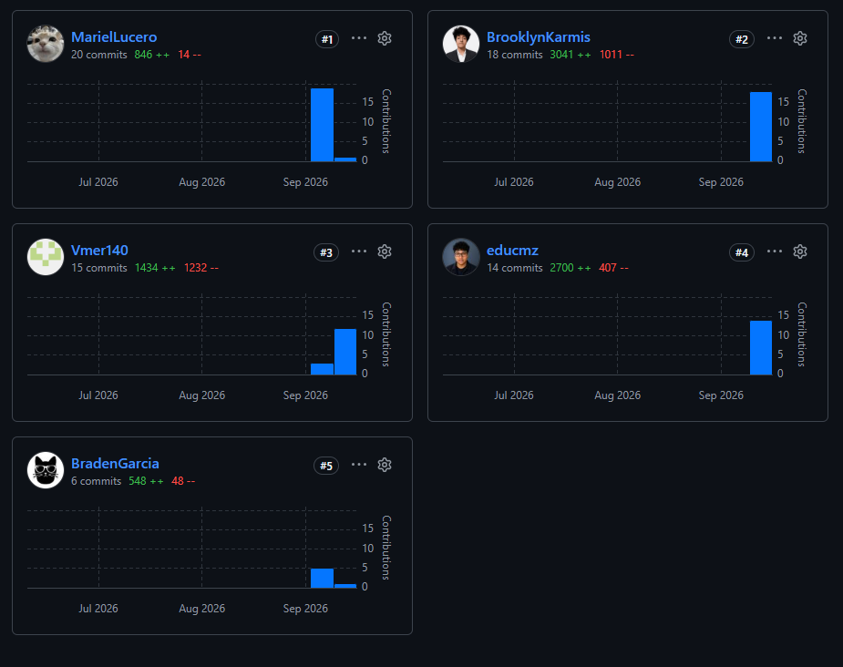

</p>

**Figura 2**  
_Commits realizados durante la entrega AV1_

<p align="center">

  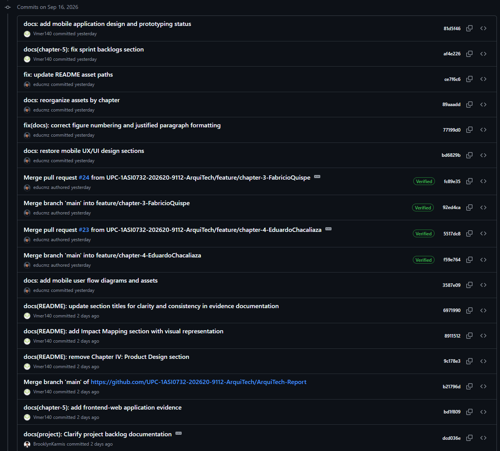

<br><br>

  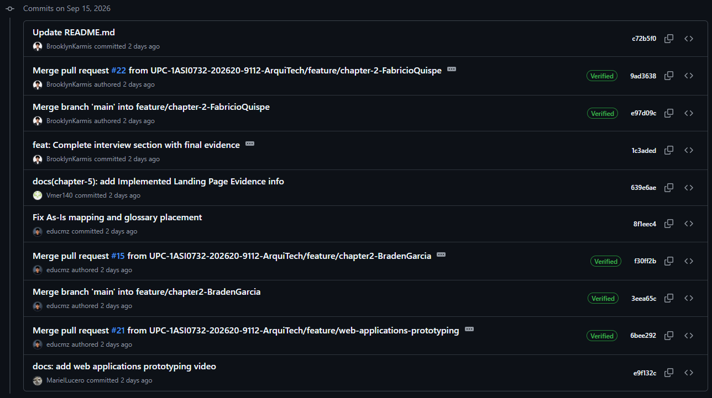

</p>

## Entrega Nº2: TB1

<p align="justify">

Durante la entrega TB1, comprendida entre el 18/09/2026 y el 07/10/2026, el equipo actualizó el Project Report para reflejar la implementación real de ArquiTech y corregir los artefactos presentados en el AV1. Las actividades incluyeron la corrección de User Personas, User Journey Mapping, Empathy Mapping, As-is y To-Be Scenario Mapping e Impact Mapping con trazabilidad hacia las entrevistas; la actualización de User Stories, Product Backlog, Class Diagram y Database Design según el Backend implementado; la incorporación del Acuerdo de Servicio - SaaS y de las evidencias de implementación del Capítulo V; la documentación de las pruebas unitarias, de integración, BDD y de sistema del Capítulo VI; y la elaboración del Capítulo VII DevOps Practices, junto con la actualización del Student Outcome y de las conclusiones.

</p>

<p align="justify">

Los aportes se registraron mediante ramas de trabajo y su integración a la rama principal del repositorio. En las analíticas de GitHub, los integrantes se identifican por su usuario: Vmer140 (Espino Rossi, Victor Manuel), BrooklynKarmis (Quispe Barzola, Fabricio Fabian), educmz (Chacaliaza Minaya, Eduardo Fabian) y BradenGarcia (Garcia Cerpa, Braden Raid). Las siguientes evidencias muestran las contribuciones y el historial de commits realizados durante la preparación de la entrega TB1, y guardan correspondencia con las versiones 2.0 a 2.6 del Registro de Versiones del Informe.

</p>

**Figura 3**  
_Analíticas de colaboración durante la entrega TB1_

<p align="center">

  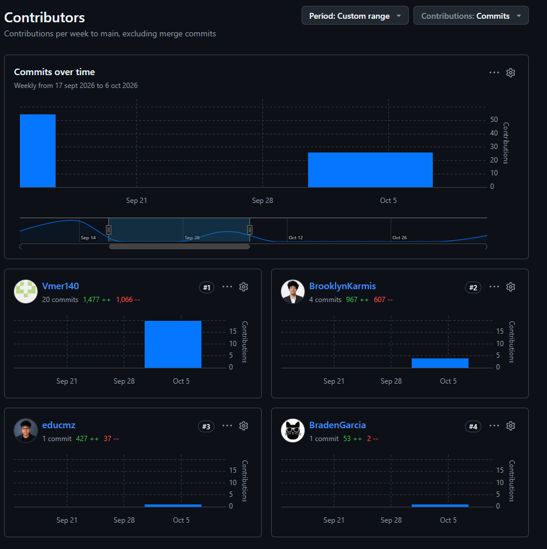

</p>

**Figura 4**  
_Commits realizados durante la entrega TB1_

<p align="center">

  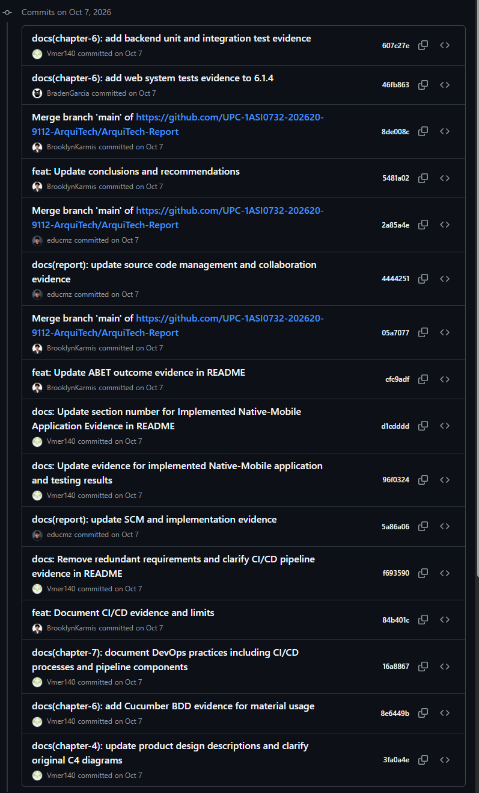

<br><br>

  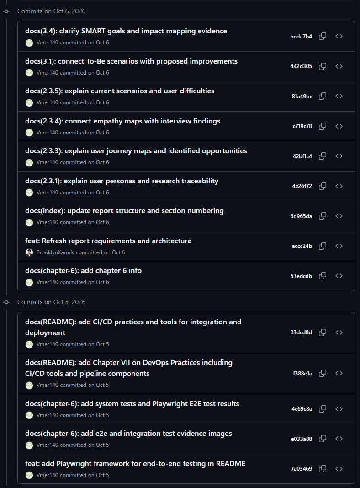

</p>

<div style="page-break-before: always;"></div>

# Contenido

## Tabla de contenido

- [Part I: As-Is Software Project](#part-i-as-is-software-project)
- [Part II: Verification, Validation & Pipeline](#part-ii-verification-validation--pipeline)

### [Capítulo I: Introducción](#capítulo-i-introducción-1)

- [1.1. Startup Profile](#11-startup-profile)
  - [1.1.1. Descripción de la Startup](#111-descripción-de-la-startup)

  - [1.1.2. Perfiles de integrantes del equipo](#112-perfiles-de-integrantes-del-equipo)

- [1.2. Solution Profile](#12-solution-profile)
  - [1.2.1. Antecedentes y problemática](#121-antecedentes-y-problemática)

  - [1.2.2. Lean UX Process](#122-lean-ux-process)
    - [1.2.2.1. Lean UX Problem Statements](#1221-lean-ux-problem-statements)

    - [1.2.2.2. Lean UX Assumptions](#1222-lean-ux-assumptions)

    - [1.2.2.3. Lean UX Hypothesis Statements](#1223-lean-ux-hypothesis-statements)

    - [1.2.2.4. Lean UX Canvas](#1224-lean-ux-canvas)

- [1.3. Segmentos objetivo](#13-segmentos-objetivo)

### [Capítulo II: Requirements Elicitation & Analysis](#capítulo-ii-requirements-elicitation--analysis-1)

- [2.1. Competidores](#21-competidores)
  - [2.1.1. Análisis competitivo](#211-análisis-competitivo)

  - [2.1.2. Estrategias y tácticas frente a competidores](#212-estrategias-y-tácticas-frente-a-competidores)

- [2.2. Entrevistas](#22-entrevistas)
  - [2.2.1. Diseño de entrevistas](#221-diseño-de-entrevistas)

  - [2.2.2. Registro de entrevistas](#222-registro-de-entrevistas)

  - [2.2.3. Análisis de entrevistas](#223-análisis-de-entrevistas)

- [2.3. Needfinding](#23-needfinding)
  - [2.3.1. User Personas](#231-user-personas)

  - [2.3.2. User Task Matrix](#232-user-task-matrix)

  - [2.3.3. User Journey Mapping](#233-user-journey-mapping)

  - [2.3.4. Empathy Mapping](#234-empathy-mapping)

  - [2.3.5. As-is Scenario Mapping](#235-as-is-scenario-mapping)

- [2.4. Ubiquitous Language](#24-ubiquitous-language)

### [Capítulo III: Requirements Specification](#capítulo-iii-requirements-specification-1)

- [3.1. To-Be Scenario Mapping](#31-to-be-scenario-mapping)

- [3.2. User Stories](#32-user-stories)

- [3.3. Product Backlog](#33-product-backlog)

- [3.4. Impact Mapping](#34-impact-mapping)

### [Capítulo IV: Product Design](#capítulo-iv-product-design-1)

- [4.1. Style Guidelines](#41-style-guidelines)
  - [4.1.1. General Style Guidelines](#411-general-style-guidelines)

  - [4.1.2. Web Style Guidelines](#412-web-style-guidelines)

  - [4.1.3. Mobile Style Guidelines](#413-mobile-style-guidelines)
    - [4.1.3.1. iOS Mobile Style Guidelines](#4131-ios-mobile-style-guidelines)

    - [4.1.3.2. Android Mobile Style Guidelines](#4132-android-mobile-style-guidelines)

- [4.2. Information Architecture](#42-information-architecture)
  - [4.2.1. Organization Systems](#421-organization-systems)

  - [4.2.2. Labeling Systems](#422-labeling-systems)

  - [4.2.3. SEO Tags and Meta Tags](#423-seo-tags-and-meta-tags)

  - [4.2.4. Searching Systems](#424-searching-systems)

  - [4.2.5. Navigation Systems](#425-navigation-systems)

- [4.3. Landing Page UI Design](#43-landing-page-ui-design)
  - [4.3.1. Landing Page Wireframe](#431-landing-page-wireframe)

  - [4.3.2. Landing Page Mock-up](#432-landing-page-mock-up)

- [4.4. Mobile Applications UX/UI Design](#44-mobile-applications-uxui-design)
  - [4.4.1. Mobile Applications Wireframes](#441-mobile-applications-wireframes)

  - [4.4.2. Mobile Applications Wireflow Diagrams](#442-mobile-applications-wireflow-diagrams)

  - [4.4.3. Mobile Applications Mock-ups](#443-mobile-applications-mock-ups)

  - [4.4.4. Mobile Applications User Flow Diagrams](#444-mobile-applications-user-flow-diagrams)

- [4.5. Mobile Applications Prototyping](#45-mobile-applications-prototyping)
  - [4.5.1. Android Mobile Applications Prototyping](#451-android-mobile-applications-prototyping)

  - [4.5.2. iOS Mobile Applications Prototyping](#452-ios-mobile-applications-prototyping)

- [4.6. Web Applications UX/UI Design](#46-web-applications-uxui-design)
  - [4.6.1. Web Applications Wireframes](#461-web-applications-wireframes)

  - [4.6.2. Web Applications Wireflow Diagrams](#462-web-applications-wireflow-diagrams)

  - [4.6.3. Web Applications Mock-ups](#463-web-applications-mock-ups)

  - [4.6.4. Web Applications User Flow Diagrams](#464-web-applications-user-flow-diagrams)

- [4.7. Web Applications Prototyping](#47-web-applications-prototyping)

- [4.8. Domain-Driven Software Architecture](#48-domain-driven-software-architecture)
  - [4.8.1. Software Architecture Context Diagram](#481-software-architecture-context-diagram)

  - [4.8.2. Software Architecture Container Diagrams](#482-software-architecture-container-diagrams)

  - [4.8.3. Software Architecture Components Diagrams](#483-software-architecture-components-diagrams)

- [4.9. Software Object-Oriented Design](#49-software-object-oriented-design)
  - [4.9.1. Class Diagrams](#491-class-diagrams)

  - [4.9.2. Class Dictionary](#492-class-dictionary)

- [4.10. Database Design](#410-database-design)
  - [4.10.1. Relational/Non-Relational Database Diagram](#4101-relationalnon-relational-database-diagram)

### [Capítulo V: Product Implementation](#capítulo-v-product-implementation-1)

- [5.1. Software Configuration Management](#51-software-configuration-management)
  - [5.1.1. Software Development Environment Configuration](#511-software-development-environment-configuration)

  - [5.1.2. Source Code Management](#512-source-code-management)

  - [5.1.3. Source Code Style Guide & Conventions](#513-source-code-style-guide--conventions)

  - [5.1.4. Software Deployment Configuration](#514-software-deployment-configuration)

- [5.2. Product Implementation & Deployment](#52-product-implementation--deployment)
  - [5.2.1. Sprint Backlogs](#521-sprint-backlogs)

  - [5.2.2. Implemented Landing Page Evidence](#522-implemented-landing-page-evidence)

  - [5.2.3. Implemented Frontend-Web Application Evidence](#523-implemented-frontend-web-application-evidence)

  - [5.2.4. Acuerdo de Servicio - SaaS](#524-acuerdo-de-servicio---saas)

  - [5.2.5. Implemented Native-Mobile Application Evidence](#525-implemented-native-mobile-application-evidence)

  - [5.2.6. Implemented RESTful API and/or Serverless Backend Evidence](#526-implemented-restful-api-andor-serverless-backend-evidence)

  - [5.2.7. RESTful API documentation](#527-restful-api-documentation)

  - [5.2.8. Team Collaboration Insights](#528-team-collaboration-insights)

- [5.3. Video About-the-Product](#53-video-about-the-product)

### [Capítulo VI: Product Verification & Validation](#capítulo-vi-product-verification--validation)

- [6.1. Testing Suites & Validation](#61-testing-suites--validation)
  - [6.1.1. Core Entities Unit Tests](#611-core-entities-unit-tests)
  - [6.1.2. Core Integration Tests](#612-core-integration-tests)
  - [6.1.3. Core Behavior-Driven Development](#613-core-behavior-driven-development)
  - [6.1.4. Core System Tests](#614-core-system-tests)
- [6.2. Static testing & Verification](#62-static-testing--verification)
  - [6.2.1. Static Code Analysis](#621-static-code-analysis)
    - [6.2.1.1. Coding standard & Code conventions.](#6211-coding-standard--code-conventions)
    - [6.2.1.2. Code Quality & Code Security.](#6212-code-quality--code-security)
  - [6.2.2. Reviews](#622-reviews)
  - [6.3. Validation Interviews](#63-validation-interviews)
  - [6.3.1. Diseño de Entrevistas](#631-diseño-de-entrevistas)

### [Capítulo VII: DevOps Practices](#capítulo-vii-devops-practices)

- [7.1. Continuous Integration](#71-continuous-integration)
  - [7.1.1. Tools and Practices](#711-tools-and-practices)
  - [7.1.2. Build & Test Suite Pipeline Components](#712-build--test-suite-pipeline-components)
- [7.2. Continuous Delivery](#72-continuous-delivery)
  - [7.2.1. Tools and Practices](#721-tools-and-practices)
  - [7.2.2. Stages Deployment Pipeline Components](#722-stages-deployment-pipeline-components)
- [7.3 Continuous Deployment](#73-continuous-deployment)
  - [7.3.1. Tools and Practices](#731-tools-and-practices)
  - [7.3.2. Production Deployment Pipeline Components](#732-production-deployment-pipeline-components)
- [7.4. Continuous Monitoring](#74-continuous-monitoring)
  - [7.4.1. Tools and Practices](#741-tools-and-practices)
  - [7.4.2. Monitoring Pipeline Components](#742-monitoring-pipeline-components)
  - [7.4.3. Alerting Pipeline Components](#743-alerting-pipeline-components)
  - [7.4.4. Notification Pipeline Components](#744-notification-pipeline-components)

### [Capítulo VIII: Experiment-Driven Development](#capítulo-viii-experiment-driven-development)

- [8.1. Experiment Planning](#81-experiment-planning)
  - [8.1.1. As-Is Summary](#811-as-is-summary)
  - [8.1.2. Raw Material: Assumptions, Knowledge Gaps, Ideas, Claims](#812-raw-material-assumptions-knowledge-gaps-ideas-claims)
  - [8.1.3. Experiment-Ready Questions](#813-experiment-ready-questions)
  - [8.1.4. Question Backlog](#814-question-backlog)
  - [8.1.5. Experiment Cards](#815-experiment-cards)
- [8.2. Experiment Design](#82-experiment-design)
  - [8.2.1. Hypotheses](#821-hypotheses)
  - [8.2.2. Domain Business Metrics](#822-domain-business-metrics)
  - [8.2.3. Measures](#823-measures)
  - [8.2.4. Conditions](#824-conditions)
  - [8.2.5. Scale Calculations and Decisions](#825-scale-calculations-and-decisions)
  - [8.2.6. Methods Selection](#826-methods-selection)
  - [8.2.7. Data Analytics: Goals, KPIs and Metrics Selection](#827-data-analytics-goals-kpis-and-metrics-selection)
  - [8.2.8. Web and Mobile Tracking Plan](#828-web-and-mobile-tracking-plan)
- [8.3. Experimentation](#83-experimentation)
  - [8.3.1. To-Be User Stories](#831-to-be-user-stories)
  - [8.3.2. To-Be Product Backlog](#832-to-be-product-backlog)
  - [8.3.3. Pipeline-supported, Experiment-Driven To-Be Software Platform Lifecycle](#833-pipeline-supported-experiment-driven-to-be-software-platform-lifecycle)
- [8.4. Experiment Aftermath & Analysis](#84-experiment-aftermath--analysis)
  - [8.4.1. Analysis and Interpretation of Results](#841-analysis-and-interpretation-of-results)
  - [8.4.2. Re-scored and Re-prioritized Question Backlog](#842-re-scored-and-re-prioritized-question-backlog)
- [8.5. Continuous Learning](#85-continuous-learning)
  - [8.5.1. Shareback Session Artifacts: Learning Workflow](#851-shareback-session-artifacts-learning-workflow)


### [Conclusion](#conclusiones)

### [Bibliografía](#bibliografia)

### [Anexos](#anexos-1)

<div style="page-break-before: always;"></div>

# Student Outcome

<p align="justify">

El curso contribuye al cumplimiento del Student Outcome ABET:

</p>

**ABET – EAC - Student Outcome 4**

<p align="justify">

Criterio: _La capacidad de reconocer responsabilidades éticas y profesionales en situaciones de ingeniería y hacer juicios informados, que deben considerar el impacto de las soluciones de ingeniería en contextos globales, económicos, ambientales y sociales._

</p>

<p align="justify">

En el siguiente cuadro se describe las acciones realizadas y enunciados de conclusiones por parte del grupo, que permiten sustentar el haber alcanzado el logro del ABET – EAC - Student Outcome 4.

</p>

<table style="width:100%; table-layout:fixed; border-collapse:collapse;">
  <colgroup>
    <col style="width:18%;">
    <col style="width:60%;">
    <col style="width:22%;">
  </colgroup>
  <thead>
    <tr>
      <th align="center" style="text-align:center !important;">Criterio específico</th>
      <th align="center" style="text-align:center !important;">Acciones realizadas</th>
      <th align="center" style="text-align:center !important;">Conclusiones</th>
    </tr>
  </thead>
  <tbody>
  <tr>
      <td valign="middle" style="text-align:justify; vertical-align:middle !important; padding:8px;">
        <strong>4.c.1 Reconoce responsabilidad ética y profesional en situaciones de ingeniería de software</strong>
      </td>
      <td style="text-align:justify; vertical-align:top; padding:8px;">
      <strong>Mendoza Moreano, Mariel Lucero</strong><br>
        <strong>AV1:</strong> Participó en la elaboración de la descripción de la startup, perfiles de integrantes, antecedentes y problemática, Lean UX Process, User Personas, User Task Matrix, Web Applications Prototyping y Domain-Driven Software Architecture. Estas actividades permitieron identificar de manera responsable las necesidades de los usuarios, evitar diseñar funcionalidades basadas únicamente en supuestos y plantear una solución alineada con los problemas reales del dominio de construcción.

<br><br>

<strong>Chacaliaza Minaya, Eduardo Fabian</strong><br>
<strong>AV1:</strong> Elaboró los segmentos objetivo, el análisis competitivo, las estrategias y tácticas frente a competidores, el Product Backlog, Landing Page UI Design y Mobile Applications UX/UI Design. Estas actividades implicaron documentar de manera transparente las fortalezas y limitaciones de ArquiTech frente a otras soluciones, priorizar requisitos de acuerdo con las necesidades de los usuarios y considerar criterios de claridad, accesibilidad y responsabilidad en el diseño de las interfaces.

<br><br>
<strong>TP:</strong> Durante el TP, implementó y corrigió flujos en Frontend Web y Mobile para asistencia y eliminación confirmada de proyectos, además de consolidar la Landing bilingüe y el acceso público al SaaS Agreement. Incorporó pruebas E2E, adecuaciones de accesibilidad para ejecutarlas y ajustes de despliegue en Cloudflare. Estas acciones evidencian responsabilidad ética y profesional al exigir confirmación antes de operaciones destructivas, validar recorridos reales, mantener consistencia entre aplicaciones y ofrecer información legal accesible. La trazabilidad de pruebas, enlaces públicos y despliegues permitió comunicar con precisión el comportamiento disponible.

<br><br>
<strong>Quispe Barzola, Fabricio Fabian</strong><br>
<strong>AV1:</strong> Desarrolló el diseño, registro y análisis de entrevistas, User Stories, Software Object-Oriented Design, Database Design y Software Configuration Management. La realización de entrevistas permitió obtener información directamente de los segmentos objetivo y reducir decisiones basadas en suposiciones. Asimismo, la definición de requisitos, modelos de datos y prácticas de configuración contribuyó a una documentación responsable y trazable del sistema.

<br><br>
<strong>TP:</strong> Durante el TP, finalizó y alineó los contratos del Backend, reforzó reglas de autorización y dominio, mantuvo secretos fuera del código y agregó pruebas para validar el contrato full-stack. También implementó la base del Frontend Mobile, sus pruebas y los cuatro workflows de GitHub Actions, junto con el soporte de preview en Cloudflare y la documentación de CI/CD. Su responsabilidad profesional se reflejó en proteger datos y accesos, automatizar verificaciones trazables y documentar solamente capacidades respaldadas por código, configuraciones y ejecuciones reales, dejando explícitas las limitaciones no implementadas.

<br><br>

<strong>Espino Rossi, Victor Manuel</strong><br>
<strong>AV1:</strong> Elaboró User Journey Mapping, Empathy Mapping, Impact Mapping, Mobile Applications Prototyping, Web Applications UX/UI Design y Product Implementation &amp; Deployment. Estas actividades permitieron representar de forma responsable las necesidades, frustraciones y experiencias de los usuarios, evitando que el diseño de la solución se centre únicamente en aspectos técnicos y considerando la experiencia de los distintos actores involucrados.

<br><br>
<strong>TP:</strong> Durante el TP, documentó Product Verification &amp; Validation, pruebas de integración, escenarios BDD, evidencia E2E y las prácticas DevOps del Capítulo VII. Además, corrigió User Personas, Journey Mapping, Empathy Mapping, escenarios As-Is y To-Be, Impact Mapping, estructura e índice del Report. Este trabajo expresó responsabilidad profesional al vincular cada afirmación con pruebas o configuraciones verificables, distinguir implementación de evidencia y limitación, y mantener coherencia entre investigación, requisitos, artefactos de experiencia y producto. Así evitó presentar como concluida una capacidad que los repositorios no demostraban.

<br><br>

<strong>Garcia Cerpa, Braden Raid</strong><br>
<strong>AV1:</strong> Elaboró As-is Scenario Mapping, Ubiquitous Language, To-Be Scenario Mapping, Style Guidelines, Information Architecture y Video About-the-Product. Estas actividades contribuyeron a mantener una comunicación clara y sin ambigüedades dentro del proyecto, así como a diseñar una experiencia comprensible y consistente para los usuarios, considerando principios de accesibilidad, claridad de información y comunicación responsable del producto.

<br><br>
<strong>TP:</strong> Durante el TP, configuró Playwright y desarrolló pruebas funcionales para el uso de materiales y la regla de unicidad del serial de maquinaria, además de pruebas E2E Mobile para autenticación y creación de proyectos. Estas verificaciones demostraron responsabilidad ética y profesional al comprobar reglas críticas antes de exponerlas a usuarios, prevenir operaciones que afecten indebidamente el stock o la identificación de equipos y validar que el acceso y el registro de proyectos respondan al comportamiento esperado. Su aporte fortaleció la detección trazable de errores en flujos relevantes del dominio.

<br><br>
<strong>AV2:</strong> Durante el AV2, elaboró la planificación de experimentos del Capítulo VIII (As-Is Summary, Raw Material, Experiment-Ready Questions, Question Backlog y Experiment Cards), así como las Hypotheses y las Domain Business Metrics. Actuó con responsabilidad profesional al diferenciar las metas propuestas de los resultados observados, acompañar cada hipótesis con su hipótesis nula, exigir datos ficticios y consentimiento de los participantes, y limitar las Experiment Cards a métricas definidas previamente para evitar decisiones basadas en métricas de vanidad.

</td>

  <td valign="middle" style="text-align:justify; vertical-align:middle !important; padding:8px;">

<strong>AV1:</strong> Durante el desarrollo del primer avance, el equipo reconoció que la construcción de ArquiTech no debe limitarse a implementar funcionalidades, sino que requiere comprender las consecuencias de las decisiones tomadas durante el ciclo de vida del software. La investigación con usuarios, la definición responsable de requisitos, la documentación de decisiones y el diseño orientado a la accesibilidad permitieron reducir suposiciones y establecer una base ética para el desarrollo de la solución. El equipo concluye que la responsabilidad profesional implica mantener transparencia sobre las capacidades y limitaciones del producto, proteger la información gestionada y priorizar las necesidades reales de los usuarios.

<br><br>

<strong>TP:</strong> Durante el Trabajo Parcial, el equipo profundizó su responsabilidad profesional mediante pruebas automatizadas de reglas de dominio, integración y recorridos E2E; controles de autorización; protección de secretos; y confirmaciones para operaciones destructivas. Los workflows de CI aportaron verificaciones reproducibles y trazabilidad para Web, Backend, Mobile y Landing, mientras que los despliegues y previews se documentaron con evidencia verificable. El Report distinguió de forma explícita entre implementación, ejecución observada y limitaciones pendientes, como Playwright deshabilitado en CI, ausencia de staging aislado para Backend y falta de distribución automática del APK. El equipo concluye que actuar profesionalmente también exige no atribuir al producto capacidades que sus repositorios, pruebas o configuraciones no demuestran.

  </td>
</tr>

<tr>
      <td valign="middle" style="text-align:justify; vertical-align:middle !important; padding:8px;">
        <strong>4.c.2 Emite juicios informados considerando el impacto de las soluciones de ingeniería de software en contextos globales, económicos, ambientales y sociales</strong>
      </td>

  <td style="text-align:justify; vertical-align:top; padding:8px;">

<strong>Mendoza Moreano, Mariel Lucero</strong><br>
<strong>AV1:</strong> Mediante el análisis de la problemática, Lean UX Process, User Personas y User Task Matrix, identificó cómo los procesos manuales utilizados actualmente pueden afectar la productividad y coordinación de las obras. Sus aportes permitieron considerar el impacto social de facilitar el trabajo de supervisores y personal administrativo, así como el impacto económico asociado a una mejor gestión del tiempo y de los recursos utilizados en los proyectos.

<br><br>

<strong>Chacaliaza Minaya, Eduardo Fabian</strong><br>
<strong>AV1:</strong> A través del análisis de segmentos, competidores, estrategias competitivas y Product Backlog, evaluó el contexto económico en el que ArquiTech busca posicionarse. El análisis permitió reconocer la necesidad de ofrecer una solución accesible para pequeñas y medianas empresas constructoras, así como considerar el impacto económico de reducir errores de inventario, mejorar el seguimiento de proyectos y evitar el uso innecesario de recursos.

<br><br>
<strong>TP:</strong> Durante el TP, la implementación de asistencia y seguimiento en Web y Mobile aportó al impacto social al facilitar que supervisores y contratantes dispongan de registros más transparentes sobre el personal y la obra. Las confirmaciones antes de eliminar proyectos y las pruebas de recorridos reducen el riesgo económico de pérdidas accidentales o errores operativos. La Landing y el SaaS Agreement bilingües amplían el alcance global de la información pública y permiten conocer las condiciones del servicio. Estas decisiones relacionaron funcionalidad, acceso legal y consistencia entre plataformas con consecuencias concretas para usuarios y organizaciones.

<br><br>

<strong>Quispe Barzola, Fabricio Fabian</strong><br>
<strong>AV1:</strong> Mediante las entrevistas y el análisis de los datos obtenidos de los usuarios, identificó problemas relacionados con duplicidad de información, retrasos en reportes y dificultades de coordinación. Estos hallazgos permiten emitir juicios sobre el impacto social y económico de la solución, debido a que una gestión más eficiente puede reducir pérdidas de tiempo, errores administrativos y decisiones basadas en información desactualizada.

<br><br>
<strong>TP:</strong> Durante el TP, las reglas de autorización, la protección de secretos y la validación del contrato API permitieron considerar el impacto social de resguardar accesos y datos utilizados por supervisores y contratantes. Los cuatro workflows de CI introdujeron verificaciones reproducibles para detectar errores antes de producción, con impacto económico al reducir correcciones tardías y despliegues defectuosos. La automatización homogénea entre tecnologías también aporta una práctica transferible a contextos globales de desarrollo. Al documentar límites reales de Railway, Playwright, Pages y Mobile, sustentó decisiones informadas sin convertir pendientes técnicos en beneficios inexistentes.

<br><br>

<strong>Espino Rossi, Victor Manuel</strong><br>
<strong>AV1:</strong> Mediante User Journey Mapping, Empathy Mapping e Impact Mapping, analizó cómo la solución podría modificar la experiencia de los usuarios y generar cambios en la forma en que supervisores y contratantes acceden a la información. Estos artefactos permitieron considerar impactos sociales relacionados con la comunicación y transparencia entre los actores del proyecto, además de impactos económicos derivados de una toma de decisiones más oportuna.

<br><br>
<strong>TP:</strong> Durante el TP, vinculó la verificación del producto, pruebas BDD, integración y evidencia E2E con la documentación de DevOps y con la corrección de artefactos de experiencia de usuario. Este enfoque permitió emitir juicios basados en resultados observables sobre el impacto social de la transparencia para supervisores y contratantes, y sobre el impacto económico de errores, reprocesos y decisiones con información inconsistente. Al mantener visibles las limitaciones de pruebas y despliegue y al alinear personas, journeys, escenarios e Impact Mapping con la evidencia, evitó conclusiones que excedieran el alcance real de la solución.

<br><br>

<strong>Garcia Cerpa, Braden Raid</strong><br>
<strong>AV1:</strong> A través del As-is Scenario Mapping y To-Be Scenario Mapping, comparó la situación actual con la experiencia propuesta mediante ArquiTech. Esta comparación permitió identificar posibles mejoras en la eficiencia operativa y en la reducción del uso de documentos físicos, considerando tanto el impacto económico como el ambiental asociado a la digitalización de procesos. Asimismo, las decisiones de Information Architecture y Style Guidelines contribuyeron a considerar el impacto social de ofrecer una plataforma comprensible y accesible para diferentes tipos de usuarios.

<br><br>
<strong>TP:</strong> Durante el TP, las pruebas sobre uso de materiales y seriales de maquinaria permitieron evaluar el impacto económico de impedir consumos sin stock suficiente y detectar identificadores que comprometan la trazabilidad de equipos. Las pruebas E2E de autenticación y creación de proyectos abordaron el impacto profesional y social de ofrecer acceso controlado y flujos previsibles para registrar obras. Al validar comportamientos críticos antes de su uso en proyectos reales, su trabajo ayudó a identificar fallos que podrían afectar recursos, continuidad operativa y confianza de supervisores y contratantes en la información registrada.

<br><br>
<strong>AV2:</strong> Durante el AV2, priorizó el Question Backlog con criterios de confianza, riesgo, impacto e interés, y definió para cada hipótesis una métrica de negocio y otra financiera. Esto le permitió emitir juicios sobre el impacto económico de ArquiTech para las pymes constructoras, como horas administrativas, reprocesos y costo de adquisición de clientes, y sobre su impacto social, al priorizar la transparencia y autonomía del contratante y una adopción accesible para usuarios con distinta experiencia digital.

  </td>

  <td valign="middle" style="text-align:justify; vertical-align:middle !important; padding:8px;">

<strong>AV1:</strong> El equipo concluye que ArquiTech puede generar impactos positivos en diferentes dimensiones. En el contexto económico, puede contribuir a disminuir errores de inventario, duplicidad de compras y tiempo invertido en tareas administrativas. En el contexto social, puede mejorar la coordinación y transparencia entre supervisores, áreas administrativas y contratantes. Desde una perspectiva ambiental, la digitalización de registros y reportes puede reducir el uso de documentos físicos, aunque también deberá considerarse posteriormente el consumo de recursos tecnológicos asociado a la plataforma. En el contexto global, el equipo reconoce que una solución digital orientada al sector construcción debe considerar escalabilidad, protección de información, accesibilidad e internacionalización para poder adaptarse a distintos contextos y usuarios.

<br><br>

<strong>TP:</strong> Durante el Trabajo Parcial, el equipo emitió juicios más informados al relacionar las funcionalidades y su evidencia con impactos concretos. Las validaciones de inventario, maquinaria, asistencia y eliminación confirmada pueden reducir errores y reprocesos con consecuencias económicas, mientras que la autorización, la trazabilidad y la digitalización de registros favorecen la confianza y coordinación social entre supervisores y contratantes. Las pruebas automatizadas y CI ayudan a evitar ejecuciones y despliegues defectuosos, contribuyendo a un uso más responsable de recursos tecnológicos, sin asumir beneficios ambientales no medidos. El contenido bilingüe y el acceso al SaaS Agreement incorporan una perspectiva global y legal. El equipo mantuvo explícitas las limitaciones de staging, E2E y distribución móvil para que la evaluación de impactos permanezca respaldada por evidencia.

  </td>
</tr>

  </tbody>
</table>

<div style="page-break-before: always;"></div>

# Capítulo I: Introducción

## 1.1. Startup Profile

### 1.1.1 Descripción de la Startup

<div style="text-align: justify;">

<p align="justify">

Foundex es una startup impulsada por jóvenes universitarios de la Universidad Peruana de Ciencias Aplicadas (UPC), orientada a facilitar la gestión eficiente de proyectos de construcción en pequeñas y medianas empresas constructoras, así como para el personal encargado de su administración. A través de ArquiTech, nuestra herramienta digital, los usuarios podrán gestionar solicitudes de servicios, monitorear el avance de las obras y controlar los gastos asociados a cada proyecto.

</p>

<p align="justify">

La solución busca facilitar la administración y mejorar la transparencia de los procesos constructivos mediante la gestión de trabajadores, materiales, presupuestos y tiempos de ejecución, además del seguimiento en tiempo real del progreso de cada obra.

</p>

<p align="justify">

En Foundex, consideramos que la digitalización de estos procesos es fundamental para agilizar la gestión de las obras, reducir los tiempos de ejecución, optimizar los recursos y facilitar la toma de decisiones informadas. Por ello, apostamos por la tecnología como una herramienta para transformar el sector de la construcción y permitir que las pequeñas y medianas empresas accedan a una gestión más organizada, eficiente y profesional.

</p>

<p align="justify">

**Misión:** Brindar soluciones digitales innovadoras que permitan optimizar la gestión de proyectos de construcción en pequeñas y medianas empresas, facilitando la administración de recursos, el seguimiento de avances, el control de gastos y otros procesos relacionados, con el propósito de impulsar la eficiencia, la transparencia y la toma de decisiones estratégicas en el sector construcción.

</p>

<p align="justify">

**Visión:** Ser la plataforma líder en Latinoamérica en la digitalización de procesos constructivos para pequeñas y medianas empresas, transformando la manera en que se gestionan las obras mediante una tecnología accesible, eficaz y enfocada en las necesidades de nuestros usuarios.

</p>

</div>

### 1.1.2. Perfiles de integrantes del equipo

| Foto                                                                                                                                             | Integrante                                                                                                                                                                                                                                                                                                                                                                                                                                                                                                                                                                                                                                                                                    |
| ------------------------------------------------------------------------------------------------------------------------------------------------ | --------------------------------------------------------------------------------------------------------------------------------------------------------------------------------------------------------------------------------------------------------------------------------------------------------------------------------------------------------------------------------------------------------------------------------------------------------------------------------------------------------------------------------------------------------------------------------------------------------------------------------------------------------------------------------------------- |
|  | <div style="text-align: justify;"><strong>Chacaliaza Minaya, Eduardo Fabian - U202324129</strong><br>Estudiante de Ingeniería de Software, interesado en el desarrollo de aplicaciones y soluciones tecnológicas orientadas a resolver necesidades reales de los usuarios. Me caracterizo por tener un enfoque analítico, capacidad para adaptarme a nuevos entornos y disposición para aprender nuevas tecnologías y herramientas de desarrollo. En este proyecto, busco contribuir en el análisis, diseño y definición de soluciones que mejoren la experiencia de los usuarios.</div>                                                                                                      |
|            | <div style="text-align: justify;"><strong>Espino Rossi, Victor Manuel - U202411567</strong><br>Estudiante de Ingeniería de Software en la Universidad Peruana de Ciencias Aplicadas, con interés en el desarrollo de aplicaciones, diseño de soluciones digitales y nuevas tecnologías. Me encuentro en constante aprendizaje y busco fortalecer mis conocimientos técnicos y habilidades de trabajo colaborativo. En este proyecto, aporto en la elaboración de artefactos de experiencia de usuario, prototipado y desarrollo de la solución.</div>                                                                                                                                         |
|            | <div style="text-align: justify;"><strong>Garcia Cerpa, Braden Raid - U202415618</strong><br>Estudiante de Ingeniería de Software con interés en el desarrollo de soluciones tecnológicas orientadas a resolver problemas reales. Me caracterizo por mantener una actitud responsable, organizada y colaborativa durante el desarrollo de proyectos. Asimismo, busco fortalecer mis conocimientos en diseño de software, experiencia de usuario y desarrollo de aplicaciones, aportando ideas que contribuyan a obtener soluciones funcionales y de calidad.</div>                                                                                                                            |
|         | <div style="text-align: justify;"><strong>Mendoza Moreano, Mariel Lucero - U20231A418</strong><br>Estudiante de Ingeniería de Software con interés en el análisis de problemas, diseño de soluciones centradas en el usuario y arquitectura de software. Me caracterizo por mantener una actitud responsable, organizada y orientada al aprendizaje continuo. En este proyecto, busco aportar en la definición de las necesidades de los usuarios, el diseño de la solución y la estructuración de los principales componentes de ArquiTech.</div>                                                                                                                                            |
|        | <div style="text-align: justify;"><strong>Quispe Barzola, Fabricio Fabian - U202320442</strong><br>Estudiante de Ingeniería de Software con interés en el desarrollo de aplicaciones y soluciones tecnológicas orientadas a resolver problemas reales. Me caracterizo por tener disposición para aprender nuevas herramientas y tecnologías, así como por mantener un enfoque responsable y organizado durante el desarrollo de proyectos. Asimismo, busco fortalecer mis conocimientos en programación, diseño de software y buenas prácticas de desarrollo, contribuyendo activamente en el trabajo en equipo y en la elaboración de soluciones funcionales, eficientes y de calidad.</div> |

## 1.2. Solution Profile

### 1.2.1. Antecedentes y problemática

<div style="text-align: justify;">

<p align="justify">

En el contexto actual del sector construcción en Lima Metropolitana, muchas pequeñas y medianas empresas enfrentan dificultades al momento de administrar sus proyectos de forma eficiente. La mayoría de estos procesos, como la gestión de materiales, personal, presupuestos y avances de obra, aún se realizan de manera manual o a través de herramientas poco integradas, como hojas de cálculo, notas físicas o mensajería informal, lo que genera desorganización, pérdida de información y errores costosos.

</p>

<p align="justify">

Particularmente, los supervisores de obra (quienes en muchos casos también cumplen funciones de jefes de obra) se enfrentan a múltiples retos. Deben coordinar equipos, controlar recursos, reportar avances y tomar decisiones en tiempo real, todo esto con herramientas limitadas y en entornos que no siempre cuentan con buena conectividad. Por otro lado, los contratantes de empresas privadas necesitan transparencia, cumplimiento normativo y visibilidad del progreso de la obra, pero suelen recibir información fragmentada y poco clara, lo que puede generar desconfianza y retrasos en los pagos o decisiones.

</p>

<p align="justify">

Frente a este panorama, surge la necesidad de una solución digital adaptada a esta realidad: accesible, intuitiva, y enfocada en automatizar tareas críticas como el control de inventario, la gestión de personal, y la generación de reportes. Una herramienta que no solo ayude a optimizar procesos, sino que también facilite la toma de decisiones estratégicas, mejore la comunicación y permita a estas empresas competir en un mercado cada vez más exigente.

</p>

**What (¿Qué problema existe?)**

<p align="justify">

El principal problema que enfrentan muchas pequeñas y medianas empresas del sector construcción es la falta de una herramienta digital centralizada que permita gestionar eficientemente sus obras. Actualmente, gran parte de la gestión operativa , como el control de inventario, la asistencia del personal, el avance del proyecto y la generación de reportes, se realiza de forma manual o desorganizada, utilizando hojas de cálculo, aplicaciones no integradas o canales de mensajería informal. Esta situación genera desorden, pérdida de información, errores administrativos y retrasos en la toma de decisiones.

</p>

**Why (¿Por qué es importante gestionar bien una obra?)**

<p align="justify">

Porque una buena gestión de obra garantiza que los proyectos se desarrollen dentro del presupuesto, en el tiempo estimado y cumpliendo los estándares de calidad y seguridad. Cuando estos procesos no se administran adecuadamente, se corre el riesgo de incurrir en sobrecostos, retrasos, accidentes laborales, reclamos de los contratantes y una menor rentabilidad del proyecto. Además, una gestión eficiente fortalece la transparencia y la confianza entre los supervisores de obra y los contratantes, lo cual es clave para futuras oportunidades de negocio.

</p>

**When (¿Cuándo ocurre?)**

<p align="justify">

Este problema ocurre principalmente durante las etapas de ejecución y supervisión de las obras, donde se requiere una coordinación constante entre personal, materiales, plazos y reportes. Sucede tanto al inicio del día (planificación y distribución de tareas), como durante el desarrollo del proyecto (seguimiento en campo) y al cierre del día (informes de avance).

</p>

**Where (¿Dónde sucede?)**

<p align="justify">

Principalmente en obras ubicadas en zonas urbanas y semiurbanas de Lima Metropolitana, como San Juan de Lurigancho, Villa El Salvador, Ate y San Martín de Porres. Estas áreas concentran una alta actividad de pequeñas y medianas empresas constructoras que aún no han adoptado herramientas digitales especializadas.

</p>

**Who (¿A quién afecta?)**

<p align="justify">

Afecta directamente a los supervisores de obra, quienes deben cumplir múltiples roles en la gestión operativa, y a los contratantes de empresas privadas, quienes exigen cumplimiento de plazos, transparencia y seguridad en la ejecución del proyecto. También impacta a los trabajadores administrativos que deben organizar, comunicar y reportar toda la información relacionada con los avances de la obra.

</p>

**How (¿Cómo se manifiesta el problema?)**

<p align="justify">

Se manifiesta mediante la falta de control en el inventario, errores en la asistencia de personal, demoras en la entrega de reportes, dificultades en la comunicación entre actores involucrados y poca capacidad para tomar decisiones basadas en datos. Además, el uso de canales informales como WhatsApp o Excel disperso impide centralizar la información y genera retrabajo.

</p>

**How much (¿Qué tan grave es?)**

<p align="justify">

La gravedad del problema radica en que una gestión deficiente de los recursos puede generar consecuencias económicas y operativas para las empresas constructoras. Según Michue Francia (2025), las deficiencias y la falta de control sobre los suministros y proveedores tienen un impacto directo en la ejecución de los proyectos, ocasionando retrasos en los plazos de entrega, incrementos imprevistos de los costos y no conformidades técnicas en la obra. Estas situaciones pueden traducirse en pérdidas económicas, compras innecesarias por un inadecuado control de materiales, menor productividad del personal y descontento de los clientes.

</p>

<p align="justify">

Asimismo, las soluciones existentes en el mercado, como Procore o Buildertrend, ofrecen funcionalidades para la gestión de proyectos de construcción, pero sus costos pueden representar una barrera de acceso para determinadas pequeñas y medianas empresas. Esto evidencia una oportunidad para desarrollar una solución digital accesible y adaptada a las necesidades de este segmento.

</p>

</div>

### 1.2.2. Lean UX Process

<p align="justify">

En esta sección se aplica el Lean UX Process con el propósito de identificar las principales suposiciones relacionadas con el problema de negocio, los usuarios, sus necesidades y las posibles soluciones asociadas a ArquiTech.

</p>

#### 1.2.2.1. Lean UX Problem Statements

**Domain**

<p align="justify">

ArquiTech se desarrolla dentro del dominio de la gestión y seguimiento de proyectos de construcción. Dentro de este contexto se realizan actividades relacionadas con el control de trabajadores, materiales, inventario, actividades, avance de obra, incidencias y elaboración de reportes.

</p>

**Customer Segments**

<p align="justify">

Para la formulación inicial del problema se consideran responsables de la supervisión y gestión cotidiana de las obras, así como personas responsables de contratar proyectos de construcción y realizar seguimiento de su ejecución.

</p>

<p align="justify">

La caracterización y análisis detallado de los segmentos objetivo se desarrolla posteriormente en la sección 1.3 del presente informe.

</p>

**Pain Points**

<p align="justify">

Actualmente, la gestión y seguimiento de una obra puede involucrar diferentes mecanismos y herramientas para registrar, consultar y comunicar información.

</p>

<p align="justify">

Entre los principales problemas identificados se encuentran:

</p>

- Información distribuida entre hojas de cálculo, documentos físicos o digitales, correo electrónico, aplicaciones de mensajería y otros registros.
- Dificultad para mantener actualizado el inventario y conocer oportunamente la disponibilidad de materiales.
- Uso de mecanismos manuales para registrar y consultar información de trabajadores.
- Duplicación de trabajo al registrar o consolidar información procedente de diferentes fuentes.
- Tiempo y esfuerzo necesarios para reunir información antes de elaborar reportes.
- Dificultades para mantener información consistente entre las actividades realizadas en campo y la información utilizada para el seguimiento del proyecto.
- Falta de visibilidad oportuna sobre el estado de las obras.
- Comunicación tardía de retrasos, incidencias o problemas que pueden afectar el desarrollo del proyecto.
- Dificultad para conocer de manera continua información relacionada con materiales, personal, actividades y avances.
- Falta de trazabilidad respecto a cuándo se registró determinada información y quién fue responsable de hacerlo.

**Gap**

<p align="justify">

Las herramientas utilizadas actualmente permiten resolver determinadas actividades de manera independiente, pero no siempre proporcionan un entorno integrado para mantener y consultar la información relevante de una obra.

</p>

<p align="justify">

Los responsables de supervisión pueden depender de hojas de tareo, Kardex, hojas de cálculo, documentos, fotografías, correo electrónico y aplicaciones de mensajería para desarrollar diferentes actividades de gestión.

</p>

<p align="justify">

De manera similar, quienes realizan seguimiento de una obra pueden depender de reportes periódicos, fotografías, mensajes, correos electrónicos y visitas presenciales para conocer el estado del proyecto.

</p>

<p align="justify">

Esta fragmentación representa una oportunidad para facilitar la centralización, actualización, consulta y trazabilidad de la información asociada con una obra.

</p>

**Vision / Strategy**

<p align="justify">

Foundex, mediante ArquiTech, busca facilitar la gestión y seguimiento de proyectos de construcción a través de una solución digital que centralice información relevante de cada obra y permita a los usuarios acceder a ella de acuerdo con sus responsabilidades.

</p>

<p align="justify">

La estrategia consiste en facilitar el registro y actualización de información operativa y proporcionar mayor visibilidad sobre el estado de las obras, disminuyendo progresivamente la dependencia de herramientas, documentos y canales de comunicación dispersos.

</p>

**Initial Segment**

<p align="justify">

El enfoque inicial estará dirigido a responsables de supervisión de obras que actualmente utilizan diferentes registros y herramientas para controlar información operativa y a responsables de proyectos contratados que dependen de reportes, mensajes, fotografías o visitas para conocer el estado de una obra.

</p>

**Measurable Criteria**

<p align="justify">

Sabremos que ArquiTech contribuye a resolver el problema cuando observemos que:

</p>

- Los responsables de supervisión utilizan recurrentemente ArquiTech para registrar y consultar información relacionada con sus obras.
- Los usuarios requieren menos fuentes independientes para obtener información relacionada con trabajadores, materiales, actividades y avances.
- La información registrada puede ser consultada posteriormente sin necesidad de volver a recopilarla desde diferentes medios.
- Las personas encargadas del seguimiento utilizan ArquiTech para consultar el estado de sus proyectos.
- Los usuarios pueden identificar responsables y fechas asociadas con las actualizaciones de información.
- Los usuarios disminuyen su dependencia de reportes, documentos o mensajes aislados para conocer el estado de una obra.

**Problem Statement**

<p align="justify">

El estado actual de la gestión y seguimiento de proyectos de construcción se caracteriza por el uso de diferentes herramientas y mecanismos para registrar, consultar y comunicar información relacionada con las obras.

</p>

<p align="justify">

Los responsables de supervisar una obra necesitan controlar trabajadores, materiales, actividades y avances durante la ejecución del proyecto. Sin embargo, gran parte de esta información puede encontrarse distribuida entre registros físicos, hojas de cálculo, documentos digitales, fotografías, correo electrónico y aplicaciones de mensajería, dificultando mantener una fuente de información actualizada y consistente.

</p>

<p align="justify">

Por otro lado, quienes contratan y realizan seguimiento de proyectos de construcción necesitan conocer si las obras avanzan según lo previsto, pero pueden depender de reportes periódicos, fotografías, mensajes y visitas presenciales para obtener dicha información. Esto puede ocasionar una detección tardía de retrasos, incidencias o problemas asociados con los recursos y actividades de la obra.

</p>

<p align="justify">

Las alternativas actuales permiten resolver partes específicas del proceso, pero no siempre facilitan la centralización y trazabilidad de la información. ArquiTech busca abordar esta brecha proporcionando un entorno digital que facilite el registro, consulta y seguimiento de información relevante de las obras.

</p>

<p align="justify">

Inicialmente, ArquiTech se enfocará en usuarios que actualmente dependen de herramientas y canales de información independientes. Sabremos que la propuesta genera valor cuando estos usuarios incorporen recurrentemente ArquiTech en sus actividades y disminuyan la dependencia de fuentes dispersas para gestionar o conocer el estado de una obra.

</p>

**How Might We**

> <p align="justify">
>
> ¿Cómo podríamos facilitar la gestión y el seguimiento de proyectos de construcción para que los responsables de una obra mantengan información actualizada y quienes realizan su seguimiento puedan conocer oportunamente su estado, reduciendo la dependencia de herramientas y canales de información dispersos?
>
> </p>

#### 1.2.2.2. Lean UX Assumptions

##### Assumptions Worksheet

##### Business Assumptions

1. **Creemos que nuestros clientes necesitan**

   Disponer de información organizada, actualizada y accesible sobre las obras para reducir errores, retrasos, pérdida de información y dificultades de coordinación durante la gestión y seguimiento de los proyectos.

2. **Estas necesidades se pueden resolver con**

   Un mecanismo centralizado que facilite el registro, consulta y seguimiento de información relacionada con trabajadores, materiales, actividades, avances e incidencias de cada obra.

3. **Nuestros clientes iniciales son**

   Organizaciones y responsables vinculados con proyectos de construcción que actualmente utilizan registros manuales, hojas de cálculo, documentos, correo electrónico, aplicaciones de mensajería y reportes independientes para gestionar o realizar seguimiento de sus obras.

4. **El valor #1 que nuestros clientes quieren obtener de nuestro servicio es**

   Disponer de información confiable y actualizada que facilite el control y seguimiento de una obra y permita identificar oportunamente situaciones que puedan afectar su ejecución.

5. **Los clientes también pueden obtener los siguientes beneficios adicionales**
   - Reducir el tiempo utilizado para recopilar información procedente de diferentes fuentes.
   - Mejorar la visibilidad sobre materiales, trabajadores, actividades y avances.
   - Facilitar la coordinación entre las personas involucradas en una obra.
   - Incrementar la transparencia durante el seguimiento del proyecto.
   - Disponer de mayor trazabilidad sobre los registros y actualizaciones realizadas.
   - Facilitar la elaboración y consulta de reportes.
   - Detectar con mayor anticipación incidencias, retrasos o necesidades de recursos.

6. **Adquiriremos la mayoría de nuestros clientes a través de**

   Contacto con empresas y profesionales relacionados con el sector construcción, marketing digital dirigido, demostraciones de ArquiTech y periodos de prueba o pilotos que permitan comprobar la utilidad de la solución en proyectos reales.

7. **Generaremos ingresos mediante**

   Planes de suscripción periódica escalables de acuerdo con las necesidades y el nivel de uso de ArquiTech.

8. **Nuestra principal competencia en el mercado será**

   Otras plataformas orientadas a la gestión y seguimiento de proyectos de construcción, además de las herramientas y procedimientos que actualmente utilizan los usuarios para resolver estas necesidades, como hojas de cálculo, documentos físicos, correo electrónico, aplicaciones de mensajería y otros mecanismos de registro y comunicación.

9. **Creemos que podremos diferenciarnos debido a**

   Un enfoque centrado en las actividades cotidianas de gestión y seguimiento de una obra, proporcionando una experiencia sencilla de adoptar y orientada a centralizar información relevante para los usuarios.

10. **Nuestro mayor riesgo de producto es**

    Que los usuarios continúen utilizando sus herramientas y procedimientos actuales porque consideren que registrar información en una nueva plataforma requiere más esfuerzo que el beneficio obtenido.

11. **Creemos que podemos reducir este riesgo mediante**

    Flujos sencillos para las tareas frecuentes, una incorporación inicial clara, retroalimentación continua con usuarios y pruebas que permitan identificar y reducir dificultades durante la utilización de ArquiTech.

12. **Otras suposiciones que, de resultar falsas, podrían causar que el proyecto fracase son**
    - Los usuarios consideran suficientemente problemático trabajar con información distribuida entre diferentes registros y herramientas.
    - Los responsables de supervisión están dispuestos a incorporar una solución digital si esta facilita sus actividades actuales.
    - Las personas que realizan seguimiento de una obra consideran valioso disponer de acceso más directo y frecuente a información del proyecto.
    - Los usuarios confiarán en información digital cuando puedan identificar responsables, fechas de actualización y evidencias asociadas.
    - Los responsables registrarán información con suficiente frecuencia para mantener los datos actualizados.
    - Los usuarios cuentan con dispositivos adecuados para utilizar ArquiTech durante sus actividades habituales.
    - Las condiciones de conectividad permitirán realizar las principales actividades o será posible mitigar su impacto sobre las tareas críticas.
    - Los clientes estarán dispuestos a pagar por ArquiTech si la solución demuestra suficiente valor frente a sus procedimientos actuales.

##### User Assumptions

1. **¿Quién es el usuario?**

   Uno de los principales usuarios de ArquiTech es el **supervisor de obra**, responsable de organizar y supervisar las actividades diarias del proyecto, controlar trabajadores y recursos, verificar materiales y realizar seguimiento del avance.

   Otro usuario es el **contratante de una empresa privada**, quien necesita realizar seguimiento de una obra contratada y consultar información relacionada con avance, materiales, personal, incidencias y otros aspectos relevantes del proyecto.

2. **¿Dónde encaja nuestro producto en su trabajo o vida?**

   Para el supervisor de obra, ArquiTech se integra en las actividades cotidianas de planificación, registro, supervisión y seguimiento. Puede ser utilizado para revisar recursos y actividades, actualizar información durante la jornada y consultar información cuando sea necesario.

   Para el contratante, ArquiTech se integra en las actividades de seguimiento del proyecto, permitiéndole consultar el estado de la obra cuando lo requiera y complementar la información recibida mediante reportes o comunicaciones de la empresa responsable.

3. **¿Qué problemas resuelve nuestro producto?**

   Para los supervisores de obra, ArquiTech busca reducir:
   - La dispersión de información entre registros físicos y herramientas digitales independientes.
   - Las dificultades para mantener actualizado el inventario.
   - La duplicación de trabajo al registrar o consolidar información.
   - La dificultad para conocer oportunamente la disponibilidad de trabajadores y materiales.
   - El esfuerzo necesario para reunir información y elaborar reportes.
   - Los problemas de coordinación ocasionados por información desactualizada.

   Para los contratantes, ArquiTech busca reducir:
   - La falta de visibilidad sobre el estado de una obra.
   - La dependencia de reportes periódicos y solicitudes constantes de información.
   - El conocimiento tardío de retrasos, incidencias o problemas.
   - La falta de claridad sobre materiales, personal y actividades desarrolladas.
   - La dificultad para comprobar cuándo determinada información fue actualizada y quién fue responsable del registro.

4. **¿Cuándo y cómo es usado nuestro producto?**

   Los supervisores pueden utilizar ArquiTech durante diferentes momentos de la jornada. Al inicio pueden revisar recursos y actividades; durante la ejecución pueden registrar o actualizar trabajadores, materiales, tareas, incidencias y avances; y posteriormente pueden consultar información consolidada o generar reportes.

   Los contratantes pueden utilizar ArquiTech cuando necesiten conocer el estado de una obra, revisar su avance, consultar información sobre recursos e incidencias y comprobar si existen situaciones que puedan afectar el proyecto.

5. **¿Qué características son importantes?**

   Consideramos inicialmente importantes las siguientes características:
   - Gestión y consulta de materiales e inventario.
   - Gestión y consulta de trabajadores.
   - Registro y seguimiento de actividades o tareas.
   - Registro y consulta del avance de obra.
   - Consulta de información relevante para el seguimiento del proyecto.
   - Registro y consulta de incidencias.
   - Generación y consulta de reportes.
   - Alertas ante eventos relevantes.
   - Identificación de responsables y fechas de actualización.
   - Historial o trazabilidad de los registros realizados.
   - Permisos diferenciados de acuerdo con las responsabilidades del usuario.
   - Capacidad de mantener disponibles determinadas operaciones críticas ante condiciones limitadas de conectividad.

6. **¿Cómo debe verse nuestro producto y cómo debe comportarse?**

   ArquiTech debe presentar una interfaz clara, consistente, responsive y sencilla de utilizar tanto desde dispositivos móviles como desde computadoras.

   Para los supervisores debe facilitar el registro de información durante las actividades realizadas en campo y evitar pasos o registros innecesarios.

   Para los contratantes debe priorizar una presentación comprensible del estado de las obras, permitiendo identificar con facilidad información relacionada con avances, materiales, personal e incidencias.

   El sistema debe comunicar claramente los estados de las operaciones, las fechas de actualización y los responsables de los registros. Asimismo, debe transmitir confianza, proteger la información y mantener tiempos de respuesta adecuados.

##### Assumption Prioritization

<p align="justify">

Una vez declaradas las Business Assumptions y User Assumptions, las suposiciones se priorizan considerando dos factores principales: el impacto que tendría para ArquiTech que una suposición resultara falsa y el nivel de incertidumbre que todavía existe alrededor de ella.

</p>

<p align="justify">

Las suposiciones con mayor riesgo e incertidumbre deben validarse antes que aquellas para las cuales ya existe mayor evidencia o cuyo impacto sobre la propuesta de valor es menor.

</p>

| Suposición                                                                                                                            | Riesgo | Incertidumbre | Prioridad |
| ------------------------------------------------------------------------------------------------------------------------------------- | ------ | ------------- | --------- |
| Los usuarios registrarán información con suficiente frecuencia para mantener ArquiTech actualizado y útil.                            | Alto   | Alto          | Crítica   |
| Los usuarios incorporarán ArquiTech en sus actividades habituales si la solución reduce la dependencia de herramientas dispersas.     | Alto   | Medio         | Alta      |
| Los contratantes utilizarán directamente la información disponible en ArquiTech para realizar seguimiento de las obras.               | Alto   | Medio         | Alta      |
| La trazabilidad de responsables y fechas aumentará la confianza de los usuarios en la información disponible.                         | Alto   | Medio         | Alta      |
| Los clientes estarán dispuestos a pagar una suscripción si ArquiTech demuestra suficiente valor frente a sus procedimientos actuales. | Alto   | Alto          | Crítica   |
| Las limitaciones de conectividad pueden gestionarse sin impedir la realización de las principales tareas de los usuarios.             | Medio  | Medio         | Media     |
| Una experiencia sencilla permitirá que nuevos usuarios aprendan las principales tareas sin requerir capacitación extensa.             | Medio  | Medio         | Media     |

<p align="justify">

Las suposiciones priorizadas sirven como base para formular los Hypothesis Statements y determinar posteriormente qué aspectos requieren validación mediante experimentos.

</p>

#### 1.2.2.3. Lean UX Hypothesis Statements

<p align="justify">

Los Hypothesis Statements convierten las principales suposiciones en afirmaciones que pueden ser comprobadas mediante evidencia.

</p>

<p align="justify">

Cada hipótesis se concentra en una característica o experiencia específica para facilitar su posterior validación.

</p>

##### Hypothesis Statement 1 — Gestión de materiales e inventario

<p align="justify">

Creemos que proporcionar un mecanismo centralizado para registrar y consultar movimientos de materiales a los supervisores de obra logrará facilitar la actualización del inventario y reducir la dependencia de registros independientes.

</p>

<p align="justify">

Sabremos que esto es cierto cuando observemos que los supervisores pueden registrar y consultar el estado de los materiales utilizando menos tiempo y menos fuentes de información que mediante su proceso actual.

</p>

##### Hypothesis Statement 2 — Gestión de trabajadores

<p align="justify">

Creemos que proporcionar un mecanismo centralizado para registrar y consultar información de trabajadores a los supervisores de obra logrará facilitar el control del personal asociado con cada obra y reducir la dependencia de registros manuales independientes.

</p>

<p align="justify">

Sabremos que esto es cierto cuando observemos que los supervisores pueden registrar y consultar información de los trabajadores con menor esfuerzo que mediante sus mecanismos actuales.

</p>

##### Hypothesis Statement 3 — Seguimiento de actividades y avance

<p align="justify">

Creemos que proporcionar un mecanismo para registrar y actualizar actividades y avances a los supervisores de obra logrará facilitar el mantenimiento de información oportuna sobre el estado del proyecto.

</p>

<p align="justify">

Sabremos que esto es cierto cuando observemos que los supervisores actualizan recurrentemente las actividades de una obra y pueden conocer su estado sin recopilar nuevamente información procedente de distintos registros.

</p>

##### Hypothesis Statement 4 — Consulta del estado de la obra

<p align="justify">

Creemos que proporcionar acceso directo a información actualizada sobre avance, materiales, personal e incidencias a los contratantes logrará reducir la incertidumbre y aumentar la transparencia durante la ejecución de una obra.

</p>

<p align="justify">

Sabremos que esto es cierto cuando observemos que los contratantes pueden conocer el estado de sus proyectos mediante ArquiTech y requieren menos solicitudes adicionales de actualización mediante correo electrónico, aplicaciones de mensajería u otros medios.

</p>

##### Hypothesis Statement 5 — Trazabilidad de la información

<p align="justify">

Creemos que proporcionar información sobre responsables, fechas de actualización e historial de los registros a supervisores y contratantes logrará aumentar su confianza en la información disponible en ArquiTech.

</p>

<p align="justify">

Sabremos que esto es cierto cuando observemos que los usuarios utilizan estos elementos para identificar el origen y vigencia de la información y pueden evaluar su confiabilidad sin requerir verificaciones adicionales.

</p>

##### Hypothesis Statement 6 — Generación de reportes

<p align="justify">

Creemos que proporcionar reportes generados a partir de la información previamente registrada en ArquiTech a los responsables de supervisión logrará reducir el esfuerzo necesario para recopilar y consolidar información sobre el estado de una obra.

</p>

<p align="justify">

Sabremos que esto es cierto cuando observemos que, después de establecer una línea base del procedimiento actual, los usuarios pueden obtener la información necesaria para un reporte utilizando menos tiempo y menos fuentes independientes.

</p>

##### Hypothesis Statement 7 — Alertas sobre eventos relevantes

<p align="justify">

Creemos que proporcionar alertas sobre incidencias o eventos relevantes a supervisores y contratantes logrará facilitar que conozcan oportunamente situaciones que requieren su atención.

</p>

<p align="justify">

Sabremos que esto es cierto cuando observemos que los usuarios identifican eventos relevantes mediante las alertas antes de recurrir a la revisión manual de diferentes registros o canales de comunicación.

</p>

##### Hypothesis Statement 8 — Uso en condiciones de conectividad limitada

<p align="justify">

Creemos que permitir que determinadas operaciones críticas permanezcan disponibles durante interrupciones temporales de conectividad para los supervisores de obra logrará reducir el impacto de la dependencia de Internet durante las actividades realizadas en campo.

</p>

<p align="justify">

Sabremos que esto es cierto cuando observemos que, en escenarios de conectividad limitada, los supervisores pueden completar las tareas críticas definidas y conservar la información necesaria hasta que pueda sincronizarse correctamente.

</p>

##### Hypothesis Statement 9 — Facilidad de adopción

<p align="justify">

Creemos que proporcionar una experiencia sencilla y una orientación inicial breve a nuevos usuarios logrará que puedan aprender a realizar las principales tareas de ArquiTech sin requerir una capacitación extensa.

</p>

<p align="justify">

Sabremos que esto es cierto cuando observemos que usuarios nuevos pueden completar de manera independiente las principales tareas correspondientes a sus responsabilidades después de recibir una orientación inicial breve.

</p>

#### 1.2.2.4. Lean UX Canvas

<p align="justify">

El Lean UX Canvas de ArquiTech consolida los principales elementos definidos previamente durante el Lean UX Process, integrando el problema de negocio, los resultados esperados, los usuarios, sus beneficios, las ideas de solución, las hipótesis y los principales aspectos que deben validarse mediante experimentación.

</p>

<p align="justify">

El canvas se encuentra organizado en ocho bloques. El **Business Problem** reúne los principales problemas relacionados con la fragmentación, actualización y trazabilidad de la información de las obras. Los **Business Outcomes** representan los cambios de comportamiento que permitirían evidenciar que ArquiTech está generando valor, como un mayor uso recurrente de la plataforma y una menor dependencia de fuentes de información externas.

</p>

<p align="justify">

En **Users & Customers** se consideran inicialmente dos roles principales: el **Supervisor de obra**, responsable de gestionar y actualizar información operativa del proyecto, y el **Contratante de empresa privada**, interesado en realizar seguimiento y disponer de mayor visibilidad sobre el estado de la obra.

</p>

<p align="justify">

Para facilitar la interpretación visual del canvas, se utilizó una diferenciación por colores en las tarjetas asociadas directamente con estos usuarios. Las tarjetas de color **verde** corresponden al **Supervisor de obra**, mientras que las tarjetas de color **azul** corresponden al **Contratante de empresa privada**. Esta convención se mantiene principalmente en los bloques **Users & Customers** y **User Benefits**, permitiendo identificar con mayor facilidad qué necesidades y beneficios corresponden a cada tipo de usuario.

</p>

<p align="justify">

Los **User Benefits** representan los resultados que ambos usuarios esperan alcanzar. Para el Supervisor de obra se consideran beneficios como reducir el trabajo duplicado, consultar información centralizada, conocer oportunamente la disponibilidad de materiales y trabajadores y detectar incidencias con mayor anticipación. Para el Contratante de empresa privada se consideran beneficios relacionados con una mayor visibilidad del proyecto, menor dependencia de solicitudes constantes de información, detección oportuna de problemas y mayor transparencia durante la ejecución de la obra.

</p>

<p align="justify">

Las **Solution Ideas** plantean posibles mecanismos para alcanzar dichos beneficios, incluyendo gestión de materiales, trabajadores, actividades y avances, seguimiento para el contratante, trazabilidad, reportes, alertas, soporte ante conectividad limitada y orientación inicial para nuevos usuarios.

</p>

<p align="justify">

A partir de la relación entre los Business Outcomes, Users, User Benefits y Solution Ideas se formularon las **Hypotheses** del canvas. Estas hipótesis permiten expresar qué cambios se espera conseguir mediante cada solución y sirven como base para determinar los aspectos que requieren validación.

</p>

<p align="justify">

En **What's the most important thing we need to learn first?** se identifican las suposiciones de mayor riesgo asociadas con las hipótesis. El principal aprendizaje requerido consiste en comprobar si los supervisores incorporarán ArquiTech de manera recurrente en sus actividades y mantendrán actualizada la información de las obras, debido a que el valor de funcionalidades como reportes, alertas, trazabilidad y seguimiento para el contratante depende directamente de la disponibilidad de información confiable y actualizada.

</p>

<p align="justify">

Finalmente, en **What's the least amount of work we need to do to learn the next most important thing?** se plantea un experimento de alcance reducido orientado a validar dicha suposición antes de realizar una implementación de mayor alcance. El experimento contempla establecer una línea base del procedimiento actual, utilizar un prototipo limitado con tareas representativas, observar el comportamiento de los supervisores y comparar el esfuerzo requerido con sus procedimientos habituales.

</p>

**Figura 3**  
_Lean UX Canvas de ArquiTech._

<p align="center">
  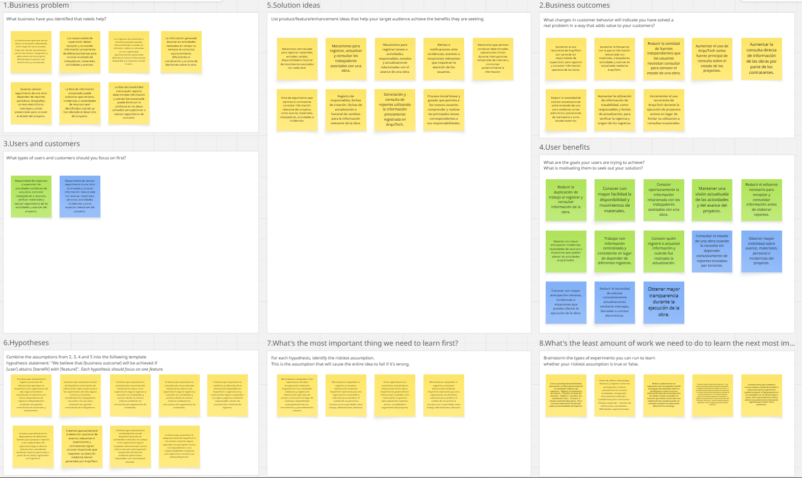
</p>

_Nota._ Elaboración propia en Miro a partir de los Lean UX Problem Statements, Lean UX Assumptions y Lean UX Hypothesis Statements definidos para ArquiTech.

**Enlace al Lean UX Canvas en Miro:**  
[https://miro.com/app/board/uXjVHncj1ew=/?share_link_id=890507134570](https://miro.com/app/board/uXjVHncj1ew=/?share_link_id=890507134570)

## 1.3. Segmentos objetivo

<div style="text-align: justify;">

<p align="justify">

ArquiTech se orienta inicialmente a dos segmentos relacionados directamente con la gestión y el seguimiento de proyectos de construcción: los supervisores de obra y los contratantes de empresas privadas. La delimitación de ambos segmentos parte de las características del dominio descritas en la problemática y se complementa con información estadística oficial relacionada con el sector construcción, el mercado laboral y el tejido empresarial peruano.

</p>

### Segmento objetivo #1: Supervisores de obra

<p align="justify">

El primer segmento está conformado por profesionales y responsables que participan en la supervisión y coordinación cotidiana de proyectos de construcción. Entre sus funciones se encuentran el seguimiento de las actividades ejecutadas en obra, la coordinación del personal, el control de materiales y maquinaria, el registro y revisión de información operativa, la gestión de incidencias y la comunicación del avance del proyecto.

</p>

**Aspectos demográficos y profesionales:**

- **Sexo:** El segmento no se restringe por sexo. Como referencia del contexto laboral del sector construcción peruano, en 2022 los hombres representaron el 96,4 % de la población ocupada del sector y las mujeres el 3,6 % (Ministerio de Trabajo y Promoción del Empleo [MTPE], 2024).

- **Edad:** ArquiTech se orienta a personas adultas que desempeñan responsabilidades relacionadas con la gestión o supervisión de obras. Como referencia sectorial, el 69,6 % de la población ocupada en construcción tenía 30 años o más en 2022 (MTPE, 2024).

- **Ocupación:** Supervisores de obra, residentes de obra, jefes de obra, asistentes de obra y otros profesionales o técnicos vinculados con la supervisión, coordinación y control de proyectos de construcción.

- **Ubicación geográfica:** El alcance inicial de ArquiTech se concentra en Lima Metropolitana.

<p align="justify">

En relación con el perfil ocupacional, el 6,6 % de la población ocupada del sector construcción pertenecía en 2022 al grupo de profesionales y técnicos, categoría que en el reporte incluye también gerentes, administradores y funcionarios (MTPE, 2024). Este dato permite identificar dentro del sector la presencia de perfiles vinculados con responsabilidades profesionales, técnicas y administrativas relacionadas con la gestión de las obras.

</p>

<p align="justify">

La relevancia del sector en el ámbito geográfico seleccionado también se observa en información reciente del mercado laboral. Durante el trimestre abril-mayo-junio de 2026, la población ocupada en la actividad de construcción en Lima Metropolitana aumentó 6,1 % respecto al mismo periodo del año anterior, incremento equivalente a aproximadamente 24 500 personas (Instituto Nacional de Estadística e Informática [INEI], 2026). Esta variación evidencia la presencia y actividad del sector construcción dentro del mercado laboral de Lima Metropolitana.

</p>

**Principales necesidades vinculadas con el dominio:**

- Mantener organizada y actualizada la información operativa de cada proyecto.
- Controlar trabajadores, asistencia, tareas, materiales y maquinaria asociados a una obra.
- Consultar el estado de los recursos y registrar sus cambios de manera ordenada.
- Gestionar incidencias ocurridas durante la ejecución del proyecto.
- Reducir la dispersión de información entre documentos físicos, hojas de cálculo y diferentes canales de comunicación.
- Disponer de información consolidada que facilite el seguimiento y la elaboración de reportes.

### Segmento objetivo #2: Contratantes de empresas privadas

<p align="justify">

El segundo segmento está conformado por personas que representan a organizaciones privadas o actúan como responsables de la contratación y seguimiento de proyectos de construcción. Dentro de este segmento pueden encontrarse empresarios, administradores, propietarios de inmuebles, representantes de empresas u otros responsables con capacidad de decisión sobre obras como locales comerciales, oficinas, viviendas, remodelaciones y otros proyectos de infraestructura privada.

</p>

**Aspectos demográficos y profesionales:**

- **Sexo:** El segmento no presenta una restricción por sexo.

- **Edad:** Está conformado por personas adultas con capacidad de decisión, contratación o seguimiento de proyectos dentro de una organización privada.

- **Ocupación:** Empresarios, administradores, propietarios de inmuebles, representantes de empresas privadas y otros responsables de contratar o supervisar externamente proyectos de construcción.

- **Ubicación geográfica:** El alcance inicial se concentra en Lima Metropolitana debido a la alta concentración de actividad empresarial existente en esta región.

<p align="justify">

La presencia de organizaciones privadas en Lima constituye un sustento relevante para este segmento. En 2024 se registraron 2 331 173 Mipyme formales en el Perú y Lima concentró el 43,8 % de ellas, constituyéndose como la región con la mayor participación de Mipyme formales del país (Ministerio de la Producción [PRODUCE], 2025).

</p>

<p align="justify">

Dentro del sector construcción se registraron 82 559 Mipyme formales en 2024, equivalentes al 3,5 % del total de Mipyme formales del país (PRODUCE, 2025). Asimismo, las ventas de las Mipyme pertenecientes al sector construcción alcanzaron aproximadamente S/ 21 032 millones durante ese año y representaron el 5,4 % de las ventas totales de las Mipyme formales (PRODUCE, 2025). Estos datos evidencian la presencia de un tejido empresarial vinculado con actividades de construcción y respaldan la consideración de responsables empresariales y personas con capacidad de contratación y seguimiento de obras como uno de los segmentos iniciales de ArquiTech.

</p>

**Principales necesidades vinculadas con el dominio:**

- Conocer el estado y progreso de los proyectos contratados.
- Consultar información relevante sobre materiales, trabajadores, tareas, maquinaria e incidencias.
- Acceder a información organizada que facilite el seguimiento de una obra sin depender únicamente de comunicaciones aisladas.
- Contar con mayor trazabilidad sobre los registros asociados al proyecto.
- Disponer de reportes comprensibles que apoyen el seguimiento y la toma de decisiones.

<p align="justify">

En conjunto, la información estadística permite contextualizar los dos segmentos seleccionados dentro de la actividad laboral y empresarial relacionada con la construcción. Los datos empleados proceden de fuentes institucionales del Ministerio de Trabajo y Promoción del Empleo, el Instituto Nacional de Estadística e Informática y el Ministerio de la Producción, mientras que las necesidades particulares de los segmentos serán profundizadas posteriormente mediante el proceso de Requirements Elicitation & Analysis.

</p>

</div>

# Capítulo II: Requirements Elicitation & Analysis

## 2.1. Competidores

### 2.1.1. Análisis competitivo

<p align="justify">

Para poder conocer y analizar mejor a nuestros posibles competidores, realizamos el siguiente Landscape:

</p>

<table style="background-color:transparent; border-collapse:collapse; width:100%; table-layout:fixed; font-family:Arial,sans-serif; font-size:12px; line-height:16px; color:inherit; border:1px solid currentColor;">
  <colgroup>
    <col style="width:12%;">
    <col style="width:10%;">
    <col style="width:10%;">
    <col style="width:17%;">
    <col style="width:17%;">
    <col style="width:17%;">
    <col style="width:17%;">
  </colgroup>

  <tr style="background-color:transparent; ">
    <th colspan="7" style="background-color:transparent; color:inherit; border:1px solid currentColor; padding:0 7px; text-align:left; height:17px;">
      Competitive Analysis Landscape
    </th>
  </tr>
  <tr style="background-color:transparent; height:49px;">
    <td colspan="2" style="background-color:transparent; color:inherit; border:1px solid currentColor; padding:0 7px; vertical-align:middle; text-align:center;">
      ¿Por qué llevar a cabo este análisis?
    </td>
    <td colspan="5" style="background-color:transparent; color:inherit; border:1px solid currentColor; padding:0 7px; vertical-align:middle; text-align:justify;">Determinar las ventajas competitivas de ArquiTech frente a otras plataformas orientadas a la gestión de proyectos de construcción, con el objetivo de identificar oportunidades de diferenciación en la gestión de personal, materiales, avances y reportes. Este análisis permitirá reconocer las fortalezas y debilidades de nuestra propuesta y de los principales competidores, facilitando la definición de estrategias dirigidas a supervisores de obra y contratantes de empresas privadas.</td>
  </tr>

  <tr style="background-color:transparent; height:50px;">
    <td colspan="3" style="background-color:transparent; color:inherit; border:1px solid currentColor; padding:0 7px; vertical-align:middle;">
      &nbsp;
    </td>
    <td style="background-color:transparent; color:inherit; border:1px solid currentColor; padding:0 7px; vertical-align:middle; text-align:center;">ArquiTech<br></td>
    <td style="background-color:transparent; color:inherit; border:1px solid currentColor; padding:0 7px; vertical-align:middle; text-align:center;">Procore<br></td>
    <td style="background-color:transparent; color:inherit; border:1px solid currentColor; padding:0 7px; vertical-align:middle; text-align:center;">Buildertrend<br></td>
    <td style="background-color:transparent; color:inherit; border:1px solid currentColor; padding:0 7px; vertical-align:middle; text-align:center;">Buildwise<br></td>
  </tr>

  <tr style="background-color:transparent; height:65px;">
    <td rowspan="2" style="background-color:transparent; color:inherit; border:1px solid currentColor; text-align:center; vertical-align:middle;">
      <span>Perfil</span>
    </td>
    <td colspan="2" style="background-color:transparent; color:inherit; border:1px solid currentColor; padding:0 7px; vertical-align:middle; text-align:center;">Overview</td>
    <td style="background-color:transparent; color:inherit; border:1px solid currentColor; padding:0 7px; vertical-align:middle; text-align:justify;">ArquiTech es una plataforma digital orientada a la gestión de proyectos de construcción. Permite centralizar información relacionada con asistencia del personal, inventario de materiales, avances de obra y reportes, facilitando la coordinación entre supervisores, áreas administrativas y contratantes.</td>
    <td style="background-color:transparent; color:inherit; border:1px solid currentColor; padding:0 7px; vertical-align:middle; text-align:justify;">Procore es una plataforma integral para la gestión de proyectos de construcción que permite administrar procesos relacionados con proyectos, documentos, costos, recursos, calidad y seguridad.</td>
    <td style="background-color:transparent; color:inherit; border:1px solid currentColor; padding:0 7px; vertical-align:middle; text-align:justify;">Buildertrend es una plataforma de gestión de construcción orientada principalmente a constructores de viviendas, remodeladores y contratistas. Integra herramientas relacionadas con planificación, presupuestos, clientes, pagos y seguimiento de proyectos.</td>
    <td style="background-color:transparent; color:inherit; border:1px solid currentColor; padding:0 7px; vertical-align:middle; text-align:justify;">Buildwise es una plataforma orientada a la gestión de proyectos de construcción que facilita el seguimiento de presupuestos, costos, gastos, facturación y cambios producidos durante la ejecución de una obra.</td>
  </tr>
  <tr style="background-color:transparent; height:82px;">
    <td colspan="2" style="background-color:transparent; color:inherit; border:1px solid currentColor; padding:0 7px; vertical-align:middle; text-align:center;">
      Ventaja competitiva<br>¿Qué valor ofrece a los clientes?
    </td>
    <td style="background-color:transparent; color:inherit; border:1px solid currentColor; padding:0 7px; vertical-align:middle; text-align:justify;">Centraliza las principales actividades operativas de una obra en una solución sencilla y accesible. Busca reducir el uso de registros físicos y herramientas dispersas, facilitando la gestión cotidiana de pequeñas y medianas empresas constructoras.</td>
    <td style="background-color:transparent; color:inherit; border:1px solid currentColor; padding:0 7px; vertical-align:middle; text-align:justify;">Plataforma robusta y escalable que integra múltiples procesos asociados a la construcción y permite gestionar proyectos de diferente complejidad desde una solución centralizada.</td>
    <td style="background-color:transparent; color:inherit; border:1px solid currentColor; padding:0 7px; vertical-align:middle; text-align:justify;">Integra gestión de proyectos, clientes, presupuestos y operaciones dentro de una misma plataforma, con un enfoque especializado en construcción residencial y remodelaciones.</td>
    <td style="background-color:transparent; color:inherit; border:1px solid currentColor; padding:0 7px; vertical-align:middle; text-align:justify;">Facilita el control financiero y administrativo de las obras mediante herramientas para seguimiento de costos, presupuestos, gastos y órdenes de cambio.</td>
  </tr>

  <tr style="background-color:transparent; height:66px;">
    <td rowspan="2" style="background-color:transparent; color:inherit; border:1px solid currentColor; text-align:center; vertical-align:middle;">
      <span>Perfil de Marketing</span>
    </td>
    <td colspan="2" style="background-color:transparent; color:inherit; border:1px solid currentColor; padding:0 7px; vertical-align:middle; text-align:center;">Mercado objetivo</td>
    <td style="background-color:transparent; color:inherit; border:1px solid currentColor; padding:0 7px; vertical-align:middle; text-align:justify;">Supervisores de obra y contratantes de empresas privadas, principalmente vinculados con pequeñas y medianas empresas constructoras que necesitan mejorar el control y seguimiento de sus proyectos.</td>
    <td style="background-color:transparent; color:inherit; border:1px solid currentColor; padding:0 7px; vertical-align:middle; text-align:justify;">Empresas constructoras, contratistas generales, gerentes de proyectos, desarrolladores inmobiliarios y organizaciones que gestionan proyectos de construcción.</td>
    <td style="background-color:transparent; color:inherit; border:1px solid currentColor; padding:0 7px; vertical-align:middle; text-align:justify;">Constructores de viviendas, remodeladores, contratistas especializados y pequeñas y medianas empresas dedicadas principalmente a construcción residencial.</td>
    <td style="background-color:transparent; color:inherit; border:1px solid currentColor; padding:0 7px; vertical-align:middle; text-align:justify;">Constructores, remodeladores y empresas que requieren herramientas digitales para gestionar presupuestos, costos y ejecución de proyectos.</td>
  </tr>
  <tr style="background-color:transparent; height:66px;">
    <td colspan="2" style="background-color:transparent; color:inherit; border:1px solid currentColor; padding:0 7px; vertical-align:middle; text-align:center;">Estrategias de marketing</td>
    <td style="background-color:transparent; color:inherit; border:1px solid currentColor; padding:0 7px; vertical-align:middle; text-align:justify;">Pruebas gratuitas, precios accesibles, demostraciones de la plataforma, contenido digital relacionado con la gestión eficiente de obras, presencia en redes sociales y atención personalizada a potenciales clientes.</td>
    <td style="background-color:transparent; color:inherit; border:1px solid currentColor; padding:0 7px; vertical-align:middle; text-align:justify;">Marketing de contenidos, demostraciones empresariales, casos de éxito, participación en eventos del sector construcción y alianzas estratégicas con organizaciones relacionadas con la industria.</td>
    <td style="background-color:transparent; color:inherit; border:1px solid currentColor; padding:0 7px; vertical-align:middle; text-align:justify;">Marketing digital, contenido educativo, recursos para empresas constructoras, demostraciones del producto, posicionamiento web y presencia en redes sociales.</td>
    <td style="background-color:transparent; color:inherit; border:1px solid currentColor; padding:0 7px; vertical-align:middle; text-align:justify;">Marketing digital dirigido a constructores y remodeladores, demostraciones de funcionalidades y comunicación enfocada en la simplificación del control financiero de los proyectos.</td>
  </tr>

  <tr style="background-color:transparent; height:66px;">
    <td rowspan="3" style="background-color:transparent; color:inherit; border:1px solid currentColor; text-align:center; vertical-align:middle;">
      <span>Perfil de Producto</span>
    </td>
    <td colspan="2" style="background-color:transparent; color:inherit; border:1px solid currentColor; padding:0 7px; vertical-align:middle; text-align:center;">Productos &amp; Servicios</td>
    <td style="background-color:transparent; color:inherit; border:1px solid currentColor; padding:0 7px; vertical-align:middle; text-align:justify;">Gestión de proyectos de construcción, registro de asistencia, gestión de personal, control de inventario y materiales, seguimiento del avance de obra, generación de reportes y alertas relacionadas con trabajadores o disponibilidad de materiales.</td>
    <td style="background-color:transparent; color:inherit; border:1px solid currentColor; padding:0 7px; vertical-align:middle; text-align:justify;">Gestión de proyectos, administración financiera, documentos, planificación, calidad, seguridad, recursos y herramientas colaborativas para los participantes de una obra.</td>
    <td style="background-color:transparent; color:inherit; border:1px solid currentColor; padding:0 7px; vertical-align:middle; text-align:justify;">Planificación de proyectos, presupuestos, gestión de clientes, facturación, pagos, órdenes de cambio, comunicación con clientes y generación de informes.</td>
    <td style="background-color:transparent; color:inherit; border:1px solid currentColor; padding:0 7px; vertical-align:middle; text-align:justify;">Gestión de presupuestos, estimaciones, gastos, órdenes de cambio, facturación y seguimiento financiero de los proyectos de construcción.</td>
  </tr>
  <tr style="background-color:transparent; height:49px;">
    <td colspan="2" style="background-color:transparent; color:inherit; border:1px solid currentColor; padding:0 7px; vertical-align:middle; text-align:center;">Precios &amp; Costos</td>
    <td style="background-color:transparent; color:inherit; border:1px solid currentColor; padding:0 7px; vertical-align:middle; text-align:justify;">Modelo de suscripción orientado principalmente a pequeñas y medianas empresas constructoras, brindando acceso a las principales funcionalidades de ArquiTech.</td>
    <td style="background-color:transparent; color:inherit; border:1px solid currentColor; padding:0 7px; vertical-align:middle; text-align:justify;">Modelo de precios personalizado de acuerdo con las características de la empresa, el volumen de construcción y los productos o funcionalidades requeridos.</td>
    <td style="background-color:transparent; color:inherit; border:1px solid currentColor; padding:0 7px; vertical-align:middle; text-align:justify;">Modelo de precios personalizado según las características, tamaño y necesidades particulares de cada empresa constructora.</td>
    <td style="background-color:transparent; color:inherit; border:1px solid currentColor; padding:0 7px; vertical-align:middle; text-align:justify;">Modelo de costos asociado a las funcionalidades y necesidades de gestión de cada empresa o proyecto.</td>
  </tr>
  <tr style="background-color:transparent; height:66px;">
    <td colspan="2" style="background-color:transparent; color:inherit; border:1px solid currentColor; padding:0 7px; vertical-align:middle; text-align:center;">
      Canales de distribución<br>(Web y/o Móvil)
    </td>
    <td style="background-color:transparent; color:inherit; border:1px solid currentColor; padding:0 7px; vertical-align:middle; text-align:justify;">Landing Page, plataforma web y aplicación móvil orientada a supervisores, personal relacionado con la obra y contratantes responsables del seguimiento de los proyectos.</td>
    <td style="background-color:transparent; color:inherit; border:1px solid currentColor; padding:0 7px; vertical-align:middle; text-align:justify;">Plataforma web, aplicación móvil, canales de venta empresarial e integraciones con plataformas y servicios externos.</td>
    <td style="background-color:transparent; color:inherit; border:1px solid currentColor; padding:0 7px; vertical-align:middle; text-align:justify;">Plataforma web, aplicación móvil, canales digitales de venta y servicios de soporte y capacitación para sus clientes.</td>
    <td style="background-color:transparent; color:inherit; border:1px solid currentColor; padding:0 7px; vertical-align:middle; text-align:justify;">Plataforma web para la administración y seguimiento de la información financiera y operativa de los proyectos.</td>
  </tr>

  <tr style="background-color:transparent; height:66px;">
    <td rowspan="4" style="background-color:transparent; color:inherit; border:1px solid currentColor; text-align:center; vertical-align:middle;">
      <span>Análisis SWOT</span>
    </td>
    <td colspan="2" style="background-color:transparent; color:inherit; border:1px solid currentColor; padding:0 7px; vertical-align:middle; text-align:center;">Fortalezas</td>
    <td style="background-color:transparent; color:inherit; border:1px solid currentColor; padding:0 7px; vertical-align:middle; text-align:justify;">Enfoque en las necesidades de supervisores de obra; centralización de información; facilidad de uso; gestión de personal, materiales y avances desde una misma plataforma; orientación a pequeñas y medianas empresas constructoras.</td>
    <td style="background-color:transparent; color:inherit; border:1px solid currentColor; padding:0 7px; vertical-align:middle; text-align:justify;">Marca consolidada; amplia variedad de funcionalidades; escalabilidad; capacidad de integración con otras soluciones y experiencia en proyectos de construcción de gran tamaño.</td>
    <td style="background-color:transparent; color:inherit; border:1px solid currentColor; padding:0 7px; vertical-align:middle; text-align:justify;">Especialización en construcción residencial; integración de ventas y operaciones; variedad de herramientas de gestión y disponibilidad de recursos de capacitación.</td>
    <td style="background-color:transparent; color:inherit; border:1px solid currentColor; padding:0 7px; vertical-align:middle; text-align:justify;">Enfoque en el control financiero de proyectos; administración de costos, presupuestos y gastos desde una solución centralizada.</td>
  </tr>
  <tr style="background-color:transparent; height:50px;">
    <td colspan="2" style="background-color:transparent; color:inherit; border:1px solid currentColor; padding:0 7px; vertical-align:middle; text-align:center;">Debilidades</td>
    <td style="background-color:transparent; color:inherit; border:1px solid currentColor; padding:0 7px; vertical-align:middle; text-align:justify;">Producto en etapa inicial; menor reconocimiento de marca; necesidad de incrementar la validación con usuarios reales y recursos más limitados en comparación con competidores internacionales consolidados.</td>
    <td style="background-color:transparent; color:inherit; border:1px solid currentColor; padding:0 7px; vertical-align:middle; text-align:justify;">La amplitud de funcionalidades y complejidad de la plataforma puede resultar excesiva para pequeñas empresas que únicamente necesitan herramientas básicas para gestionar sus obras.</td>
    <td style="background-color:transparent; color:inherit; border:1px solid currentColor; padding:0 7px; vertical-align:middle; text-align:justify;">Puede presentar una curva de aprendizaje inicial y disponer de funcionalidades que no sean necesarias para empresas constructoras pequeñas.</td>
    <td style="background-color:transparent; color:inherit; border:1px solid currentColor; padding:0 7px; vertical-align:middle; text-align:justify;">Menor amplitud funcional en comparación con plataformas integrales y menor reconocimiento internacional frente a soluciones consolidadas.</td>
  </tr>
  <tr style="background-color:transparent; height:49px;">
    <td colspan="2" style="background-color:transparent; color:inherit; border:1px solid currentColor; padding:0 7px; vertical-align:middle; text-align:center;">Oportunidades</td>
    <td style="background-color:transparent; color:inherit; border:1px solid currentColor; padding:0 7px; vertical-align:middle; text-align:justify;">Crecimiento de la digitalización del sector construcción; necesidad de reemplazar procesos manuales; aumento del uso de dispositivos móviles y oportunidad de atender pequeñas y medianas empresas que buscan herramientas sencillas y accesibles.</td>
    <td style="background-color:transparent; color:inherit; border:1px solid currentColor; padding:0 7px; vertical-align:middle; text-align:justify;">Expansión hacia nuevos mercados, incorporación de nuevas tecnologías y desarrollo de integraciones adicionales con servicios relacionados con la gestión de construcción.</td>
    <td style="background-color:transparent; color:inherit; border:1px solid currentColor; padding:0 7px; vertical-align:middle; text-align:justify;">Crecimiento del mercado de construcción residencial, remodelaciones y aumento de la adopción de herramientas digitales por parte de contratistas y empresas constructoras.</td>
    <td style="background-color:transparent; color:inherit; border:1px solid currentColor; padding:0 7px; vertical-align:middle; text-align:justify;">Incremento de la digitalización financiera y administrativa de pequeñas y medianas empresas relacionadas con el sector construcción.</td>
  </tr>
  <tr style="background-color:transparent; height:49px;">
    <td colspan="2" style="background-color:transparent; color:inherit; border:1px solid currentColor; padding:0 7px; vertical-align:middle; text-align:center;">Amenazas</td>
    <td style="background-color:transparent; color:inherit; border:1px solid currentColor; padding:0 7px; vertical-align:middle; text-align:justify;">Entrada de competidores internacionales con mayores recursos; resistencia al cambio de empresas acostumbradas a procesos manuales y aparición de nuevas soluciones digitales de gestión de construcción.</td>
    <td style="background-color:transparent; color:inherit; border:1px solid currentColor; padding:0 7px; vertical-align:middle; text-align:justify;">Aparición de plataformas especializadas con menores costos y evolución constante de nuevas tecnologías aplicadas al sector construcción.</td>
    <td style="background-color:transparent; color:inherit; border:1px solid currentColor; padding:0 7px; vertical-align:middle; text-align:justify;">Entrada de nuevos competidores con soluciones más económicas y funcionalidades especializadas para pequeñas empresas y contratistas.</td>
    <td style="background-color:transparent; color:inherit; border:1px solid currentColor; padding:0 7px; vertical-align:middle; text-align:justify;">Competencia de plataformas integrales, herramientas financieras especializadas y nuevas soluciones digitales de menor costo.</td>
  </tr>
</table>

### 2.1.2. Estrategias y tácticas frente a competidores

<p align="justify">

ArquiTech se diferenciará de competidores como Procore, Buildertrend y Buildwise mediante una propuesta enfocada en las necesidades operativas de pequeñas y medianas empresas constructoras. Frente a la amplia variedad de funcionalidades, escalabilidad y posicionamiento que poseen estas plataformas, nuestra estrategia será priorizar una solución más sencilla y especializada en actividades frecuentes de obra, como la gestión de personal, control de asistencia, inventario de materiales, seguimiento de avances y generación de reportes.

</p>

<p align="justify">

Para aprovechar las debilidades identificadas en soluciones de mayor alcance, ArquiTech aplicará una estrategia de adopción simplificada. La plataforma contará con una interfaz intuitiva, recursos de capacitación breves y un periodo de prueba que permita conocer sus principales funcionalidades antes de contratar el servicio. De esta manera, se busca reducir la resistencia al cambio de empresas que todavía administran parte de sus operaciones mediante registros físicos, hojas de cálculo, documentos y aplicaciones de mensajería.

</p>

<p align="justify">

Asimismo, ArquiTech aprovechará la oportunidad generada por la creciente digitalización del sector construcción mediante funcionalidades orientadas a problemas cotidianos de la obra. Entre ellas se consideran alertas relacionadas con la disponibilidad de materiales, registro y seguimiento de asistencia, actualización del progreso de los proyectos y centralización de información. Esta especialización permitirá brindar mayor utilidad a los supervisores de obra y, al mismo tiempo, ofrecer a los contratantes una mayor visibilidad sobre el estado de los proyectos.

</p>

<p align="justify">

Como táctica comercial, se ofrecerán planes escalables de acuerdo con las necesidades de cada empresa, considerando factores como la cantidad de obras activas, usuarios y funcionalidades requeridas. Esto permitirá que pequeñas y medianas empresas comiencen utilizando las funciones necesarias para su operación y amplíen posteriormente el servicio conforme aumenten sus proyectos, evitando contratar desde el inicio una solución sobredimensionada.

</p>

<p align="justify">

Para afrontar la amenaza representada por plataformas internacionales con mayor reconocimiento y recursos, ArquiTech buscará diferenciarse mediante una atención más cercana y adaptada al contexto de sus segmentos objetivo. Se brindará soporte mediante canales digitales, demostraciones de la plataforma y contenido educativo relacionado con la digitalización y gestión de obras. Para los supervisores de obra, la comunicación se enfocará en la centralización del personal, materiales y avances; mientras que para los contratantes de empresas privadas se destacará la transparencia, el seguimiento de los proyectos y el acceso a información actualizada.

</p>

<p align="justify">

Finalmente, ArquiTech mantendrá un proceso de mejora continua basado en las necesidades identificadas en sus usuarios y en los cambios del sector construcción. Esto permitirá incorporar progresivamente nuevas funcionalidades sin perder el enfoque en facilidad de uso, accesibilidad y gestión centralizada, buscando construir una ventaja competitiva sostenible frente a soluciones de mayor complejidad.

</p>

## 2.2. Entrevistas

### 2.2.1. Diseño de entrevistas

<p align="justify">

Para el proceso de investigación de ArquiTech se diseñó un conjunto de entrevistas dirigido a representantes de los dos segmentos objetivo identificados: supervisores de obra y contratantes de empresas privadas.

</p>

<p align="justify">

El objetivo de estas entrevistas es comprender las actividades que actualmente realizan los participantes durante la gestión y seguimiento de proyectos de construcción, las herramientas que utilizan, las principales dificultades que enfrentan y sus necesidades respecto al acceso, organización y comunicación de la información de una obra.

</p>

<p align="justify">

Las preguntas fueron organizadas en cuatro grupos principales: introducción y contexto, procesos actuales, puntos de dolor, necesidades y expectativas, además de preguntas de cierre. Esta estructura permite recopilar información relacionada con el contexto del participante, sus actividades habituales, problemas experimentados durante la ejecución o seguimiento de una obra y su percepción respecto al uso de herramientas digitales.

</p>

<p align="justify">

Para mantener la consistencia del proceso de investigación, todos los participantes pertenecientes a un mismo segmento serán entrevistados utilizando el mismo conjunto base de preguntas y variables de investigación. Durante la ejecución de las entrevistas, las preguntas podrán ser reformuladas ligeramente o acompañadas de preguntas de seguimiento con el propósito de mantener un flujo conversacional natural, sin modificar la información que se busca recopilar. De esta manera, las respuestas podrán ser posteriormente comparadas e interpretadas para identificar patrones y características recurrentes dentro de cada segmento objetivo.

</p>

<p align="justify">

Antes de iniciar cada entrevista, se informará al participante sobre el propósito académico de la investigación y se solicitará su consentimiento para participar y para registrar la sesión en video.

</p>

#### Segmento objetivo #1: Supervisores de obra

**Introducción y contexto**

- ¿Cuál es su nombre y apellido?
- ¿Cuántos años tiene?
- ¿En qué distrito reside?
- ¿Podría contarme sobre su rol como supervisor de obra y las actividades que realiza durante un día habitual de trabajo?
- ¿Aproximadamente cuántos trabajadores y qué tipos de materiales suele gestionar en una obra?

**Procesos actuales**

- ¿Cómo realiza actualmente el control de asistencia de los trabajadores? ¿Qué procedimiento sigue cuando alguien falta?
- ¿Cómo lleva actualmente el control del inventario de materiales? ¿Qué herramientas o métodos utiliza?
- ¿Cómo registra los avances de una obra y prepara los reportes correspondientes? ¿Cuánto tiempo suele dedicar a estas actividades?
- ¿Cómo comparte actualmente la información relacionada con el avance de la obra con otras personas involucradas en el proyecto?

**Puntos de dolor**

- ¿Qué actividades relacionadas con la gestión de trabajadores, materiales o avances considera más complicadas o demandantes? ¿Podría contarme un caso reciente?
- ¿Ha tenido problemas relacionados con errores en el inventario, asistencia o reportes? ¿Qué ocurrió y cómo lo resolvió?
- ¿Qué dificultades suele encontrar al coordinar con otros roles involucrados en la gestión de la obra, como asistentes administrativos o responsables del proyecto?
- ¿Hay alguna información que normalmente necesite durante la obra y que resulte difícil obtener o mantener actualizada?

**Necesidades y expectativas**

- ¿Cómo considera que podría mejorarse actualmente la gestión de asistencia, inventario y reportes de una obra?
- ¿Qué información considera más importante consultar durante la ejecución de una obra y con qué frecuencia necesita acceder a ella?
- ¿Qué características debería tener una herramienta digital para resultarle útil en la gestión y seguimiento de una obra?
- ¿Qué condiciones o características le generarían confianza al utilizar una nueva plataforma digital?
- ¿Qué aspectos podrían dificultar o impedir que utilice una herramienta de este tipo?

**Cierre**

- ¿Hay algún problema o necesidad relacionada con la gestión de obras que no hayamos mencionado y que considere importante resolver?
- ¿Qué condiciones tendrían que cumplirse para que considere probar una plataforma digital orientada a la gestión de una obra?

#### Segmento objetivo #2: Contratantes de empresas privadas

**Introducción y contexto**

- ¿Cuál es su nombre y apellido?
- ¿Cuántos años tiene?
- ¿En qué distrito reside?
- ¿Qué tipo de proyectos de construcción suele contratar, por ejemplo, locales comerciales, oficinas, edificios u otros?
- ¿Cómo realiza normalmente el proceso de selección de una empresa constructora? ¿Qué aspectos toma en cuenta para elegirla?

**Procesos actuales**

- ¿Cómo se mantiene informado actualmente sobre el avance de una obra que ha contratado?
- ¿Qué tipo de información recibe sobre el proyecto y con qué frecuencia?
- ¿Qué herramientas o medios utiliza normalmente la constructora para comunicarle el avance de la obra?
- ¿Cómo verifica actualmente el cumplimiento de aspectos como plazos, licencias, normas de seguridad u otras condiciones del proyecto?
- ¿Cómo realiza el seguimiento del uso de materiales y del personal involucrado en la obra?

**Puntos de dolor**

- ¿Qué dificultades ha experimentado anteriormente al trabajar con empresas constructoras? ¿Podría contarme algún caso?
- ¿Qué nivel de visibilidad suele tener sobre el uso de materiales, el personal y el avance de una obra?
- ¿Ha tenido alguna dificultad debido a información incompleta, desactualizada o poco clara durante un proyecto? ¿Qué ocurrió?
- ¿Ha experimentado retrasos, errores o situaciones que hayan generado costos adicionales durante una obra? ¿Cómo afectaron al proyecto?
- ¿Qué aspectos del seguimiento de una obra le generan actualmente mayor preocupación o incertidumbre?

**Necesidades y expectativas**

- ¿Qué información considera más importante recibir durante el desarrollo de una obra?
- ¿Con qué frecuencia considera necesario recibir información sobre el avance del proyecto?
- ¿Qué aspectos podrían mejorar la forma en que una constructora comunica y presenta la información de una obra?
- ¿Qué papel considera que pueden tener las herramientas digitales en el seguimiento de un proyecto de construcción?
- ¿Qué características debería tener una herramienta digital para aumentar su confianza en la información proporcionada por una constructora?
- ¿Qué aspectos podrían generarle desconfianza o dificultar el uso de una plataforma de este tipo?

**Cierre**

- ¿Qué considera que podrían mejorar las empresas constructoras para brindarle mayor tranquilidad durante el desarrollo de una obra?
- ¿Qué condiciones deberían cumplirse para que el uso de una plataforma digital por parte de una constructora influya positivamente en su decisión de contratarla?
- ¿Hay algún aspecto relacionado con el seguimiento de una obra que no hayamos mencionado y que considere importante?

#### Preguntas complementarias de caracterización para ambos segmentos

<p align="justify">

Las siguientes preguntas complementarias serán integradas de manera natural dentro del flujo de las entrevistas de ambos segmentos objetivo. Su propósito es recopilar características objetivas y subjetivas que permitan comprender mejor el perfil, contexto, comportamiento y preferencias de los participantes.

</p>

<p align="justify">

Aunque estas preguntas se presentan de manera agrupada en el diseño de entrevistas para facilitar su documentación, durante la ejecución de las entrevistas podrán ubicarse en distintos momentos de la conversación con el propósito de mantener una secuencia coherente y natural, sin alterar la información que se busca recopilar.

</p>

- ¿Con qué género se identifica?
- ¿Cuál es su estado civil?
- ¿Tiene responsabilidades familiares que influyan en su rutina o en la forma en que toma decisiones?
- ¿Cuál es su ocupación o cargo actual?
- ¿Cuántos años de experiencia tiene en el sector construcción o contratando proyectos de construcción?
- ¿Cómo describiría su personalidad y su forma habitual de trabajar o tomar decisiones?
- ¿Qué habilidades considera más importantes para desarrollar sus actividades?
- ¿Qué personas, empresas, marcas o referentes suelen influir en sus decisiones relacionadas con proyectos de construcción?
- ¿Qué dispositivo utiliza principalmente para realizar actividades relacionadas con su trabajo o con el seguimiento de proyectos: smartphone, laptop, tablet u otro? ¿Cuál prefiere utilizar y por qué?
- ¿Qué aplicaciones o canales digitales utiliza con mayor frecuencia para comunicarse o gestionar información relacionada con su trabajo?
- ¿Qué navegador web utiliza habitualmente?
- ¿Cuál es su principal objetivo cuando participa en la gestión o seguimiento de una obra?
- ¿Cuál es la principal dificultad o frustración que experimenta durante dicho proceso?
- ¿Podría contarme brevemente sobre su trayectoria y experiencia relacionada con proyectos de construcción?

### 2.2.2. Registro de entrevistas

<p align="justify">

Como parte del proceso de investigación de ArquiTech, se contemplan entrevistas a representantes de los dos segmentos objetivo definidos: supervisores de obra y contratantes de empresas privadas. Para esta etapa se consideran tres participantes por cada segmento, obteniendo un total de seis entrevistas.

</p>

<p align="justify">

Cada entrevista será registrada en video como evidencia del proceso de investigación. Posteriormente, las seis entrevistas serán consolidadas en un único video editado de Entrevistas, utilizando Clipchamp y publicándolo en Microsoft Stream mediante un enlace privado. Para cada participante se registran sus nombres y apellidos, edad, distrito de residencia, segmento objetivo, fecha de entrevista, un cuadro representativo del video, el timing exacto en el que inicia su participación dentro del video consolidado y la duración correspondiente.

</p>

<p align="justify">

El video consolidado incluirá una pantalla inicial de presentación, elementos visuales relacionados con la identidad de Foundex y ArquiTech, una secuencia coherente entre entrevistas y títulos que identifiquen al participante, el segmento objetivo y la fecha de realización de cada entrevista. La edición considerará aproximadamente entre tres y cinco minutos por participante.

</p>

<p align="justify">

Los resúmenes presentados para cada entrevista recogen las principales respuestas obtenidas mediante el guion principal y las preguntas complementarias de caracterización. Se consideran tanto características objetivas como subjetivas, incluyendo información demográfica, ocupación, trayectoria, personalidad, habilidades, marcas e influencias, tecnología utilizada, dispositivos de preferencia, canales digitales de interacción, navegador, objetivos, frustraciones, procesos actuales, dificultades, necesidades y expectativas.

</p>

<p align="justify">

Esta información servirá posteriormente como fuente para el análisis estadístico de entrevistas y para la construcción de los User Personas, manteniendo trazabilidad entre las características incorporadas en los arquetipos y la información obtenida durante las entrevistas.

</p>

**Video consolidado de Needfinding:** https://upcedupe-my.sharepoint.com/:v:/g/personal/u202320442_upc_edu_pe/IQDWnJj67oWOTaeKQVq4DaOPAXX9DFuqJ-kxtlCUQ-2Lsos?nav=eyJyZWZlcnJhbEluZm8iOnsicmVmZXJyYWxBcHAiOiJPbmVEcml2ZUZvckJ1c2luZXNzIiwicmVmZXJyYWxBcHBQbGF0Zm9ybSI6IldlYiIsInJlZmVycmFsTW9kZSI6InZpZXciLCJyZWZlcnJhbFZpZXciOiJNeUZpbGVzTGlua0NvcHkifX0&e=8BvJOp

**Nombre del video:** `upc-pre-202620-1asi0732-9112-Foundex-needfinding-interviews.mp4`

**Formato:** `.mp4`

**Duración total:** 38:31

---

#### Segmento objetivo #1: Supervisores de obra

**Datos del entrevistado**

- **Nombres y apellidos:** Alvaro Cristian Gonzales Yupanqui
- **Edad:** 61 años
- **Distrito de residencia:** San Juan de Lurigancho
- **Segmento objetivo:** Supervisor de obra
- **Fecha de entrevista:** 14/09/26
- **Timing de inicio:** 00:00
- **Duración:** 07:24
- **Video consolidado:** https://upcedupe-my.sharepoint.com/:v:/g/personal/u202320442_upc_edu_pe/IQDWnJj67oWOTaeKQVq4DaOPAXX9DFuqJ-kxtlCUQ-2Lsos?nav=eyJyZWZlcnJhbEluZm8iOnsicmVmZXJyYWxBcHAiOiJPbmVEcml2ZUZvckJ1c2luZXNzIiwicmVmZXJyYWxBcHBQbGF0Zm9ybSI6IldlYiIsInJlZmVycmFsTW9kZSI6InZpZXciLCJyZWZlcnJhbFZpZXciOiJNeUZpbGVzTGlua0NvcHkifX0&e=8BvJOp

**Figura 4**  
_Cuadro de video del entrevistado #1 del segmento Supervisores de obra._

<p align="center">
  
</p>

_Nota._ Elaboración propia a partir de la entrevista realizada.

**Resumen de la entrevista**

<p align="justify">

Alvaro Cristian Gonzales Yupanqui es un supervisor de obra de 61 años, identificado con el género masculino, casado y con responsabilidades familiares que influyen en la organización de su tiempo. Cuenta con más de treinta años de experiencia en el sector construcción y ha participado principalmente en edificaciones, ampliaciones y proyectos de infraestructura, desempeñando actividades relacionadas con supervisión, control técnico y administración de recursos.

</p>

<p align="justify">

Durante una jornada habitual inicia revisando las actividades programadas y verificando la disponibilidad del personal y los materiales necesarios. También comprueba que los trabajos sean ejecutados de acuerdo con el expediente técnico, coordina con el residente de obra y realiza seguimiento de metrados, calidad y avance. Dependiendo de la magnitud del proyecto, trabaja con diferentes cuadrillas y gestiona materiales como cemento, acero, agregados, ladrillo y concreto.

</p>

<p align="justify">

Para controlar la asistencia utiliza hojas de tareo en las que se registra la presencia y las horas trabajadas. Cuando algún trabajador falta, la situación es comunicada al responsable de la cuadrilla y se evalúa si es necesario realizar un reemplazo. El inventario se controla mediante Kardex y registros de movimientos de almacén, utilizados para registrar entradas y salidas de materiales.

</p>

<p align="justify">

El avance es medido principalmente mediante metrados diarios y posteriormente consolidado en reportes semanales y mensuales. La preparación y revisión de estos documentos puede tomar varias horas debido a que la información proviene de diferentes registros. Para compartirla con otros responsables utiliza reuniones, reportes, correo electrónico y WhatsApp.

</p>

<p align="justify">

Entre sus principales dificultades se encuentra mantener actualizada toda la información operativa. Indicó que la ausencia de trabajadores o los retrasos de proveedores pueden modificar inmediatamente la planificación. También ha experimentado inconsistencias entre el stock registrado y el stock físico cuando las salidas de materiales no son registradas oportunamente. Asimismo, considera que pueden producirse diferencias entre campo y administración cuando la información no se comunica a tiempo.

</p>

<p align="justify">

Su principal objetivo es lograr que la obra sea ejecutada de acuerdo con el expediente técnico, dentro de los plazos establecidos y utilizando adecuadamente los recursos. Su principal frustración es trabajar con información desactualizada o detectar demasiado tarde la falta de algún material o recurso.

</p>

<p align="justify">

Considera que la gestión podría mejorarse mediante la centralización de asistencia, inventario, metrados y reportes. Necesita consultar diariamente información relacionada con avance, stock y disponibilidad de personal. Espera que una herramienta digital sea sencilla, confiable y evite la duplicación de trabajo. También considera valiosas funciones relacionadas con el control de maquinaria y combustible y con la generación de reportes valorizados.

</p>

<p align="justify">

Respecto a la adopción de tecnología, considera importante que existan permisos diferenciados para los usuarios, registros confiables y trazabilidad sobre quién realiza cada actualización. Una herramienta excesivamente complicada o que requiera más tiempo de registro que el procedimiento actual constituiría una barrera para su utilización.

</p>

<p align="justify">

En cuanto a sus características personales, se describe como una persona metódica y cuidadosa que prefiere verificar la información antes de tomar decisiones. Considera especialmente importantes las habilidades de organización, supervisión, comunicación, interpretación de documentación técnica, control de recursos y resolución de imprevistos.

</p>

<p align="justify">

Entre sus principales influencias profesionales menciona las buenas prácticas difundidas por CAPECO y SENCICO, además de la experiencia de otros ingenieros con los que ha trabajado. En cuanto a tecnología, utiliza smartphone y laptop, aunque prefiere la laptop para revisar documentos y elaborar reportes. Emplea principalmente WhatsApp, correo electrónico y herramientas de Microsoft Office, y utiliza Google Chrome como navegador habitual.

</p>

<p align="justify">

Finalmente, considera que una solución digital también debería permitir comparar automáticamente lo planificado con lo ejecutado y con los recursos consumidos. Estaría dispuesto a probar una plataforma orientada a la gestión de obras siempre que sea fácil de implementar y reduzca efectivamente el trabajo administrativo.

</p>

---

##### Entrevista #2

**Datos del entrevistado**

- **Nombres y apellidos:** Juan José Meza Huanacune
- **Edad:** 55 años
- **Distrito de residencia:** San Juan de Lurigancho
- **Segmento objetivo:** Supervisora de obra
- **Fecha de entrevista:** 14/09/26
- **Timing de inicio:** 07:24
- **Duración:** 05:42
- **Video consolidado:** https://upcedupe-my.sharepoint.com/:v:/g/personal/u202320442_upc_edu_pe/IQDWnJj67oWOTaeKQVq4DaOPAXX9DFuqJ-kxtlCUQ-2Lsos?nav=eyJyZWZlcnJhbEluZm8iOnsicmVmZXJyYWxBcHAiOiJPbmVEcml2ZUZvckJ1c2luZXNzIiwicmVmZXJyYWxBcHBQbGF0Zm9ybSI6IldlYiIsInJlZmVycmFsTW9kZSI6InZpZXciLCJyZWZlcnJhbFZpZXciOiJNeUZpbGVzTGlua0NvcHkifX0&e=8BvJOp

**Figura 5**  
_Cuadro de video del entrevistado #2 del segmento Supervisores de obra._

<p align="center">
  
</p>

_Nota._ Elaboración propia a partir de la entrevista realizada.

**Resumen de la entrevista**

<p align="justify">

Juan José Meza Huanacune es una ingeniera civil de 55 años que se identifica con el género femenino, es casada y tiene responsabilidades familiares. Cuenta con aproximadamente veinticinco años de experiencia en construcción y ha trabajado supervisando distintas etapas de proyectos, especialmente en actividades relacionadas con control de calidad, seguridad y ejecución de trabajos.

</p>

<p align="justify">

Durante una jornada habitual revisa las actividades programadas, verifica la calidad de los materiales y las condiciones de seguridad, supervisa el uso adecuado de equipos de protección personal y comprueba el cumplimiento de las funciones asignadas al equipo técnico. La cantidad de trabajadores y materiales que debe gestionar varía de acuerdo con las actividades programadas para cada jornada.

</p>

<p align="justify">

El control de asistencia se realiza mediante hojas de tareo administradas principalmente por el asistente técnico y el maestro de obra. Cuando se produce una ausencia, esta debe comunicarse inmediatamente debido a que puede afectar una actividad crítica del proyecto.

</p>

<p align="justify">

Para el control del inventario se utilizan notas de entrada y salida que posteriormente son registradas en Excel. El avance se controla mediante valorizaciones físicas y reportes semanales y mensuales. La información es compartida mediante reuniones, correo electrónico, documentos digitales y WhatsApp.

</p>

<p align="justify">

Entre las principales dificultades menciona la coordinación de recursos y la necesidad de mantener actualizada la información. Los retrasos en el registro de entradas o salidas pueden generar diferencias en el inventario. Asimismo, considera fundamental que técnicos, residentes, personal administrativo y responsables de almacén trabajen utilizando información consistente.

</p>

<p align="justify">

La información que considera más difícil de mantener actualizada es el inventario y el estado de los requerimientos de materiales. Su principal objetivo es asegurar que las actividades sean desarrolladas correctamente y con el nivel de calidad requerido, mientras que sus principales frustraciones están relacionadas con los retrasos en materiales y las inconsistencias en los registros.

</p>

<p align="justify">

Considera que la gestión podría mejorar mediante una herramienta que integre asistencia, almacén, requerimientos y reportes. Necesita consultar diariamente información relacionada con avance, materiales y disponibilidad del personal. Espera que una plataforma digital sea integral pero sencilla y que permita generar diferentes tipos de reportes según las necesidades de cada responsable.

</p>

<p align="justify">

Para confiar en una herramienta digital considera necesario que la información esté protegida, que los responsables de cada registro estén identificados y que pueda verificarse cuándo se actualizó cada dato. Una interfaz complicada o la falta de orientación inicial al personal podrían dificultar su adopción.

</p>

<p align="justify">

Se describe como una persona organizada, preventiva y rigurosa con los procedimientos. Entre sus principales habilidades reconoce la comunicación, liderazgo, coordinación, control de calidad e interpretación de documentación técnica.

</p>

<p align="justify">

Entre sus referentes profesionales se encuentran SENCICO, CAPECO y las normas técnicas aplicables al sector construcción. Utiliza principalmente laptop y smartphone, aunque prefiere la laptop para actividades documentales. Entre sus herramientas y canales digitales habituales se encuentran Excel, Outlook y WhatsApp, y utiliza Google Chrome como navegador.

</p>

<p align="justify">

Finalmente, considera importante que una plataforma permita realizar seguimiento al estado de los requerimientos de materiales, identificando si se encuentran pendientes, aprobados o atendidos. Estaría dispuesta a utilizar una solución digital si facilita las actividades y centraliza la información relevante de la obra.

</p>

---

##### Entrevista #3

**Datos del entrevistado**

- **Nombres y apellidos:** Álvaro Salazar
- **Edad:** 31 años
- **Distrito de residencia:** Callao
- **Segmento objetivo:** Supervisora de obra
- **Fecha de entrevista:** 14/09/26
- **Timing de inicio:** 13:07
- **Duración:** 06:30
- **Video consolidado:** https://upcedupe-my.sharepoint.com/:v:/g/personal/u202320442_upc_edu_pe/IQDWnJj67oWOTaeKQVq4DaOPAXX9DFuqJ-kxtlCUQ-2Lsos?nav=eyJyZWZlcnJhbEluZm8iOnsicmVmZXJyYWxBcHAiOiJPbmVEcml2ZUZvckJ1c2luZXNzIiwicmVmZXJyYWxBcHBQbGF0Zm9ybSI6IldlYiIsInJlZmVycmFsTW9kZSI6InZpZXciLCJyZWZlcnJhbFZpZXciOiJNeUZpbGVzTGlua0NvcHkifX0&e=8BvJOp

**Figura 6**  
_Cuadro de video del entrevistado #3 del segmento Supervisores de obra._

<p align="center">
  
</p>

_Nota._ Elaboración propia a partir de la entrevista realizada.

**Resumen de la entrevista**

<p align="justify">

Álvaro Salazar es una ingeniera civil de 31 años que se identifica con el género femenino y es soltera. No tiene personas que dependan económicamente de ella. Cuenta con aproximadamente siete años de experiencia en el sector construcción y ha participado principalmente en proyectos de edificaciones y remodelaciones.

</p>

<p align="justify">

Su jornada habitual comprende la organización de actividades, supervisión de cuadrillas, revisión de materiales y coordinación con el área administrativa al finalizar el día. Dependiendo del proyecto, suele trabajar con aproximadamente entre diez y dieciocho trabajadores y gestionar materiales como ladrillo, cemento, fierro y concreto premezclado.

</p>

<p align="justify">

La asistencia del personal se registra mediante firmas y las ausencias suelen comunicarse a través de WhatsApp. Para controlar el inventario utiliza Excel y, en determinadas situaciones, cuadernos físicos. El avance de la obra es documentado mediante fotografías y posteriormente se elaboran reportes en Word.

</p>

<p align="justify">

La información relacionada con la obra es compartida mediante WhatsApp, correo electrónico y documentos digitales compartidos. Una de sus principales dificultades es mantener toda la información actualizada mientras desarrolla actividades en campo.

</p>

<p align="justify">

Ha experimentado situaciones de compras duplicadas debido a que los registros de inventario no fueron actualizados oportunamente. También identifica dificultades en la coordinación entre campo y administración, debido a que la información generada en obra no siempre llega inmediatamente a la oficina.

</p>

<p align="justify">

La información que necesita con mayor rapidez se encuentra relacionada con stock de materiales, ausencias del personal y avance de las actividades. Su principal objetivo es mantener organizadas las operaciones y evitar interrupciones innecesarias, mientras que sus principales frustraciones son registrar repetidamente la misma información y trabajar con datos desactualizados.

</p>

<p align="justify">

Considera que la gestión podría mejorar mediante una herramienta que pueda utilizar directamente desde el smartphone y que centralice la información de obra. Entre las características que considera especialmente importantes se encuentran las alertas por ausencias o niveles bajos de materiales, reportes resumidos y una interfaz sencilla.

</p>

<p align="justify">

Para confiar en una solución digital espera que sea intuitiva, confiable y que almacene adecuadamente la información. Entre las posibles barreras identifica la dependencia de una buena conexión a Internet y un rendimiento lento de la aplicación.

</p>

<p align="justify">

Se describe como una persona práctica, dinámica y orientada a resolver problemas. Considera importantes las habilidades de organización, comunicación, resolución de problemas y manejo de herramientas digitales.

</p>

<p align="justify">

Entre sus influencias se encuentran contenidos técnicos de **SENCICO**, experiencias compartidas por colegas y comunidades profesionales. También utiliza herramientas de Microsoft Office y Autodesk.

</p>

<p align="justify">

Utiliza smartphone y laptop. En actividades realizadas directamente en campo prefiere el smartphone, mientras que para preparar reportes prefiere la laptop. Sus aplicaciones y canales más utilizados son WhatsApp, Excel, Word y Google Drive. Su navegador habitual es Google Chrome.

</p>

<p align="justify">

Finalmente, considera que sería útil recibir alertas automáticas ante eventos relevantes. Estaría dispuesta a utilizar una plataforma de gestión siempre que pueda emplearla fácilmente durante las actividades desarrolladas en campo.

</p>

---

#### Segmento objetivo #2: Contratantes de empresas privadas

##### Entrevista #4

**Datos del entrevistado**

- **Nombres y apellidos:** Yul Nuñez
- **Edad:** 27 años
- **Distrito de residencia:** Cercado de Lima
- **Segmento objetivo:** Contratante de empresa privada
- **Fecha de entrevista:** 14/09/26
- **Timing de inicio:** 19:38
- **Duración:** 06:22
- **Video consolidado:** https://upcedupe-my.sharepoint.com/:v:/g/personal/u202320442_upc_edu_pe/IQDWnJj67oWOTaeKQVq4DaOPAXX9DFuqJ-kxtlCUQ-2Lsos?nav=eyJyZWZlcnJhbEluZm8iOnsicmVmZXJyYWxBcHAiOiJPbmVEcml2ZUZvckJ1c2luZXNzIiwicmVmZXJyYWxBcHBQbGF0Zm9ybSI6IldlYiIsInJlZmVycmFsTW9kZSI6InZpZXciLCJyZWZlcnJhbFZpZXciOiJNeUZpbGVzTGlua0NvcHkifX0&e=8BvJOp

**Figura 7**  
_Cuadro de video del entrevistado #1 del segmento Contratantes de empresas privadas._

<p align="center">
  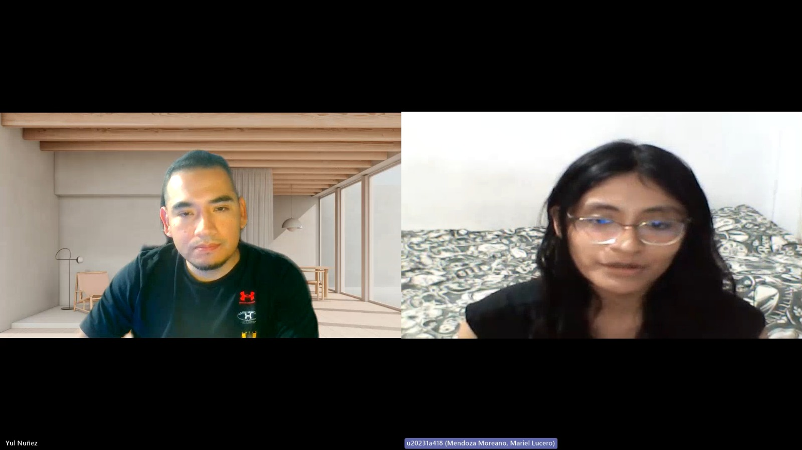
</p>

_Nota._ Elaboración propia a partir de la entrevista realizada.

**Resumen de la entrevista**

<p align="justify">

Yul Nuñez es una administradora de un pequeño negocio comercial de 27 años, residente en Cercado de Lima. Se identifica con el género femenino, es soltera y no tiene hijos ni personas que dependan económicamente de ella. Cuenta con aproximadamente cuatro años de experiencia contratando proyectos relacionados con remodelaciones y adecuaciones de locales comerciales.

</p>

<p align="justify">

Suele contratar principalmente remodelaciones de locales comerciales, oficinas y pequeños almacenes. Para seleccionar una empresa constructora revisa recomendaciones, trabajos anteriores, presupuesto y cumplimiento de plazos.

</p>

<p align="justify">

Actualmente se mantiene informada sobre sus proyectos mediante WhatsApp y correo electrónico. Recibe principalmente fotografías y listados semanales, aunque considera que esta información puede ser informal y no siempre permite determinar con claridad cuánto se ha avanzado.

</p>

<p align="justify">

Para verificar licencias y condiciones normativas revisa la documentación con apoyo de un abogado y, cuando lo considera necesario, contrata inspecciones externas. En relación con materiales y personal, depende principalmente de la información proporcionada por la constructora y de las visitas realizadas a la obra.

</p>

<p align="justify">

Entre sus experiencias negativas menciona retrasos, acabados con una calidad menor a la esperada y reportes poco claros. En una experiencia previa, el retraso en una obra ocasionó aproximadamente S/ 10 000 de pérdidas debido a que no pudo abrir un negocio en la fecha programada.

</p>

<p align="justify">

Su principal objetivo es que los proyectos finalicen dentro del plazo y presupuesto establecidos. Su principal frustración es no conocer con claridad lo que está ocurriendo durante la ejecución hasta que aparece un problema.

</p>

<p align="justify">

Considera especialmente importante disponer de información sobre avance, materiales, personal e incidentes. Le gustaría poder consultar esta información cuando la necesite y recibir adicionalmente un resumen semanal.

</p>

<p align="justify">

Considera que las constructoras deberían comunicar los problemas con mayor claridad y anticipación. Una herramienta digital podría permitirle consultar directamente la información sin solicitar actualizaciones constantemente. Para confiar en una plataforma espera disponer de reportes claros, fotografías, seguimiento de materiales y personal e información sobre licencias. Los datos desactualizados o la falta de trazabilidad sobre el origen de la información le generarían desconfianza.

</p>

<p align="justify">

Se describe como una persona práctica que compara alternativas y revisa referencias antes de tomar decisiones, debido a que busca reducir riesgos. Considera importantes las habilidades de organización, negociación y revisión de presupuestos.

</p>

<p align="justify">

Entre sus principales influencias se encuentran las recomendaciones de otros empresarios, referencias de clientes anteriores y el portafolio de trabajos realizados por las constructoras.

</p>

<p align="justify">

Utiliza smartphone y laptop. Prefiere el smartphone para comunicaciones rápidas y la laptop para revisar documentos. Entre sus principales canales y aplicaciones digitales se encuentran WhatsApp, Gmail y Google Drive. Su navegador habitual es Google Chrome.

</p>

<p align="justify">

Finalmente, considera que una empresa constructora que utilice herramientas digitales para ofrecer mayor transparencia y organización generaría mayor confianza e influiría positivamente en su decisión de contratación.

</p>

---

##### Entrevista #5

**Datos del entrevistado**

- **Nombres y apellidos:** Gerardo Rojas Quispe
- **Edad:** 35 años
- **Distrito de residencia:** San Martín de Porres
- **Segmento objetivo:** Contratante de empresa privada
- **Fecha de entrevista:** 14/09/26
- **Timing de inicio:** 25:55
- **Duración:** 06:24
- **Video consolidado:** https://upcedupe-my.sharepoint.com/:v:/g/personal/u202320442_upc_edu_pe/IQDWnJj67oWOTaeKQVq4DaOPAXX9DFuqJ-kxtlCUQ-2Lsos?nav=eyJyZWZlcnJhbEluZm8iOnsicmVmZXJyYWxBcHAiOiJPbmVEcml2ZUZvckJ1c2luZXNzIiwicmVmZXJyYWxBcHBQbGF0Zm9ybSI6IldlYiIsInJlZmVycmFsTW9kZSI6InZpZXciLCJyZWZlcnJhbFZpZXciOiJNeUZpbGVzTGlua0NvcHkifX0&e=8BvJOp

**Figura 8**  
_Cuadro de video del entrevistado #2 del segmento Contratantes de empresas privadas._

<p align="center">
  
</p>

_Nota._ Elaboración propia a partir de la entrevista realizada.

**Resumen de la entrevista**

<p align="justify">

Gerardo Rojas Quispe es un gerente de operaciones de 35 años, residente en San Martín de Porres. Se identifica con el género masculino, es casado y tiene responsabilidades familiares, aspecto que influye en la organización de sus horarios y en la precaución con la que evalúa decisiones que pueden representar riesgos económicos.

</p>

<p align="justify">

Cuenta con aproximadamente ocho años de experiencia participando en proyectos relacionados con remodelaciones industriales, oficinas y almacenes. Para seleccionar una empresa constructora considera principalmente la experiencia específica, el cumplimiento normativo, la transparencia, el presupuesto y los plazos.

</p>

<p align="justify">

Actualmente recibe reportes sobre el avance mediante correo electrónico aproximadamente cada diez días. Esta información se complementa con fotografías y visitas quincenales, mientras que para las comunicaciones rápidas utiliza WhatsApp. Algunas constructoras proporcionan gráficos, aunque una parte importante continúa utilizando documentos básicos elaborados en Word o Excel.

</p>

<p align="justify">

Para verificar licencias y normas de seguridad recurre al equipo legal de su empresa y, cuando es necesario, solicita la participación de un ingeniero especializado. A pesar de ello, no cuenta con visibilidad directa y permanente sobre los materiales y personal, por lo que depende en gran medida de los reportes y visitas.

</p>

<p align="justify">

Entre las principales dificultades que ha experimentado se encuentran una planificación deficiente de materiales, retrasos y comunicación tardía de los problemas. También ha recibido reportes que ya no representaban adecuadamente la situación actual de la obra.

</p>

<p align="justify">

En determinados proyectos, las penalidades y acciones necesarias para acelerar la ejecución han generado aproximadamente S/ 15 000 de costos adicionales. También ha experimentado situaciones en las que se utilizaron materiales de calidad inferior a la acordada.

</p>

<p align="justify">

Su principal objetivo es que los proyectos sean ejecutados dentro del presupuesto y cronograma establecidos. Su principal frustración es enterarse tarde de riesgos que podrían haber sido gestionados previamente.

</p>

<p align="justify">

Considera indispensable consultar información sobre avance, presupuesto, materiales, personal, incidentes y licencias. Para él, la información crítica debería estar disponible permanentemente.

</p>

<p align="justify">

Considera que una plataforma digital podría aportar trazabilidad y permitirle consultar información sin esperar al siguiente reporte por correo. Para confiar en una herramienta de este tipo considera necesarios mecanismos de seguridad, historial de cambios, registros detallados y responsables claramente identificados. La posibilidad de que cualquier usuario modifique información o la presencia de datos desactualizados le generarían desconfianza.

</p>

<p align="justify">

Se describe como una persona analítica que evalúa costos, riesgos e impacto sobre el cronograma antes de tomar decisiones. Entre las habilidades que considera más importantes se encuentran planificación, negociación, análisis presupuestal y gestión de riesgos.

</p>

<p align="justify">

Sus decisiones están influenciadas principalmente por su equipo técnico, asesores legales, otros gerentes y referencias proporcionadas por empresas que hayan trabajado anteriormente con una constructora.

</p>

<p align="justify">

Utiliza laptop y smartphone, aunque prefiere la laptop para desarrollar sus actividades profesionales. Entre sus herramientas y canales digitales se encuentran Outlook, Microsoft Teams, WhatsApp y Excel. Su navegador habitual es Microsoft Edge.

</p>

<p align="justify">

Finalmente, considera que una plataforma de seguimiento podría influir positivamente en su decisión de contratar una constructora, debido a que representaría una señal de mayor organización y madurez en sus procesos. También considera valioso disponer de alertas automáticas ante eventos críticos.

</p>

---

##### Entrevista #6

**Datos del entrevistado**

- **Nombres y apellidos:** Delicia Aguilar Vega
- **Edad:** 28 años
- **Distrito de residencia:** San Juan de Miraflores
- **Segmento objetivo:** Contratante de empresa privada
- **Fecha de entrevista:** 14/09/26
- **Timing de inicio:** 32:19
- **Duración:** 06:12
- **Video consolidado:** https://upcedupe-my.sharepoint.com/:v:/g/personal/u202320442_upc_edu_pe/IQDWnJj67oWOTaeKQVq4DaOPAXX9DFuqJ-kxtlCUQ-2Lsos?nav=eyJyZWZlcnJhbEluZm8iOnsicmVmZXJyYWxBcHAiOiJPbmVEcml2ZUZvckJ1c2luZXNzIiwicmVmZXJyYWxBcHBQbGF0Zm9ybSI6IldlYiIsInJlZmVycmFsTW9kZSI6InZpZXciLCJyZWZlcnJhbFZpZXciOiJNeUZpbGVzTGlua0NvcHkifX0&e=8BvJOp

**Figura 9**  
_Cuadro de video del entrevistado #3 del segmento Contratantes de empresas privadas._

<p align="center">
  
</p>

_Nota._ Elaboración propia a partir de la entrevista realizada.

**Resumen de la entrevista**

<p align="justify">

Delicia Aguilar Vega es una administradora de una pequeña empresa de 28 años, residente en San Juan de Miraflores. Se identifica con el género femenino, es conviviente y tiene responsabilidades familiares, ya que contribuye económicamente en su hogar. Esta situación influye en la precaución con la que toma decisiones financieras.

</p>

<p align="justify">

Cuenta con aproximadamente cinco años de experiencia contratando remodelaciones y adecuaciones de locales. Los proyectos que suele contratar incluyen remodelaciones, pequeños locales comerciales y edificaciones de hasta tres pisos.

</p>

<p align="justify">

Para seleccionar una empresa constructora considera principalmente la experiencia, cumplimiento de plazos, presupuesto y transparencia. Actualmente recibe reportes semanales por correo electrónico y fotografías ocasionales mediante WhatsApp. Los reportes son elaborados principalmente en Word o Excel.

</p>

<p align="justify">

Para verificar licencias y cumplimiento normativo solicita la documentación mediante correo electrónico y complementa este proceso con verificaciones presenciales de su equipo. No obstante, reconoce que no tiene capacidad para verificar directamente y de manera continua el uso de materiales y el personal presente en obra, por lo que depende en gran medida de la información proporcionada por la constructora.

</p>

<p align="justify">

Entre las principales dificultades que ha experimentado se encuentran la comunicación poco proactiva, informes incompletos y poca claridad sobre el uso de materiales. También ha experimentado situaciones en las que se comunicaron retrasos después de que estos ya habían afectado considerablemente el cronograma.

</p>

<p align="justify">

En una experiencia anterior, problemas relacionados con planificación y comunicación impidieron entregar una obra dentro del plazo establecido, lo que ocasionó la pérdida de un contrato y el pago de una penalidad.

</p>

<p align="justify">

Su principal objetivo es comprobar que la obra avance de acuerdo con lo acordado. Su mayor frustración es recibir información sobre los problemas cuando estos ya han ocurrido y existen menos posibilidades de corregirlos.

</p>

<p align="justify">

Considera especialmente importante disponer de información sobre avance, materiales, personal, incidentes, retrasos y actividades pendientes. Le gustaría poder consultar estos datos en cualquier momento y recibir, además, un resumen semanal del estado general del proyecto.

</p>

<p align="justify">

Considera que la comunicación podría mejorar mediante la centralización de la información y el envío de avisos cuando ocurra algún evento importante. Una herramienta digital podría proporcionarle una visión más estructurada y reducir su dependencia de mensajes aislados.

</p>

<p align="justify">

Para confiar en una plataforma considera importante disponer de evidencias, fechas de actualización, responsables identificados y reportes comprensibles. Una plataforma complicada o con datos desactualizados disminuiría su disposición a utilizarla.

</p>

<p align="justify">

Se describe como una persona organizada y precavida que prefiere conocer los problemas con anticipación antes de tomar decisiones. Considera importantes las habilidades de organización, control de gastos, comunicación y negociación.

</p>

<p align="justify">

Sus decisiones están influenciadas principalmente por recomendaciones de personas conocidas, referencias de otros clientes y evidencia de trabajos anteriores desarrollados por la constructora.

</p>

<p align="justify">

Utiliza laptop y smartphone, prefiriendo la laptop para la revisión de documentos. Sus principales herramientas y canales digitales son correo electrónico, WhatsApp, Excel y Google Drive. Utiliza Google Chrome como navegador habitual.

</p>

<p align="justify">

Finalmente, considera que una empresa constructora que permita realizar un seguimiento transparente mediante una plataforma digital generaría mayor confianza e influiría positivamente en su decisión de contratación. También considera útil contar con alertas automáticas ante eventos importantes sin necesidad de revisar constantemente el sistema.

</p>

---

### 2.2.3. Análisis de entrevistas

<p align="justify">

A partir de las entrevistas registradas se realizó un análisis independiente de los dos segmentos objetivo de ArquiTech: supervisores de obra y contratantes de empresas privadas. El análisis busca identificar, mediante sustento estadístico, las características objetivas y subjetivas más representativas de cada segmento, tomando como fuente las respuestas y resúmenes documentados en el registro de entrevistas.

</p>

<p align="justify">

Para cada segmento se consideraron tres participantes. En consecuencia, una característica identificada en un participante representa el 33.3 % del segmento, una característica compartida por dos participantes representa el 66.7 %, y una característica presente en los tres participantes representa el 100 %.

</p>

<p align="justify">

Las características analizadas comprenden aspectos demográficos y profesionales, experiencia, contexto familiar, preferencias tecnológicas, personalidad, habilidades, influencias, canales de interacción, objetivos, frustraciones, necesidades y expectativas. Estos resultados servirán posteriormente como base para la construcción de los User Personas y los demás artefactos de Needfinding.

</p>

---

#### Segmento objetivo #1: Supervisores de obra

##### Características objetivas predominantes

<p align="justify">

Las entrevistas muestran que el segmento está conformado por profesionales con experiencia directa en la supervisión y gestión de proyectos de construcción. El 100 % de los participantes se desempeña como supervisor o supervisora de obra y participa directamente en actividades relacionadas con personal, materiales, avance y coordinación de los proyectos.

</p>

<p align="justify">

Respecto al género, el 66.7 % de los participantes se identifica con el género femenino y el 33.3 % con el género masculino.

</p>

<p align="justify">

En cuanto a la edad, el 66.7 % tiene 55 años o más, mientras que el 33.3 % se encuentra alrededor de los 31 años. Esto evidencia la presencia predominante de profesionales con una trayectoria extensa, aunque también existe representación de perfiles más jóvenes con experiencia en herramientas digitales.

</p>

<p align="justify">

El 66.7 % de los participantes se encuentra casado y tiene responsabilidades familiares, mientras que el 33.3 % es soltero y no presenta personas económicamente dependientes.

</p>

<p align="justify">

En relación con la experiencia profesional, el 66.7 % cuenta con más de veinte años de experiencia en el sector construcción, mientras que el 33.3 % cuenta con aproximadamente siete años de experiencia. En todos los casos, equivalente al 100 %, la trayectoria está directamente relacionada con supervisión, construcción, edificaciones, remodelaciones o control técnico de obras.

</p>

<p align="justify">

Respecto al uso de tecnología, el 100 % utiliza tanto smartphone como laptop durante sus actividades profesionales. El 66.7 % manifiesta una preferencia principal por la laptop para revisar documentación o preparar reportes, mientras que el 33.3 % destaca el smartphone como dispositivo preferido para las actividades realizadas directamente en campo.

</p>

<p align="justify">

El 100 % utiliza WhatsApp como canal de comunicación laboral y el 100 % utiliza correo electrónico o herramientas equivalentes para compartir información y documentación. Asimismo, el 100 % utiliza Google Chrome como navegador habitual.

</p>

<p align="justify">

Los distritos de residencia serán incorporados al análisis estadístico una vez que los tres participantes completen esta información durante las entrevistas. Este dato no se considera todavía dentro de los porcentajes para evitar incorporar información que no haya sido registrada.

</p>

**Figura 10**  
_Características objetivas predominantes en supervisores de obra_

<p align="center">
  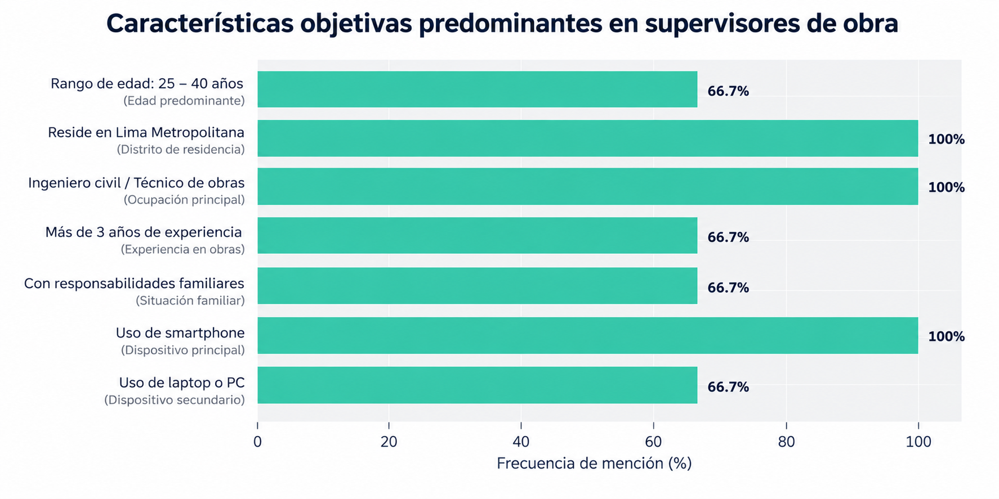
</p>

_Nota._ Elaboración propia a partir de las entrevistas realizadas.

<p align="justify">

Los resultados objetivos permiten identificar un segmento profesional con experiencia significativa en el sector, acostumbrado a combinar herramientas tradicionales de gestión con dispositivos y canales digitales de uso general. La laptop y el smartphone forman parte de las herramientas habituales de los tres participantes, aunque la elección del dispositivo depende del contexto de trabajo: la laptop se utiliza principalmente para documentación y reportes, mientras que el smartphone facilita la comunicación y el trabajo en campo.

</p>

---

##### Características subjetivas predominantes

<p align="justify">

Las respuestas también muestran patrones comunes relacionados con la forma de trabajar, las habilidades, objetivos, frustraciones y expectativas de los supervisores.

</p>

<p align="justify">

El 100 % considera fundamental disponer de información actualizada sobre el estado de la obra. Los tres participantes mencionaron problemas asociados con información desactualizada, inconsistencias en registros o dificultades para conocer oportunamente el estado del inventario, personal o avance.

</p>

<p align="justify">

El 100 % manifestó interés en centralizar información relacionada con asistencia, inventario, recursos, avance y reportes. La fragmentación entre registros físicos, hojas de cálculo, comunicaciones y documentos constituye una dificultad común dentro del segmento.

</p>

<p align="justify">

Asimismo, el 100 % considera importante que una herramienta digital sea sencilla y confiable. Los participantes señalaron que una solución demasiado compleja, lenta o difícil de utilizar podría convertirse en una barrera de adopción.

</p>

<p align="justify">

La coordinación y comunicación entre personas y áreas constituye otra característica representativa. El 100 % reconoce la importancia de mantener una comunicación efectiva entre campo, administración, residentes, responsables técnicos y almacén.

</p>

<p align="justify">

En relación con las habilidades, el 100 % menciona la comunicación o coordinación como una competencia relevante. El 66.7 % destaca explícitamente habilidades relacionadas con organización y control, y el 66.7 % menciona capacidades vinculadas con resolución de problemas o prevención de incidencias.

</p>

<p align="justify">

Respecto a la personalidad, los tres perfiles presentan una orientación hacia el control y resolución de situaciones operativas. El 100 % evidencia una forma de trabajo orientada a comprobar información, prevenir problemas o reaccionar ante situaciones que puedan afectar el proyecto.

</p>

<p align="justify">

En cuanto a influencias profesionales, SENCICO es mencionado por el 100 % de los participantes como fuente o referente técnico. CAPECO aparece en el 66.7 % de los casos y herramientas o productos asociados con Microsoft se encuentran presentes en el 100 % de los perfiles tecnológicos. Autodesk aparece como herramienta o referencia tecnológica en el 66.7 %.

</p>

<p align="justify">

El 100 % tiene como objetivo mantener control sobre la ejecución de la obra y evitar que problemas relacionados con personal, materiales o información interrumpan el desarrollo de las actividades.

</p>

<p align="justify">

Finalmente, el 100 % presenta frustraciones relacionadas con información que no se encuentra actualizada oportunamente, mientras que el 66.7 % menciona directamente retrasos o problemas asociados con materiales y el 66.7 % evidencia preocupación por la coordinación entre distintas áreas.

</p>

**Figura 11**  
_Características subjetivas predominantes en supervisores de obra_

<p align="center">
  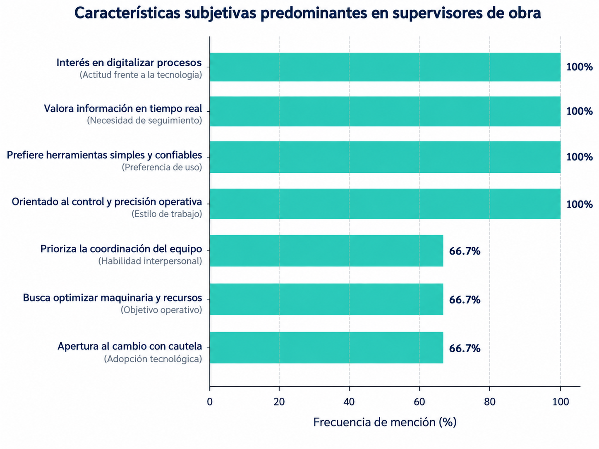
</p>

_Nota._ Elaboración propia a partir de las entrevistas realizadas.

<p align="justify">

En conjunto, el segmento de supervisores se caracteriza por una orientación hacia el control operativo, organización, disponibilidad de información y coordinación de recursos. Los participantes necesitan mantener información actualizada sobre personal, materiales y avance, y muestran una percepción favorable hacia herramientas digitales siempre que estas simplifiquen el trabajo y no añadan complejidad a las actividades realizadas en campo.

</p>

<p align="justify">

Estas características deberán reflejarse posteriormente en el User Persona correspondiente al segmento, especialmente en sus objetivos, habilidades, comportamiento tecnológico, necesidades y frustraciones.

</p>

---

#### Segmento objetivo #2: Contratantes de empresas privadas

##### Características objetivas predominantes

<p align="justify">

Los contratantes entrevistados desempeñan funciones administrativas o gerenciales desde las cuales participan directamente en la selección de constructoras y en el seguimiento de proyectos.

</p>

<p align="justify">

Respecto al género, el 66.7 % se identifica con el género femenino y el 33.3 % con el género masculino.

</p>

<p align="justify">

En relación con la edad, el 66.7 % tiene menos de 30 años, mientras que el 33.3 % tiene 35 años. Esto representa un segmento predominantemente adulto joven que combina responsabilidades administrativas con seguimiento de proyectos de construcción.

</p>

<p align="justify">

El 66.7 % tiene responsabilidades familiares, mientras que el 33.3 % no presenta personas económicamente dependientes. Respecto al estado civil, los tres participantes presentan condiciones distintas: el 33.3 % es soltero, el 33.3 % casado y el 33.3 % conviviente, por lo que no existe una situación civil predominante.

</p>

<p align="justify">

El 100 % desarrolla funciones administrativas, gerenciales o de toma de decisiones dentro de una empresa. Asimismo, el 100 % cuenta con experiencia previa contratando o realizando seguimiento a proyectos de construcción, con una experiencia comprendida aproximadamente entre cuatro y ocho años.

</p>

<p align="justify">

Los tres participantes residen en Lima Metropolitana, equivalente al 100 % del segmento: Cercado de Lima, San Martín de Porres y San Juan de Miraflores.

</p>

<p align="justify">

En cuanto a tecnología, el 100 % utiliza laptop y smartphone. El 100 % utiliza la laptop para revisar documentos o realizar actividades profesionales relacionadas con el seguimiento de sus proyectos, mientras que el smartphone se utiliza principalmente para comunicaciones rápidas.

</p>

<p align="justify">

El 100 % utiliza WhatsApp y correo electrónico como canales de comunicación relacionados con los proyectos. Respecto al navegador, el 66.7 % utiliza Google Chrome y el 33.3 % utiliza Microsoft Edge.

</p>

**Figura 12**  
_Características objetivas predominantes en contratantes de empresas privadas_

<p align="center">
  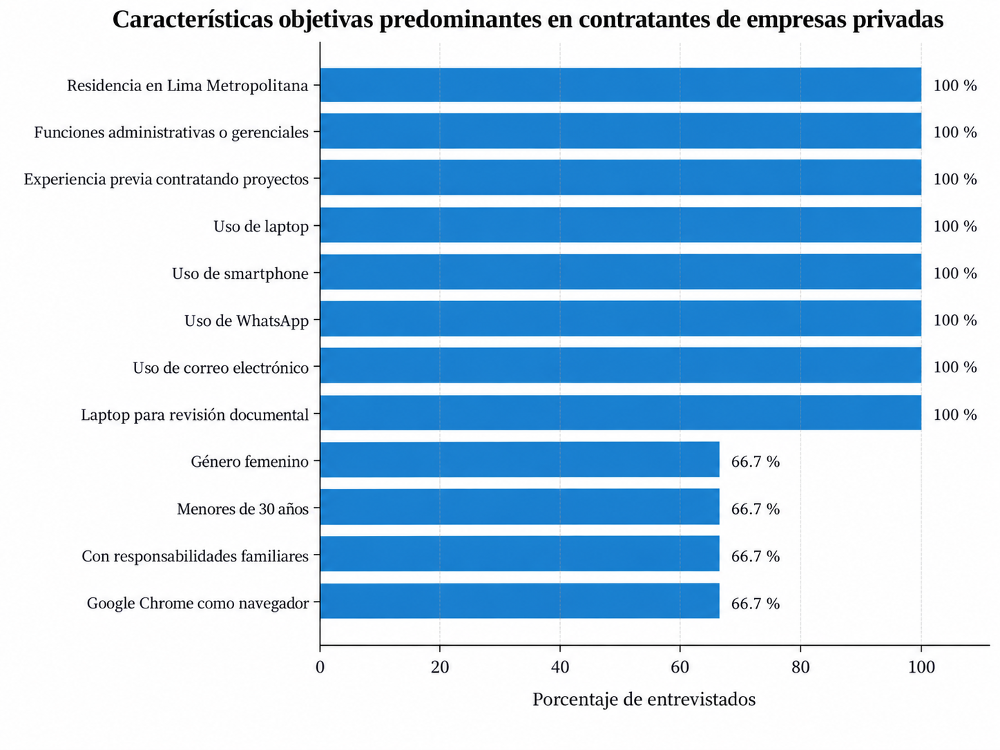
</p>

_Nota._ Elaboración propia a partir de las entrevistas realizadas.

<p align="justify">

Los datos objetivos permiten identificar un segmento compuesto por personas con responsabilidades administrativas y capacidad de decisión, que utilizan habitualmente herramientas digitales convencionales para revisar documentación y comunicarse con las constructoras. Todos los participantes poseen experiencia previa con proyectos de construcción, lo que les permite evaluar aspectos como cumplimiento de plazos, presupuesto, calidad y transparencia.

</p>

---

##### Características subjetivas predominantes

<p align="justify">

Las entrevistas muestran una coincidencia significativa respecto a la importancia de disponer de información clara, actualizada y verificable durante la ejecución de los proyectos.

</p>

<p align="justify">

El 100 % considera la transparencia como una característica fundamental al trabajar con una empresa constructora. Los tres participantes relacionan una mayor transparencia con una mayor confianza y capacidad para tomar decisiones.

</p>

<p align="justify">

El 100 % manifiesta la necesidad de acceder a información actualizada sobre el avance de la obra. Asimismo, los tres participantes consideran importante conocer información relacionada con materiales, personal, incidentes o situaciones que puedan afectar el desarrollo del proyecto.

</p>

<p align="justify">

La comunicación proactiva constituye otro patrón común. El 100 % expresa frustración frente a problemas comunicados tardíamente o información incompleta, y considera importante conocer los riesgos antes de que estos produzcan consecuencias importantes.

</p>

<p align="justify">

Respecto a la forma de tomar decisiones, el 100 % presenta un comportamiento orientado a la reducción de riesgos. Los participantes revisan referencias, antecedentes, costos, cumplimiento o evidencia antes de elegir o continuar trabajando con una empresa constructora.

</p>

<p align="justify">

El 100 % considera que una herramienta digital de seguimiento podría mejorar su experiencia, especialmente si proporciona trazabilidad, evidencia y acceso directo a la información.

</p>

<p align="justify">

En relación con las habilidades, la negociación aparece en el 100 % de los perfiles, mientras que las capacidades relacionadas con organización, planificación o control financiero están presentes en el 100 % de los participantes.

</p>

<p align="justify">

Las recomendaciones, referencias o antecedentes de terceros constituyen una influencia relevante en el 100 % de los casos. Los participantes indicaron que consideran referencias de clientes, otros empresarios, equipos técnicos, asesores o experiencias anteriores antes de tomar decisiones.

</p>

<p align="justify">

En cuanto a los factores de confianza, el 100 % valora que la información presentada incluya evidencia o mecanismos que permitan comprobar su procedencia. Los registros actualizados, fotografías, responsables identificados, historial de cambios o documentación constituyen elementos importantes para el segmento.

</p>

<p align="justify">

El cumplimiento de plazos constituye un objetivo o criterio de decisión para el 100 % de los participantes. Asimismo, el 100 % busca reducir la incertidumbre y evitar consecuencias económicas ocasionadas por retrasos, falta de planificación o comunicación tardía.

</p>

<p align="justify">

Como principal frustración, el 100 % menciona situaciones relacionadas con información incompleta, poco clara o comunicada después de que el problema ya se ha producido.

</p>

**Figura 13**  
_Características subjetivas predominantes en contratantes de empresas privadas_

<p align="center">
  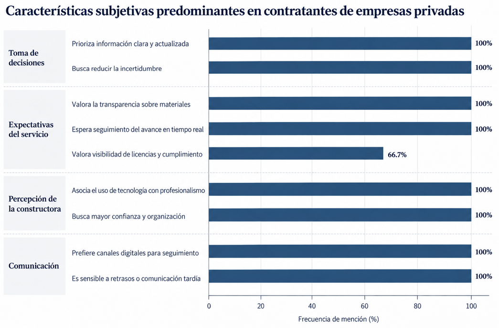
</p>

_Nota._ Elaboración propia a partir de las entrevistas realizadas.

<p align="justify">

El segmento de contratantes se caracteriza principalmente por una necesidad de transparencia, visibilidad, reducción de riesgos y acceso oportuno a información verificable. Los participantes valoran positivamente la tecnología cuando esta les permite conocer el estado real de una obra sin depender exclusivamente de reportes enviados manualmente por la constructora.

</p>

<p align="justify">

Estas características deberán reflejarse posteriormente en el User Persona correspondiente al segmento, particularmente en su comportamiento orientado al análisis de riesgos, sus necesidades de información, sus factores de confianza, sus canales digitales y sus principales frustraciones.

</p>

---

#### Síntesis del análisis

<p align="justify">

Los resultados permiten observar diferencias claras entre los dos segmentos objetivo.

</p>

<p align="justify">

Los supervisores de obra presentan necesidades principalmente relacionadas con el control operativo y la actualización de información. El 100 % busca disponer de información actualizada, el 100 % considera necesaria una mejor centralización de datos y el 100 % destaca la importancia de la coordinación entre los diferentes responsables del proyecto.

</p>

<p align="justify">

En contraste, los contratantes de empresas privadas concentran sus necesidades en la transparencia, visibilidad y reducción de incertidumbre. El 100 % considera importante contar con información actualizada, el 100 % valora la transparencia y el 100 % presenta preocupación por recibir información o alertas demasiado tarde.

</p>

<p align="justify">

A nivel tecnológico, ambos segmentos utilizan dispositivos y herramientas digitales de uso cotidiano, pero con finalidades distintas. Los supervisores emplean principalmente estas herramientas para registrar, consolidar y comunicar información operativa, mientras que los contratantes las utilizan para recibir documentación, revisar el estado de sus proyectos y comunicarse con la constructora.

</p>

<p align="justify">

En consecuencia, el arquetipo correspondiente al supervisor de obra deberá reflejar principalmente necesidades de eficiencia operativa, control, coordinación y reducción de registros fragmentados. Por otro lado, el arquetipo correspondiente al contratante de empresa privada deberá reflejar necesidades de transparencia, seguimiento, evidencia, confianza y reducción de riesgos.

</p>

<p align="justify">

La información obtenida en este análisis mantiene relación directa con los registros y resúmenes de las entrevistas y constituirá la base para la construcción de los User Personas y los demás artefactos de Needfinding.

</p>

---

## 2.3. Needfinding

### 2.3.1. User Personas

Las personas representan los dos segmentos definidos en 1.3 y sintetizan el análisis de las seis entrevistas de 2.2. Juan Carlos Zegarra representa al supervisor que necesita coordinar recursos y consolidar registros; Verónica Delgado representa a la contratante que necesita visibilidad y confianza sobre su obra. Se relacionan con las dificultades de información dispersa, retrasos y trazabilidad descritas en 2.2.3. El análisis competitivo de 2.1 aporta contexto para priorizar una solución accesible para estos segmentos; las personas son modelos de diseño y no sustituyen la validación con usuarios reales.

**Figura 14**  
_User persona del segmento #1: Supervisor de Obra_

<p align="center">
  
</p>

_Nota._ Elaboración propia.

**Figura 15**  
_User persona del segmento #2: Contratista de Empresas privadas_

<p align="center">
  
</p>

_Nota._ Elaboración propia.

### 2.3.2. User Task Matrix

<p align="justify">

La User Task Matrix presenta las principales tareas realizadas por los User Persona correspondientes a los dos segmentos objetivo de ArquiTech: Juan Carlos Zegarra, representante de los supervisores de obra, y Verónica Delgado, representante de los contratantes de empresas privadas. Para cada tarea se identifica la frecuencia con la que es realizada y su nivel de importancia. Las tareas descritas corresponden a actividades propias de los usuarios y pueden realizarse independientemente de la existencia de ArquiTech.

</p>

| Tarea                                                                   | Juan Carlos Zegarra |             | Verónica Delgado   |             |
| :---------------------------------------------------------------------- | ------------------- | ----------- | ------------------ | ----------- |
|                                                                         | Frecuencia          | Importancia | Frecuencia         | Importancia |
| Supervisar el avance de la obra                                         | Diaria              | Alta        | \-                 | \-          |
| Revisar reportes sobre el avance y estado del proyecto                  | \-                  | \-          | Semanal            | Alta        |
| Verificar el uso de materiales y controlar posibles desperdicios        | Diaria              | Alta        | \-                 | \-          |
| Supervisar la asistencia del personal de obra y detectar ausencias      | Diaria              | Alta        | \-                 | \-          |
| Verificar que las licencias y permisos se encuentren vigentes           | \-                  | \-          | Según vencimientos | Alta        |
| Comunicar los avances de la obra a clientes y responsables del proyecto | Semanal             | Alta        | \-                 | \-          |
| Revisar problemas críticos que puedan afectar la ejecución de la obra   | \-                  | \-          | Inmediata          | Alta        |

<p align="justify">

En el caso de Juan Carlos Zegarra, las tareas de mayor frecuencia e importancia se encuentran relacionadas con el control operativo de la obra. La supervisión del avance, la verificación del uso de materiales y el control de la asistencia del personal se realizan diariamente y presentan una importancia alta. Asimismo, la comunicación periódica de avances permite mantener informados a los responsables vinculados con la ejecución del proyecto.

</p>

<p align="justify">

Por su parte, Verónica Delgado concentra sus actividades en el seguimiento y la verificación del proyecto. La revisión de reportes se realiza semanalmente, mientras que la comprobación de licencias y permisos depende de sus fechas de vigencia. Asimismo, la revisión de problemas críticos requiere atención inmediata debido al impacto que estos pueden generar sobre el cumplimiento de la obra.

</p>

<p align="justify">

La principal diferencia entre ambos User Personas radica en su nivel de participación en la ejecución del proyecto. El supervisor interviene de manera directa y frecuente en las actividades operativas de la obra, mientras que el contratante realiza principalmente tareas de seguimiento, comprobación y evaluación de la información recibida. Como coincidencia, ambos requieren conocer el estado de la obra y detectar situaciones que puedan afectar su desarrollo para poder tomar decisiones oportunas.

</p>

### 2.3.3. User Journey Mapping

Los mapas organizan la experiencia de ambos segmentos desde la planificación y obtención de información hasta el seguimiento y consulta de resultados. En el supervisor se vinculan la coordinación diaria, la supervisión en campo y la consolidación de reportes; en el contratante, la solicitud de información y la evaluación del avance. Las dificultades sintetizadas en 2.2.3 —registros dispersos, actualización tardía y poca visibilidad— permiten identificar oportunidades de centralización. Esta lectura de extremo a extremo conecta las tareas de 2.3.2 con los escenarios actuales de 2.3.5 y los escenarios propuestos de 3.1.

_User Journey Mapping del segmento #1: Supervisor de Obra_

<p align="center">
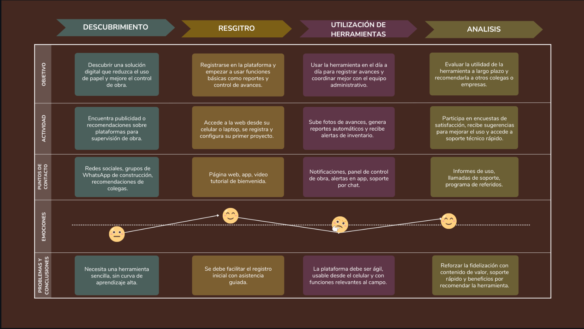
</p>

_Nota._ Elaboración propia.

_User Journey Mapping del segmento #2: Contratista de Empresas privadas_

<p align="center">

</p>

_Nota._ Elaboración propia.

### 2.3.4. Empathy Mapping

Los mapas agrupan lo que cada segmento dice, hace, piensa y siente para relacionar comportamientos observables con necesidades. Su sustento documental es el registro y análisis de entrevistas de 2.2: el supervisor busca datos confiables y menor esfuerzo administrativo; el contratante busca transparencia y comunicación oportuna. La separación entre acciones y percepciones evita interpretar una expectativa como una función ya implementada. Las necesidades resultantes se contrastan con User Personas y User Journey Mapping antes de traducirse en requisitos de 3.2.

**Figura 16**
_Empathy Mapping del segmento #1: Supervisor de Obra_

<p align="center">
  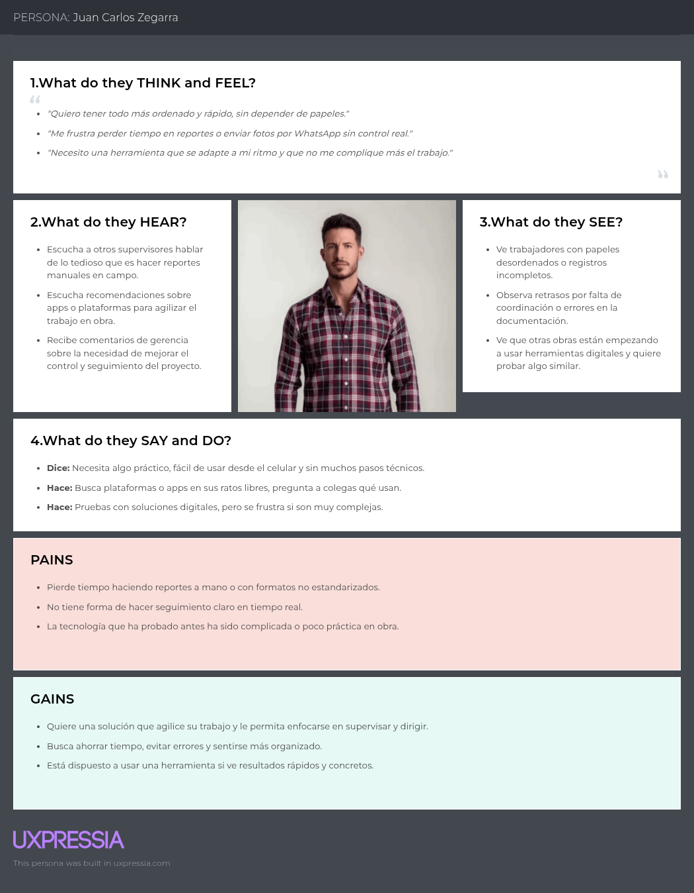
</p>

_Nota._ Elaboración propia.

**Figura 17**
_Empathy Mapping del segmento #2: Contratista de Empresas privadas_

<p align="center">
  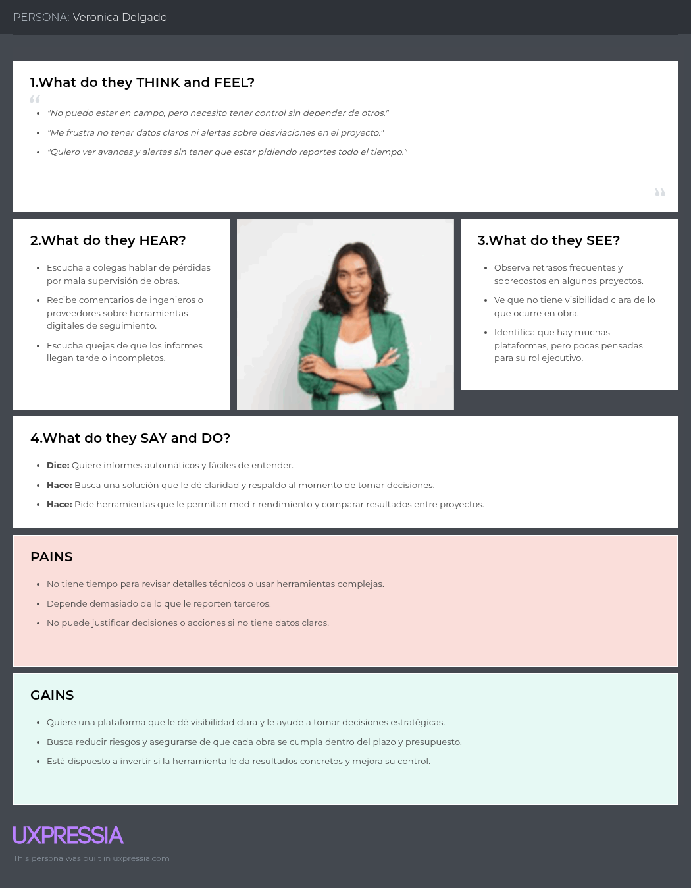
</p>

_Nota._ Elaboración propia.

### 2.3.5. As-is Scenario Mapping

### 2.3.5. As-is Scenario Mapping

La lectura del escenario actual parte de las entrevistas de 2.2 y ordena las actividades por fase. En el segmento Supervisor, la figura distingue Planificación Matutina, Supervisión en Campo, Gestión Operativa y Reporte y Cierre Diario. La fila Doing registra acciones como revisar cuadernos o Excel, confirmar asistencia, recorrer la obra, contar materiales y enviar resúmenes; Thinking muestra dudas sobre stock, ritmo de avance y completitud del reporte; Feeling identifica preocupación, presión y agotamiento.

Para elaborar y revisar estos mapas se propone preparar los hallazgos por segmento, generar ideas a partir de los registros, agruparlas en fases y ubicar cada observación en Doing/Thinking/Feeling. Este procedimiento es una pauta reproducible de revisión: el ZIP no permite acreditar que se realizó una sesión específica de lluvia de ideas. Las figuras de áreas positivas identifican prácticas que se deben conservar; las negativas señalan dificultades a reducir; las blank areas representan preguntas y datos faltantes que requieren investigación. El segundo segmento se analiza por separado para conservar su perspectiva de consulta y supervisión contractual.

<ins>**As-Is Scenario Mapping del segmento #1: Supervisores de Obra**</ins>

**Figura 18**  
_As-Is Scenario Mapping para segmento #1_

<p align="center">
  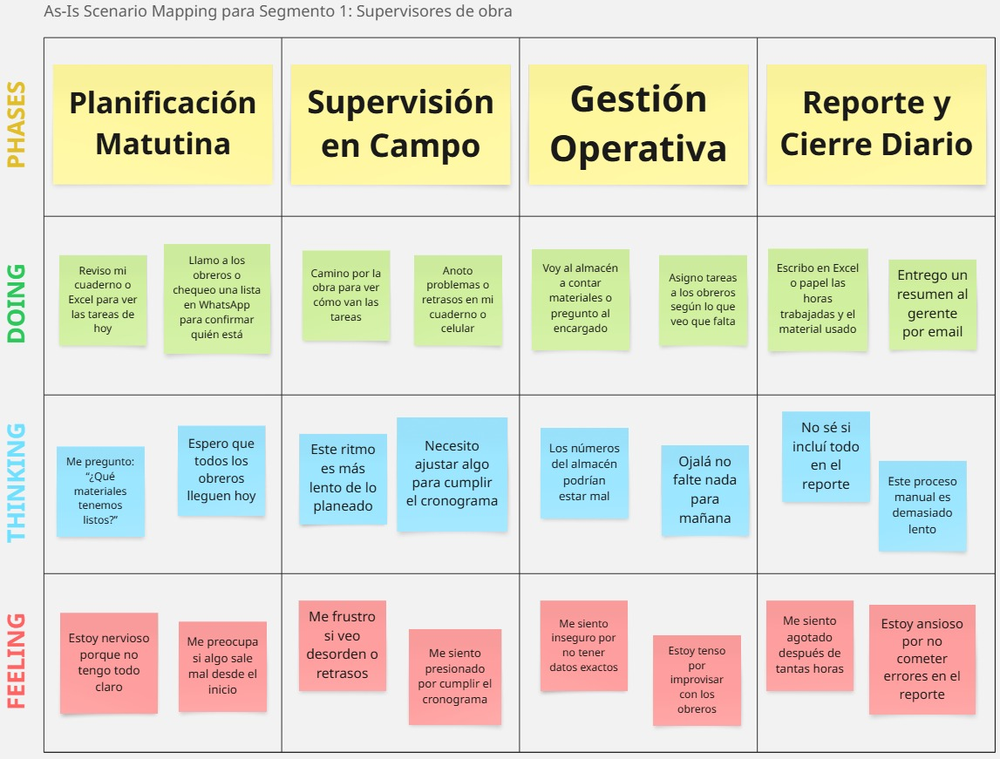
</p>

**Figura 19**  
_Áreas positivas del As-Is Scenario Mapping para segmento #1_

<p align="center">
  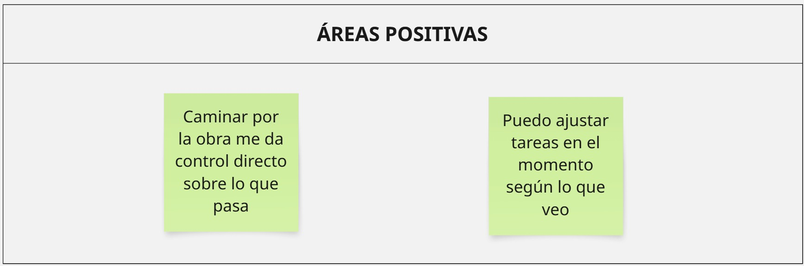
</p>

**Figura 20**  
_Áreas negativas del As-Is Scenario Mapping para segmento #1_

<p align="center">
  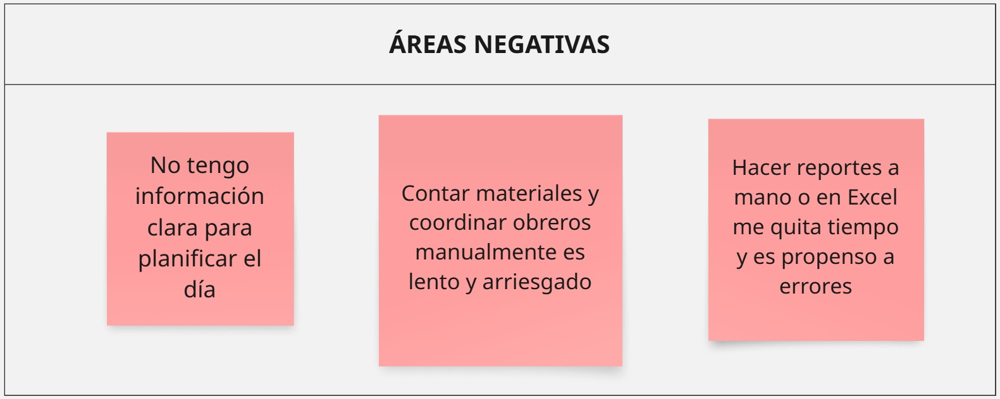
</p>

**Figura 21**  
_Blank areas del As-Is Scenario Mapping para segmento \#1_

<p align="center">
  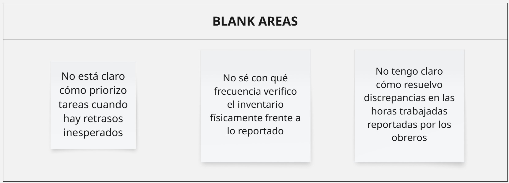
</p>

<ins>**As-Is Scenario Mapping para Segmento \# 2: Contratantes de Empresas Privadas**</ins>

**Figura 22**  
_As-Is Scenario Mapping para segmento #2_

<p align="center">
  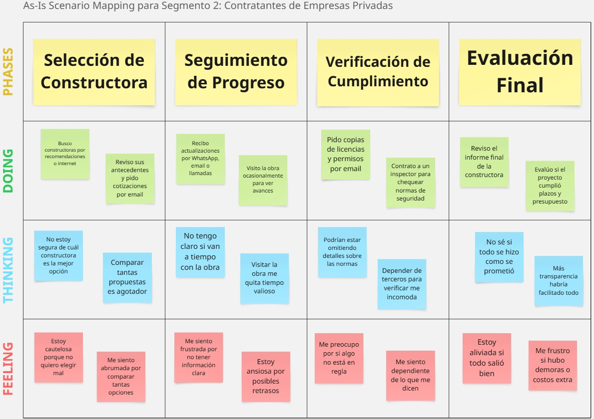
</p>

**Figura 23**  
_Áreas positivas del As-Is Scenario Mapping para segmento #2_

<p align="center">
  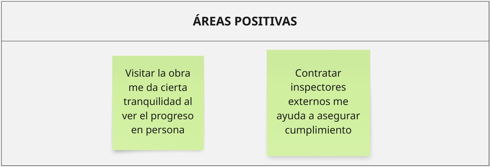
</p>

**Figura 24**  
_Áreas negativas del As-Is Scenario Mapping para segmento #2_

<p align="center">
  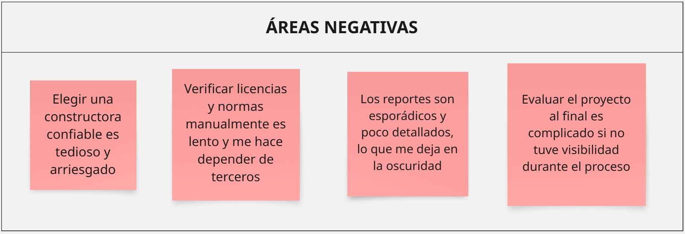
</p>

**Figura 25**  
_Blank areas del As-Is Scenario Mapping para segmento #2_

<p align="center">
  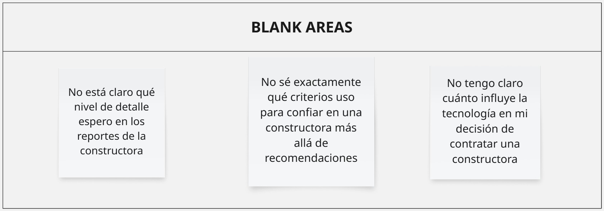
</p>

## 2.4. Ubiquitous Language

<p align="justify">

El Ubiquitous Language de ArquiTech reúne los principales términos utilizados dentro del dominio de gestión y seguimiento de proyectos de construcción. Estos conceptos permiten mantener un vocabulario común entre los integrantes del equipo y los stakeholders, reduciendo ambigüedades entre los requisitos, el diseño y las funcionalidades del producto. Los términos definidos corresponden al dominio de negocio de ArquiTech y se utilizan de manera consistente en las User Stories y en los procesos soportados por la solución.

</p>

| Término (Inglés)  | Término (Español)      | Definición                                                                                                                                                                                                                  |
| :---------------- | :--------------------- | :-------------------------------------------------------------------------------------------------------------------------------------------------------------------------------------------------------------------------- |
| Project           | Proyecto               | Obra o proyecto de construcción gestionado en ArquiTech. Contiene información como nombre, ubicación, fechas, presupuesto, estado, progreso y los responsables asociados.                                                   |
| Supervisor        | Supervisor de obra     | Usuario responsable de administrar una obra y coordinar sus recursos y actividades. Gestiona proyectos, materiales, trabajadores, asistencia, tareas, maquinaria e incidencias dentro de los proyectos bajo su supervisión. |
| Contractor        | Contratante            | Usuario asociado a un proyecto que realiza seguimiento de la obra y consulta la información disponible sobre su ejecución, sin administrar los recursos operativos del proyecto.                                            |
| Project Progress  | Avance del proyecto    | Porcentaje que representa el nivel de progreso registrado para un proyecto de construcción, comprendido entre 0 % y 100 %.                                                                                                  |
| Worker            | Trabajador             | Persona que forma parte del personal de una obra y se encuentra asociada a un proyecto para realizar actividades durante su ejecución.                                                                                      |
| Attendance        | Asistencia             | Registro correspondiente a la presencia de un trabajador en una jornada determinada. Puede indicar estados como presente, ausente, tardanza o justificado e incluir horas de entrada y salida cuando corresponda.           |
| Task              | Tarea                  | Actividad de trabajo asociada a un proyecto y asignada a un trabajador, con información como título, descripción, fecha límite y estado de ejecución.                                                                       |
| Material          | Material               | Recurso físico utilizado durante la ejecución de una obra y cuyo inventario se controla dentro de un proyecto.                                                                                                              |
| Material Entry    | Entrada de material    | Recepción de una cantidad de material en la obra. Incrementa la cantidad acumulada recibida y el stock disponible del material.                                                                                             |
| Material Usage    | Uso de material        | Consumo de una cantidad de material durante la ejecución de la obra. Reduce el stock disponible y no puede superar la cantidad existente.                                                                                   |
| Material Movement | Movimiento de material | Registro de una entrada o uso de material que permite mantener la trazabilidad de las variaciones producidas en el inventario de una obra.                                                                                  |
| Stock             | Stock disponible       | Cantidad de un material que se encuentra disponible para ser utilizada dentro de un proyecto después de considerar sus entradas y usos registrados.                                                                         |
| Minimum Stock     | Stock mínimo           | Cantidad mínima definida para un material que sirve como referencia para identificar cuándo su disponibilidad se encuentra en un nivel bajo.                                                                                |
| Machinery         | Maquinaria             | Equipo o maquinaria utilizada dentro de un proyecto de construcción y registrada para controlar su identificación, estado y disponibilidad.                                                                                 |
| Serial Number     | Número de serie        | Identificador asociado a una maquinaria que permite distinguirla dentro de un proyecto.                                                                                                                                     |
| Incident          | Incidencia             | Situación, problema o evento ocurrido durante la ejecución de una obra que requiere ser registrado y seguido de acuerdo con su tipo, severidad y estado.                                                                    |
| Weekly Report     | Reporte semanal        | Consolidación de información correspondiente a una semana de ejecución del proyecto, considerando registros como tareas, movimientos de materiales e incidencias para facilitar el seguimiento de la obra.                  |

<p align="justify">

Este vocabulario se utiliza de manera consistente en la especificación de requisitos de ArquiTech. En particular, conceptos como Project, Material, Material Movement, Worker, Attendance, Task, Machinery, Incident y Weekly Report representan elementos centrales del dominio y permiten mantener coherencia entre el análisis del problema, las User Stories y las funcionalidades implementadas.

</p>

# Capítulo III: Requirements Specification

## 3.1. To-Be Scenario Mapping

El To-Be propone cómo cambiaría la experiencia con ArquiTech a partir de los problemas del As-Is de 2.3.5. Su revisión comienza con los hallazgos de cada segmento, continúa con propuestas de mejora y las organiza en fases y filas Doing/Thinking/Feeling. La comparación se centra en sustituir la consolidación dispersa por registros centralizados y facilitar la consulta del avance. Las áreas positivas representan beneficios esperados; las negativas, riesgos de adopción y conectividad; las blank areas, aspectos aún por validar. No se presentan estos beneficios como resultados medidos.

| Dimensión        | As-Is                               | To-Be propuesto                               | Evidencia para validar                            |
| ---------------- | ----------------------------------- | --------------------------------------------- | ------------------------------------------------- |
| Materiales       | Conteos y registros separados       | Entradas, usos e historial por obra           | HU01/HU02/HU28 y pruebas de inventario en 6.1     |
| Personal         | Coordinación y asistencia manual    | Personal y asistencia asociados a proyecto    | HU06/HU10 y suites de workforce                   |
| Consulta de obra | Información consolidada con retraso | Acceso según rol y proyecto                   | HU22/HU27/HU33 y pruebas de autorización          |
| Reportes         | Consolidación manual                | Reporte semanal a partir de datos registrados | Pruebas de weekly-report y experimento de tiempos |

<ins>_To-Be Scenario Mapping del segmento #1: Supervisores de obra_</ins>

_Figura 26_  
To-Be Scenario Mapping del segmento #1

<p align="center">
  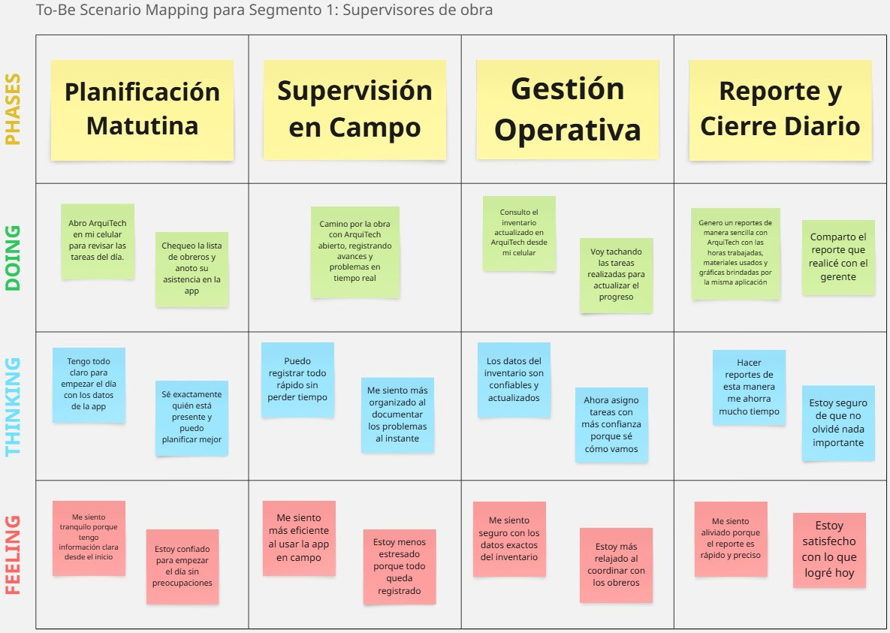
</p>

_Figura 27_  
Áreas positivas del To-Be Scenario Mapping para segmento #1

<p align="center">
  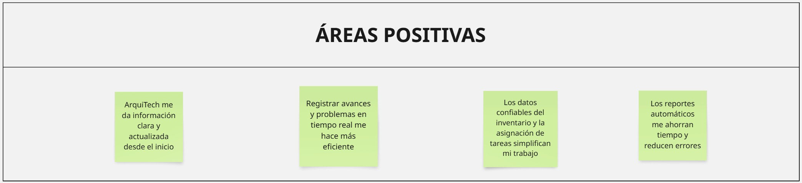
</p>

_Figura 28_  
Áreas negativas del To-Be Scenario Mapping para segmento #1

<p align="center">
  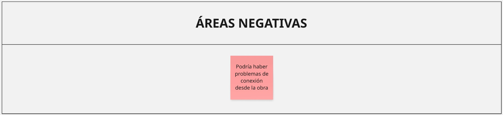
</p>

_Figura 29_  
Blank areas del To-Be Scenario Mapping para segmento #1

<p align="center">
  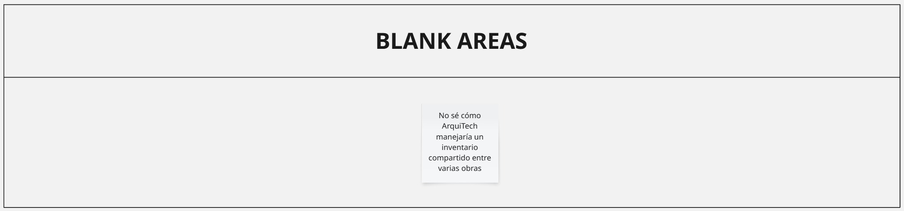
</p>

<ins>_To-Be Scenario Mapping para Segmento #2: Contratantes de Empresas Privadas_</ins>

_Figura 30_  
To-Be Scenario Mapping para segmento #2

<p align="center">
  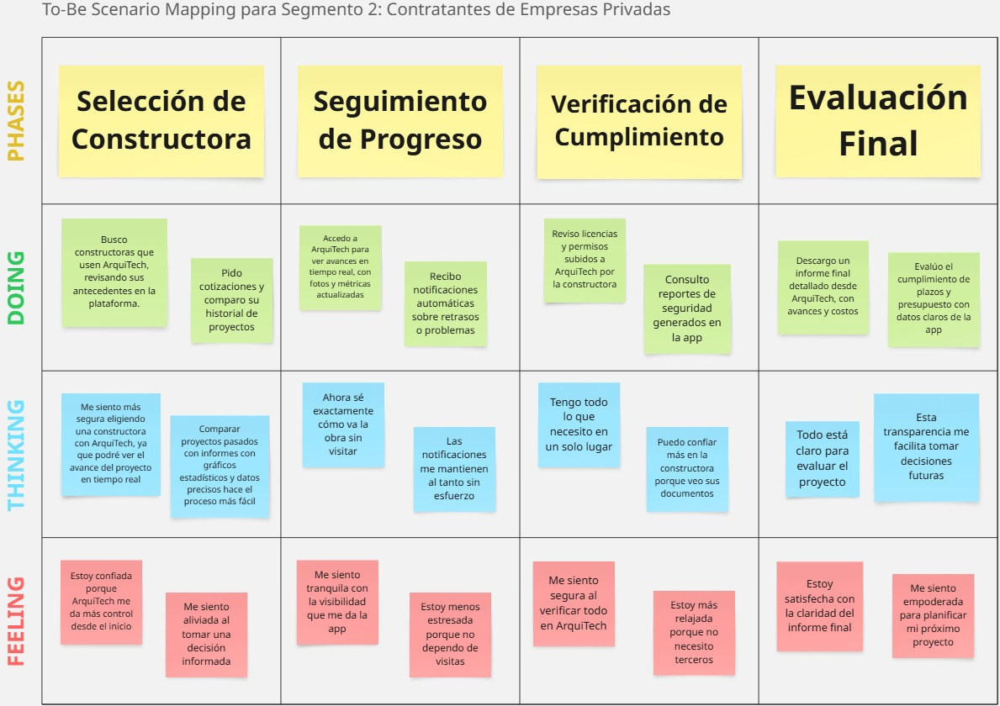
</p>

_Figura 31_  
Áreas positivas del To-Be Scenario Mapping para segmento #2

<p align="center">
  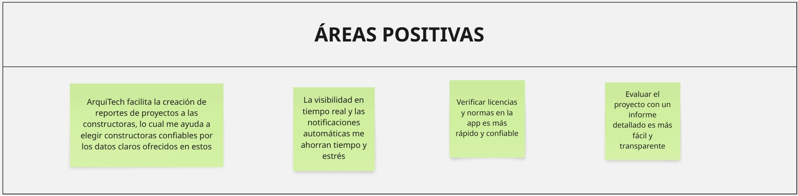
</p>

_Figura 32_  
Áreas negativas del To-Be Scenario Mapping para segmento #2

<p align="center">
  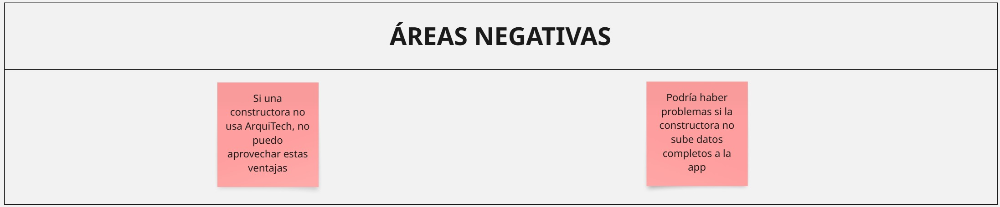
</p>

_Figura 33_  
Blank areas del To-Be Scenario Mapping para segmento #2

<p align="center">
  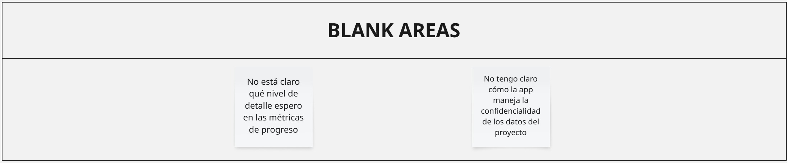
</p>

## 3.2. User Stories

<p align="justify">

En esta sección se presentan los Epics, User Stories, Technical Stories y Spike Stories definidos para ArquiTech. Las historias funcionales representan las necesidades de los principales segmentos de usuario del producto digital: supervisores de obra, contratantes y visitantes de la Landing Page. Las Technical Stories representan capacidades técnicas necesarias para soportar dichas funcionalidades y utilizan el rol Developer. Finalmente, las Spike Stories representan actividades de investigación, análisis o validación técnica necesarias para reducir incertidumbre antes de realizar modificaciones o extensiones sobre el producto.

</p>

<p align="justify">

Dentro del contexto de ArquiTech se mantiene un lenguaje ubicuo consistente empleando términos como Proyecto, Supervisor de Obra, Contratante, Material, Movimiento de Material, Trabajador, Tarea, Maquinaria, Incidencia y Reporte Semanal. Estos términos se utilizan de manera uniforme en las historias y representan conceptos propios del dominio de gestión y seguimiento de obras de construcción.

</p>

<p align="justify">

Los Acceptance Criteria se expresan mediante la estructura Given-When-Then (Dado-Cuando-Entonces), utilizando tiempo presente y tercera persona. Para las historias relacionadas con APIs REST, los criterios representan escenarios verificables de interacción request/response. Para las Spike Stories, los criterios establecen los resultados, documentación y conclusiones técnicas necesarias para determinar cuándo la investigación puede considerarse completada.

</p>

| Story ID | User               | Priority | Epic | Title                                                              | Description                                                                                                                                                                                                             | Acceptance Criteria                                                                                                                                                                                                                                                                                                                                                                                                                                                                                                                                                                                                                                                |
| -------- | ------------------ | -------- | ---- | ------------------------------------------------------------------ | ----------------------------------------------------------------------------------------------------------------------------------------------------------------------------------------------------------------------- | ------------------------------------------------------------------------------------------------------------------------------------------------------------------------------------------------------------------------------------------------------------------------------------------------------------------------------------------------------------------------------------------------------------------------------------------------------------------------------------------------------------------------------------------------------------------------------------------------------------------------------------------------------------------ |
| EP01     | —                  | Alta     | —    | Gestión de inventarios y materiales                                | Agrupa las funcionalidades relacionadas con materiales, movimientos de inventario y maquinaria utilizada en los proyectos.                                                                                              | —                                                                                                                                                                                                                                                                                                                                                                                                                                                                                                                                                                                                                                                                  |
| HU01     | Supervisor de obra | Alta     | EP01 | Registrar entrada de materiales                                    | Como supervisor de obra, deseo registrar la entrada de materiales para mantener actualizado el inventario de una obra.                                                                                                  | AC1: Dado que el supervisor gestiona un proyecto válido, cuando registra una entrada de material con datos válidos, entonces el sistema almacena el movimiento y actualiza la disponibilidad del material.<br><br>AC2: Dado que la información requerida para la entrada es inválida o incompleta, cuando el supervisor intenta registrar el movimiento, entonces el sistema rechaza la operación y conserva el inventario sin modificaciones.                                                                                                                                                                                                                     |
| HU02     | Supervisor de obra | Alta     | EP01 | Registrar uso o salida de materiales                               | Como supervisor de obra, deseo registrar los materiales utilizados en una obra para mantener actualizado el stock disponible.                                                                                           | AC1: Dado que un material posee stock suficiente, cuando el supervisor registra una cantidad utilizada válida, entonces el sistema descuenta dicha cantidad y registra la salida correspondiente.<br><br>AC2: Dado que la cantidad solicitada supera el stock disponible, cuando el supervisor intenta registrar la salida, entonces el sistema rechaza la operación y conserva el stock existente.                                                                                                                                                                                                                                                                |
| HU04     | Supervisor de obra | Alta     | EP01 | Consultar historial de movimientos de materiales                   | Como supervisor de obra, deseo consultar las entradas y salidas de materiales para realizar seguimiento de los movimientos del inventario.                                                                              | AC1: Dado que existen movimientos asociados al proyecto, cuando el supervisor consulta el historial, entonces el sistema presenta las entradas y salidas registradas con su información correspondiente.<br><br>AC2: Dado que el proyecto no posee movimientos registrados, cuando el supervisor consulta el historial, entonces el sistema devuelve un resultado vacío sin alterar la información existente.                                                                                                                                                                                                                                                      |
| HU05     | Supervisor de obra | Alta     | EP01 | Registrar maquinaria                                               | Como supervisor de obra, deseo registrar maquinaria asociada a una obra para mantener control sobre los recursos utilizados en el proyecto.                                                                             | AC1: Dado que el proyecto existe, cuando el supervisor registra una maquinaria con información válida, entonces el sistema almacena la maquinaria asociada al proyecto.<br><br>AC2: Dado que los datos de la maquinaria no cumplen las condiciones requeridas, cuando se solicita su registro, entonces el sistema rechaza la operación y no crea el recurso.                                                                                                                                                                                                                                                                                                      |
| HU28     | Supervisor de obra | Alta     | EP01 | Consultar materiales                                               | Como supervisor de obra, deseo consultar los materiales registrados en una obra para conocer su disponibilidad e información asociada.                                                                                  | AC1: Dado que existen materiales registrados, cuando el supervisor consulta los materiales de una obra, entonces el sistema devuelve la información correspondiente a los materiales disponibles.<br><br>AC2: Dado que no existen materiales asociados, cuando el supervisor realiza la consulta, entonces el sistema devuelve un resultado vacío sin generar modificaciones.                                                                                                                                                                                                                                                                                      |
| HU29     | Supervisor de obra | Alta     | EP01 | Actualizar información de materiales                               | Como supervisor de obra, deseo actualizar la información de un material para mantener correctos los datos del inventario.                                                                                               | AC1: Dado que el material existe, cuando el supervisor proporciona nuevos datos válidos, entonces el sistema actualiza la información del material.<br><br>AC2: Dado que el material no existe o los nuevos datos son inválidos, cuando se solicita la actualización, entonces el sistema rechaza la operación y conserva la información previa.                                                                                                                                                                                                                                                                                                                   |
| HU30     | Supervisor de obra | Alta     | EP01 | Consultar maquinaria                                               | Como supervisor de obra, deseo consultar la maquinaria registrada en una obra para conocer los recursos disponibles y su estado.                                                                                        | AC1: Dado que existe maquinaria asociada al proyecto, cuando el supervisor realiza la consulta, entonces el sistema devuelve la información de las maquinarias registradas.<br><br>AC2: Dado que no existe maquinaria asociada, cuando el supervisor realiza la consulta, entonces el sistema devuelve un resultado vacío.                                                                                                                                                                                                                                                                                                                                         |
| HU31     | Supervisor de obra | Alta     | EP01 | Actualizar información de maquinaria                               | Como supervisor de obra, deseo actualizar la información de una maquinaria para mantener vigente su información operativa.                                                                                              | AC1: Dado que la maquinaria existe, cuando el supervisor proporciona información válida, entonces el sistema actualiza sus datos.<br><br>AC2: Dado que la maquinaria no existe o la información es inválida, cuando se solicita la actualización, entonces el sistema rechaza la operación y conserva la información existente.                                                                                                                                                                                                                                                                                                                                    |
| HU40     | Contratante        | Alta     | EP01 | Consultar materiales de una obra                                   | Como contratante, deseo consultar los materiales asociados a una obra para conocer los recursos registrados en el proyecto.                                                                                             | AC1: Dado que el contratante tiene acceso al proyecto, cuando consulta sus materiales, entonces el sistema devuelve los materiales asociados al proyecto.<br><br>AC2: Dado que no existen materiales registrados, cuando el contratante realiza la consulta, entonces el sistema devuelve un resultado vacío.                                                                                                                                                                                                                                                                                                                                                      |
| HU41     | Contratante        | Alta     | EP01 | Consultar maquinaria de una obra                                   | Como contratante, deseo consultar la maquinaria asociada a una obra para conocer los recursos utilizados en el proyecto.                                                                                                | AC1: Dado que el contratante tiene acceso al proyecto, cuando consulta la maquinaria, entonces el sistema devuelve los recursos de maquinaria asociados.<br><br>AC2: Dado que no existe maquinaria registrada, cuando se realiza la consulta, entonces el sistema devuelve un resultado vacío.                                                                                                                                                                                                                                                                                                                                                                     |
| HU47     | Supervisor de obra | Alta     | EP01 | Eliminar material                                                  | Como supervisor de obra, deseo eliminar un material que ya no debe formar parte del registro para mantener actualizado el inventario.                                                                                   | AC1: Dado que el material existe y puede eliminarse, cuando el supervisor solicita su eliminación, entonces el sistema elimina el material registrado.<br><br>AC2: Dado que el material no existe, cuando se solicita su eliminación, entonces el sistema rechaza la operación y no modifica el inventario.                                                                                                                                                                                                                                                                                                                                                        |
| HU48     | Supervisor de obra | Alta     | EP01 | Eliminar maquinaria                                                | Como supervisor de obra, deseo eliminar una maquinaria que ya no debe permanecer registrada para mantener actualizados los recursos de la obra.                                                                         | AC1: Dado que la maquinaria existe, cuando el supervisor solicita su eliminación, entonces el sistema elimina el registro correspondiente.<br><br>AC2: Dado que la maquinaria no existe, cuando se solicita su eliminación, entonces el sistema informa que el recurso no se encuentra disponible y no realiza modificaciones.                                                                                                                                                                                                                                                                                                                                     |
| EP02     | —                  | Alta     | —    | Gestión de trabajadores, asistencia y tareas                       | Agrupa las funcionalidades relacionadas con trabajadores, el registro y consulta de asistencia y las actividades asignadas durante la ejecución de los proyectos.                                                       | —                                                                                                                                                                                                                                                                                                                                                                                                                                                                                                                                                                                                                                                                  |
| HU06     | Supervisor de obra | Alta     | EP02 | Registrar trabajadores                                             | Como supervisor de obra, deseo registrar trabajadores para mantener actualizada la información del personal asociado a las obras.                                                                                       | AC1: Dado que existe un proyecto válido, cuando el supervisor registra un trabajador con información válida, entonces el sistema almacena al trabajador asociado al proyecto.<br><br>AC2: Dado que la información del trabajador es inválida o incompleta, cuando se solicita su registro, entonces el sistema rechaza la operación y no crea el trabajador.                                                                                                                                                                                                                                                                                                       |
| HU07     | Supervisor de obra | Alta     | EP02 | Asignar tareas a trabajadores                                      | Como supervisor de obra, deseo asignar tareas a los trabajadores para organizar las actividades necesarias durante la ejecución de la obra.                                                                             | AC1: Dado que el trabajador está registrado, cuando el supervisor crea una tarea válida asociada al trabajador, entonces el sistema registra la tarea y su asignación.<br><br>AC2: Dado que el trabajador no existe o la información de la tarea es inválida, cuando se intenta realizar la asignación, entonces el sistema rechaza la operación.                                                                                                                                                                                                                                                                                                                  |
| HU08     | Supervisor de obra | Alta     | EP02 | Consultar tareas                                                   | Como supervisor de obra, deseo consultar las tareas registradas para conocer sus responsables, fechas y estado de ejecución.                                                                                            | AC1: Dado que existen tareas registradas, cuando el supervisor consulta las tareas, entonces el sistema devuelve la información correspondiente a cada actividad.<br><br>AC2: Dado que no existen tareas asociadas, cuando se realiza la consulta, entonces el sistema devuelve un resultado vacío.                                                                                                                                                                                                                                                                                                                                                                |
| HU10     | Supervisor de obra | Alta     | EP02 | Consultar trabajadores de una obra                                 | Como supervisor de obra, deseo consultar los trabajadores asociados a una obra para conocer el personal participante en el proyecto.                                                                                    | AC1: Dado que existen trabajadores asociados al proyecto, cuando el supervisor realiza la consulta, entonces el sistema devuelve la información del personal registrado.<br><br>AC2: Dado que el proyecto no posee trabajadores registrados, cuando se realiza la consulta, entonces el sistema devuelve un resultado vacío.                                                                                                                                                                                                                                                                                                                                       |
| HU32     | Supervisor de obra | Alta     | EP02 | Actualizar información de trabajadores                             | Como supervisor de obra, deseo actualizar la información de un trabajador para mantener correctos los datos del personal.                                                                                               | AC1: Dado que el trabajador existe, cuando el supervisor proporciona datos válidos actualizados, entonces el sistema modifica la información correspondiente.<br><br>AC2: Dado que el trabajador no existe o los datos son inválidos, cuando se solicita la modificación, entonces el sistema rechaza la operación y conserva los datos previos.                                                                                                                                                                                                                                                                                                                   |
| HU42     | Contratante        | Alta     | EP02 | Consultar trabajadores de una obra                                 | Como contratante, deseo consultar los trabajadores asociados a una obra para conocer el personal registrado en el proyecto.                                                                                             | AC1: Dado que el contratante posee acceso al proyecto, cuando consulta los trabajadores, entonces el sistema devuelve el personal asociado a la obra.<br><br>AC2: Dado que no existen trabajadores registrados, cuando se realiza la consulta, entonces el sistema devuelve un resultado vacío.                                                                                                                                                                                                                                                                                                                                                                    |
| HU43     | Contratante        | Alta     | EP02 | Consultar tareas de una obra                                       | Como contratante, deseo consultar las tareas asociadas a una obra para conocer las actividades registradas y su estado.                                                                                                 | AC1: Dado que existen tareas asociadas al proyecto, cuando el contratante las consulta, entonces el sistema devuelve sus datos y estado actual.<br><br>AC2: Dado que no existen tareas asociadas, cuando el contratante realiza la consulta, entonces el sistema devuelve un resultado vacío.                                                                                                                                                                                                                                                                                                                                                                      |
| HU49     | Supervisor de obra | Alta     | EP02 | Eliminar trabajador                                                | Como supervisor de obra, deseo eliminar el registro de un trabajador que ya no corresponde a la obra para mantener actualizado el personal del proyecto.                                                                | AC1: Dado que el trabajador existe y puede eliminarse, cuando el supervisor solicita su eliminación, entonces el sistema elimina el registro correspondiente.<br><br>AC2: Dado que el trabajador no existe, cuando se solicita su eliminación, entonces el sistema rechaza la operación y conserva los datos existentes.                                                                                                                                                                                                                                                                                                                                           |
| HU50     | Supervisor de obra | Alta     | EP02 | Eliminar tarea                                                     | Como supervisor de obra, deseo eliminar una tarea que ya no corresponde al plan de trabajo para mantener actualizadas las actividades de la obra.                                                                       | AC1: Dado que la tarea existe, cuando el supervisor solicita su eliminación, entonces el sistema elimina la tarea registrada.<br><br>AC2: Dado que la tarea no existe, cuando se solicita su eliminación, entonces el sistema no modifica las tareas existentes.                                                                                                                                                                                                                                                                                                                                                                                                   |
| HU53     | Supervisor de obra | Alta     | EP02 | Actualizar tarea                                                   | Como supervisor de obra, deseo actualizar la información y estado de una tarea para reflejar correctamente el avance de las actividades.                                                                                | AC1: Dado que la tarea existe, cuando el supervisor proporciona información válida actualizada, entonces el sistema modifica los datos y estado de la tarea.<br><br>AC2: Dado que la tarea no existe o los nuevos datos son inválidos, cuando se solicita la actualización, entonces el sistema rechaza la operación y conserva la información anterior.                                                                                                                                                                                                                                                                                                           |
| HU54     | Supervisor de obra | Alta     | EP02 | Registrar asistencia de trabajadores                               | Como supervisor de obra, deseo registrar la asistencia de los trabajadores para mantener evidencia de su presencia durante las jornadas de trabajo.                                                                     | AC1: Dado que el trabajador pertenece al proyecto y la información de asistencia es válida, cuando el supervisor registra su asistencia para una fecha determinada, entonces el sistema almacena el registro asociado al trabajador y al proyecto.<br><br>AC2: Dado que ya existe un registro de asistencia para el mismo trabajador y fecha, cuando el supervisor intenta registrar una segunda asistencia, entonces el sistema rechaza la operación y conserva el registro existente.<br><br>AC3: Dado que el estado de asistencia es ausente o justificado, cuando se registra la asistencia, entonces el sistema no permite asociar horas de entrada o salida. |
| HU55     | Supervisor de obra | Alta     | EP02 | Consultar asistencia de trabajadores                               | Como supervisor de obra, deseo consultar la asistencia registrada en una obra para realizar seguimiento de la presencia del personal durante la ejecución del proyecto.                                                 | AC1: Dado que existen registros de asistencia asociados al proyecto, cuando el supervisor consulta la asistencia, entonces el sistema presenta los registros correspondientes al proyecto al que tiene acceso.<br><br>AC2: Dado que se especifica una fecha para la consulta, cuando el supervisor solicita los registros, entonces el sistema devuelve únicamente las asistencias correspondientes a dicha fecha.<br><br>AC3: Dado que no existen registros para el criterio solicitado, cuando se realiza la consulta, entonces el sistema devuelve un resultado vacío sin modificar información.                                                                |
| HU56     | Contratante        | Alta     | EP02 | Consultar asistencia de una obra                                   | Como contratante, deseo consultar la asistencia registrada en una obra para conocer la presencia del personal asociado al proyecto.                                                                                     | AC1: Dado que el contratante se encuentra asociado al proyecto, cuando consulta los registros de asistencia, entonces el sistema presenta la información de asistencia correspondiente a esa obra.<br><br>AC2: Dado que el contratante intenta consultar la asistencia de un proyecto al que no tiene acceso, cuando realiza la solicitud, entonces el sistema rechaza el acceso a la información.<br><br>AC3: Dado que no existen registros para el criterio solicitado, cuando se realiza la consulta, entonces el sistema devuelve un resultado vacío.                                                                                                          |
| HU57     | Supervisor de obra | Alta     | EP02 | Actualizar registro de asistencia                                  | Como supervisor de obra, deseo corregir un registro de asistencia para mantener actualizada la información de presencia y horario de los trabajadores.                                                                  | AC1: Dado que el registro de asistencia existe y pertenece a un proyecto administrado por el supervisor, cuando proporciona información válida actualizada, entonces el sistema modifica el registro correspondiente.<br><br>AC2: Dado que la modificación produciría más de un registro para el mismo trabajador y fecha, cuando se intenta actualizar la asistencia, entonces el sistema rechaza la operación.<br><br>AC3: Dado que se registra una hora de salida, cuando se actualiza la asistencia, entonces debe existir una hora de entrada y la salida no puede ser anterior a ella.                                                                       |
| HU58     | Supervisor de obra | Alta     | EP02 | Eliminar registro de asistencia                                    | Como supervisor de obra, deseo eliminar un registro de asistencia incorrecto para mantener consistente la información del personal de la obra.                                                                          | AC1: Dado que el registro existe y pertenece a un proyecto administrado por el supervisor, cuando solicita su eliminación, entonces el sistema elimina el registro correspondiente.<br><br>AC2: Dado que el registro no existe o el supervisor no posee autorización sobre el proyecto, cuando se solicita la eliminación, entonces el sistema rechaza la operación sin modificar otros registros.                                                                                                                                                                                                                                                                 |
| EP03     | —                  | Alta     | —    | Gestión de proyectos                                               | Agrupa las funcionalidades necesarias para registrar, consultar y eliminar proyectos de construcción y gestionar sus responsables.                                                                                      | —                                                                                                                                                                                                                                                                                                                                                                                                                                                                                                                                                                                                                                                                  |
| HU09     | Supervisor de obra | Alta     | EP03 | Registrar proyecto de construcción                                 | Como supervisor de obra, deseo registrar un proyecto para gestionar la información correspondiente a una nueva obra.                                                                                                    | AC1: Dado que los responsables y la información del proyecto son válidos, cuando el supervisor registra el proyecto, entonces el sistema almacena la nueva obra con sus datos correspondientes.<br><br>AC2: Dado que la información obligatoria es inválida o incompleta, cuando se intenta registrar el proyecto, entonces el sistema rechaza la operación y no crea el proyecto.                                                                                                                                                                                                                                                                                 |
| HU22     | Supervisor de obra | Alta     | EP03 | Consultar proyectos bajo supervisión                               | Como supervisor de obra, deseo consultar los proyectos asociados a mi gestión para realizar seguimiento de las obras bajo mi responsabilidad.                                                                           | AC1: Dado que existen proyectos asociados al supervisor, cuando este consulta sus proyectos, entonces el sistema devuelve las obras correspondientes.<br><br>AC2: Dado que no existen proyectos asociados, cuando el supervisor realiza la consulta, entonces el sistema informa que no existen proyectos registrados para dicho usuario.                                                                                                                                                                                                                                                                                                                          |
| HU33     | Contratante        | Alta     | EP03 | Consultar proyectos contratados                                    | Como contratante, deseo consultar los proyectos asociados a mi participación para realizar seguimiento de las obras contratadas.                                                                                        | AC1: Dado que existen proyectos asociados al contratante, cuando este consulta sus proyectos, entonces el sistema devuelve las obras correspondientes.<br><br>AC2: Dado que no existen proyectos asociados, cuando se realiza la consulta, entonces el sistema devuelve un resultado sin proyectos disponibles.                                                                                                                                                                                                                                                                                                                                                    |
| HU59     | Supervisor de obra | Alta     | EP03 | Eliminar proyecto de construcción                                  | Como supervisor de obra, deseo eliminar un proyecto bajo mi responsabilidad para retirar una obra que ya no debe permanecer registrada junto con su información dependiente.                                            | AC1: Dado que el proyecto existe y pertenece al supervisor autenticado, cuando solicita su eliminación, entonces el sistema elimina el proyecto y los registros dependientes asociados a dicha obra.<br><br>AC2: Dado que el proyecto pertenece a otro usuario o el solicitante no posee permisos de escritura, cuando intenta eliminarlo, entonces el sistema rechaza la operación.<br><br>AC3: Dado que ocurre un error durante la eliminación de los registros dependientes, cuando no puede completarse la operación, entonces el sistema conserva la consistencia de la información y no realiza una eliminación parcial del proyecto.                        |
| EP04     | —                  | Media    | —    | Landing Page y comunicación                                        | Agrupa las historias relacionadas con la presentación pública de ArquiTech, su propuesta de valor, canales de comunicación y acceso a información legal del servicio.                                                   | —                                                                                                                                                                                                                                                                                                                                                                                                                                                                                                                                                                                                                                                                  |
| HU11     | Visitante          | Media    | EP04 | Conocer ArquiTech                                                  | Como visitante, deseo conocer la propuesta de ArquiTech para comprender el propósito de la solución y los problemas que busca resolver.                                                                                 | AC1: Dado que el visitante accede al contenido público de ArquiTech, cuando consulta la información de la solución, entonces el sistema presenta el propósito y la propuesta de valor de ArquiTech.<br><br>AC2: Dado que el visitante desea conocer el alcance de la solución, cuando consulta la información del producto, entonces el sistema presenta los principales problemas que aborda y los segmentos de usuario a los que está dirigido.                                                                                                                                                                                                                  |
| HU12     | Visitante          | Media    | EP04 | Consultar medios de contacto                                       | Como visitante, deseo conocer los medios de contacto de ArquiTech para disponer de canales mediante los cuales comunicarme con el equipo responsable.                                                                   | AC1: Dado que el visitante desea contactar a ArquiTech, cuando consulta la información de contacto, entonces el sistema presenta los canales de comunicación disponibles.<br><br>AC2: Dado que existen medios de contacto registrados, cuando el visitante consulta dicha información, entonces el sistema presenta los datos necesarios para utilizar cada canal disponible.                                                                                                                                                                                                                                                                                      |
| HU13     | Visitante          | Media    | EP04 | Explorar características y beneficios                              | Como visitante, deseo conocer las principales características y beneficios de ArquiTech para evaluar si la solución responde a mis necesidades.                                                                         | AC1: Dado que el visitante desea conocer las capacidades de ArquiTech, cuando consulta la información del producto, entonces el sistema presenta sus principales características funcionales.<br><br>AC2: Dado que el visitante desea evaluar la propuesta de valor, cuando consulta los beneficios de ArquiTech, entonces el sistema presenta los beneficios asociados con la gestión y seguimiento de obras de construcción.                                                                                                                                                                                                                                     |
| HU34     | Visitante          | Media    | EP04 | Acceder a la plataforma desde la Landing Page                      | Como visitante, deseo acceder a la plataforma de ArquiTech desde el sitio público para comenzar a utilizar el producto digital.                                                                                         | AC1: Dado que el visitante decide utilizar ArquiTech, cuando solicita acceder a la plataforma, entonces el sistema lo dirige al punto de acceso de la aplicación web.<br><br>AC2: Dado que el visitante accede al producto digital, cuando se completa la navegación desde el sitio público, entonces la aplicación web queda disponible para continuar con el proceso de autenticación.                                                                                                                                                                                                                                                                           |
| HU60     | Visitante          | Media    | EP04 | Consultar Términos y Condiciones                                   | Como visitante, deseo consultar los Términos y Condiciones de ArquiTech para conocer las condiciones aplicables al uso del servicio antes de utilizar el producto.                                                      | AC1: Dado que el visitante desea conocer las condiciones aplicables al servicio, cuando consulta los Términos y Condiciones, entonces el producto presenta la versión vigente de dicha información.<br><br>AC2: Dado que los Términos y Condiciones constituyen información pública del servicio, cuando una persona desea consultarlos, entonces puede acceder a su contenido sin requerir una sesión autenticada.                                                                                                                                                                                                                                                |
| EP05     | —                  | Media    | —    | Perfil, preferencias y accesibilidad                               | Agrupa las funcionalidades relacionadas con información personal, preferencias de visualización, accesibilidad e idioma del producto.                                                                                   | —                                                                                                                                                                                                                                                                                                                                                                                                                                                                                                                                                                                                                                                                  |
| HU16     | Usuario registrado | Media    | EP05 | Actualizar información del perfil                                  | Como usuario registrado, deseo actualizar la información de mi perfil para mantener mis datos personales configurados de acuerdo con mis preferencias.                                                                  | AC1: Dado que el usuario posee información de perfil disponible, cuando proporciona nuevos datos válidos, entonces el sistema conserva la información actualizada.<br><br>AC2: Dado que el usuario vuelve a utilizar el producto desde el mismo entorno, cuando consulta su configuración de perfil, entonces el sistema recupera la información previamente conservada.                                                                                                                                                                                                                                                                                           |
| HU19     | Usuario registrado | Media    | EP05 | Configurar preferencias de accesibilidad                           | Como usuario registrado, deseo configurar preferencias de accesibilidad para adaptar la experiencia de uso a mis necesidades.                                                                                           | AC1: Dado que el usuario requiere una configuración visual diferente, cuando modifica una preferencia de accesibilidad disponible, entonces el sistema aplica la configuración seleccionada.<br><br>AC2: Dado que una preferencia ha sido configurada, cuando el usuario continúa utilizando el producto, entonces el sistema mantiene la configuración aplicable al entorno actual.                                                                                                                                                                                                                                                                               |
| HU46     | Usuario registrado | Media    | EP05 | Cambiar idioma del producto                                        | Como usuario registrado, deseo cambiar el idioma disponible para comprender el contenido de ArquiTech en el idioma de mi preferencia.                                                                                   | AC1: Dado que el producto dispone de más de un idioma compatible, cuando el usuario selecciona un idioma disponible, entonces el sistema presenta el contenido traducido al idioma seleccionado.<br><br>AC2: Dado que el usuario ha seleccionado un idioma compatible, cuando continúa utilizando el producto durante la misma sesión, entonces el sistema conserva el idioma seleccionado.                                                                                                                                                                                                                                                                        |
| EP06     | —                  | Alta     | —    | Incidencias y reportes                                             | Agrupa las funcionalidades relacionadas con el registro y seguimiento de incidencias y con la generación y consulta de reportes de proyecto.                                                                            | —                                                                                                                                                                                                                                                                                                                                                                                                                                                                                                                                                                                                                                                                  |
| HU20     | Contratante        | Alta     | EP06 | Consultar reporte semanal de una obra                              | Como contratante, deseo consultar un reporte semanal de una obra para conocer los principales acontecimientos y avances registrados durante la semana.                                                                  | AC1: Dado que existen datos correspondientes a la semana actual, cuando el contratante consulta el reporte de un proyecto, entonces el sistema consolida la información principal del proyecto, tareas completadas, entradas y salidas de materiales e incidencias registradas.<br><br>AC2: Dado que alguna categoría no posee registros durante la semana, cuando se genera el reporte, entonces el sistema presenta la información disponible sin impedir la consulta del reporte.                                                                                                                                                                               |
| HU35     | Supervisor de obra | Alta     | EP06 | Registrar incidencia                                               | Como supervisor de obra, deseo registrar una incidencia ocurrida durante la ejecución del proyecto para mantener evidencia de los problemas de la obra.                                                                 | AC1: Dado que existe un proyecto válido, cuando el supervisor registra una incidencia con información válida, entonces el sistema almacena la incidencia asociada a la obra.<br><br>AC2: Dado que la información requerida es inválida o incompleta, cuando se intenta registrar una incidencia, entonces el sistema rechaza la operación y no crea el registro.                                                                                                                                                                                                                                                                                                   |
| HU36     | Supervisor de obra | Alta     | EP06 | Actualizar incidencia                                              | Como supervisor de obra, deseo actualizar una incidencia para mantener vigente su información, severidad y estado.                                                                                                      | AC1: Dado que la incidencia existe, cuando el supervisor proporciona información válida actualizada, entonces el sistema modifica los datos de la incidencia.<br><br>AC2: Dado que la incidencia no existe o los datos son inválidos, cuando se solicita la actualización, entonces el sistema rechaza la operación y conserva la información anterior.                                                                                                                                                                                                                                                                                                            |
| HU37     | Supervisor de obra | Alta     | EP06 | Consultar incidencias                                              | Como supervisor de obra, deseo consultar las incidencias registradas para realizar seguimiento de los problemas ocurridos en una obra.                                                                                  | AC1: Dado que existen incidencias registradas, cuando el supervisor las consulta, entonces el sistema devuelve su información, severidad y estado.<br><br>AC2: Dado que no existen incidencias, cuando se realiza la consulta, entonces el sistema devuelve un resultado vacío.                                                                                                                                                                                                                                                                                                                                                                                    |
| HU39     | Contratante        | Alta     | EP06 | Consultar incidencias de una obra                                  | Como contratante, deseo consultar las incidencias de una obra para conocer los problemas registrados durante la ejecución del proyecto.                                                                                 | AC1: Dado que existen incidencias asociadas al proyecto, cuando el contratante las consulta, entonces el sistema devuelve la información disponible.<br><br>AC2: Dado que no existen incidencias registradas, cuando el contratante realiza la consulta, entonces el sistema devuelve un resultado vacío.                                                                                                                                                                                                                                                                                                                                                          |
| HU51     | Supervisor de obra | Alta     | EP06 | Eliminar incidencia                                                | Como supervisor de obra, deseo eliminar una incidencia registrada incorrectamente para mantener consistente la información del proyecto.                                                                                | AC1: Dado que la incidencia existe y puede eliminarse, cuando el supervisor solicita su eliminación, entonces el sistema elimina el registro correspondiente.<br><br>AC2: Dado que la incidencia no existe, cuando se solicita su eliminación, entonces el sistema no modifica la información disponible.                                                                                                                                                                                                                                                                                                                                                          |
| HU52     | Contratante        | Alta     | EP06 | Descargar reporte semanal                                          | Como contratante, deseo descargar el reporte semanal de una obra para conservar una copia de la información consolidada del proyecto.                                                                                   | AC1: Dado que el reporte semanal ha sido generado con información disponible, cuando el contratante solicita su descarga, entonces el sistema genera un documento que contiene la información del reporte.<br><br>AC2: Dado que el proceso de generación concluye correctamente, cuando el documento es producido, entonces el sistema proporciona el reporte en un formato portable para su conservación.                                                                                                                                                                                                                                                         |
| EP07     | —                  | Alta     | —    | Autenticación y seguridad                                          | Agrupa las funcionalidades relacionadas con autenticación, autorización, sesión y acceso a recursos según el rol del usuario.                                                                                           | —                                                                                                                                                                                                                                                                                                                                                                                                                                                                                                                                                                                                                                                                  |
| HU23     | Usuario registrado | Alta     | EP07 | Iniciar sesión de forma segura                                     | Como usuario registrado, deseo iniciar sesión de forma segura para acceder a las funcionalidades correspondientes a mi cuenta.                                                                                          | AC1: Dado que el usuario proporciona credenciales válidas, cuando solicita iniciar sesión, entonces el sistema autentica al usuario y establece una sesión válida.<br><br>AC2: Dado que las credenciales proporcionadas son inválidas, cuando el usuario intenta iniciar sesión, entonces el sistema rechaza la autenticación y no establece una sesión.                                                                                                                                                                                                                                                                                                           |
| HU27     | Usuario registrado | Alta     | EP07 | Acceder a funcionalidades según el rol                             | Como usuario registrado, deseo acceder únicamente a las funcionalidades autorizadas para mi rol para utilizar ArquiTech de acuerdo con mis responsabilidades.                                                           | AC1: Dado que el usuario se encuentra autenticado con un rol autorizado, cuando solicita acceder a una funcionalidad permitida, entonces el sistema concede el acceso.<br><br>AC2: Dado que el rol del usuario no posee autorización, cuando solicita acceder a una funcionalidad restringida, entonces el sistema impide el acceso al recurso.                                                                                                                                                                                                                                                                                                                    |
| HU44     | Usuario registrado | Alta     | EP07 | Cerrar sesión                                                      | Como usuario registrado, deseo cerrar mi sesión para finalizar de forma segura el acceso a mi cuenta.                                                                                                                   | AC1: Dado que existe una sesión autenticada, cuando el usuario solicita finalizarla, entonces el sistema elimina la información utilizada para mantener la sesión activa.<br><br>AC2: Dado que la sesión ha finalizado, cuando se intenta acceder nuevamente a un recurso protegido, entonces el sistema requiere una nueva autenticación.                                                                                                                                                                                                                                                                                                                         |
| EP08     | —                  | Alta     | —    | Integración y evolución técnica                                    | Agrupa capacidades y actividades técnicas transversales necesarias para integrar, validar, documentar y evolucionar los componentes reutilizados de ArquiTech.                                                          | —                                                                                                                                                                                                                                                                                                                                                                                                                                                                                                                                                                                                                                                                  |
| TS01     | Developer          | Alta     | EP01 | Implementar servicio para registrar entradas de materiales         | Como Developer, deseo disponer de servicios REST para registrar entradas de materiales y mantener actualizado el inventario del proyecto.                                                                               | AC1: Dado que una solicitud autenticada contiene información válida de una entrada, cuando el servicio procesa la solicitud, entonces crea el registro y devuelve la información resultante.<br><br>AC2: Dado que la solicitud contiene información inválida, cuando el servicio la procesa, entonces devuelve una respuesta de error y no modifica el inventario.                                                                                                                                                                                                                                                                                                 |
| TS02     | Developer          | Alta     | EP01 | Implementar servicio para registrar uso de materiales              | Como Developer, deseo disponer de un servicio REST para registrar salidas de materiales y actualizar el stock disponible.                                                                                               | AC1: Dado que existe stock suficiente, cuando el servicio recibe una solicitud válida de salida, entonces registra el movimiento y actualiza el stock.<br><br>AC2: Dado que no existe stock suficiente, cuando el servicio procesa la solicitud, entonces devuelve una respuesta de error y conserva el stock anterior.                                                                                                                                                                                                                                                                                                                                            |
| TS03     | Developer          | Alta     | EP01 | Validar disponibilidad de stock                                    | Como Developer, deseo validar la disponibilidad de materiales antes de procesar una salida para mantener la consistencia del inventario.                                                                                | AC1: Dado que la cantidad solicitada es menor o igual al stock disponible, cuando se procesa la operación, entonces la validación permite continuar con la salida.<br><br>AC2: Dado que la cantidad solicitada supera el stock disponible, cuando se ejecuta la validación, entonces la operación es rechazada antes de modificar los datos.                                                                                                                                                                                                                                                                                                                       |
| TS04     | Developer          | Alta     | EP01 | Implementar consulta de movimientos de materiales                  | Como Developer, deseo disponer de servicios REST para consultar movimientos de materiales y recuperar el historial del inventario.                                                                                      | AC1: Dado que existen movimientos almacenados, cuando se realiza una solicitud de consulta válida, entonces el servicio devuelve los movimientos correspondientes.<br><br>AC2: Dado que no existen movimientos para el criterio solicitado, cuando se realiza la consulta, entonces el servicio devuelve una colección vacía válida.                                                                                                                                                                                                                                                                                                                               |
| TS05     | Developer          | Alta     | EP01 | Implementar registro de maquinaria                                 | Como Developer, deseo disponer de un servicio REST para registrar maquinaria asociada a proyectos.                                                                                                                      | AC1: Dado que la solicitud contiene información válida, cuando el servicio procesa el registro, entonces crea la maquinaria y devuelve el recurso creado.<br><br>AC2: Dado que la solicitud contiene datos incompatibles o inválidos, cuando se procesa, entonces el servicio devuelve una respuesta de error y no crea la maquinaria.                                                                                                                                                                                                                                                                                                                             |
| TS24     | Developer          | Alta     | EP01 | Implementar consulta de materiales                                 | Como Developer, deseo disponer de servicios REST para recuperar los materiales registrados.                                                                                                                             | AC1: Dado que existen materiales almacenados, cuando se realiza una solicitud de consulta válida, entonces el servicio devuelve los recursos correspondientes.<br><br>AC2: Dado que no existen materiales, cuando se realiza la consulta, entonces el servicio devuelve una colección vacía válida.                                                                                                                                                                                                                                                                                                                                                                |
| TS25     | Developer          | Alta     | EP01 | Implementar actualización de materiales                            | Como Developer, deseo disponer de un servicio REST para actualizar materiales existentes.                                                                                                                               | AC1: Dado que el material existe y la solicitud contiene datos válidos, cuando el servicio procesa la actualización, entonces modifica el recurso y devuelve su nueva información.<br><br>AC2: Dado que el material no existe o la solicitud es inválida, cuando se procesa la actualización, entonces el servicio devuelve una respuesta de error y no altera el recurso.                                                                                                                                                                                                                                                                                         |
| TS26     | Developer          | Alta     | EP01 | Implementar consulta de maquinaria                                 | Como Developer, deseo disponer de servicios REST para recuperar la maquinaria registrada.                                                                                                                               | AC1: Dado que existen recursos de maquinaria, cuando se realiza una solicitud válida, entonces el servicio devuelve los recursos correspondientes.<br><br>AC2: Dado que un identificador solicitado no corresponde a una maquinaria existente, cuando se realiza la consulta individual, entonces el servicio devuelve una respuesta indicando que el recurso no existe.                                                                                                                                                                                                                                                                                           |
| TS27     | Developer          | Alta     | EP01 | Implementar actualización de maquinaria                            | Como Developer, deseo disponer de un servicio REST para actualizar la información de maquinaria existente.                                                                                                              | AC1: Dado que la maquinaria existe y los datos son válidos, cuando se procesa la solicitud de actualización, entonces el servicio modifica y devuelve el recurso actualizado.<br><br>AC2: Dado que la maquinaria no existe o los datos son inválidos, cuando se procesa la solicitud, entonces el servicio devuelve una respuesta de error sin alterar la información existente.                                                                                                                                                                                                                                                                                   |
| TS34     | Developer          | Alta     | EP01 | Implementar eliminación de materiales                              | Como Developer, deseo disponer de un servicio REST para eliminar materiales cuando la operación se encuentre autorizada.                                                                                                | AC1: Dado que el material existe, cuando se procesa una solicitud válida de eliminación, entonces el servicio elimina el recurso y devuelve una respuesta satisfactoria.<br><br>AC2: Dado que el material no existe, cuando se solicita su eliminación, entonces el servicio devuelve una respuesta de error y no modifica otros recursos.                                                                                                                                                                                                                                                                                                                         |
| TS35     | Developer          | Alta     | EP01 | Implementar eliminación de maquinaria                              | Como Developer, deseo disponer de un servicio REST para eliminar registros de maquinaria existentes.                                                                                                                    | AC1: Dado que la maquinaria existe, cuando el servicio procesa una solicitud válida de eliminación, entonces elimina el recurso y confirma la operación.<br><br>AC2: Dado que la maquinaria no existe, cuando se solicita su eliminación, entonces el servicio devuelve una respuesta indicando que el recurso no se encuentra disponible.                                                                                                                                                                                                                                                                                                                         |
| TS06     | Developer          | Alta     | EP02 | Implementar registro de trabajadores                               | Como Developer, deseo disponer de un servicio REST para registrar trabajadores asociados a proyectos.                                                                                                                   | AC1: Dado que la solicitud posee información válida de un trabajador, cuando el servicio procesa el registro, entonces crea y devuelve el trabajador correspondiente.<br><br>AC2: Dado que la información enviada es inválida, cuando se procesa la solicitud, entonces el servicio rechaza el registro y no crea el recurso.                                                                                                                                                                                                                                                                                                                                      |
| TS07     | Developer          | Alta     | EP02 | Implementar gestión de creación y asignación de tareas             | Como Developer, deseo disponer de servicios REST para crear tareas y asociarlas al personal correspondiente.                                                                                                            | AC1: Dado que los recursos asociados son válidos, cuando se procesa una solicitud de creación de tarea, entonces el servicio almacena la tarea con su información correspondiente.<br><br>AC2: Dado que los datos de la tarea o sus referencias no son válidos, cuando se procesa la solicitud, entonces el servicio rechaza la operación.                                                                                                                                                                                                                                                                                                                         |
| TS08     | Developer          | Alta     | EP02 | Implementar consulta de tareas                                     | Como Developer, deseo disponer de servicios REST para recuperar las tareas registradas.                                                                                                                                 | AC1: Dado que existen tareas registradas, cuando se realiza una solicitud válida, entonces el servicio devuelve las tareas correspondientes.<br><br>AC2: Dado que no existen tareas para el criterio solicitado, cuando se realiza la consulta, entonces el servicio devuelve una colección vacía válida.                                                                                                                                                                                                                                                                                                                                                          |
| TS10     | Developer          | Alta     | EP02 | Implementar consulta de trabajadores                               | Como Developer, deseo disponer de servicios REST para recuperar trabajadores y permitir su asociación con los proyectos.                                                                                                | AC1: Dado que existen trabajadores registrados, cuando se realiza una solicitud válida, entonces el servicio devuelve la información correspondiente.<br><br>AC2: Dado que el trabajador solicitado no existe, cuando se realiza una consulta individual, entonces el servicio devuelve una respuesta indicando que el recurso no se encuentra disponible.                                                                                                                                                                                                                                                                                                         |
| TS28     | Developer          | Alta     | EP02 | Implementar actualización de trabajadores                          | Como Developer, deseo disponer de un servicio REST para modificar información de trabajadores existentes.                                                                                                               | AC1: Dado que el trabajador existe y los datos son válidos, cuando el servicio procesa la actualización, entonces modifica y devuelve el recurso actualizado.<br><br>AC2: Dado que el trabajador no existe o la información es inválida, cuando se procesa la solicitud, entonces el servicio devuelve una respuesta de error.                                                                                                                                                                                                                                                                                                                                     |
| TS29     | Developer          | Alta     | EP02 | Implementar actualización de tareas                                | Como Developer, deseo disponer de un servicio REST para actualizar los datos y estado de una tarea.                                                                                                                     | AC1: Dado que la tarea existe, cuando se procesa una actualización válida, entonces el servicio modifica y devuelve la información actualizada.<br><br>AC2: Dado que la tarea no existe o los datos son inválidos, cuando se solicita la actualización, entonces el servicio devuelve una respuesta de error y conserva la información anterior.                                                                                                                                                                                                                                                                                                                   |
| TS36     | Developer          | Alta     | EP02 | Implementar eliminación de trabajadores                            | Como Developer, deseo disponer de un servicio REST para eliminar trabajadores existentes cuando corresponda.                                                                                                            | AC1: Dado que el trabajador existe, cuando se procesa una solicitud válida de eliminación, entonces el servicio elimina el recurso.<br><br>AC2: Dado que el trabajador no existe, cuando se solicita su eliminación, entonces el servicio devuelve una respuesta de error sin modificar otros trabajadores.                                                                                                                                                                                                                                                                                                                                                        |
| TS37     | Developer          | Alta     | EP02 | Implementar eliminación de tareas                                  | Como Developer, deseo disponer de un servicio REST para eliminar tareas que ya no deban mantenerse registradas.                                                                                                         | AC1: Dado que la tarea existe, cuando se procesa una solicitud válida de eliminación, entonces el servicio elimina la tarea.<br><br>AC2: Dado que la tarea no existe, cuando se procesa la solicitud, entonces el servicio devuelve una respuesta indicando que el recurso solicitado no se encuentra disponible.                                                                                                                                                                                                                                                                                                                                                  |
| TS09     | Developer          | Alta     | EP03 | Implementar registro de proyectos                                  | Como Developer, deseo disponer de un servicio REST para registrar proyectos de construcción.                                                                                                                            | AC1: Dado que la solicitud contiene información válida del proyecto y sus responsables, cuando el servicio procesa el registro, entonces crea el proyecto y devuelve el recurso creado.<br><br>AC2: Dado que la información requerida es inválida, cuando se procesa la solicitud, entonces el servicio rechaza la operación y no crea el proyecto.                                                                                                                                                                                                                                                                                                                |
| TS13     | Developer          | Alta     | EP03 | Implementar consulta de proyectos                                  | Como Developer, deseo disponer de servicios REST para recuperar proyectos registrados y permitir su consulta según el usuario correspondiente.                                                                          | AC1: Dado que existen proyectos compatibles con el criterio solicitado, cuando se realiza la consulta, entonces el servicio devuelve los proyectos correspondientes.<br><br>AC2: Dado que no existen proyectos compatibles, cuando se realiza la consulta, entonces el servicio devuelve un resultado válido sin proyectos disponibles.                                                                                                                                                                                                                                                                                                                            |
| TS11     | Developer          | Alta     | EP06 | Implementar consulta de incidencias                                | Como Developer, deseo disponer de servicios REST para recuperar las incidencias registradas y permitir su seguimiento.                                                                                                  | AC1: Dado que existen incidencias almacenadas, cuando se realiza una solicitud de consulta válida, entonces el servicio devuelve los recursos correspondientes.<br><br>AC2: Dado que no existen incidencias, cuando se realiza la consulta, entonces el servicio devuelve una colección vacía válida.                                                                                                                                                                                                                                                                                                                                                              |
| TS30     | Developer          | Alta     | EP06 | Implementar registro de incidencias                                | Como Developer, deseo disponer de un servicio REST para registrar incidencias asociadas a proyectos.                                                                                                                    | AC1: Dado que la solicitud contiene información válida, cuando el servicio procesa el registro, entonces crea la incidencia y devuelve el recurso correspondiente.<br><br>AC2: Dado que la información de la incidencia es inválida, cuando se procesa la solicitud, entonces el servicio devuelve una respuesta de error y no crea el recurso.                                                                                                                                                                                                                                                                                                                    |
| TS31     | Developer          | Alta     | EP06 | Implementar actualización de incidencias                           | Como Developer, deseo disponer de un servicio REST para actualizar la información y estado de incidencias existentes.                                                                                                   | AC1: Dado que la incidencia existe y los datos son válidos, cuando el servicio procesa la actualización, entonces modifica y devuelve la incidencia actualizada.<br><br>AC2: Dado que la incidencia no existe o los datos son inválidos, cuando se solicita la actualización, entonces el servicio devuelve una respuesta de error.                                                                                                                                                                                                                                                                                                                                |
| TS38     | Developer          | Alta     | EP06 | Implementar eliminación de incidencias                             | Como Developer, deseo disponer de un servicio REST para eliminar incidencias cuando corresponda.                                                                                                                        | AC1: Dado que la incidencia existe, cuando el servicio procesa una solicitud válida de eliminación, entonces elimina el recurso y confirma la operación.<br><br>AC2: Dado que la incidencia no existe, cuando se solicita su eliminación, entonces el servicio devuelve una respuesta de error sin modificar otros registros.                                                                                                                                                                                                                                                                                                                                      |
| TS14     | Developer          | Alta     | EP07 | Implementar autenticación mediante JWT                             | Como Developer, deseo generar tokens de autenticación para identificar de manera segura las solicitudes realizadas por usuarios autenticados.                                                                           | AC1: Dado que las credenciales son válidas, cuando el servicio procesa una solicitud de autenticación, entonces genera un token asociado al usuario autenticado y devuelve la información necesaria para establecer la sesión.<br><br>AC2: Dado que las credenciales son inválidas, cuando se procesa la solicitud, entonces el servicio rechaza la autenticación y no genera un token válido.                                                                                                                                                                                                                                                                     |
| TS15     | Developer          | Alta     | EP07 | Implementar gestión de roles y permisos                            | Como Developer, deseo disponer de roles y permisos diferenciados para controlar las operaciones autorizadas a cada tipo de usuario.                                                                                     | AC1: Dado que un usuario posee un rol registrado, cuando se evalúa una operación protegida, entonces el sistema considera las autorizaciones correspondientes al rol.<br><br>AC2: Dado que el rol no posee autorización para la operación solicitada, cuando se evalúa el acceso, entonces el sistema rechaza la operación.                                                                                                                                                                                                                                                                                                                                        |
| TS16     | Developer          | Alta     | EP07 | Integrar autenticación entre frontend y backend                    | Como Developer, deseo integrar el cliente web con el servicio de autenticación para mantener una sesión coherente entre ambos componentes.                                                                              | AC1: Dado que el backend devuelve una autenticación válida, cuando el frontend procesa la respuesta, entonces conserva la información necesaria para las siguientes solicitudes autenticadas.<br><br>AC2: Dado que el servicio de autenticación devuelve una respuesta inválida o de error, cuando el frontend la procesa, entonces no establece una sesión autenticada.                                                                                                                                                                                                                                                                                           |
| TS17     | Developer          | Alta     | EP07 | Implementar gestión de sesión                                      | Como Developer, deseo gestionar el estado de autenticación en el cliente para mantener la sesión del usuario durante el uso autorizado de la aplicación.                                                                | AC1: Dado que existe una autenticación válida, cuando el usuario continúa utilizando recursos protegidos, entonces el cliente conserva la información necesaria para identificar la sesión.<br><br>AC2: Dado que la sesión se finaliza, cuando se procesa el cierre, entonces el cliente elimina la información utilizada para identificar la sesión.                                                                                                                                                                                                                                                                                                              |
| TS20     | Developer          | Alta     | EP07 | Validar JWT en solicitudes protegidas                              | Como Developer, deseo validar los tokens enviados en solicitudes protegidas para rechazar accesos no autenticados o con tokens inválidos.                                                                               | AC1: Dado que una solicitud contiene un token válido, cuando el backend procesa el recurso protegido, entonces permite continuar con la autenticación de la solicitud.<br><br>AC2: Dado que el token es inválido, inexistente o no puede validarse, cuando se procesa la solicitud, entonces el sistema rechaza el acceso al recurso protegido.                                                                                                                                                                                                                                                                                                                    |
| TS21     | Developer          | Alta     | EP07 | Proteger rutas y funcionalidades según rol                         | Como Developer, deseo proteger los recursos del producto según el rol del usuario para impedir accesos no autorizados.                                                                                                  | AC1: Dado que un usuario autenticado posee el rol requerido, cuando solicita acceder a un recurso protegido, entonces el sistema permite continuar con el acceso.<br><br>AC2: Dado que el usuario no posee el rol requerido, cuando solicita acceder al recurso, entonces el sistema impide la operación.                                                                                                                                                                                                                                                                                                                                                          |
| TS32     | Developer          | Media    | EP07 | Implementar servicio de registro de usuarios                       | Como Developer, deseo disponer de un servicio REST de registro de usuarios para permitir la creación técnica de cuentas con la información correspondiente.                                                             | AC1: Dado que una solicitud de registro contiene información válida y no duplicada, cuando el servicio la procesa, entonces crea el usuario y devuelve la información permitida del recurso creado.<br><br>AC2: Dado que la solicitud contiene información inválida o incompatible con una cuenta existente, cuando se procesa, entonces el servicio rechaza la creación.                                                                                                                                                                                                                                                                                          |
| TS33     | Developer          | Media    | EP07 | Implementar consulta de usuarios                                   | Como Developer, deseo disponer de servicios REST para recuperar información de usuarios requerida por otras funcionalidades del producto.                                                                               | AC1: Dado que el usuario solicitado existe, cuando se realiza una consulta válida, entonces el servicio devuelve la información permitida del usuario.<br><br>AC2: Dado que el usuario solicitado no existe, cuando se realiza la consulta, entonces el servicio devuelve una respuesta indicando que el recurso no se encuentra disponible.                                                                                                                                                                                                                                                                                                                       |
| TS39     | Developer          | Media    | EP08 | Documentar la API REST mediante OpenAPI                            | Como Developer, deseo disponer de documentación OpenAPI de los servicios REST para facilitar la comprensión y validación de los contratos expuestos por el backend.                                                     | AC1: Dado que los controladores REST se encuentran disponibles, cuando se genera la documentación de la API, entonces se describen los recursos y operaciones expuestos por el backend.<br><br>AC2: Dado que se modifica un contrato REST documentado, cuando se actualiza la definición correspondiente, entonces la documentación refleja el contrato vigente.                                                                                                                                                                                                                                                                                                   |
| SP-01    | Developer          | Alta     | EP08 | Analizar compatibilidad de contratos REST entre frontend y backend | Como Developer, deseo analizar los contratos utilizados por el frontend y los expuestos por el backend para determinar las incompatibilidades que deben resolverse antes de extender el producto.                       | AC1: Dado que existen servicios consumidos por el frontend y endpoints expuestos por el backend, cuando se comparan sus rutas, parámetros, payloads y respuestas, entonces se genera una matriz de compatibilidad con los resultados identificados.<br><br>AC2: Dado que la comparación ha finalizado, cuando se analizan las incompatibilidades encontradas, entonces se documentan los problemas detectados y las acciones técnicas recomendadas para resolverlos.                                                                                                                                                                                               |
| SP-02    | Developer          | Alta     | EP07 | Validar estrategia de autorización por roles                       | Como Developer, deseo validar el comportamiento de autenticación y autorización por roles para determinar si la estrategia existente protege correctamente los recursos antes de incorporar nuevas funcionalidades.     | AC1: Dado que existen los roles Supervisor y Contratante y recursos protegidos asociados, cuando se ejecutan pruebas de acceso permitido y denegado, entonces se documentan los resultados obtenidos para cada rol.<br><br>AC2: Dado que las pruebas de autorización han finalizado, cuando se analizan sus resultados, entonces se documentan los riesgos encontrados y las recomendaciones técnicas necesarias para mantener o modificar la estrategia de autorización.                                                                                                                                                                                          |
| SP-03    | Developer          | Media    | EP05 | Evaluar persistencia de perfil y preferencias de accesibilidad     | Como Developer, deseo evaluar la estrategia utilizada para conservar la información de perfil y las preferencias de accesibilidad para determinar si resulta adecuada para la evolución del producto.                   | AC1: Dado que el producto conserva información de perfil y preferencias del usuario, cuando se evalúan los mecanismos de persistencia, seguridad, alcance y recuperación de la información, entonces se documentan los resultados obtenidos.<br><br>AC2: Dado que la evaluación ha finalizado, cuando se analizan los resultados, entonces se documenta una conclusión técnica y una recomendación sobre la estrategia de persistencia que debe utilizarse en los siguientes incrementos.                                                                                                                                                                          |
| SP-04    | Developer          | Alta     | EP08 | Validar despliegue integrado de los componentes de ArquiTech       | Como Developer, deseo validar la integración desplegada entre Landing Page, Frontend Web App y Backend Web App para determinar si los tres componentes pueden utilizarse como línea base del nuevo ciclo de desarrollo. | AC1: Dado que los componentes desplegados de ArquiTech se encuentran disponibles, cuando se ejecuta una prueba de navegación e integración de extremo a extremo, entonces se documenta el resultado de la comunicación entre los componentes.<br><br>AC2: Dado que la prueba de integración ha finalizado, cuando se analizan los resultados obtenidos, entonces se documentan las dependencias, problemas detectados y acciones requeridas antes de continuar con nuevas funcionalidades.                                                                                                                                                                         |

## 3.3. Product Backlog

<p align="justify">

En esta sección se presenta el Product Backlog de ArquiTech, conformado por las User Stories definidas para las principales funcionalidades del producto. Las historias se encuentran ordenadas de acuerdo con el valor que aportan al negocio y a las necesidades de los segmentos objetivo. Asimismo, cada historia cuenta con una estimación expresada mediante Story Points utilizando la escala 1, 2, 3, 5 y 8.

</p>

| # Orden | User Story Id | Título                                           | Descripción                                                                                                                                                                  | Story Points |
| ------- | ------------- | ------------------------------------------------ | ---------------------------------------------------------------------------------------------------------------------------------------------------------------------------- | ------------ |
| 1       | HU11          | Conocer ArquiTech                                | Como visitante, deseo conocer la propuesta de ArquiTech para comprender el propósito de la solución y los problemas que busca resolver.                                      | 1            |
| 2       | HU13          | Explorar características y beneficios            | Como visitante, deseo conocer las principales características y beneficios de ArquiTech para evaluar si la solución responde a mis necesidades.                              | 1            |
| 3       | HU12          | Consultar medios de contacto                     | Como visitante, deseo conocer los medios de contacto de ArquiTech para disponer de canales mediante los cuales comunicarme con el equipo responsable.                        | 1            |
| 4       | HU34          | Acceder a la plataforma desde la Landing Page    | Como visitante, deseo acceder a la plataforma de ArquiTech desde el sitio público para comenzar a utilizar el producto digital.                                              | 1            |
| 5       | HU60          | Consultar Términos y Condiciones                 | Como visitante, deseo consultar los Términos y Condiciones de ArquiTech para conocer las condiciones aplicables al uso del servicio antes de utilizar el producto.           | 1            |
| 6       | HU09          | Registrar proyecto de construcción               | Como supervisor de obra, deseo registrar un proyecto para gestionar la información correspondiente a una nueva obra.                                                         | 3            |
| 7       | HU22          | Consultar proyectos bajo supervisión             | Como supervisor de obra, deseo consultar los proyectos asociados a mi gestión para realizar seguimiento de las obras bajo mi responsabilidad.                                | 2            |
| 8       | HU33          | Consultar proyectos contratados                  | Como contratante, deseo consultar los proyectos asociados a mi participación para realizar seguimiento de las obras contratadas.                                             | 2            |
| 9       | HU59          | Eliminar proyecto de construcción                | Como supervisor de obra, deseo eliminar un proyecto bajo mi responsabilidad para retirar una obra que ya no debe permanecer registrada junto con su información dependiente. | 5            |
| 10      | HU28          | Consultar materiales                             | Como supervisor de obra, deseo consultar los materiales registrados en una obra para conocer su disponibilidad e información asociada.                                       | 2            |
| 11      | HU01          | Registrar entrada de materiales                  | Como supervisor de obra, deseo registrar la entrada de materiales para mantener actualizado el inventario de una obra.                                                       | 2            |
| 12      | HU02          | Registrar uso o salida de materiales             | Como supervisor de obra, deseo registrar los materiales utilizados en una obra para mantener actualizado el stock disponible.                                                | 2            |
| 13      | HU04          | Consultar historial de movimientos de materiales | Como supervisor de obra, deseo consultar las entradas y salidas de materiales para realizar seguimiento de los movimientos del inventario.                                   | 5            |
| 14      | HU10          | Consultar trabajadores de una obra               | Como supervisor de obra, deseo consultar los trabajadores asociados a una obra para conocer el personal participante en el proyecto.                                         | 3            |
| 15      | HU06          | Registrar trabajadores                           | Como supervisor de obra, deseo registrar trabajadores para mantener actualizada la información del personal asociado a las obras.                                            | 3            |
| 16      | HU07          | Asignar tareas a trabajadores                    | Como supervisor de obra, deseo asignar tareas a los trabajadores para organizar las actividades necesarias durante la ejecución de la obra.                                  | 3            |
| 17      | HU08          | Consultar tareas                                 | Como supervisor de obra, deseo consultar las tareas registradas para conocer sus responsables, fechas y estado de ejecución.                                                 | 2            |
| 18      | HU54          | Registrar asistencia de trabajadores             | Como supervisor de obra, deseo registrar la asistencia de los trabajadores para mantener evidencia de su presencia durante las jornadas de trabajo.                          | 3            |
| 19      | HU55          | Consultar asistencia de trabajadores             | Como supervisor de obra, deseo consultar la asistencia registrada en una obra para realizar seguimiento de la presencia del personal durante la ejecución del proyecto.      | 2            |
| 20      | HU57          | Actualizar registro de asistencia                | Como supervisor de obra, deseo corregir un registro de asistencia para mantener actualizada la información de presencia y horario de los trabajadores.                       | 3            |
| 21      | HU58          | Eliminar registro de asistencia                  | Como supervisor de obra, deseo eliminar un registro de asistencia incorrecto para mantener consistente la información del personal de la obra.                               | 2            |
| 22      | HU30          | Consultar maquinaria                             | Como supervisor de obra, deseo consultar la maquinaria registrada en una obra para conocer los recursos disponibles y su estado.                                             | 2            |
| 23      | HU05          | Registrar maquinaria                             | Como supervisor de obra, deseo registrar maquinaria asociada a una obra para mantener control sobre los recursos utilizados en el proyecto.                                  | 2            |
| 24      | HU35          | Registrar incidencia                             | Como supervisor de obra, deseo registrar una incidencia ocurrida durante la ejecución del proyecto para mantener evidencia de los problemas de la obra.                      | 3            |
| 25      | HU37          | Consultar incidencias                            | Como supervisor de obra, deseo consultar las incidencias registradas para realizar seguimiento de los problemas ocurridos en una obra.                                       | 2            |
| 26      | HU40          | Consultar materiales de una obra                 | Como contratante, deseo consultar los materiales asociados a una obra para conocer los recursos registrados en el proyecto.                                                  | 2            |
| 27      | HU41          | Consultar maquinaria de una obra                 | Como contratante, deseo consultar la maquinaria asociada a una obra para conocer los recursos utilizados en el proyecto.                                                     | 2            |
| 28      | HU42          | Consultar trabajadores de una obra               | Como contratante, deseo consultar los trabajadores asociados a una obra para conocer el personal registrado en el proyecto.                                                  | 2            |
| 29      | HU43          | Consultar tareas de una obra                     | Como contratante, deseo consultar las tareas asociadas a una obra para conocer las actividades registradas y su estado.                                                      | 2            |
| 30      | HU56          | Consultar asistencia de una obra                 | Como contratante, deseo consultar la asistencia registrada en una obra para conocer la presencia del personal asociado al proyecto.                                          | 2            |
| 31      | HU39          | Consultar incidencias de una obra                | Como contratante, deseo consultar las incidencias de una obra para conocer los problemas registrados durante la ejecución del proyecto.                                      | 2            |
| 32      | HU20          | Consultar reporte semanal de una obra            | Como contratante, deseo consultar un reporte semanal de una obra para conocer los principales acontecimientos y avances registrados durante la semana.                       | 5            |
| 33      | HU52          | Descargar reporte semanal                        | Como contratante, deseo descargar el reporte semanal de una obra para conservar una copia de la información consolidada del proyecto.                                        | 3            |
| 34      | HU29          | Actualizar información de materiales             | Como supervisor de obra, deseo actualizar la información de un material para mantener correctos los datos del inventario.                                                    | 3            |
| 35      | HU31          | Actualizar información de maquinaria             | Como supervisor de obra, deseo actualizar la información de una maquinaria para mantener vigente su información operativa.                                                   | 3            |
| 36      | HU32          | Actualizar información de trabajadores           | Como supervisor de obra, deseo actualizar la información de un trabajador para mantener correctos los datos del personal.                                                    | 3            |
| 37      | HU53          | Actualizar tarea                                 | Como supervisor de obra, deseo actualizar la información y estado de una tarea para reflejar correctamente el avance de las actividades.                                     | 3            |
| 38      | HU36          | Actualizar incidencia                            | Como supervisor de obra, deseo actualizar una incidencia para mantener vigente su información, severidad y estado.                                                           | 3            |
| 39      | HU47          | Eliminar material                                | Como supervisor de obra, deseo eliminar un material que ya no debe formar parte del registro para mantener actualizado el inventario.                                        | 2            |
| 40      | HU48          | Eliminar maquinaria                              | Como supervisor de obra, deseo eliminar una maquinaria que ya no debe permanecer registrada para mantener actualizados los recursos de la obra.                              | 2            |
| 41      | HU49          | Eliminar trabajador                              | Como supervisor de obra, deseo eliminar el registro de un trabajador que ya no corresponde a la obra para mantener actualizado el personal del proyecto.                     | 2            |
| 42      | HU50          | Eliminar tarea                                   | Como supervisor de obra, deseo eliminar una tarea que ya no corresponde al plan de trabajo para mantener actualizadas las actividades de la obra.                            | 2            |
| 43      | HU51          | Eliminar incidencia                              | Como supervisor de obra, deseo eliminar una incidencia registrada incorrectamente para mantener consistente la información del proyecto.                                     | 2            |
| 44      | HU23          | Iniciar sesión de forma segura                   | Como usuario registrado, deseo iniciar sesión de forma segura para acceder a las funcionalidades correspondientes a mi cuenta.                                               | 3            |
| 45      | HU27          | Acceder a funcionalidades según el rol           | Como usuario registrado, deseo acceder únicamente a las funcionalidades autorizadas para mi rol para utilizar ArquiTech de acuerdo con mis responsabilidades.                | 5            |
| 46      | HU44          | Cerrar sesión                                    | Como usuario registrado, deseo cerrar mi sesión para finalizar de forma segura el acceso a mi cuenta.                                                                        | 1            |
| 47      | HU16          | Actualizar información del perfil                | Como usuario registrado, deseo actualizar la información de mi perfil para mantener mis datos personales configurados de acuerdo con mis preferencias.                       | 2            |
| 48      | HU19          | Configurar preferencias de accesibilidad         | Como usuario registrado, deseo configurar preferencias de accesibilidad para adaptar la experiencia de uso a mis necesidades.                                                | 2            |
| 49      | HU46          | Cambiar idioma del producto                      | Como usuario registrado, deseo cambiar el idioma disponible para comprender el contenido de ArquiTech en el idioma de mi preferencia.                                        | 2            |

<p align="justify">

El Product Backlog se mantiene registrado en una herramienta de gestión de proyectos, permitiendo visualizar y administrar la priorización y estimación de las User Stories definidas para ArquiTech.

</p>

**Figura 34**  
_Product Backlog de ArquiTech_

<p align="center">

  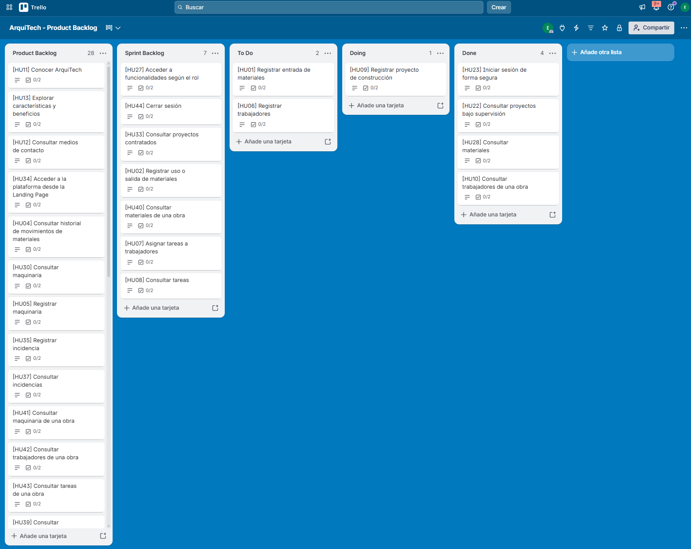

<br>_Nota._ Elaboración propia.

</p>

**Enlace al Product Backlog:**  
[Product Backlog de ArquiTech](https://trello.com/invite/b/6aacb78e51a68075302ced48/ATTIfad677b0a497f17bfc7aac0e8c6a297cB0B7787A/arquitech-product-backlog)

## 3.4. Impact Mapping

**Ampliación propuesta de objetivos SMART para revisión del equipo:** la figura original contiene un objetivo. Los siguientes objetivos adicionales se plantean para completar el diseño; sus valores no son resultados ni acuerdos ya aprobados.

| ID    | Business Goal propuesto                                                                                                                                         | Actor e impacto esperado                                           | Entregable/HU                                       | Medida y comprobación                                                                                |
| ----- | --------------------------------------------------------------------------------------------------------------------------------------------------------------- | ------------------------------------------------------------------ | --------------------------------------------------- | ---------------------------------------------------------------------------------------------------- |
| BG-01 | Reducir 40% el tiempo/esfuerzo de generación y consulta de reportes en seis meses (meta original)                                                               | Supervisor consolida registros; contratante consulta oportunamente | Reportes semanales y selección de obra              | Tiempo mediano antes/después, frecuencia de uso y satisfacción                                       |
| BG-02 | Lograr que al menos 80% de los supervisores del piloto registren entradas/usos el mismo día durante cuatro semanas                                              | Supervisor mantiene inventario actualizado                         | Registro e historial de movimientos; HU01/HU02/HU28 | Días con registro oportuno / días con movimiento × 100; comparar fecha del hecho y fecha de registro |
| BG-03 | Lograr que al menos 80% de los contratantes del piloto consulten sus obras sin asistencia en una sesión de evaluación antes del cierre del siguiente incremento | Contratante encuentra y consulta su obra autónomamente             | Listado/consulta y permisos; HU33/HU40/HU27         | Participantes que completan tarea sin ayuda / participantes que intentan tarea × 100                 |

BG-02 requiere instrumentar el dato de momento del registro si no está disponible; no debe calcularse sustituyéndolo por la fecha del movimiento. BG-03 requiere sesiones con usuarios; ningún porcentaje se presenta como observado. Las propuestas deben trasladarse al mapa editable y aprobarse junto con la priorización del backlog.

El mapa plantea reducir en 40% el tiempo y esfuerzo de generación y consulta de reportes de obra durante los próximos seis meses. Es un objetivo específico y temporal; su medición requiere una línea base y comparación posterior, todavía no aportadas. Los actores son el supervisor y el contratante. Para el supervisor se esperan reportes más frecuentes, evidencia visual y selección correcta de obra; para el contratante, recepción y consulta oportuna de reportes. Los entregables del mapa incluyen formularios de reporte, carga de evidencias, filtro por obra, notificaciones y vista de reportes semanales. Son propuestas de alcance: no se acredita que todas estén implementadas. La cadena objetivo → actor → impacto → entregable → historia debe conservarse al priorizar 3.3 y al evidenciar implementación en 5.2.

Para medir el objetivo se propone registrar el tiempo mediano de generación y consulta antes y después, calcular `(tiempo base - tiempo posterior) / tiempo base × 100`, y complementar con frecuencia de uso y satisfacción. El 40% es una meta, no un resultado del proyecto.

_Impact Mapping de ArquiTech_

<div align="center">

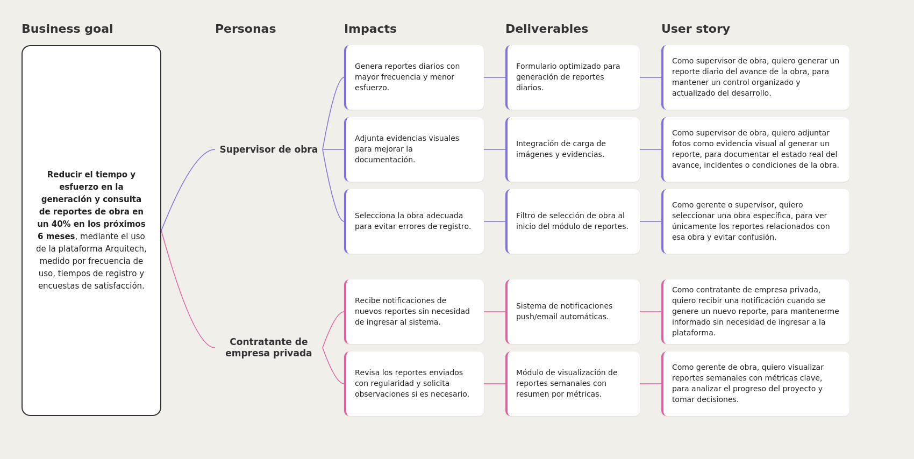

</div>
# Capítulo IV: Product Design

## 4.1. Style Guidelines

<p align="justify">

Esta sección ofrece la estructura que va contener nuestro diseño y los elementos visuales de nuestra aplicación llamada Arquitech. Se presentarán recursos como tipografías del logo y del texto, las paletas de colores que se van a usar en nuestra aplicación y nuestro logo. Todo aquello con el propósito de garantizar una imagen visual coherente y que coincida con el objetivo principal de nuestra startup, que es la de brindar soluciones digitales innovadoras para optimizar la gestión de proyectos de construcción de pequeñas y medianas empresas. Esta sección se divide en General Style Guidelines, Web Style Guidelines y Mobile Style Guidelines y se mostrará la experiencia visual atractiva y accesible que les presentaremos a nuestros usuarios. Es necesario que el diseño sea coherente para facilitar la navegación y mejorar la experiencia del usuario, asegurando la funcionalidad, claridad y alineación con las características que representa Arquitech.

</p>

### 4.1.1. General Style Guidelines

<p align="justify">

Se presentará el diseño conceptual para la landing page como para la aplicación, realizado con el objetivo de lograr una interfaz intuitiva, fácil de usar y mostrar una experiencia estética agradable y cómoda. Se usarán 5 colores, los cuales son el Jet, Sinopia, Fulvous, Selective Yellow y Isabelline. Algunos de estos colores serán usados para el logotipo y para la landing page y la aplicación se alternará entre los 5 colores. Estos colores reflejan nuestra intención de crear un entorno visual digital para mejorar procesos de construcción. A continuación, se detallarán los elementos visuales con mayor precisión.

</p>

<ins> **Branding e ícono:** </ins>

**Figura 35**  
_Logo_

<p align="center">
  
</p>

- Identidad:

  Arquitech representa una fusión entre la construcción tradicional y la innovación tecnológica. La marca proyecta solidez, precisión y modernidad, dirigida a supervisores de obras y contratantes de pequeñas o medianas empresas privadas que valoran la optimización de procesos de las construcciones.

- Paleta de Colores:
  - \#C43508 (Sinopia): Es un color intenso y cálido y transmite fuerza y energía. También refleja estabilidad ya que representa solidez y firmeza.
  - \#DE7F1A (Fulvous): Transmite profundidad, energía y dinamismo.
  - \#FFB627 (Selective yellow): Aporta energía, innovación y enfoque en soluciones.
  - \#F8F5F1 (Isabelline): Sirve para usarlo como fondo ya que aporta neutralidad, elegancia y contraste.
  - \#2F2E2D (Jet): Representa seriedad, profesionalismo y sobriedad.

- Simbolismo:
  - Casco de construcción: Evidencia seguridad, ingeniería y trabajo profesional..
  - Engranaje: Representa tecnología, precisión, procesos y avance constante.
  - El combinar ambos iconos refuerza la idea de una startup que construye con inteligencia y eficiencia e integra lo físico con lo digital para optimizar procesos de construcción.

- Mensaje de la marca:
  - Optimización y eficiencia: Comunica simplicidad y que la startup busca mejorar los procesos constructivos desde la planificación hasta la ejecución, busca eliminar lo innecesario, maximizar recursos y entregar soluciones inteligentes y funcionales.
  - Precisión y confiabilidad: El logo refleja solidez y confianza que Arquitech le brindará a sus clientes. Además, refleja seguridad, calidad y resultados duraderos.
  - Claridad visual y profesionalismo: Representa lo funcional, lo directo y profesional. También, refuerza la idea de una empresa seria, accesible y alineada con las necesidades de la industria actualmente.

- Aplicación del branding:
  - Sitios web (landing page) y app: Interfaz limpia con los colores corporativos, iconos vectoriales y navegación intuitiva.
  - Redes sociales y presentaciones digitales: Plantillas visualmente coherentes con el mensaje de la startup.
  - Identidad visual corporativa: Uso estratégico del logo y la paleta de colores en material gráfico de la startup como las tarjetas de presentación, presentaciones empresariales, o imagen de perfil en aplicaciones de chats para contactar clientes.

<ins> **Tipografía** </ins>

<p align="justify">

La tipografía de Arquitech cumple un importante rol en la expresión de la identidad de nuestra marca y brinda una sensación de claridad visual, calidez, acompañamiento para nuestros usuarios. Nuestra empresa eligió una fuente tipográfica que combina lo amigable y lo fluido, asegurando al usuario comodidad y nitidez en la landing page y en la aplicación.

</p>

- Tipografía del Logo y Títulos:  
  El logo de Arquitech que se eligió comunica claridad con varios valores clave como el profesionalismo y técnica, por lo que se ha utilizado la tipografía Anton Regular que pertenece a la Anton Font Family. Esta tipografía transmite un aspecto fuerte y serio, lo cual es ideal para una empresa de construcción que busca mejorar los procesos de las obras. Además, las letras son altas y gruesas, lo que da buena visibilidad al nombre de la empresa en el logo y en los títulos. Cabe agregar, que tiene un aire moderno, pero sin dejar de ser profesional.

**Figura 36**  
_Tipografía de logo y títulos_

<p align="center">
  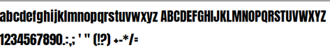
</p>

- Tipografía de Texto Regular:  
  Para el texto de la landing page y la aplicación se ha elegido la tipografía Futura que pertenece a Futura Font Family con el objetivo de que el usuario pueda obtener una cómoda y agradable lectura al visitar nuestras plataformas digitales. Además, esta tipografía representa modernidad, minimalismo, profesionalismo y seriedad. Aquello ayuda a la marca a representar tecnicismo, precisión y avances.

**Figura 37**  
_Tipografía de texto regular_

<p align="center">
  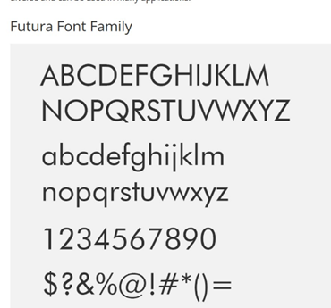
</p>

<ins> **Colores** </ins>  
 Es importante elegir los colores para las plataformas digitales adecuadamente, ya que así se asegura que la experiencia del usuario sea placentera y agradable. Por ello, nos aseguramos que la paleta de colores seleccionada de Arquitech refleje la esencia de la startup en la landing page y en nuestra aplicación.

_Nota_. Elaboración propia.

**Figura 38**  
_Paleta de colores de ArquiTech_

<p align="center">
  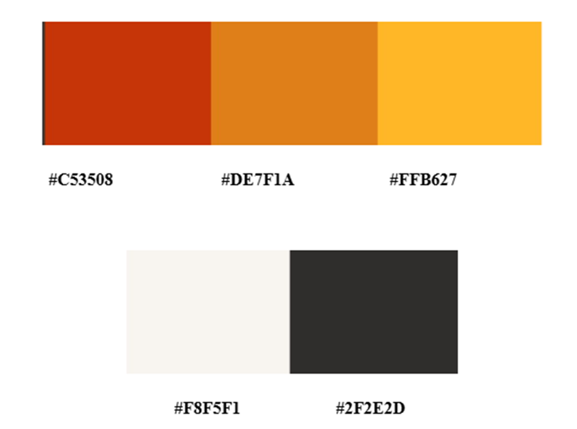
</p>

<ins>**Espaciado**</ins>

- Interlineado: 140%-160% para que los textos sean legibles.
- Padding en botones: Mínimo 12px vertical x 24px horizontal para accesibilidad táctil a nuestros usuarios.
- Margen entre secciones: 34px-64px para mantener un aire visual a los usuarios.
- Grid base: Utilizar un grid de 8px para dar consistencia.

<p align="justify">

Esto transmite un espaciado limpio y estructurado, ya que se aprecia un orden, claridad y refleja la misión de Arquitech de optimizar procesos, pero en lo visual.

</p>

<ins>**Tono de Comunicación y Lenguaje Aplicado**</ins>

- El tono de Arquitech es profesional, preciso, eficiente, tecnológico y accesible y confiable, diseñado para generar confianza, demostrando experiencia en el rubro de la construcción sin recurrir a un lenguaje complicado o inaccesible para nuestros usuarios.
- Arquitech acompaña a los clientes desde el inicio hasta el final del proceso constructivo, comunicando con claridad cómo la innovación tecnológica y la eficiencia operativa pueden realizar la diferencia en cada obra.
- El lenguaje se mantiene preciso y funcional, priorizando la acción. Se evita el exceso de tecnicismos y apuesta por una forma de comunicar que cualquiera dentro del sector pueda entender con facilidad.
- El estilo comunicativo está alineado con los principios de Arquitech que es innovar, optimizar y liderar.

### 4.1.2. Web Style Guidelines

<p align="justify">

En esta sección, para nuestra aplicación de Arquitech, se ha decidido colocar como fuente SF Pro Display y Poppins. Consideramos que estas fuentes son atractivas e ideales para títulos, encabezados y contenido de texto en cada sección, ya que brinda un estilo claro, moderno y profesional. Además, se ha usado la fuente Inter Regular para los botones, ya que está específicamente diseñada para interfaces digitales. Inter Regular posee un diseño limpio y permite una lectura rápida y concisa, lo cual es vital para elementos interactivos como los botones.  
Los colores que hemos usado para Arquitech, son los mismos anteriormente mencionados. Se ha usado aquellos colores alternándose en cada sección de contenido para ofrecer a nuestros usuarios una experiencia visual agradable y alineada. Se usó el color Isabelline (\#F8F5F1) para el fondo ya que transmite una sensación de calidez, limpieza y simplicidad, lo que permite que los elementos visuales y los textos puedan destacar sin generar distracción. También, se usó el color Jet (\#2F2E2D) en los iconos de botones de agregar para que se pueda resaltar aquellas opciones con mayor facilidad. Para los botones de registrar o que tienen la finalidad de guardar información se le colocó el color Green Pigment (\#2BBA51), ya que es un color que se suele usar para elementos que necesitan llamar la atención, dinamismo y resalta visualmente sobre fondos claros como el nuestro que usamos el color Isabelline.

</p>

<p align="justify">

La interfaz de Arquitech debe ser responsiva y se debe adaptar a diversos tamaños de pantalla a través de un diseño flexible. Por esta razón es importante saber el tamaño de la pantalla que vamos a utilizar y ajustar aquello en otros dispositivos.

</p>
Medidas para Web Responsive:  
Monitor pequeño: 1296x1781px

**Figura 39**

<p align="center">
  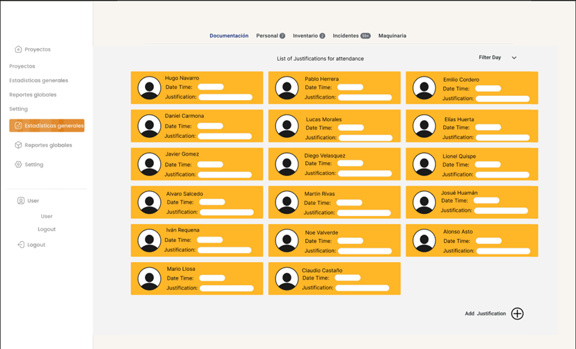
</p>

**Figura 40**

<p align="center">
  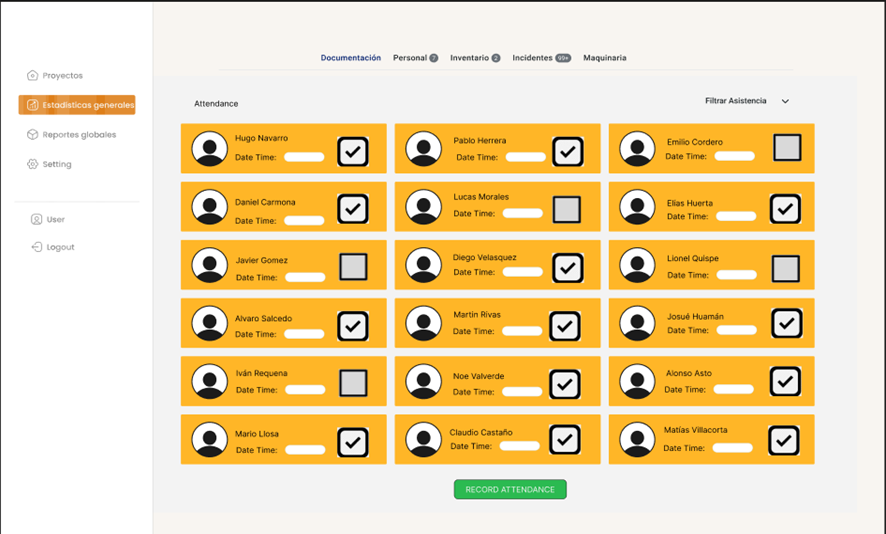
</p>

**Figura 41**

<p align="center">
  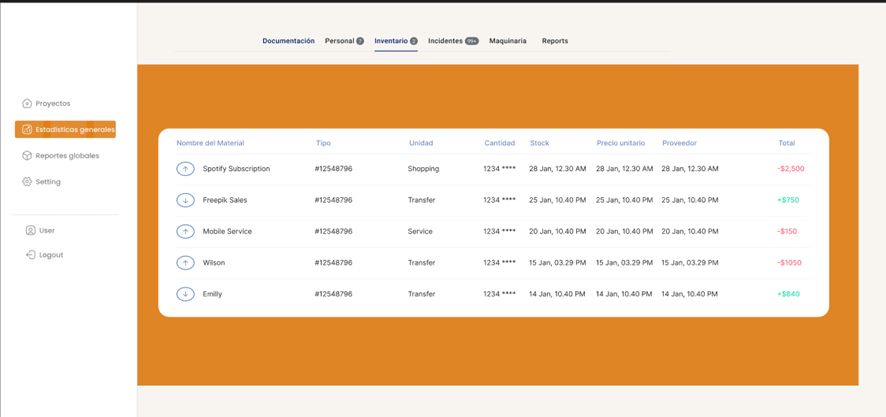
</p>
 
### 4.1.3. Mobile Style Guidelines

<p align="justify">

Esta sección define los lineamientos visuales y de interacción que deberá seguir la versión móvil de Arquitech, tanto en iOS como en Android. Dado que nuestros usuarios principales (supervisores de obra) suelen operar la aplicación directamente en campo, muchas veces con conectividad limitada, bajo luz solar directa o mientras usan guantes de trabajo, el diseño móvil prioriza elementos táctiles grandes, alto contraste y flujos simples de una sola mano. Se mantiene la identidad visual ya definida para Arquitech (paleta de colores, logotipo y tono de comunicación), adaptando la tipografía, el espaciado y los componentes de interfaz a las convenciones nativas de cada plataforma, con el objetivo de que la aplicación se sienta familiar y fluida para el usuario sin importar su sistema operativo.

</p>

<p align="justify">

Se mantiene la misma paleta de colores de marca (Sinopia \#C43508, Fulvous \#DE7F1A, Selective Yellow \#FFB627, Isabelline \#F8F5F1 y Jet \#2F2E2D), así como el color Green Pigment (\#2BBA51) para acciones de confirmación y guardado, garantizando consistencia visual entre la web y las aplicaciones móviles.

</p>

#### 4.1.3.1. iOS Mobile Style Guidelines

<p align="justify">

La versión iOS de Arquitech sigue las recomendaciones de las Apple Human Interface Guidelines (HIG), priorizando la claridad, la jerarquía visual y el uso de componentes nativos del sistema.

</p>

- Tipografía:  
  Se utiliza San Francisco (SF Pro Text / SF Pro Display), la tipografía del sistema de iOS, con soporte de Dynamic Type para que el usuario pueda ajustar el tamaño del texto desde la configuración de su dispositivo sin romper el diseño.

- Íconos:  
  Se emplean SF Symbols para los íconos de navegación y acciones, asegurando consistencia con el resto del ecosistema iOS y compatibilidad automática con distintos pesos y tamaños de texto.

- Áreas táctiles:  
  Todo elemento interactivo (botones, íconos, celdas de lista) respeta un tamaño mínimo de 44x44 pt, conforme a los estándares de accesibilidad táctil de Apple.

- Navegación:  
  Se utiliza un Tab Bar inferior para las secciones principales (Inicio, Reportes, Materiales, Perfil) y una Navigation Bar superior con títulos grandes (Large Titles) para reforzar la jerarquía dentro de cada sección.

- Modo claro y oscuro:  
  La interfaz soporta Light Mode y Dark Mode de forma nativa, adaptando el color Isabelline (\#F8F5F1) como fondo en modo claro y el color Jet (\#2F2E2D) como fondo en modo oscuro, sin perder el contraste de los colores de marca.

- Safe Areas y márgenes:  
  Se respetan los Safe Area Insets definidos por iOS para evitar que el contenido quede oculto detrás del notch, la Dynamic Island o la barra de gestos inferior.

- Gestos:  
  Se habilitan gestos nativos como el swipe-back para retroceder entre pantallas y el pull-to-refresh para actualizar reportes y listados.

#### 4.1.3.2. Android Mobile Style Guidelines

<p align="justify">

La versión Android de Arquitech se basa en los lineamientos de Material Design 3 (Material You) de Google, adaptados a la paleta de colores de la marca.

</p>

- Tipografía:  
  Se utiliza Roboto como tipografía principal del sistema, siguiendo la escala tipográfica de Material Design para títulos, subtítulos y cuerpo de texto.

- Sistema de color Material:  
  Los colores de marca se mapean a los tokens del sistema Material (primary, secondary, surface, background), utilizando Sinopia (\#C43508) como color primario, Fulvous (\#DE7F1A) como color secundario e Isabelline (\#F8F5F1) como superficie base, manteniendo el contraste mínimo exigido por las pautas de accesibilidad de Material Design.

- Áreas táctiles:  
  Todo elemento interactivo respeta un tamaño mínimo de 48x48 dp, conforme a los estándares de accesibilidad táctil de Android.

- Navegación:  
  Se utiliza una Bottom Navigation Bar para las secciones principales de la aplicación y un Navigation Drawer lateral para opciones secundarias (configuración, ayuda, cierre de sesión).

- Elevación y feedback visual:  
  Los componentes utilizan sombras (elevation) para indicar jerarquía entre superficies, y se aplica el efecto ripple en botones e íconos para dar retroalimentación táctil inmediata al usuario.

- Botón de acción flotante (FAB):  
  Se utiliza un Floating Action Button con el color Green Pigment (\#2BBA51) para la acción principal de cada pantalla, como "Nuevo reporte" o "Registrar asistencia".

- Íconos adaptativos:  
  Se emplean adaptive icons para el ícono de la aplicación, asegurando que se vea correctamente en las distintas formas de ícono (círculo, cuadrado, squircle) según el fabricante del dispositivo Android.

- Botón de retroceso del sistema:  
  La navegación respeta el comportamiento nativo del botón de retroceso (back) del sistema operativo, tanto físico como gestual, para mantener la coherencia con el resto de aplicaciones Android.

## 4.2. Information Architecture

### 4.2.1. Organization Systems

<p align="justify">

En la arquitectura de información de Arquitech, se aplican distintos sistemas de organización para estructurar el contenido de manera clara y funcional, adaptada al contexto de los usuarios del sector construcción.

</p>

<ins> **Organización Visual del Contenido** </ins>

1.  Jerárquica (Visual Hierarchy):

        Se aplica principalmente en la vista general del dashboard, donde la información más importante y urgente se muestra primero (como reportes recientes, alertas de bajo inventario y resumen de avances).

    Esta jerarquía ayuda a que el usuario enfoque su atención en lo prioritario al momento de ingresar.

2.  Secuencial (Step-by-Step):

    Se utiliza en procesos como la generación de reportes diarios, donde se guía al usuario paso a paso:
    - Selección de obra

    - Registro de asistencia

    - Registro de materiales utilizados

    - Observaciones finales

    - Adjuntar evidencias

    Esto evita errores y facilita la curva de aprendizaje.

3.  Matricial:

    Se emplea para la vista comparativa de reportes semanales, permitiendo ver columnas con distintas métricas (avance físico, asistencia, materiales) por cada día, en una tabla ordenada que el usuario puede leer horizontal y verticalmente.

<ins> **Esquemas de Categorización del Contenido** </ins>

1. Por tópicos:

   Toda la plataforma está organizada por módulos funcionales:
   - Gestión de personal

   - Control de materiales

   - Reportes

   - Configuración de perfil

   Esto facilita al usuario identificar rápidamente dónde realizar cada acción.

2. Cronológico:

   En los módulos de reportes y asistencia, los datos se organizan por fecha para reflejar la progresión temporal de la obra.

3. Alfabético:

   Utilizado en listas de trabajadores, maquinaria o materiales para facilitar la búsqueda rápida y ordenada.

4. Por audiencia:
   - Los contratantes solo pueden ver y recibir reportes.

   - Los supervisores pueden generar y editar.

   - Los administrativos tienen permisos de configuración y visualización más avanzada.

   Esto mejora la experiencia personalizada según el rol.

### 4.2.2. Labeling Systems

<p align="justify">

En Arquitech, se ha diseñado un sistema de etiquetado simple y funcional para evitar la sobrecarga cognitiva y facilitar la comprensión inmediata de la interfaz.

</p>

- Principios utilizados:
  - Simplicidad y claridad:

    Se prioriza el uso de palabras clave cortas y comunes en obra (ej. "Reporte diario", "Materiales", "Asistencia", "Obreros", "Avance", "Notificaciones").

  - Evitar ambigüedad:

    Se evita el uso de términos técnicos complejos o jerga poco conocida. Por ejemplo, se prefiere "Registro de materiales" en lugar de "Logística de recursos".

  - Consistencia visual:

    Las etiquetas mantienen estilo uniforme en botones, menús y formularios, para que el usuario no dude sobre el significado de cada elemento.

  - Asociaciones entre etiquetas:
    - “Reporte” siempre se relaciona con acciones como “Generar”, “Visualizar”, “Descargar”, “Compartir”.
    - “Materiales” se relaciona con “Entrada”, “Salida”, “Inventario”.
    - “Obreros” se relaciona con “Asistencia”, “Tareas”, “Evaluación”.

### 4.2.3. SEO Tags and Meta Tags

<p align="justify">

En esta sección se presentan los meta tags y los SEO tags utilizados en la Landing Page de ArquiTech. Su propósito es que los motores de búsqueda indexen correctamente el sitio y que, al compartir el enlace por redes sociales o mensajería, se muestre una vista previa clara con el nombre, la descripción y el logo de la startup. El contenido de las etiquetas comunica la propuesta de valor del producto, que es la gestión y el seguimiento digital de obras de construcción para pequeñas y medianas empresas, y utiliza el vocabulario definido en el Ubiquitous Language y en los sistemas de etiquetado de la sección 4.2.2, de modo que los términos que encuentra el usuario en el buscador sean los mismos que verá dentro de la plataforma.

</p>

<ins>**Criterios aplicados**</ins>

- Título descriptivo: incluye el nombre de la marca y la propuesta de valor en menos de 60 caracteres, para que no se corte en los resultados de búsqueda.
- Descripción orientada al usuario: resume en una sola frase qué resuelve ArquiTech y a quién está dirigido, dentro del límite recomendado de 160 caracteres.
- Palabras clave del dominio: se emplean los términos que los segmentos objetivo utilizan realmente, como gestión de obras, control de inventario, asistencia de personal, avance e incidencias.
- Open Graph y Twitter Card: garantizan que el enlace compartido con contratantes o supervisores muestre título, descripción e imagen de marca.
- Idioma y localización: se declara el español y la localización es_PE, coherente con el alcance del proyecto en Lima Metropolitana.

<ins>**Implementación**</ins>

```html
<!DOCTYPE html>
<html lang="es">
  <head>
    <meta charset="UTF-8" />
    <meta name="viewport" content="width=device-width, initial-scale=1.0" />

    <title>ArquiTech | Gestión y seguimiento digital de obras</title>

    <meta
      name="description"
      content="ArquiTech centraliza materiales, personal, avance e incidencias de cada obra. Registro en campo para supervisores y seguimiento con reportes para contratantes."
    />
    <meta
      name="keywords"
      content="ArquiTech, Foundex, gestión de obras, software de construcción, control de inventario de obra, registro de asistencia, seguimiento de avance, reportes de obra, incidencias en obra, PYMES constructoras, Lima, Perú"
    />
    <meta name="author" content="Equipo Foundex" />
    <meta name="robots" content="index, follow" />
    <link
      rel="canonical"
      href="https://osfoundex.github.io/ArquiTech_LandingPage/"
    />

    <meta
      property="og:title"
      content="ArquiTech | Gestión y seguimiento digital de obras"
    />
    <meta
      property="og:description"
      content="Una sola fuente de información para cada obra: materiales, trabajadores, asistencia, avance e incidencias, con reportes y trazabilidad para el contratante."
    />
    <meta
      property="og:image"
      content="https://osfoundex.github.io/ArquiTech_LandingPage/assets/images/logo.png"
    />
    <meta
      property="og:url"
      content="https://osfoundex.github.io/ArquiTech_LandingPage/"
    />
    <meta property="og:type" content="website" />
    <meta property="og:site_name" content="ArquiTech" />
    <meta property="og:locale" content="es_PE" />

    <meta name="twitter:card" content="summary_large_image" />
    <meta
      name="twitter:title"
      content="ArquiTech | Gestión y seguimiento digital de obras"
    />
    <meta
      name="twitter:description"
      content="Plataforma de Foundex para controlar materiales, asistencia, avance e incidencias de obra desde el celular, con reportes en línea para el contratante."
    />
    <meta
      name="twitter:image"
      content="https://osfoundex.github.io/ArquiTech_LandingPage/assets/images/logo.png"
    />

    <link rel="icon" href="assets/images/logo.png" type="image/x-icon" />
    <link rel="stylesheet" href="style.css" />
  </head>
</html>
```

<br>_Nota._ Elaboración propia. Las URLs absolutas corresponden al despliegue de la Landing Page en GitHub Pages, indicado en la sección 5.2.2.

<p align="justify">

De forma complementaria, la estructura semántica de la Landing Page acompaña a estas etiquetas: se utiliza un único encabezado de primer nivel con el nombre y la propuesta de valor del producto, encabezados de segundo nivel para las secciones de funcionalidades, segmentos y contacto, y texto alternativo descriptivo en cada imagen. Esta jerarquía es la misma que sostiene la navegación lineal con anclas descrita en la sección 4.2.5, por lo que la organización del contenido resulta comprensible tanto para el usuario como para los motores de búsqueda.

</p>

### 4.2.4. Searching Systems

<p align="justify">

Dentro de la plataforma ArquiTech, los sistemas de búsqueda han sido diseñados para facilitar el acceso rápido y eficiente a información crítica relacionada con la gestión de obras. La aplicación contempla un volumen significativo de datos relacionados con proyectos, documentos técnicos, solicitudes, trabajadores, insumos y cronogramas. Por ello, se proyecta la implementación de un sistema de búsqueda integral que ayude a los usuarios a evitar pérdidas de tiempo y a mantener el control operativo en todo momento.

</p>

<p align="justify">

El sistema permitirá a los usuarios buscar información dentro de los distintos módulos del sistema, utilizando:

</p>

- Palabras clave (términos técnicos, nombres de obra, actividades específicas, materiales).
- Filtros por categoría (tipo de documento, fase del proyecto, tipo de solicitud, tipo de personal).
- Rangos de fechas (fecha de emisión, entrega, modificación o supervisión).
- Códigos internos asignados a solicitudes, órdenes de servicio, contratistas o áreas constructivas.

<p align="justify">

Este sistema será particularmente útil para:

</p>

- Ahorrar tiempo en la localización de documentos, reportes o actividades específicas, sin necesidad de navegar por múltiples módulos manualmente.
- Encontrar rápidamente registros relacionados con avances de obra, observaciones, solicitudes de materiales o incidencias.
- Apoyar la toma de decisiones sobre ejecución, control de calidad o cumplimiento de cronogramas mediante el acceso inmediato a la información registrada.

<p align="justify">

Una vez realizada una búsqueda, los resultados se presentarán de forma estructurada en tablas o tarjetas, con opciones para visualizar, editar o exportar la información según los permisos del usuario.

</p>

### 4.2.5. Navigation Systems

<p align="justify">

Los sistemas de navegación implementados en el proyecto ArquiTech han sido diseñados para garantizar una experiencia intuitiva, fluida y orientada a la consecución de objetivos por parte del usuario. Considerando que el público objetivo está conformado principalmente por supervisores de obra, contratistas y personal administrativo de empresas constructoras, se ha priorizado una arquitectura de navegación clara, jerárquica y adaptada al flujo natural de las actividades constructivas.

</p>

<ins>**En la Landing Page**</ins>

<p align="justify">

La navegación en la landing page tiene una estructura lineal con anclajes internos y botones de acción, facilitando la exploración informativa en orden lógico. Las acciones de navegación se guían mediante:

</p>

- Un menú fijo en la parte superior con enlaces directos a secciones como: “¿Qué es ArquiTech?”, “Beneficios”, “Funcionalidades”, “Casos de uso” y “Contacto”.
- Botones con anclas que desplazan suavemente al usuario dentro de la misma página, sin recarga.
- Llamados a la acción (“Conoce la plataforma”, “Solicita una demo”) que direccionan al formulario de contacto o a secciones específicas de interés.

<p align="justify">

Este diseño permite que los visitantes comprendan rápidamente el propósito de la solución y se dirijan con claridad hacia la acción deseada.

</p>

## 4.3. Landing Page UI Design

<div style="text-align: justify;">

<p align="justify">

La propuesta de interfaz de usuario del Landing Page de ArquiTech fue desarrollada tomando como base las decisiones establecidas previamente en los lineamientos visuales y en la arquitectura de información. La organización del contenido busca comunicar de manera clara la propuesta de valor de la plataforma, presentar sus principales funcionalidades y facilitar la navegación de los usuarios.

</p>

<p align="justify">

El diseño considera una estructura visual jerárquica, una distribución ordenada de la información y una navegación sencilla, permitiendo que los usuarios comprendan rápidamente qué es ArquiTech, qué beneficios ofrece y cuáles son las principales acciones disponibles dentro del Landing Page.

</p>

<p align="justify">

Asimismo, se mantiene coherencia con la identidad visual definida para el producto mediante el uso consistente de tipografías, componentes, espaciados, elementos gráficos y criterios de diseño responsive, buscando ofrecer una experiencia clara tanto en dispositivos de escritorio como en dispositivos móviles.

</p>

</div>

### 4.3.1. Landing Page Wireframe

Se presentan versiones desktop y mobile de la misma estructura informativa. La versión desktop aprovecha el ancho para organizar navegación y contenido; la móvil debe mantener el orden de lectura y acciones accesibles en menor espacio. Los wireframes expresan jerarquía y distribución; los mock-ups incorporan identidad visual de 4.1. La revisión del diseño debe comprobar legibilidad, contraste, consistencia y acceso a las acciones principales en ambas versiones. La implementación actual de idioma, navegación accesible y términos se verifica por código en 5.2.2; las imágenes de diseño por sí solas no prueban accesibilidad funcional.

**Desktop Web Browser**

<p align="center">
  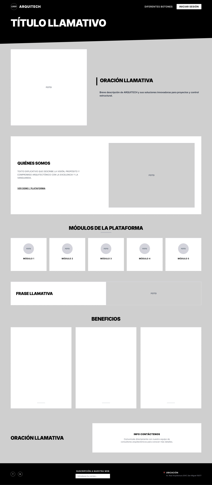
</p>

**Mobile Web Browser**

<p align="center">
  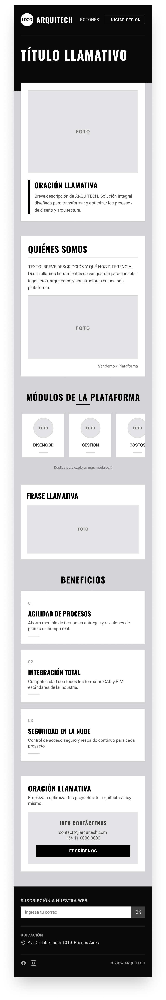
</p>

### 4.3.2. Landing Page Mock-up

Se presentan versiones desktop y mobile de la misma estructura informativa. La versión desktop aprovecha el ancho para organizar navegación y contenido; la móvil debe mantener el orden de lectura y acciones accesibles en menor espacio. Los wireframes expresan jerarquía y distribución; los mock-ups incorporan identidad visual de 4.1. La revisión del diseño debe comprobar legibilidad, contraste, consistencia y acceso a las acciones principales en ambas versiones. La implementación actual de idioma, navegación accesible y términos se verifica por código en 5.2.2; las imágenes de diseño por sí solas no prueban accesibilidad funcional.

**Desktop Web Browser**

<p align="center">
  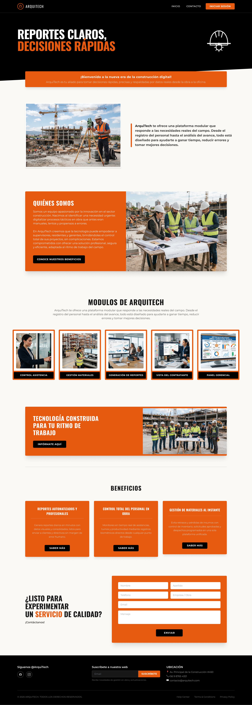
</p>

**Mobile Web Browser**

<p align="center">
  
</p>

## 4.4. Mobile Applications UX/UI Design

### 4.4.1. Mobile Applications Wireframes

| Pantalla  | Objetivo, información y criterio de interacción                                                                                                                              |
| --------- | ---------------------------------------------------------------------------------------------------------------------------------------------------------------------------- |
| Login     | Identificar al usuario y establecer sesión; mostrar validaciones y rechazar credenciales inválidas sin conceder acceso (HU23).                                               |
| Projects  | Consultar y seleccionar una obra; conservar el proyecto seleccionado al navegar y limitar consultas según el rol (HU22/HU33/HU27).                                           |
| Materials | Consultar stock y recursos de la obra; el supervisor administra entradas/usos y el contratante consulta; distinguir cantidad disponible de movimiento (HU01/HU02/HU28/HU40). |
| Workers   | Consultar personal y, para el supervisor, registrar trabajadores; mostrar identificación y estado sin perder contexto de obra (HU06/HU10).                                   |
| Incidents | Registrar/consultar incidencias y su estado; distinguir severidad y resolución y confirmar cambios del supervisor.                                                           |
| Machinery | Consultar equipos de la obra y su estado; restringir acciones de escritura según rol y mostrar datos de identificación.                                                      |

Los wireframes definen estructura y jerarquía; los mock-ups incorporan tipografía, color y espaciado del Design System. El estado de datos, errores y permisos se verifica en producto y pruebas: no se infiere solo por la apariencia de una figura.

Las seis pantallas presentadas cubren Login, Projects, Materials, Workers, Incidents y Machinery. Login inicia el acceso; Projects permite seleccionar el contexto de obra; Materials organiza inventario; Workers presenta personal; Incidents permite consultar acontecimientos; Machinery organiza los equipos. La separación por proyecto mantiene el contexto al navegar entre recursos. Cada formulario debe mostrar validaciones y resultado de la operación, y cada listado debe contemplar búsqueda, estado vacío y errores. Los controles de escritura dependen del rol. Estas condiciones son criterios de revisión del diseño y deben comprobarse en el producto y las pruebas, no inferirse solamente de las figuras.

**Figura 42**  
_Mobile Wireframe Login_

<p align="center">

  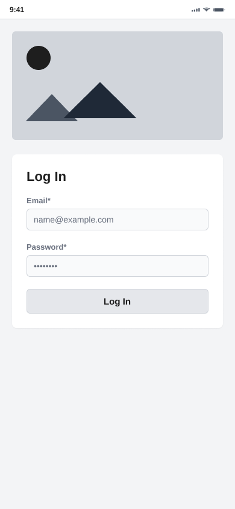

<br>_Nota._ Elaboración propia.

</p>

**Figura 43**  
_Mobile Wireframe Projects_

<p align="center">

  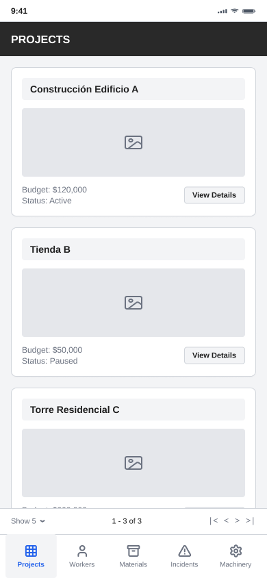

<br>_Nota._ Elaboración propia.

</p>

**Figura 44**  
_Mobile Wireframe Workers_

<p align="center">

  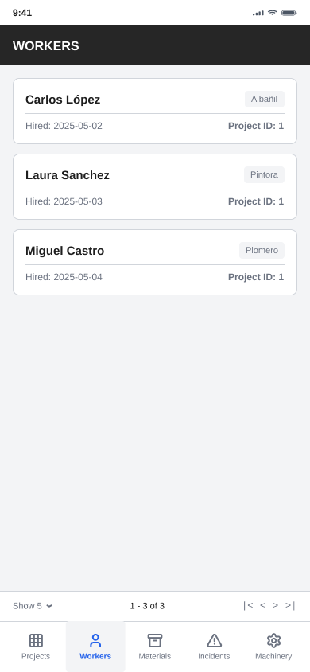

<br>_Nota._ Elaboración propia.

</p>

**Figura 45**  
_Mobile Wireframe Materials_

<p align="center">

  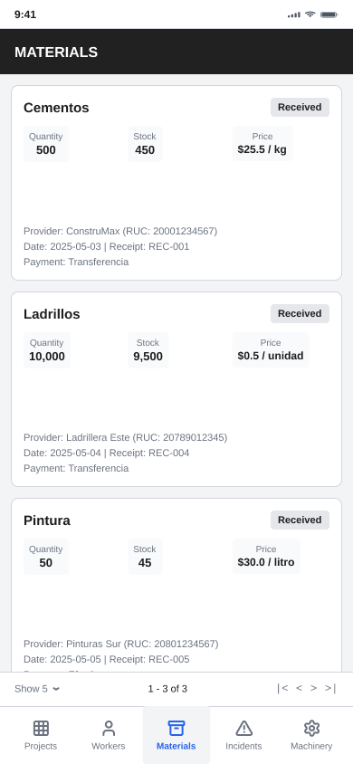

<br>_Nota._ Elaboración propia.

</p>

**Figura 46**  
_Mobile Wireframe Incidents_

<p align="center">

  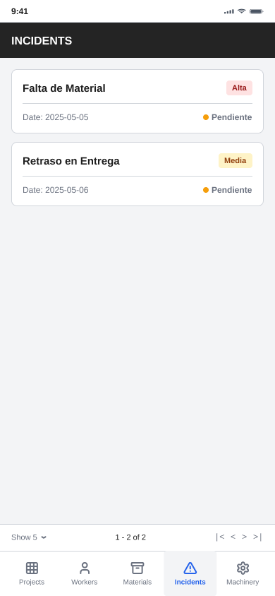

<br>_Nota._ Elaboración propia.

</p>

**Figura 47**  
_Mobile Wireframe Machinery_

<p align="center">

  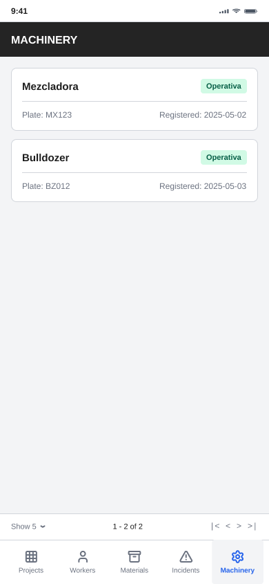

<br>_Nota._ Elaboración propia.

</p>

### 4.4.2. Mobile Applications Wireflow Diagrams

**Segmento #2: Contratantes de empresas privadas**

**User Goal 1: Supervisión de materiales y personal de obra**

<p align="justify">

Como usuario, quiero poder visualizar desde la aplicación móvil la lista de proyectos que posee mi empresa junto con la información de materiales y trabajadores asociados, para mantener un mejor control y supervisión de los recursos y del personal de cada obra.

</p>

**Wireflow:**

**Figura 48**

<p align="center">

  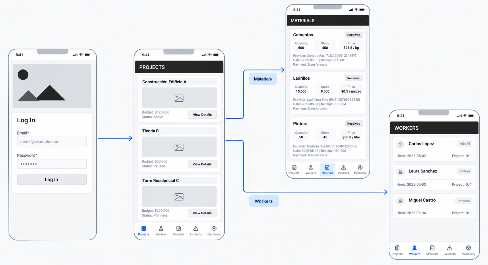

<br>_Nota._ Elaboración propia.

</p>

<p align="justify">

Para obtener la información de materiales y trabajadores que brinda ArquiTech desde la aplicación móvil, el usuario debe acceder primero mediante la pantalla de inicio de sesión. Luego, puede visualizar la lista de proyectos asociados a su empresa desde la pantalla principal de proyectos. A partir de esta vista, el usuario puede dirigirse a la sección de materiales, donde se muestran datos como la cantidad registrada, el stock disponible, el precio y el proveedor. Del mismo modo, puede acceder a la sección de trabajadores, donde se presenta información como el nombre del trabajador, su rol, la fecha de contratación y el proyecto al que se encuentra asociado.

</p>

**Segmento #1: Supervisores de obra**

**User Goal 1: Gestión de maquinarias e incidentes**

<p align="justify">

Como usuario, quiero consultar desde la aplicación móvil las maquinarias utilizadas en los proyectos y los incidentes registrados durante la ejecución de las obras, para mantener una visión general sobre la disponibilidad de los equipos y las situaciones que pueden afectar la seguridad y el desarrollo del proyecto.

</p>

**Wireflow:**

**Figura 49**

<p align="center">

  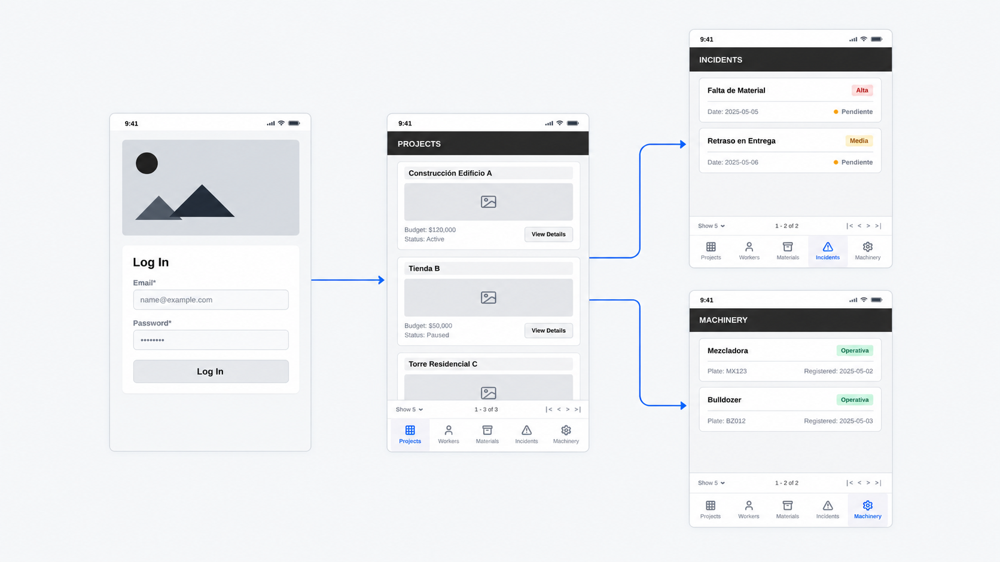

<br>_Nota._ Elaboración propia.

</p>

<p align="justify">

Para acceder a las secciones de maquinarias e incidentes desde la aplicación móvil, el supervisor debe iniciar sesión y acceder a la pantalla principal de proyectos. Desde esta vista, puede dirigirse a la sección de incidentes para consultar información como la fecha en la que ocurrió cada evento, su tipo, nivel de severidad y estado de resolución. Asimismo, puede acceder a la sección de maquinaria para visualizar los equipos registrados, incluyendo datos como el nombre de la maquinaria, su licencia o placa, la fecha de registro y su estado de funcionamiento.

</p>

### 4.4.3. Mobile Applications Mock-ups

| Pantalla  | Objetivo, información y criterio de interacción                                                                                                                              |
| --------- | ---------------------------------------------------------------------------------------------------------------------------------------------------------------------------- |
| Login     | Identificar al usuario y establecer sesión; mostrar validaciones y rechazar credenciales inválidas sin conceder acceso (HU23).                                               |
| Projects  | Consultar y seleccionar una obra; conservar el proyecto seleccionado al navegar y limitar consultas según el rol (HU22/HU33/HU27).                                           |
| Materials | Consultar stock y recursos de la obra; el supervisor administra entradas/usos y el contratante consulta; distinguir cantidad disponible de movimiento (HU01/HU02/HU28/HU40). |
| Workers   | Consultar personal y, para el supervisor, registrar trabajadores; mostrar identificación y estado sin perder contexto de obra (HU06/HU10).                                   |
| Incidents | Registrar/consultar incidencias y su estado; distinguir severidad y resolución y confirmar cambios del supervisor.                                                           |
| Machinery | Consultar equipos de la obra y su estado; restringir acciones de escritura según rol y mostrar datos de identificación.                                                      |

Los wireframes definen estructura y jerarquía; los mock-ups incorporan tipografía, color y espaciado del Design System. El estado de datos, errores y permisos se verifica en producto y pruebas: no se infiere solo por la apariencia de una figura.

Las seis pantallas presentadas cubren Login, Projects, Materials, Workers, Incidents y Machinery. Login inicia el acceso; Projects permite seleccionar el contexto de obra; Materials organiza inventario; Workers presenta personal; Incidents permite consultar acontecimientos; Machinery organiza los equipos. La separación por proyecto mantiene el contexto al navegar entre recursos. Cada formulario debe mostrar validaciones y resultado de la operación, y cada listado debe contemplar búsqueda, estado vacío y errores. Los controles de escritura dependen del rol. Estas condiciones son criterios de revisión del diseño y deben comprobarse en el producto y las pruebas, no inferirse solamente de las figuras.

**Figura 50**  
_Mobile Mock-up Login_

<p align="center">

  

<br>_Nota._ Elaboración propia.

</p>

**Figura 51**  
_Mobile Mock-up Projects_

<p align="center">

  

<br>_Nota._ Elaboración propia.

</p>

**Figura 52**  
_Mobile Mock-up Workers_

<p align="center">

  

<br>_Nota._ Elaboración propia.

</p>

**Figura 53**  
_Mobile Mock-up Materials_

<p align="center">

  

<br>_Nota._ Elaboración propia.

</p>

**Figura 54**  
_Mobile Mock-up Incidents_

<p align="center">

  

<br>_Nota._ Elaboración propia.

</p>

**Figura 55**  
_Mobile Mock-up Machinery_

<p align="center">

  

<br>_Nota._ Elaboración propia.

</p>

### 4.4.4. Mobile Applications User Flow Diagrams

**Segmento 1: Supervisores de obra**

**User Goal 1:** Gestionar y controlar materiales de construcción  
**Descripción:** El supervisor desea consultar y controlar desde la aplicación móvil la disponibilidad, stock y demás información de los materiales asociados a una obra para mantener un mejor control de los recursos utilizados durante el desarrollo del proyecto.

**Figura 56**  
_Mobile User Flow 1_

<p align="center">

  

<br>_Nota._ Elaboración propia.

</p>

**User Goal 2:** Controlar la asistencia y roles de los trabajadores  
**Descripción:** El supervisor necesita consultar y gestionar desde la aplicación móvil la información de los trabajadores asignados a la obra, incluyendo sus roles, asistencia, tareas y responsabilidades dentro del proyecto.

**Figura 57**  
_Mobile User Flow 2_

<p align="center">

  

<br>_Nota._ Elaboración propia.

</p>

**User Goal 3:** Consultar incidencias en obra  
**Descripción:** El supervisor desea consultar desde la aplicación móvil los incidentes registrados durante la ejecución de la obra para conocer su tipo, fecha, nivel de severidad y estado de resolución.

**Figura 58**  
_Mobile User Flow 3_

<p align="center">

  

<br>_Nota._ Elaboración propia.

</p>

**Segmento Objetivo #2: Contratantes de Empresas Privadas**

**User Goal 1:** Visualizar el estado y progreso de mis obras contratadas (solo lectura)  
**Descripción:** El contratante necesita consultar desde la aplicación móvil las obras asociadas a su empresa, con acceso a información clara y actualizada sobre el estado general de cada proyecto.

**Figura 59**  
_Mobile User Flow 4_

<p align="center">

  

<br>_Nota._ Elaboración propia.

</p>

**User Goal 2:** Visualizar el uso y estado de la maquinaria asignada a la obra  
**Descripción:** El contratante desea consultar desde la aplicación móvil las maquinarias asociadas a sus obras para conocer los equipos disponibles, su identificación, fecha de registro y estado operativo.

**Figura 60**  
_Mobile User Flow 5_

<p align="center">

  

<br>_Nota._ Elaboración propia.

</p>

**User Goal 3:** Ver detalles del consumo y disponibilidad de materiales (solo lectura)  
**Descripción:** El contratante desea consultar desde la aplicación móvil la información de los materiales asociados a las obras para evaluar la cantidad registrada, el stock disponible, los proveedores y el uso de los recursos del proyecto.

**Figura 61**  
_Mobile User Flow 6_

<p align="center">

  

<br>_Nota._ Elaboración propia.

</p>

### 4.5. Mobile Applications Prototyping

<div style="text-align: justify;">
<p align="justify">

En esta sección se presentan los prototipos de alta fidelidad para la aplicación móvil de ArquiTech. Estos diseños reflejan la interfaz de usuario (UI) y la experiencia de usuario (UX) proyectada para ser la herramienta principal de los supervisores de obra. Se ha mantenido la identidad visual de la marca (colores corporativos e iconografía) y se han adaptado los componentes visuales para operar de manera nativa y fluida en los dos ecosistemas móviles predominantes: Android e iOS.

</p>
</div>

#### 4.5.1. Android Mobile Applications Prototyping

<div style="text-align: justify;">
<p align="justify">

El prototipo para el sistema operativo Android ha sido estructurado tomando como referencia los lineamientos de diseño de <em>Material Design</em>. Se prioriza una navegación ágil mediante un <em>Bottom Navigation Bar</em>, permitiendo al usuario acceder de manera intuitiva a la gestión de Proyectos, Trabajadores, Materiales, Incidentes y Maquinaria, adaptándose a las resoluciones estándar de los dispositivos Android en campo.

</p>
</div>

<br>

- **Enlace a la demostración del prototipo (Android):** [https://upcedupe-my.sharepoint.com/:v:/g/personal/u202411567_upc_edu_pe/IQBpi1MmgSweSpgQaaibmtjpAeptaXy8xzyXBnw7krQtGiQ?e=l46fti&nav=eyJyZWZlcnJhbEluZm8iOnsicmVmZXJyYWxBcHAiOiJTdHJlYW1XZWJBcHAiLCJyZWZlcnJhbFZpZXciOiJTaGFyZURpYWxvZy1MaW5rIiwicmVmZXJyYWxBcHBQbGF0Zm9ybSI6IldlYiIsInJlZmVycmFsTW9kZSI6InZpZXcifX0%3D]

<br>

_Prototipo de Alta Fidelidad - Vistas Principales Android_

<p align="center">
  
</p>
<p align="center"><em>*Nota.* Elaboración propia.</em></p>

<br>

#### 4.5.2. iOS Mobile Applications Prototyping

<div style="text-align: justify;">
<p align="justify">

El prototipo para iOS fue diseñado adaptando la interfaz a las <em>Human Interface Guidelines</em> de Apple. Se mantiene la consistencia funcional y gráfica de ArquiTech, pero integrando elementos característicos del ecosistema iOS, como la barra de estado superior nativa y los comportamientos de transición, garantizando una experiencia de uso familiar y eficiente para los supervisores que operan desde un iPhone.

</p>
</div>

<br>

- **Enlace a la demostración del prototipo (iOS):** [https://upcedupe-my.sharepoint.com/:v:/g/personal/u202411567_upc_edu_pe/IQApSEZ506tZSq2o1Z-glggZAf4sDV66qbA55-3cd0FrFk8?e=oRYe3I&nav=eyJyZWZlcnJhbEluZm8iOnsicmVmZXJyYWxBcHAiOiJTdHJlYW1XZWJBcHAiLCJyZWZlcnJhbFZpZXciOiJTaGFyZURpYWxvZy1MaW5rIiwicmVmZXJyYWxBcHBQbGF0Zm9ybSI6IldlYiIsInJlZmVycmFsTW9kZSI6InZpZXcifX0%3D]

<br>

_Prototipo de Alta Fidelidad - Vistas Principales iOS_

<p align="center">
  
</p>
<p align="center"><em>*Nota.* Elaboración propia.</em></p>

## 4.6. Web Applications UX/UI Design

### 4.6.1. Web Applications Wireframes

| Pantalla  | Objetivo, información y criterio de interacción                                                                                                                              |
| --------- | ---------------------------------------------------------------------------------------------------------------------------------------------------------------------------- |
| Login     | Identificar al usuario y establecer sesión; mostrar validaciones y rechazar credenciales inválidas sin conceder acceso (HU23).                                               |
| Projects  | Consultar y seleccionar una obra; conservar el proyecto seleccionado al navegar y limitar consultas según el rol (HU22/HU33/HU27).                                           |
| Materials | Consultar stock y recursos de la obra; el supervisor administra entradas/usos y el contratante consulta; distinguir cantidad disponible de movimiento (HU01/HU02/HU28/HU40). |
| Workers   | Consultar personal y, para el supervisor, registrar trabajadores; mostrar identificación y estado sin perder contexto de obra (HU06/HU10).                                   |
| Incidents | Registrar/consultar incidencias y su estado; distinguir severidad y resolución y confirmar cambios del supervisor.                                                           |
| Machinery | Consultar equipos de la obra y su estado; restringir acciones de escritura según rol y mostrar datos de identificación.                                                      |

Los wireframes definen estructura y jerarquía; los mock-ups incorporan tipografía, color y espaciado del Design System. El estado de datos, errores y permisos se verifica en producto y pruebas: no se infiere solo por la apariencia de una figura.

Las seis pantallas presentadas cubren Login, Projects, Materials, Workers, Incidents y Machinery. Login inicia el acceso; Projects permite seleccionar el contexto de obra; Materials organiza inventario; Workers presenta personal; Incidents permite consultar acontecimientos; Machinery organiza los equipos. La separación por proyecto mantiene el contexto al navegar entre recursos. Cada formulario debe mostrar validaciones y resultado de la operación, y cada listado debe contemplar búsqueda, estado vacío y errores. Los controles de escritura dependen del rol. Estas condiciones son criterios de revisión del diseño y deben comprobarse en el producto y las pruebas, no inferirse solamente de las figuras.

**Figura 62**

<p align="center">
  
<br>*Nota.* Elaboración propia. 
</p>
<br>

**Figura 63**

<p align="center">
  
<br>*Nota.* Elaboración propia. 
</p>
<br>

**Figura 64**

<p align="center">
  
<br>*Nota.* Elaboración propia. 
</p>
<br>

**Figura 65**

<p align="center">
  
<br>*Nota.* Elaboración propia.  
</p>
<br>

**Figura 66**

<p align="center">
  
<br>*Nota.* Elaboración propia.  
</p>
<br>

**Figura 67**

<p align="center">
  
<br>*Nota.* Elaboración propia.  
</p>
<br>

### 4.6.2. Web Applications Wireflow Diagrams

**Segmento #2: Contratantes de empresa privadas**
<br>
**User Goal 1: Supervisión de Materiales y personal de obra**
<br>

<p align="justify">

Como usuario, quiero poder ver la lista de proyectos que posee mi empresa con sus respectivos reportes de materiales y trabajadores para poder obtener un mejor control y supervisión de materiales y personal de cada obra.

</p>

**Wire:**
<br>
**Figura 68**

<p align="center">
  
<br>*Nota.* Elaboración propia.  
</p>
<br>
<p align="justify">

Para poder obtener los reportes anteriormente dichos que brinda Arquitech a cada usuario, debes primero acceder a la app web mediante el login. Luego, podrás observar la lista de trabajadores y materiales cuando presiones “ver detalles” en la página de listado de proyectos. Esto te dirigirá a la sección de materiales donde puedes visualizar campos como la cantidad de materiales, el stock, el precio, el estado del pago, el nombre del material, etc. En cuanto a la sección de trabajadores, logras acceder con la barra lateral donde se muestra aquella sección y se detalla el nombre del trabajador, su rol y la fecha de cuando fue contratado.

</p>
<br><br>

**Segmento #1: Supervisores de obra**
<br>
**User Goal 1: Gestión de maquinarias y accidentes**
<br>

<p align="justify">

Como usuario quiero tener detallado las maquinarias que se usan por cada proyecto y que incidentes suelen ocurrir en las obras para tener una visión panorámica más acertada sobre lo seguro que son las obras y asegurarse de que se cuenta con las máquinas necesarias.

</p>

**Wireflow:** <br>
**Figura 69**

<p align="center">
  
<br>*Nota.* Elaboración propia.  
</p>
<br>
<p align="justify">

Para acceder a las secciones de maquinarias e incidentes debes presionar aquellos botones con los respectivos nombres. En la sección Incidentes, verás un detallado de una lista de los incidentes ocurridos en cada obra, así podrás estar informado de la fecha en la que ocurrió aquel incidente, el tipo de incidente que ocurrió, la severidad del incidente y el estado de resolución de aquello. Por otro lado, en la sección de Maquinarias, puedes visualizar el nombre de la maquinaria que posee cada obra, la licencia de la maquinaria, la fecha de registro de la maquinaria asignada a la obra y el estado de funcionamiento de aquella.

</p>

### 4.6.3. Web Applications Mock-ups

| Pantalla  | Objetivo, información y criterio de interacción                                                                                                                              |
| --------- | ---------------------------------------------------------------------------------------------------------------------------------------------------------------------------- |
| Login     | Identificar al usuario y establecer sesión; mostrar validaciones y rechazar credenciales inválidas sin conceder acceso (HU23).                                               |
| Projects  | Consultar y seleccionar una obra; conservar el proyecto seleccionado al navegar y limitar consultas según el rol (HU22/HU33/HU27).                                           |
| Materials | Consultar stock y recursos de la obra; el supervisor administra entradas/usos y el contratante consulta; distinguir cantidad disponible de movimiento (HU01/HU02/HU28/HU40). |
| Workers   | Consultar personal y, para el supervisor, registrar trabajadores; mostrar identificación y estado sin perder contexto de obra (HU06/HU10).                                   |
| Incidents | Registrar/consultar incidencias y su estado; distinguir severidad y resolución y confirmar cambios del supervisor.                                                           |
| Machinery | Consultar equipos de la obra y su estado; restringir acciones de escritura según rol y mostrar datos de identificación.                                                      |

Los wireframes definen estructura y jerarquía; los mock-ups incorporan tipografía, color y espaciado del Design System. El estado de datos, errores y permisos se verifica en producto y pruebas: no se infiere solo por la apariencia de una figura.

Las seis pantallas presentadas cubren Login, Projects, Materials, Workers, Incidents y Machinery. Login inicia el acceso; Projects permite seleccionar el contexto de obra; Materials organiza inventario; Workers presenta personal; Incidents permite consultar acontecimientos; Machinery organiza los equipos. La separación por proyecto mantiene el contexto al navegar entre recursos. Cada formulario debe mostrar validaciones y resultado de la operación, y cada listado debe contemplar búsqueda, estado vacío y errores. Los controles de escritura dependen del rol. Estas condiciones son criterios de revisión del diseño y deben comprobarse en el producto y las pruebas, no inferirse solamente de las figuras.

**Figura 70**

<p align="center">
  
	
<br>*Nota.* Elaboración propia. 
</p>
<br>

**Figura 71**

<p align="center">
  
	
<br>*Nota.* Elaboración propia. 
</p>
<br>

**Figura 72**

<p align="center">
  
	
<br>*Nota.* Elaboración propia. 
</p>
<br>

**Figura 73**

<p align="center">
  
	
<br>*Nota.* Elaboración propia. 
</p>
<br>

**Figura 74**

<p align="center">
  
	
<br>*Nota.* Elaboración propia. 
</p>

**Figura 75**

<p align="center">
  
	
<br>*Nota.* Elaboración propia. 
</p>

### 4.6.4. Web Applications User Flow Diagrams

<ins>**Segmento 1: Supervisores de obra**</ins>

**User Goal 1:** Gestionar y controlar materiales de construcción  
**Descripción:** El supervisor desea registrar el ingreso, uso y nivel de materiales en obra para evitar desperdicios y garantizar continuidad en las actividades.

**Figura 76**  
_User flow 1_

<p align="center">
  
	
<br>*Nota.* Elaboración propia. 
</p>

**User Goal 2:** Controlar la asistencia y roles de los trabajadores  
**Descripción:** El supervisor debe tener control total sobre el personal: quién está presente, qué tarea cumple y qué rol desempeña.

**Figura 77**  
_User flow 2_

<p align="center">

	
<br>*Nota.* Elaboración propia.

**User Goal 3:** Reportar incidencias en obra  
**Descripción:** El supervisor reporta eventos importantes en campo (fallas de maquinaria, ausencias masivas, problemas logísticos).

**Figura 78**  
_User flow 3_

<p align="center">


<br>_Nota._ Elaboración propia.

<ins>**Segmento Objetivo #2: Contratantes de Empresas Privadas**</ins>

**User Goal 1:** Visualizar el estado y progreso de mis obras contratadas (solo lectura)  
**Descripción:** El contratante necesita consultar las obras activas donde ha contratado los servicios, con acceso a información clara y actualizada.

**Figura 79**  
_User flow 4_

<p align="center">


<br>_Nota._ Elaboración propia.

**User Goal 2:** Visualizar el uso y estado de la maquinaria asignada a la obra  
**Descripción:** Permitir que el contratante consulte, en tiempo real y de forma clara, qué maquinarias están siendo utilizadas en sus obras, cuál es su estado operativo y cómo impactan en el avance del proyecto.

**Figura 80**  
_User flow 5_

<p align="center">

</p>

_Nota._ Elaboración propia.

**User Goal 3:** Ver detalles del consumo de materiales y reportes de avance (en modo solo lectura)  
**Descripción:** El contratante desea evaluar cómo se están utilizando los recursos materiales y verificar si el avance reportado está alineado con lo esperado.

**Figura 81**  
_User flow 6_

<p align="center">

</p>

_Nota._ Elaboración propia.

## 4.7. Web Applications Prototyping

El prototipo permite recorrer acceso, selección de proyecto y consulta de módulos antes de evaluar la implementación. Los criterios de interacción son visibilidad del estado, navegación consistente, conservación del contexto de obra y respuesta comprensible a acciones y errores. Las tareas de evaluación deben contemplar un supervisor y un contratante para comprobar permisos y facilidad de consulta. Un prototipo demuestra la intención de interacción; la evidencia del software ejecutado se presenta separadamente en 5.2.3 y 6.1.

**Figura 82**  
_Video of Web Applications Prototype of ArquiTech_

<p align="center">
  
</p>

_Nota._ Elaboración propia. Link del video: [https://upcedupe-my.sharepoint.com/:v:/g/personal/u20231a418_upc_edu_pe/IQAZBSS8VPO-Sr1Da7xkzDxSAWar5iNcGeT-RkKH8l7VM8s?nav=eyJyZWZlcnJhbEluZm8iOnsicmVmZXJyYWxBcHAiOiJTdHJlYW1XZWJBcHAiLCJyZWZlcnJhbFZpZXciOiJTaGFyZURpYWxvZy1MaW5rIiwicmVmZXJyYWxBcHBQbGF0Zm9ybSI6IldlYiIsInJlZmVycmFsTW9kZSI6InZpZXcifX0%3D&e=YXHzf3](https://upcedupe-my.sharepoint.com/:v:/g/personal/u20231a418_upc_edu_pe/IQAZBSS8VPO-Sr1Da7xkzDxSAWar5iNcGeT-RkKH8l7VM8s?nav=eyJyZWZlcnJhbEluZm8iOnsicmVmZXJyYWxBcHAiOiJTdHJlYW1XZWJBcHAiLCJyZWZlcnJhbFZpZXciOiJTaGFyZURpYWxvZy1MaW5rIiwicmVmZXJyYWxBcHBQbGF0Zm9ybSI6IldlYiIsInJlZmVycmFsTW9kZSI6InZpZXcifX0%3D&e=YXHzf3)

## 4.8. Domain-Driven Software Architecture

Las figuras 83–85 conservan el diseño arquitectónico inicial del proyecto. Se mantienen para documentar las decisiones de diseño de esa etapa. La implementación disponible en los repositorios revisados presenta diferencias tecnológicas y de alcance, descritas en cada vista y contrastadas con las evidencias del capítulo V. Los servicios externos dibujados no se consideran integrados solo por aparecer en estas figuras.

### 4.8.1. Software Architecture Context Diagram

La vista de contexto sitúa ArquiTech como plataforma de gestión operativa para empresas constructoras y representa la interacción de supervisores de obra y contratantes. El supervisor registra información de personal y materiales y genera reportes; el contratante consulta el avance de sus obras. El diseño inicial incluye Google Maps, Stripe, OneSignal, Firebase Storage y un sistema externo de control de acceso. Estas relaciones expresan integraciones previstas en el modelo; su implementación no quedó acreditada en los snapshots revisados. La autenticación y autorización observadas en el backend actual se realizan mediante Spring Security y JWT.

**Figura 83**  
_Software Architecture Context Diagram of ArquiTech_

<p align="center">
  
</p>

_Nota._ Elaboración propia.

### 4.8.2. Software Architecture Container Diagrams

La vista de contenedores descompone el diseño inicial en Landing Page, Web App, API REST y base de datos, y representa las solicitudes entre clientes, API y servicios externos. La figura plantea una API Node.js/NestJS y MySQL en AWS RDS. En la implementación revisada, la landing y el frontend utilizan Angular, existe un cliente móvil Flutter y la API utiliza Java/Spring Boot con persistencia MySQL mediante JPA. La presencia de MySQL en el código no acredita su despliegue en AWS RDS. Se conserva la figura como diseño inicial; la evidencia de los componentes implementados se documenta en 5.2.

**Figura 84**  
_Software Architecture Container Diagram of ArquiTech_

<p align="center">
  
</p>

_Nota._ Elaboración propia.

### 4.8.3. Software Architecture Components Diagrams

La vista de componentes agrupa responsabilidades de registro y generación de reportes, notificaciones, visualización de reportes y compra o exportación, con relaciones hacia almacenamiento y servicios externos. La figura inicial incluye una base de datos MongoDB, mientras que el backend revisado emplea MySQL y repositorios JPA, con controladores REST y servicios de aplicación. Las notificaciones externas y la compra de reportes representadas en esta vista se mantienen como alcance de diseño sin evidencia de implementación en los snapshots consultados. Los contratos realmente expuestos se documentan en 5.2.7 y las pruebas de integración disponibles en 6.1.2.

**Figura 85**  
_Software Architecture Components Diagram of ArquiTech_

<p align="center">
  
</p>

_Nota._ Elaboración propia.

## 4.9. Software Object-Oriented Design

<p align="justify">

El diseño orientado a objetos de ArquiTech representa las principales entidades del dominio relacionadas con la gestión y seguimiento de proyectos de construcción. El modelo fue elaborado considerando los requisitos funcionales identificados, las necesidades obtenidas durante el proceso de Needfinding y las funcionalidades definidas mediante las User Stories.

</p>

<p align="justify">

El diseño busca representar de manera coherente las responsabilidades de cada entidad, sus atributos, operaciones y relaciones. Entre los principales conceptos considerados se encuentran los usuarios de la plataforma, proyectos, materiales, movimientos de inventario, maquinaria, trabajadores, asistencia, tareas, incidencias y reportes.

</p>

### 4.9.1. Class Diagrams

<p align="justify">

El Class Diagram de ArquiTech representa la estructura estática del dominio de la aplicación y las relaciones existentes entre sus principales clases.

</p>

<p align="justify">

El modelo se encuentra compuesto por las clases `User`, `Project`, `ProjectMember`, `Material`, `MaterialMovement`, `Machinery`, `Worker`, `Attendance`, `Task`, `Incident` y `Report`.

</p>

**Figura 86**  
_Class Diagram de ArquiTech_

<p align="center">
  
</p>

_Nota._ Elaboración propia.

<p align="justify">

La clase `User` representa a los usuarios que acceden a ArquiTech, principalmente supervisores de obra y contratantes de empresas privadas. Los usuarios pueden participar en diferentes proyectos, relación que se representa mediante la clase asociativa `ProjectMember`.

</p>

<p align="justify">

La clase `Project` constituye la entidad central del modelo y representa una obra administrada mediante ArquiTech. A partir de un proyecto se organizan los materiales, maquinaria, trabajadores, tareas, incidencias y reportes asociados.

</p>

<p align="justify">

La gestión de materiales se representa mediante `Material` y `MaterialMovement`. `Material` mantiene información acerca del stock disponible de un recurso, mientras que `MaterialMovement` registra las entradas y usos realizados, permitiendo conservar la trazabilidad del inventario.

</p>

<p align="justify">

`Machinery` representa los equipos o maquinarias asignados a una obra, incluyendo su identificación y estado operativo.

</p>

<p align="justify">

La gestión de personal se representa mediante `Worker`, que almacena la información de los trabajadores asignados a cada proyecto. `Attendance` conserva los registros diarios de asistencia, mientras que `Task` representa las actividades asignadas a los trabajadores y su estado de ejecución.

</p>

<p align="justify">

`Incident` permite registrar acontecimientos relevantes ocurridos durante la ejecución de la obra, manteniendo información sobre su descripción, severidad, estado y resolución.

</p>

<p align="justify">

Finalmente, `Report` representa los reportes generados a partir de la información registrada en el proyecto, permitiendo consolidar datos relacionados con avance, materiales, trabajadores, tareas e incidencias.

</p>

<p align="justify">

Las principales relaciones del modelo son las siguientes:

</p>

- Un `User` puede participar en múltiples `Project` y un `Project` puede contar con múltiples usuarios mediante `ProjectMember`.
- Un `Project` puede contener múltiples `Material`, `Machinery`, `Worker`, `Task`, `Incident` y `Report`.
- Un `Material` puede registrar múltiples `MaterialMovement`.
- Un `Worker` puede tener múltiples registros de `Attendance`.
- Un `Worker` puede tener múltiples `Task` asignadas.
- Un `Project` puede registrar múltiples incidencias y reportes.

### 4.9.2. Class Dictionary

<p align="justify">

El Class Dictionary complementa el Class Diagram mediante la descripción de las responsabilidades, atributos y operaciones correspondientes a cada una de las clases identificadas en el dominio de ArquiTech.

</p>

#### Clase `User`

<p align="justify">

Representa a los usuarios registrados en ArquiTech que participan en el seguimiento o gestión de los proyectos.

</p>

| Atributo     | Tipo     | Descripción                                                    |
| ------------ | -------- | -------------------------------------------------------------- |
| userId       | int      | Identificador único del usuario.                               |
| email        | string   | Correo electrónico utilizado para acceder a la plataforma.     |
| passwordHash | string   | Representación cifrada de la contraseña del usuario.           |
| fullName     | string   | Nombre completo del usuario.                                   |
| role         | UserRole | Rol del usuario dentro de ArquiTech: Supervisor o Contratante. |
| createdAt    | datetime | Fecha y hora de creación de la cuenta.                         |

| Método                         | Retorno | Descripción                                      |
| ------------------------------ | ------- | ------------------------------------------------ |
| updateProfile(fullName, email) | void    | Actualiza la información personal del usuario.   |
| changePassword(passwordHash)   | void    | Actualiza la contraseña almacenada del usuario.  |
| hasRole(role)                  | bool    | Verifica si el usuario posee un determinado rol. |

#### Clase `Project`

<p align="justify">

Representa una obra o proyecto de construcción gestionado mediante ArquiTech.

</p>

| Atributo  | Tipo          | Descripción                                      |
| --------- | ------------- | ------------------------------------------------ |
| projectId | int           | Identificador único del proyecto.                |
| name      | string        | Nombre del proyecto.                             |
| startDate | date          | Fecha de inicio del proyecto.                    |
| endDate   | date          | Fecha estimada de finalización.                  |
| budget    | decimal       | Presupuesto asignado al proyecto.                |
| status    | ProjectStatus | Estado actual del proyecto.                      |
| progress  | decimal       | Porcentaje de avance registrado.                 |
| createdAt | datetime      | Fecha de creación del proyecto en la plataforma. |

| Método                                 | Retorno | Descripción                                   |
| -------------------------------------- | ------- | --------------------------------------------- |
| updateInformation(name, dates, budget) | void    | Actualiza los datos generales del proyecto.   |
| updateStatus(status)                   | void    | Modifica el estado del proyecto.              |
| updateProgress(progress)               | void    | Actualiza el porcentaje de avance.            |
| isActive()                             | bool    | Determina si el proyecto se encuentra activo. |

#### Clase `ProjectMember`

<p align="justify">

Representa la asociación entre un usuario y un proyecto.

</p>

| Atributo        | Tipo     | Descripción                                       |
| --------------- | -------- | ------------------------------------------------- |
| projectMemberId | int      | Identificador único de la asociación.             |
| projectId       | int      | Identificador del proyecto relacionado.           |
| userId          | int      | Identificador del usuario relacionado.            |
| joinedAt        | datetime | Fecha en que el usuario fue asociado al proyecto. |

| Método                             | Retorno | Descripción                                        |
| ---------------------------------- | ------- | -------------------------------------------------- |
| assignToProject(userId, projectId) | void    | Asocia un usuario con un proyecto.                 |
| removeFromProject()                | void    | Elimina la asociación del usuario con el proyecto. |

#### Clase `Material`

<p align="justify">

Representa un material disponible dentro del inventario de un proyecto.

</p>

| Atributo     | Tipo     | Descripción                                 |
| ------------ | -------- | ------------------------------------------- |
| materialId   | int      | Identificador único del material.           |
| projectId    | int      | Proyecto al que pertenece el material.      |
| name         | string   | Nombre del material.                        |
| unit         | string   | Unidad utilizada para medir el material.    |
| currentStock | decimal  | Cantidad disponible actualmente.            |
| minimumStock | decimal  | Cantidad mínima recomendada.                |
| lastUpdated  | datetime | Fecha de la última actualización del stock. |

| Método                      | Retorno | Descripción                                                     |
| --------------------------- | ------- | --------------------------------------------------------------- |
| registerEntry(quantity)     | void    | Incrementa el stock por una entrada de material.                |
| registerUsage(quantity)     | void    | Reduce el stock por utilización del material.                   |
| hasAvailableStock(quantity) | bool    | Verifica si existe cantidad suficiente para una salida.         |
| isBelowMinimum()            | bool    | Indica si el stock se encuentra por debajo del mínimo definido. |

#### Clase `MaterialMovement`

<p align="justify">

Representa una transacción de entrada o utilización de un material.

</p>

| Atributo           | Tipo         | Descripción                                           |
| ------------------ | ------------ | ----------------------------------------------------- |
| movementId         | int          | Identificador único del movimiento.                   |
| materialId         | int          | Material relacionado con el movimiento.               |
| registeredByUserId | int          | Usuario que registra el movimiento.                   |
| type               | MovementType | Tipo de movimiento: Entry o Usage.                    |
| quantity           | decimal      | Cantidad involucrada.                                 |
| supplier           | string       | Proveedor relacionado cuando se registra una entrada. |
| occurredAt         | datetime     | Fecha y hora del movimiento.                          |

| Método                           | Retorno | Descripción                                    |
| -------------------------------- | ------- | ---------------------------------------------- |
| registerMovement(type, quantity) | void    | Registra un movimiento de material.            |
| validateQuantity()               | bool    | Verifica que la cantidad ingresada sea válida. |

#### Clase `Machinery`

<p align="justify">

Representa una maquinaria o equipo asignado a un proyecto.

</p>

| Atributo     | Tipo            | Descripción                                  |
| ------------ | --------------- | -------------------------------------------- |
| machineryId  | int             | Identificador único de la maquinaria.        |
| projectId    | int             | Proyecto al que se encuentra asignada.       |
| name         | string          | Nombre o tipo de maquinaria.                 |
| serialNumber | string          | Número de serie o código identificador.      |
| status       | MachineryStatus | Estado operativo de la maquinaria.           |
| description  | string          | Información complementaria de la maquinaria. |

| Método                               | Retorno | Descripción                                        |
| ------------------------------------ | ------- | -------------------------------------------------- |
| updateInformation(name, description) | void    | Actualiza la información de la maquinaria.         |
| updateStatus(status)                 | void    | Modifica su estado operativo.                      |
| isOperational()                      | bool    | Comprueba si la maquinaria se encuentra operativa. |

#### Clase `Worker`

<p align="justify">

Representa a un trabajador asignado a un proyecto de construcción.

</p>

| Atributo  | Tipo   | Descripción                               |
| --------- | ------ | ----------------------------------------- |
| workerId  | int    | Identificador único del trabajador.       |
| projectId | int    | Proyecto en el que participa.             |
| fullName  | string | Nombre completo del trabajador.           |
| role      | string | Rol desempeñado dentro de la obra.        |
| specialty | string | Especialidad del trabajador.              |
| hireDate  | date   | Fecha de incorporación.                   |
| active    | bool   | Indica si continúa activo en el proyecto. |

| Método                                       | Retorno | Descripción                              |
| -------------------------------------------- | ------- | ---------------------------------------- |
| updateInformation(fullName, role, specialty) | void    | Actualiza la información del trabajador. |
| deactivate()                                 | void    | Marca al trabajador como inactivo.       |
| isActive()                                   | bool    | Indica si continúa asignado al proyecto. |

#### Clase `Attendance`

<p align="justify">

Representa un registro diario de asistencia de un trabajador.

</p>

| Atributo     | Tipo             | Descripción                          |
| ------------ | ---------------- | ------------------------------------ |
| attendanceId | int              | Identificador único del registro.    |
| workerId     | int              | Trabajador asociado.                 |
| date         | date             | Fecha correspondiente al registro.   |
| checkInTime  | datetime         | Hora de ingreso registrada.          |
| checkOutTime | datetime         | Hora de salida registrada.           |
| status       | AttendanceStatus | Estado de asistencia del trabajador. |

| Método                               | Retorno | Descripción                          |
| ------------------------------------ | ------- | ------------------------------------ |
| recordCheckIn(time)                  | void    | Registra la hora de ingreso.         |
| recordCheckOut(time)                 | void    | Registra la hora de salida.          |
| correctAttendance(checkIn, checkOut) | void    | Corrige un registro de asistencia.   |
| markAbsent()                         | void    | Registra la ausencia del trabajador. |

#### Clase `Task`

<p align="justify">

Representa una actividad asignada a un trabajador dentro de un proyecto.

</p>

| Atributo    | Tipo       | Descripción                            |
| ----------- | ---------- | -------------------------------------- |
| taskId      | int        | Identificador único de la tarea.       |
| projectId   | int        | Proyecto al que pertenece.             |
| workerId    | int        | Trabajador asignado a la tarea.        |
| title       | string     | Nombre de la tarea.                    |
| description | string     | Descripción detallada de la actividad. |
| status      | TaskStatus | Estado de ejecución de la tarea.       |
| dueDate     | datetime   | Fecha límite de la tarea.              |
| createdAt   | datetime   | Fecha en que fue registrada.           |

| Método                                         | Retorno | Descripción                                   |
| ---------------------------------------------- | ------- | --------------------------------------------- |
| assignWorker(workerId)                         | void    | Asigna la tarea a un trabajador.              |
| updateStatus(status)                           | void    | Modifica el estado de la tarea.               |
| updateInformation(title, description, dueDate) | void    | Modifica la información de la tarea.          |
| isCompleted()                                  | bool    | Verifica si la tarea se encuentra finalizada. |

#### Clase `Incident`

<p align="justify">

Representa una incidencia ocurrida durante el desarrollo de una obra.

</p>

| Atributo         | Tipo             | Descripción                                     |
| ---------------- | ---------------- | ----------------------------------------------- |
| incidentId       | int              | Identificador único de la incidencia.           |
| projectId        | int              | Proyecto relacionado.                           |
| reportedByUserId | int              | Usuario que registró la incidencia.             |
| type             | string           | Categoría de la incidencia.                     |
| description      | string           | Descripción de lo sucedido.                     |
| severity         | IncidentSeverity | Nivel de severidad registrado.                  |
| status           | IncidentStatus   | Estado actual de la incidencia.                 |
| reportedAt       | datetime         | Fecha y hora en que fue registrada.             |
| resolvedAt       | datetime         | Fecha y hora de resolución, cuando corresponda. |

| Método                                         | Retorno | Descripción                                 |
| ---------------------------------------------- | ------- | ------------------------------------------- |
| updateInformation(type, description, severity) | void    | Actualiza la información registrada.        |
| updateStatus(status)                           | void    | Cambia el estado de la incidencia.          |
| resolve()                                      | void    | Marca la incidencia como resuelta.          |
| isResolved()                                   | bool    | Comprueba si la incidencia fue solucionada. |

#### Clase `Report`

<p align="justify">

Representa un reporte generado a partir de la información de un proyecto.

</p>

| Atributo          | Tipo       | Descripción                           |
| ----------------- | ---------- | ------------------------------------- |
| reportId          | int        | Identificador único del reporte.      |
| projectId         | int        | Proyecto sobre el cual se genera.     |
| generatedByUserId | int        | Usuario responsable de la generación. |
| type              | ReportType | Tipo de reporte.                      |
| generatedAt       | datetime   | Fecha y hora de generación.           |
| filePath          | string     | Ubicación del archivo generado.       |
| summary           | string     | Resumen general del reporte.          |

| Método         | Retorno | Descripción                                          |
| -------------- | ------- | ---------------------------------------------------- |
| generate()     | Report  | Genera el reporte utilizando los datos del proyecto. |
| export(format) | File    | Exporta el reporte en el formato indicado.           |
| getSummary()   | string  | Retorna el resumen del reporte.                      |

---

## 4.10. Database Design

<p align="justify">

El diseño de base de datos de ArquiTech se plantea mediante un modelo relacional debido a la naturaleza estructurada de la información gestionada y a la necesidad de mantener relaciones consistentes entre proyectos, usuarios, trabajadores, materiales, tareas e incidencias.

</p>

<p align="justify">

El modelo utiliza claves primarias para identificar cada registro y claves foráneas para mantener la integridad referencial entre las entidades relacionadas.

</p>

### 4.10.1. Relational/Non-Relational Database Diagram

<p align="justify">

El Relational Database Diagram representa las tablas necesarias para persistir la información correspondiente a las entidades definidas en el diseño orientado a objetos.

</p>

<p align="justify">

Las principales tablas consideradas son `users`, `projects`, `project_members`, `materials`, `material_movements`, `machineries`, `workers`, `attendances`, `tasks`, `incidents` y `reports`.

</p>

**Figura 87**  
_Relational Database Diagram de ArquiTech_

<p align="center">
  
</p>

_Nota._ Elaboración propia.

<p align="justify">

La tabla `users` almacena la información de autenticación y perfil de los usuarios de ArquiTech. La relación entre los usuarios y los proyectos se representa mediante `project_members`, permitiendo que múltiples usuarios puedan participar en un mismo proyecto y que un usuario pueda estar relacionado con diferentes proyectos.

</p>

<p align="justify">

`projects` constituye la tabla central del modelo y se relaciona con los distintos recursos utilizados durante la ejecución de una obra.

</p>

<p align="justify">

`materials` almacena el inventario actual de materiales correspondiente a cada proyecto, mientras que `material_movements` conserva el historial de entradas y usos realizados. Esta separación permite mantener el stock actual y, al mismo tiempo, preservar la trazabilidad de las operaciones.

</p>

<p align="justify">

`machineries` almacena la información de la maquinaria asignada a cada proyecto.

</p>

<p align="justify">

`workers` registra al personal involucrado en una obra. Los registros diarios de asistencia se almacenan mediante `attendances`, mientras que las actividades asignadas a los trabajadores son gestionadas mediante `tasks`.

</p>

<p align="justify">

`incidents` mantiene el historial de acontecimientos relevantes registrados durante el desarrollo de un proyecto y permite realizar seguimiento de su estado hasta su resolución.

</p>

<p align="justify">

Finalmente, `reports` almacena la información de los reportes generados para cada proyecto.

</p>

<p align="justify">

Las principales relaciones del modelo son de tipo uno a muchos y muchos a muchos. La relación muchos a muchos existente entre usuarios y proyectos se resuelve mediante la tabla intermedia `project_members`.

</p>

#### Estructura propuesta de tablas

| Tabla                | Campos principales                                                                                                                     |
| -------------------- | -------------------------------------------------------------------------------------------------------------------------------------- |
| `users`              | `user_id PK`, `email`, `password_hash`, `full_name`, `role`, `created_at`                                                              |
| `projects`           | `project_id PK`, `name`, `start_date`, `end_date`, `budget`, `status`, `progress`, `created_at`                                        |
| `project_members`    | `project_member_id PK`, `project_id FK`, `user_id FK`, `joined_at`                                                                     |
| `materials`          | `material_id PK`, `project_id FK`, `name`, `unit`, `current_stock`, `minimum_stock`, `last_updated`                                    |
| `material_movements` | `movement_id PK`, `material_id FK`, `registered_by_user_id FK`, `type`, `quantity`, `supplier`, `occurred_at`                          |
| `machineries`        | `machinery_id PK`, `project_id FK`, `name`, `serial_number`, `status`, `description`                                                   |
| `workers`            | `worker_id PK`, `project_id FK`, `full_name`, `role`, `specialty`, `hire_date`, `active`                                               |
| `attendances`        | `attendance_id PK`, `worker_id FK`, `date`, `check_in_time`, `check_out_time`, `status`                                                |
| `tasks`              | `task_id PK`, `project_id FK`, `worker_id FK`, `title`, `description`, `status`, `due_date`, `created_at`                              |
| `incidents`          | `incident_id PK`, `project_id FK`, `reported_by_user_id FK`, `type`, `description`, `severity`, `status`, `reported_at`, `resolved_at` |
| `reports`            | `report_id PK`, `project_id FK`, `generated_by_user_id FK`, `type`, `generated_at`, `file_path`, `summary`                             |

# Capítulo V: Product Implementation

## 5.1. Software Configuration Management

<p align="justify">

Esta sección define las herramientas, prácticas de control de versiones, convenciones de código y procesos de despliegue utilizados para mantener de forma trazable los productos de ArquiTech. El Project Report, la Landing Page, el Frontend Web, el Frontend Mobile y el Backend se administran en repositorios de la organización `UPC-1ASI0732-202620-9112-ArquiTech`.

</p>

### 5.1.1. Software Development Environment Configuration

#### Project Management y Requirements Management

- **[Trello](https://trello.com/):** permite organizar el Product Backlog, planificar los sprints, asignar responsables y dar seguimiento al estado de las actividades y requisitos del proyecto.
- **[GitHub](https://github.com/):** centraliza los repositorios, el historial de cambios, las revisiones mediante Pull Requests y la trazabilidad entre cambios e incidencias.

#### Product UX/UI Design

- **[Figma](https://www.figma.com/):** se utiliza para elaborar y compartir wireframes, mock-ups, prototipos y especificaciones visuales de la experiencia de usuario.

#### Software Development

- **[WebStorm](https://www.jetbrains.com/webstorm/):** entorno de desarrollo para la Landing Page y el Frontend Web Application basados en Angular y TypeScript.
- **[IntelliJ IDEA](https://www.jetbrains.com/idea/):** entorno de desarrollo para el Backend y los Web Services implementados con Java y Spring Boot.
- **[Angular](https://angular.dev/):** framework basado en componentes. El repositorio `ArquiTech-FrontendWeb` emplea Angular 19.2 y `ArquiTech-LandingPage` emplea Angular 20 en sus ramas `main`.
- **[TypeScript](https://www.typescriptlang.org/):** lenguaje utilizado por las aplicaciones Angular. El Frontend Web Application emplea TypeScript 5.7 y la Landing Page emplea TypeScript 5.8.
- **[Angular CDK](https://material.angular.dev/cdk/categories):** conjunto de utilidades de comportamiento, accesibilidad y overlays utilizado por el Frontend Web Application en su línea de versión 19.2.
- **[Lucide](https://lucide.dev/):** biblioteca de iconos integrada en el Frontend Web Application mediante `lucide-angular`.
- **[npm](https://www.npmjs.com/):** gestor de dependencias y ejecutor de scripts para los proyectos Angular.
- **[Flutter](https://flutter.dev/) y [Dart](https://dart.dev/):** tecnologías utilizadas por `ArquiTech-FrontendMobile`; el proyecto declara Dart 3.13.5 y dependencias de Flutter para la aplicación móvil.
- **[Java](https://www.oracle.com/java/technologies/downloads/#java17):** lenguaje del Backend; el proyecto de la rama `main` está configurado para Java 17.
- **[Spring Boot](https://spring.io/projects/spring-boot):** framework del Backend, configurado en la versión 3.5.0 con Spring Web, Spring Data JPA, Spring Validation y Spring Security.
- **[Apache Maven](https://maven.apache.org/):** herramienta de construcción y gestión de dependencias del Backend.
- **[MySQL](https://www.mysql.com/):** sistema gestor de base de datos relacional utilizado por el Backend mediante MySQL Connector/J y Spring Data JPA.

#### Software Testing

- **[Jasmine](https://jasmine.github.io/):** framework de pruebas unitarias declarado en los proyectos Angular.
- **[Karma](https://karma-runner.github.io/):** test runner configurado por Angular para ejecutar las pruebas de Jasmine en un navegador.
- **[Spring Boot Test](https://docs.spring.io/spring-boot/reference/testing/index.html):** dependencia de pruebas del Backend para pruebas unitarias y de integración del contexto Spring.
- **[Mockito](https://site.mockito.org/):** framework utilizado por las pruebas del Backend para crear y controlar colaboradores simulados dentro de las pruebas de integración.
- **[Playwright](https://playwright.dev/):** framework de pruebas end-to-end configurado en `ArquiTech-FrontendMobile`, con escenarios para autenticación, proyectos, asistencia, materiales, tareas y permisos.
- **[Flutter Test](https://docs.flutter.dev/testing/overview):** framework de pruebas incluido en el SDK de Flutter y utilizado por el Frontend Mobile.

#### Software Deployment

- **[GitHub Actions](https://github.com/features/actions):** plataforma de automatización utilizada para ejecutar procesos asociados con integración continua y con la publicación de la Landing Page.
- **[GitHub Pages](https://pages.github.com/):** plataforma activa para publicar la Landing Page desde el repositorio de la organización.
- **[Railway](https://railway.com/):** plataforma utilizada para desplegar el Backend Spring Boot y conectarlo con MySQL mediante configuración externa.

#### Software Documentation

- **[OpenAPI](https://www.openapis.org/) y [Swagger UI](https://swagger.io/tools/swagger-ui/):** documentación interactiva de la API generada por `springdoc-openapi` 2.8.8 en el Backend.
- **[Markdown](https://www.markdownguide.org/) y [GitHub README](https://docs.github.com/en/repositories/managing-your-repositorys-settings-and-features/customizing-your-repository/about-readmes):** formato y medio utilizados para mantener el Project Report y la documentación técnica junto con su historial de versiones.
- **[Git](https://git-scm.com/):** sistema distribuido de control de versiones utilizado durante todo el ciclo de vida del software.

##### Validacion reproducible del informe

El informe incluye un validador reproducible para detectar omisiones estructurales y referencias locales rotas antes de integrar cambios:

```powershell
powershell -ExecutionPolicy Bypass -File .\tools\validate-report.ps1
```

El script valida la presencia de las secciones principales de los capítulos II, V, VI, VII y VIII y comprueba que cada imagen o enlace relativo del `README.md` apunte a un archivo existente dentro del repositorio. Los enlaces externos, anclas internas y direcciones `mailto:` se excluyen de la comprobacion de rutas locales.

Las pruebas reproducibles del validador cubren un informe minimo valido y una referencia inexistente:

```powershell
powershell -ExecutionPolicy Bypass -File .\tools\test-validate-report.ps1
```

### 5.1.2. Source Code Management

<p align="justify">

ArquiTech utiliza Git como sistema distribuido de control de versiones y GitHub como plataforma para alojar los repositorios, administrar ramas y revisar cambios mediante Pull Requests. Los repositorios del ciclo actual están centralizados en la organización [UPC-1ASI0732-202620-9112-ArquiTech](https://github.com/UPC-1ASI0732-202620-9112-ArquiTech), con un repositorio independiente para la documentación y cada componente de la solución.

</p>

<p align="justify">

Repositorios vigentes del producto:

</p>

- **Project Report:** [ArquiTech-Report](https://github.com/UPC-1ASI0732-202620-9112-ArquiTech/ArquiTech-Report)
- **Landing Page:** [ArquiTech-LandingPage](https://github.com/UPC-1ASI0732-202620-9112-ArquiTech/ArquiTech-LandingPage)
- **Frontend Web Application:** [ArquiTech-FrontendWeb](https://github.com/UPC-1ASI0732-202620-9112-ArquiTech/ArquiTech-FrontendWeb)
- **Frontend Mobile Application:** [ArquiTech-FrontendMobile](https://github.com/UPC-1ASI0732-202620-9112-ArquiTech/ArquiTech-FrontendMobile)
- **Backend / Web Services:** [Arquitech-Backend](https://github.com/UPC-1ASI0732-202620-9112-ArquiTech/Arquitech-Backend)

#### GitFlow

<p align="justify">

El equipo aplica una estrategia GitFlow mínima basada en ramas de trabajo e integración mediante Pull Requests. Durante este ciclo se creó `develop` a partir de `main` en Backend, Frontend Web y Frontend Mobile. Esta estructura permite mantener separado el código estable de los cambios que se encuentran en proceso de desarrollo e integración.

</p>

- **`main`:** rama principal que contiene los cambios aprobados y considerados estables.
- **`develop`:** rama de integración donde se incorporan funcionalidades, pruebas y correcciones antes de su promoción a `main`.
- **`feature/*`:** ramas utilizadas para desarrollar funcionalidades o pruebas de manera aislada. Ejemplos reales incluyen `feature/backend-tests`, `feature/backend-completion` y `feature/functional-tests`.
- **`fix/*`:** ramas utilizadas para implementar correcciones específicas. Un ejemplo real es `fix/fullstack-integration-alignment`.

<p align="justify">

En el flujo aplicado, las ramas `feature/*` y `fix/*` se integran a `develop` mediante Pull Requests. Posteriormente, los cambios revisados y validados en `develop` pueden promoverse a `main` mediante un nuevo Pull Request. Los nombres de las ramas se redactan en inglés y emplean nombres descriptivos para mantener una convención uniforme entre los repositorios.

</p>

<pre><code>feature/* o fix/*
        ↓
   Pull Request
        ↓
      develop
        ↓
   Pull Request
        ↓
       main</code></pre>

#### Semantic Versioning

<p align="justify">

El equipo adopta [Semantic Versioning 2.0.0](https://semver.org/) como convención para identificar versiones mediante el formato `MAJOR.MINOR.PATCH`.

</p>

- **`MAJOR`:** aumenta cuando se introducen cambios incompatibles con versiones anteriores.
- **`MINOR`:** aumenta cuando se incorporan nuevas funcionalidades compatibles.
- **`PATCH`:** aumenta cuando se corrigen defectos de forma compatible.

<p align="justify">

Las versiones estables pueden identificarse mediante etiquetas Git utilizando el formato `v<version>` una vez que hayan sido aprobadas para su publicación.

</p>

#### Conventional Commits

<p align="justify">

El equipo adopta [Conventional Commits](https://www.conventionalcommits.org/) como convención para los mensajes de commit, redactados en inglés. El tipo identifica la intención del cambio, el alcance identifica el área afectada y la descripción resume brevemente la modificación realizada. Cuando se utiliza un alcance, el formato es el siguiente:

</p>

<pre><code>&lt;type&gt;(&lt;scope&gt;): &lt;description&gt;</code></pre>

<p align="justify">

Entre los tipos utilizados se consideran `feat`, `fix`, `test`, `docs`, `style`, `refactor` y `chore`. Los siguientes ejemplos representan el formato adoptado por el equipo:

</p>

<pre><code>feat(projects): add project creation form
fix(inventory): correct material stock calculation
test(backend): add integration tests
docs(report): update source code management section</code></pre>

#### GitFlow Evidence

<p align="justify">

La evidencia disponible en GitHub muestra la existencia de las ramas `main`, `develop` y `feature/*`, así como los Pull Requests utilizados para integrar cambios hacia `develop` y posteriormente promoverlos hacia `main`. Las siguientes integraciones corresponden al flujo aplicado durante el desarrollo del proyecto.

</p>

| Repositorio     | Rama origen → destino                  | Pull Request                                                                                | Estado comprobado |
| --------------- | -------------------------------------- | ------------------------------------------------------------------------------------------- | ----------------- |
| Backend         | `feature/backend-tests` → `develop`    | [#3](https://github.com/UPC-1ASI0732-202620-9112-ArquiTech/Arquitech-Backend/pull/3)        | Merged            |
| Frontend Web    | `feature/functional-tests` → `develop` | [#1](https://github.com/UPC-1ASI0732-202620-9112-ArquiTech/ArquiTech-FrontendWeb/pull/1)    | Merged            |
| Frontend Mobile | `feature/functional-tests` → `develop` | [#3](https://github.com/UPC-1ASI0732-202620-9112-ArquiTech/ArquiTech-FrontendMobile/pull/3) | Merged            |
| Backend         | `develop` → `main`                     | [#4](https://github.com/UPC-1ASI0732-202620-9112-ArquiTech/Arquitech-Backend/pull/4)        | Merged            |
| Frontend Web    | `develop` → `main`                     | [#2](https://github.com/UPC-1ASI0732-202620-9112-ArquiTech/ArquiTech-FrontendWeb/pull/2)    | Merged            |
| Frontend Mobile | `develop` → `main`                     | [#4](https://github.com/UPC-1ASI0732-202620-9112-ArquiTech/ArquiTech-FrontendMobile/pull/4) | Merged            |

<p align="justify">

A continuación, se presentan las evidencias visuales de la estrategia GitFlow aplicada en los repositorios principales de ArquiTech. Las capturas muestran la estructura de ramas y los Pull Requests utilizados para integrar funcionalidades, pruebas y correcciones.

</p>

<br>

_Ramas del repositorio Backend_

<p align="center">
  
</p>

<p align="center"><em><b>Nota.</b> Elaboración propia (GitHub - Branches del Backend).</em></p>

<br>

_Pull Requests del Backend_

<p align="center">
  
</p>

<p align="center"><em><b>Nota.</b> Elaboración propia (GitHub - Pull Requests del Backend).</em></p>

<br>

_Pull Requests del Frontend Web_

<p align="center">
  
</p>

<p align="center"><em><b>Nota.</b> Elaboración propia (GitHub - Pull Requests del Frontend Web).</em></p>

<br>

_Pull Requests del Frontend Mobile_

<p align="center">
  
</p>

<p align="center"><em><b>Nota.</b> Elaboración propia (GitHub - Pull Requests del Frontend Mobile).</em></p>

<br>

<p align="justify">

Las evidencias anteriores demuestran que las funcionalidades y pruebas desarrolladas en ramas independientes fueron integradas mediante Pull Requests hacia `develop`. Asimismo, los Pull Requests entre `develop` y `main` evidencian la segunda etapa del flujo de integración adoptado por el equipo para mantener control y trazabilidad sobre los cambios realizados.

</p>

### 5.1.3. Source Code Style Guide & Conventions

<p align="justify">

Las convenciones se aplican a las tecnologías presentes en los repositorios reutilizados. Toda nomenclatura de código se escribe en inglés y emplea nombres descriptivos que expresen intención.

</p>

#### Convenciones generales

- Usar `camelCase` para variables, funciones y métodos.
- Usar `PascalCase` para clases, interfaces y componentes.
- Usar `UPPER_SNAKE_CASE` para constantes.
- Usar `kebab-case` para nombres de archivos y componentes web cuando corresponda.
- Evitar abreviaturas ambiguas y nombres genéricos como `data`, `item` o `temp` cuando el dominio permita un nombre más preciso.

#### HTML

- Utilizar HTML5 y su declaración `<!DOCTYPE html>`.
- Preferir etiquetas semánticas como `header`, `nav`, `main`, `section`, `article` y `footer`.
- Escribir etiquetas y atributos en minúsculas, con valores entre comillas.
- Incluir atributos de accesibilidad, como `alt` en imágenes y etiquetas asociadas a controles de formulario.
- Evitar estilos inline cuando puedan mantenerse en los archivos de estilo del componente.

#### CSS

- Nombrar las clases en minúsculas y con guiones, por ejemplo, `project-card` y `material-list`.
- Organizar los estilos por componente y mantener selectores con baja especificidad.
- Evitar `!important`, salvo cuando exista una necesidad documentada que no pueda resolverse mediante la cascada.
- Agrupar reglas relacionadas y reutilizar variables o estilos comunes para mantener consistencia visual.

#### TypeScript

- Usar `camelCase` en variables y funciones, `PascalCase` en clases e interfaces y `UPPER_SNAKE_CASE` en constantes globales.
- Declarar tipos apropiados para propiedades, parámetros y valores de retorno; evitar `any` salvo integración justificada con datos sin tipo.
- Preferir `const` cuando no exista reasignación y `let` cuando sea necesaria; no usar `var`.
- Mantener funciones pequeñas, responsabilidades claras e importaciones ordenadas.

#### Angular

- Nombrar los archivos de componentes y servicios en `kebab-case` y con el sufijo que identifica su responsabilidad:

```text
project-list.component.ts
project-list.component.html
project-list.component.css
project.service.ts
```

- Nombrar las clases de componentes en `PascalCase` con el sufijo `Component`, por ejemplo, `ProjectListComponent`.
- Nombrar los servicios en `PascalCase` con el sufijo `Service`, por ejemplo, `ProjectService`.
- Agrupar componentes, servicios, modelos y rutas por feature; mantener la lógica de acceso a datos fuera de los componentes.

#### Java

- Usar `PascalCase` para clases, records y enums; `camelCase` para variables y métodos; y `UPPER_SNAKE_CASE` para constantes.
- Escribir los packages completamente en minúsculas y organizarlos de acuerdo con los bounded contexts y responsabilidades del proyecto.
- Mantener una clase pública principal por archivo y usar nombres que representen conceptos del dominio.

#### Spring Boot

- Emplear los sufijos `Controller`, `Service`, `Repository`, `Entity`, `Resource` y `Assembler` para hacer explícita la responsabilidad de cada clase.
- Diseñar recursos REST con sustantivos plurales y una versión de API, por ejemplo, `/api/v1/users` y `/api/v1/projects`.
- Utilizar los verbos HTTP y códigos de estado de acuerdo con la operación ejecutada.
- Validar las entradas y centralizar el manejo de errores; los controladores no deben contener reglas de negocio ni acceso directo a persistencia.
- Proporcionar secretos, credenciales y configuración específica del entorno mediante variables de entorno; nunca incluirlos en el código fuente.

#### Gherkin

- Organizar las especificaciones con `Feature`, `Scenario`, `Given`, `When` y `Then`.
- Redactar escenarios y pasos en inglés, con lenguaje claro y centrado en el comportamiento observable.
- Evitar detalles de implementación y mantener cada escenario independiente y verificable.

```gherkin
Feature: Project management
  Scenario: Contractor creates a project with valid information
    Given the contractor is authenticated
    When the contractor submits the project information
    Then the project is added to the project list
```

#### Comentarios

<p align="justify">

Los comentarios deben explicar decisiones, restricciones o comportamientos que no sean evidentes a partir del código. Se evitan comentarios redundantes que solo repitan una instrucción, así como código comentado que deba eliminarse o recuperarse desde el historial de Git.

</p>

### 5.1.4. Software Deployment Configuration

<p align="justify">

Antes de desplegar, los cambios deben superar la revisión, la construcción y las pruebas correspondientes. Los valores sensibles no se almacenan en el repositorio ni se escriben en esta documentación.

</p>

#### Landing Page

<p align="justify">

La Landing Page se encuentra en [ArquiTech-LandingPage](https://github.com/UPC-1ASI0732-202620-9112-ArquiTech/ArquiTech-LandingPage). Su rama `main` contiene un proyecto Angular 20 administrado con npm; su instalación, prueba y construcción se realizan con los scripts declarados en `package.json`:

</p>

```bash
git clone https://github.com/UPC-1ASI0732-202620-9112-ArquiTech/ArquiTech-LandingPage.git
cd ArquiTech-LandingPage
git checkout main
npm install
npm test -- --watch=false
npm run build
npm run build:pages
```

<p align="justify">

El resultado optimizado se genera en `dist/landingatt3/browser`. El script `build:pages` configura la ruta base de GitHub Pages y el proceso posterior materializa las rutas legales estáticas. La publicación activa es:

</p>

- **GitHub Pages:** [https://upc-1asi0732-202620-9112-arquitech.github.io/ArquiTech-LandingPage/](https://upc-1asi0732-202620-9112-arquitech.github.io/ArquiTech-LandingPage/)

<p align="justify">

GitHub Actions ejecuta el proceso asociado con GitHub Pages y publica el contenido de la Landing Page en el entorno `github-pages`.

</p>

#### Frontend Web Application

<p align="justify">

El Frontend Web se encuentra en [ArquiTech-FrontendWeb](https://github.com/UPC-1ASI0732-202620-9112-ArquiTech/ArquiTech-FrontendWeb). La rama `main` declara Angular 19.2, TypeScript 5.7, Angular CDK 19.2, `lucide-angular` y los scripts `build`, `test` y `test:ci`:

</p>

```bash
git clone https://github.com/UPC-1ASI0732-202620-9112-ArquiTech/ArquiTech-FrontendWeb.git
cd ArquiTech-FrontendWeb
git checkout main
npm install
npm run test:ci
npm run build
```

<p align="justify">

`npm run build` ejecuta `ng build` y utiliza por defecto la configuración de producción. De forma explícita también puede ejecutarse:

</p>

```bash
npx ng build --configuration production
```

<p align="justify">

La salida se genera en `dist/arquitech`, tal como establece `angular.json`; para un hosting estático basado en el builder de aplicación de Angular, el contenido publicable se encuentra en `dist/arquitech/browser`. La configuración de producción del Frontend Web consume el Backend desplegado en Railway.

</p>

#### Frontend Mobile Application

<p align="justify">

El Frontend Mobile se encuentra en [ArquiTech-FrontendMobile](https://github.com/UPC-1ASI0732-202620-9112-ArquiTech/ArquiTech-FrontendMobile). Su rama `main` contiene una aplicación Flutter que requiere Dart 3.13.5. El repositorio incluye pruebas con Flutter Test y una suite end-to-end separada basada en Playwright.

</p>

```bash
git clone https://github.com/UPC-1ASI0732-202620-9112-ArquiTech/ArquiTech-FrontendMobile.git
cd ArquiTech-FrontendMobile
git checkout main
flutter pub get
flutter analyze
flutter test
flutter build apk --debug
```

<p align="justify">

La aplicación móvil obtiene la URL del servicio desde su configuración y utiliza el Backend publicado en Railway para el entorno de producción. La generación mostrada produce un APK de validación sin publicar credenciales ni secretos dentro del repositorio.

</p>

#### Backend / Web Services

<p align="justify">

El Backend se encuentra en [Arquitech-Backend](https://github.com/UPC-1ASI0732-202620-9112-ArquiTech/Arquitech-Backend). El módulo Maven está ubicado en `arquitech-back-end` y su rama `main` incluye Maven Wrapper, Java 17, Spring Boot 3.5.0, MySQL Connector/J, Spring Security, Spring Boot Test, Mockito y `springdoc-openapi`.

</p>

<p align="justify">

En Linux o macOS:

</p>

```bash
git clone https://github.com/UPC-1ASI0732-202620-9112-ArquiTech/Arquitech-Backend.git
cd Arquitech-Backend/arquitech-back-end
git checkout main
./mvnw test
./mvnw clean package
```

<p align="justify">

En Windows:

</p>

```powershell
git clone https://github.com/UPC-1ASI0732-202620-9112-ArquiTech/Arquitech-Backend.git
cd Arquitech-Backend\arquitech-back-end
git checkout main
.\mvnw.cmd test
.\mvnw.cmd clean package
```

<p align="justify">

El comando `test` ejecuta las pruebas configuradas con Spring Boot Test. `clean package` recompila el proyecto, ejecuta las pruebas y genera el artefacto JAR dentro de `target/`. Railway puede construir el servicio desde el repositorio o ejecutar el JAR generado, exponer el puerto asignado por la plataforma y conectarlo con una instancia MySQL.

</p>

<p align="justify">

La configuración de producción se proporciona mediante variables de entorno. Como mínimo se administran nombres como los siguientes, sin registrar sus valores en Git:

</p>

```text
DATABASE_URL
PROD_DB_USERNAME
PROD_DB_PASSWORD
```

<p align="justify">

Estas variables se asignan a las propiedades de datasource de Spring Boot en la configuración del entorno de Railway. `JWT_SECRET`, `JWT_EXPIRATION_DAYS`, `CORS_ALLOWED_ORIGINS`, `PORT`, `SHOW_SQL` y `DDL_AUTO` también se gestionan mediante variables de entorno según la configuración del repositorio. `springdoc-openapi` genera la especificación OpenAPI y Swagger UI permite consultar y probar los endpoints una vez desplegado el servicio. El Backend de producción utilizado por los clientes se encuentra en `https://arquitech-backend-production-cfc2.up.railway.app`.

</p>

#### Flujo de promoción

```text
Development
↓
feature/*
↓
Pull Request: Testing and Verification
↓
main
↓
GitHub Actions / Build Verification
↓
GitHub Pages or Railway Deployment
```

## 5.2. Product Implementation & Deployment

### 5.2.1. Sprint Backlogs

<div style="text-align: justify;">
<p align="justify">

Para el control y seguimiento de las actividades del proyecto ArquiTech, el equipo gestiona el Sprint Backlog mediante un tablero Kanban en Trello, organizado en las listas Sprint Backlog, To Do, Doing y Done. Cada tarjeta del tablero representa una User Story del Product Backlog, y las Technical Stories y Work-Items necesarios para completarla se registran como ítems de checklist dentro de la tarjeta correspondiente. De esta manera se mantiene la trazabilidad entre cada historia definida en la sección 3.2 y las tareas técnicas que la implementan.

</p>
</div>

<br>

**Sprint #1 — Sprint Goal**

<div style="text-align: justify;">
<p align="justify">

Habilitar el flujo base de ArquiTech sobre los componentes reutilizados, permitiendo que un Supervisor de obra acceda de forma autenticada, registre y consulte proyectos, y gestione la información de materiales y trabajadores asociados a una obra.

</p>
</div>

<br>

_Vista del Sprint Backlog en Trello_

<p align="center">
  
</p>
<p align="center"><em>*Nota.* Elaboración propia (Tablero de Trello).</em></p>

<br>

**Sprint #1 - Sprint Backlog**

| User Story Id | User Story Title                     | Work-Item/Task Id | Work-Item/Task Title                             | Description                                                                 | Estimation (Hours) | Assigned To        | Status         |
| :------------ | :----------------------------------- | :---------------- | :----------------------------------------------- | :-------------------------------------------------------------------------- | :----------------- | :----------------- | :------------- |
| **HU23**      | Iniciar sesión de forma segura       | **TS14**          | Backend: Implementar auth JWT                    | Generación y emisión de tokens JWT para sesiones autenticadas.              | —                  | Fabricio Quispe    | Done           |
| **HU23**      | Iniciar sesión de forma segura       | **TS16**          | Frontend: Integrar Auth y pantalla Login         | Integración del cliente web con el servicio de autenticación.               | —                  | Victor Espino      | Done           |
| **HU22**      | Consultar proyectos bajo supervisión | **TS13**          | Backend: API Consulta Proyectos                  | Servicio REST para recuperar los proyectos asociados al supervisor.         | —                  | Fabricio Quispe    | Done           |
| **HU22**      | Consultar proyectos bajo supervisión | **ARQ-16**        | Frontend: Vista Dashboard de Proyectos           | Listado de proyectos con navegación al detalle de cada obra.                | —                  | Eduardo Chacaliaza | Done           |
| **HU28**      | Consultar materiales                 | **TS24**          | Backend: API Consulta Materiales                 | Servicio REST para recuperar los materiales registrados en una obra.        | —                  | Mariel Mendoza     | Done           |
| **HU28**      | Consultar materiales                 | **ARQ-21**        | Frontend: Tabla de visualización de materiales   | Tabla paginada con la información de materiales del proyecto.               | —                  | Victor Espino      | Done           |
| **HU10**      | Consultar trabajadores de una obra   | **TS10**          | Backend: API Consulta Trabajadores               | Servicio REST para recuperar el personal asociado a una obra.               | —                  | Mariel Mendoza     | Done           |
| **HU10**      | Consultar trabajadores de una obra   | **ARQ-20**        | Frontend: Tabla de visualización de personal     | Tabla paginada con la información de trabajadores del proyecto.             | —                  | Eduardo Chacaliaza | Done           |
| **HU09**      | Registrar proyecto de construcción   | **TS09**          | Backend: API para crear proyectos                | Servicio REST para registrar nuevos proyectos de construcción.              | —                  | Fabricio Quispe    | In Progress    |
| **HU09**      | Registrar proyecto de construcción   | **ARQ-29**        | Frontend: Formulario de nuevo proyecto           | Formulario de alta de proyecto con validación de datos obligatorios.        | —                  | Eduardo Chacaliaza | In Progress    |
| **HU01**      | Registrar entrada de materiales      | **TS01**          | Backend: API para registrar entradas             | Servicio REST para registrar entradas y actualizar el inventario.           | —                  | Mariel Mendoza     | To Do          |
| **HU01**      | Registrar entrada de materiales      | **ARQ-18**        | Frontend: Vista de ingreso de materiales         | Formulario de registro de entrada de materiales a la obra.                  | —                  | Victor Espino      | To Do          |
| **HU06**      | Registrar trabajadores               | **TS06**          | Backend: API Registro de Trabajadores            | Servicio REST para registrar trabajadores asociados a un proyecto.          | —                  | Mariel Mendoza     | To Do          |
| **HU06**      | Registrar trabajadores               | **ARQ-23**        | Frontend: Formulario de nuevo trabajador         | Formulario de alta de personal con rol y fecha de contratación.             | —                  | Eduardo Chacaliaza | To Do          |
| **HU27**      | Acceder a funcionalidades según rol  | **TS15**          | Backend: Autorización por roles                  | Evaluación de permisos diferenciados sobre los recursos protegidos.         | —                  | Por asignar        | Sprint Backlog |
| **HU27**      | Acceder a funcionalidades según rol  | **TS21**          | Frontend: Proteger rutas según rol               | Control de acceso a las rutas del cliente web según el rol autenticado.     | —                  | Por asignar        | Sprint Backlog |
| **HU44**      | Cerrar sesión                        | **TS17**          | Frontend: Gestión de sesión                      | Cierre de sesión y limpieza de la información de autenticación del cliente. | —                  | Por asignar        | Sprint Backlog |
| **HU33**      | Consultar proyectos contratados      | **TS13**          | Backend: API Consulta Proyectos (Contratante)    | Consulta de proyectos filtrada por el rol Contratante.                      | —                  | Por asignar        | Sprint Backlog |
| **HU33**      | Consultar proyectos contratados      | **ARQ-37**        | Frontend: Vista de proyectos contratados         | Listado de obras contratadas visible para el rol Contratante.               | —                  | Por asignar        | Sprint Backlog |
| **HU02**      | Registrar uso o salida de materiales | **TS02**          | Backend: API para registrar salida de materiales | Servicio REST que descuenta stock y registra la salida del material.        | —                  | Por asignar        | Sprint Backlog |
| **HU02**      | Registrar uso o salida de materiales | **ARQ-38**        | Frontend: Formulario de salida de materiales     | Formulario de registro de consumo de materiales en obra.                    | —                  | Por asignar        | Sprint Backlog |
| **HU40**      | Consultar materiales de una obra     | **TS24**          | Backend: API Consulta Materiales (Contratante)   | Consulta de materiales filtrada por el rol Contratante.                     | —                  | Por asignar        | Sprint Backlog |
| **HU40**      | Consultar materiales de una obra     | **ARQ-39**        | Frontend: Vista de materiales para contratante   | Vista de solo lectura de los materiales de la obra contratada.              | —                  | Por asignar        | Sprint Backlog |
| **HU07**      | Asignar tareas a trabajadores        | **TS07**          | Backend: API Creación y Asignación de Tareas     | Servicio REST para crear tareas y asignarlas a un trabajador.               | —                  | Por asignar        | Sprint Backlog |
| **HU07**      | Asignar tareas a trabajadores        | **ARQ-40**        | Frontend: Formulario de asignación de tareas     | Formulario de creación de tarea con responsable y fechas.                   | —                  | Por asignar        | Sprint Backlog |
| **HU08**      | Consultar tareas                     | **TS08**          | Backend: API Consulta de Tareas                  | Servicio REST para recuperar las tareas registradas y su estado.            | —                  | Por asignar        | Sprint Backlog |
| **HU08**      | Consultar tareas                     | **ARQ-41**        | Frontend: Vista de tareas                        | Tabla de tareas con responsable, fechas y estado de ejecución.              | —                  | Por asignar        | Sprint Backlog |

<br>

<div style="text-align: justify;">
<p align="justify">

Al cierre del periodo reportado, cuatro User Stories se encuentran en estado Done (HU23, HU22, HU28 y HU10), verificadas mediante la ejecución del producto desplegado según se evidencia en la sección 5.2.3. La historia HU09 se encuentra en progreso, mientras que las historias restantes permanecen en To Do y Sprint Backlog para su desarrollo en el siguiente incremento. Las historias HU33 y HU40 reutilizan los servicios TS13 y TS24 respectivamente, incorporando las restricciones de autorización correspondientes al rol Contratante.

</p>
</div>

<br>

**Sprint #2 — Sprint Goal**

<div style="text-align: justify;">
<p align="justify">

Completar los principales flujos pendientes de gestión de obra en ArquiTech, incorporando el registro y seguimiento de asistencia y la eliminación segura de proyectos en Backend, Frontend Web y Frontend Mobile, además de consolidar la aplicación móvil y actualizar la experiencia pública presentada mediante la Landing Page.

</p>
</div>

<br>

**Development Evidence — Sprint #2**

| Repository               | Branch | Commit                                                                                                     | Message                                                                | Date       |
| :----------------------- | :----- | :--------------------------------------------------------------------------------------------------------- | :--------------------------------------------------------------------- | :--------- |
| Arquitech-Backend        | main   | [`9b801ca`](https://github.com/UPC-1ASI0732-202620-9112-ArquiTech/Arquitech-Backend/commit/9b801ca)        | feat: add worker attendance and transactional project deletion         | 2026-10-04 |
| ArquiTech-FrontendWeb    | main   | [`bee0551`](https://github.com/UPC-1ASI0732-202620-9112-ArquiTech/ArquiTech-FrontendWeb/commit/bee0551)    | feat: add attendance and confirmed project deletion                    | 2026-10-04 |
| ArquiTech-FrontendMobile | main   | [`1245ee7`](https://github.com/UPC-1ASI0732-202620-9112-ArquiTech/ArquiTech-FrontendMobile/commit/1245ee7) | feat: add attendance and confirmed project deletion                    | 2026-10-04 |
| ArquiTech-FrontendMobile | main   | [`74a1a33`](https://github.com/UPC-1ASI0732-202620-9112-ArquiTech/ArquiTech-FrontendMobile/commit/74a1a33) | feat(mobile): complete project management and local reporting          | 2026-10-04 |
| ArquiTech-LandingPage    | main   | [`347b506`](https://github.com/UPC-1ASI0732-202620-9112-ArquiTech/ArquiTech-LandingPage/commit/347b506)    | feat: redesign ArquiTech landing and complete bilingual content        | 2026-10-07 |
| ArquiTech-LandingPage    | main   | [`c53a016`](https://github.com/UPC-1ASI0732-202620-9112-ArquiTech/ArquiTech-LandingPage/commit/c53a016)    | feat: finalize subscription plans, English default and landing cleanup | 2026-10-07 |

### 5.2.2. Implemented Landing Page Evidence

<div style="text-align: justify;">
<p align="justify">

La Landing Page vigente de ArquiTech se implementa con Angular 20 y TypeScript en el repositorio [ArquiTech-LandingPage](https://github.com/UPC-1ASI0732-202620-9112-ArquiTech/ArquiTech-LandingPage). Utiliza `ngx-translate` para ofrecer contenido en español e inglés y presenta la propuesta de valor, los beneficios, la explicación del producto, los planes disponibles, el equipo Foundex, preguntas frecuentes, la Política de Privacidad y los Términos y Condiciones.

</p>
</div>

**Execution Evidence (Capturas de Pantalla)**

<div style="text-align: justify;">
<p align="justify">

La ruta de evidencia visual se conserva temporalmente para mantener la estructura del informe. La captura correspondiente a la implementación vigente será sustituida manualmente; por ello, la imagen actual no se presenta como evidencia actualizada del repositorio.

</p>
</div>

<br>

_Evidencia de la Landing Page pendiente de actualización manual_

<p align="center">
  
</p>
<p align="center"><em>*Nota.* La captura se conserva temporalmente y será reemplazada por evidencia de la Landing Page vigente.</em></p>

<br>

### 5.2.3. Implemented Frontend-Web Application Evidence

<div style="text-align: justify;">
<p align="justify">

Esta sección evidencia la implementación de la Frontend-Web Application de ArquiTech, desarrollada como el principal entorno de interacción para supervisores y contratistas. La aplicación se encuentra desplegada en un entorno de producción y consume los servicios REST proporcionados por el backend de la plataforma.

La solución permite acceder a las principales funcionalidades del sistema, incluyendo la gestión de proyectos, materiales, trabajadores, asistencia, tareas, incidencias, maquinaria, reportes y perfil de usuario. Asimismo, la aplicación cuenta con soporte de internacionalización (i18n) y adapta las funcionalidades disponibles según el rol del usuario autenticado.

A continuación, se presentan evidencias visuales de la aplicación web en ejecución, utilizando datos dinámicos obtenidos desde el backend desplegado.

</p>
</div>

<br>

_Vista de la Aplicación Web en Producción (Inicio de Sesión)_

<p align="center">
  
</p>
<p align="center"><em><b>Nota.</b> Elaboración propia (Software en ejecución).</em></p>

<br>

_Vista de la Aplicación Web en Producción (Módulo de Proyectos)_

<p align="center">
  
</p>
<p align="center"><em><b>Nota.</b> Elaboración propia (Software en ejecución).</em></p>

<br>

_Vista de la Aplicación Web en Producción (Módulo de Materiales)_

<p align="center">
  
</p>
<p align="center"><em><b>Nota.</b> Elaboración propia (Software en ejecución).</em></p>

<br>

### 5.2.4. Acuerdo de Servicio - SaaS

<p align="justify">

ArquiTech se ofrece bajo un modelo Software as a Service (SaaS) orientado principalmente a pequeñas y medianas empresas del sector construcción. El presente acuerdo establece las condiciones generales de acceso y uso de la plataforma, así como los derechos, obligaciones y restricciones aplicables a los usuarios que interactúan con sus aplicaciones Web y Mobile.

El acuerdo aplica a los usuarios registrados en ArquiTech, principalmente Supervisores y Contratistas, y se encuentra publicado mediante la sección pública de Terms and Conditions de la plataforma. Su contenido busca proporcionar transparencia respecto al funcionamiento del servicio, tratamiento de información, responsabilidades de los usuarios y limitaciones propias de la solución.

</p>

#### Parties and Purpose

<p align="justify">

ArquiTech proporciona una plataforma tecnológica orientada a apoyar la gestión de proyectos de construcción mediante funcionalidades relacionadas con proyectos, materiales, trabajadores, asistencia, tareas, incidencias, maquinaria y reportes. El uso de la plataforma se encuentra sujeto a las condiciones establecidas en el presente acuerdo.

</p>

#### Definitions

<p align="justify">

Para efectos del presente acuerdo, se consideran los siguientes conceptos principales:

</p>

- **Usuario:** persona que accede a la plataforma mediante una cuenta registrada.
- **Supervisor:** usuario con permisos para registrar, modificar y gestionar información asociada a los proyectos bajo su responsabilidad.
- **Contratista:** usuario con permisos de consulta y acceso a la información autorizada de los proyectos asociados.
- **Proyecto:** obra o iniciativa de construcción registrada dentro de la plataforma.
- **Cuenta:** credenciales utilizadas para autenticar a un usuario en ArquiTech.
- **Datos del cliente:** información registrada por los usuarios relacionada con proyectos, trabajadores, materiales, tareas, incidencias y demás elementos gestionados mediante la plataforma.

#### User Accounts and Roles

<p align="justify">

El acceso a ArquiTech requiere una cuenta válida. Las funcionalidades disponibles dependen del rol asignado al usuario. Los Supervisores pueden realizar operaciones de gestión y actualización sobre los recursos autorizados, mientras que los Contratistas acceden principalmente a funcionalidades de consulta de acuerdo con los permisos definidos por la plataforma.

Cada usuario es responsable de mantener la confidencialidad de sus credenciales y de evitar el acceso no autorizado a su cuenta.

</p>

#### User Rights

<p align="justify">

Los usuarios de ArquiTech tienen derecho a acceder a las funcionalidades incluidas en el servicio contratado, consultar la información correspondiente a sus proyectos autorizados, utilizar las funcionalidades disponibles según su rol y solicitar soporte ante incidencias relacionadas con el funcionamiento de la plataforma.

Asimismo, los usuarios pueden ejercer los derechos que correspondan respecto al tratamiento de sus datos personales conforme a la normativa aplicable.

</p>

#### User Obligations

<p align="justify">

Los usuarios se comprometen a proporcionar información veraz y actualizada, utilizar la plataforma exclusivamente para fines relacionados con la gestión de sus proyectos de construcción, proteger sus credenciales de acceso y respetar las restricciones de seguridad y autorización establecidas en el sistema.

También deberán cumplir con las condiciones correspondientes al modelo de suscripción vigente para mantener el acceso al servicio.

</p>

#### Restrictions

<p align="justify">

Queda prohibido compartir cuentas entre personas no autorizadas, intentar acceder a proyectos o información ajena, realizar acciones destinadas a vulnerar los mecanismos de seguridad, efectuar ingeniería inversa sobre los componentes del servicio, utilizar la plataforma para actividades ilícitas o introducir contenido que pueda afectar la operación o seguridad del sistema.

</p>

#### Subscription and Payments

<p align="justify">

ArquiTech contempla un modelo de suscripción orientado principalmente a pequeñas y medianas empresas constructoras. La plataforma considera un único plan de servicio que permite acceder a las funcionalidades disponibles de acuerdo con los roles definidos para los usuarios.

Las condiciones económicas, renovación y cancelación del servicio serán comunicadas al cliente antes de la contratación o modificación de la suscripción.

</p>

#### Availability and Support

<p align="justify">

ArquiTech busca mantener sus servicios disponibles de manera continua; sin embargo, pueden producirse interrupciones temporales debido a actividades de mantenimiento, actualizaciones, problemas de infraestructura, conectividad o situaciones fuera del control del equipo responsable.

Las incidencias relacionadas con el funcionamiento de la plataforma podrán ser reportadas mediante los canales de soporte habilitados por ArquiTech.

</p>

#### Data Protection

<p align="justify">

El tratamiento de datos personales realizado mediante ArquiTech se efectúa considerando los principios establecidos en la Ley N.° 29733, Ley de Protección de Datos Personales del Perú, y su normativa aplicable.

Los usuarios podrán solicitar, cuando corresponda, el ejercicio de sus derechos de Acceso, Rectificación, Cancelación y Oposición (ARCO) respecto a sus datos personales mediante los canales de contacto establecidos por la plataforma.

</p>

#### Information Ownership

<p align="justify">

La información correspondiente a proyectos, trabajadores, materiales, tareas, incidencias y demás datos registrados por una empresa cliente continúa perteneciendo a dicha organización. ArquiTech utiliza esta información únicamente para proporcionar las funcionalidades ofrecidas por la plataforma y no contempla su comercialización a terceros como parte de su modelo de servicio.

</p>

#### Intellectual Property

<p align="justify">

El software, diseño, identidad visual, documentación y demás componentes propios de ArquiTech se encuentran asociados al proyecto y a sus responsables. El acceso al servicio no implica la transferencia de derechos de propiedad intelectual sobre la plataforma a los usuarios.

</p>

#### Limitation of Liability

<p align="justify">

ArquiTech funciona como una herramienta de apoyo para la gestión de información relacionada con proyectos de construcción. La plataforma no reemplaza las responsabilidades profesionales, técnicas, administrativas o legales correspondientes a los responsables de cada obra.

Las decisiones tomadas a partir de la información registrada en el sistema continúan siendo responsabilidad de los usuarios y organizaciones involucradas.

</p>

#### Suspension and Termination

<p align="justify">

El acceso al servicio podrá ser suspendido ante incumplimientos graves de las condiciones establecidas, uso indebido de la plataforma, actividades que comprometan su seguridad o finalización de la relación de servicio.

En caso de terminación, el tratamiento y conservación de la información se realizará conforme a las condiciones establecidas con el cliente y a la normativa aplicable.

</p>

#### Changes to the Agreement

<p align="justify">

ArquiTech podrá actualizar las condiciones del servicio cuando existan cambios funcionales, técnicos, normativos o comerciales que lo requieran. Las modificaciones relevantes deberán ser comunicadas a los usuarios mediante los canales disponibles en la plataforma antes de su aplicación cuando corresponda.

</p>

#### Applicable Law

<p align="justify">

El presente acuerdo se rige por la legislación vigente de la República del Perú. Cualquier controversia relacionada con el uso de la plataforma será tratada conforme a la normativa y jurisdicción aplicable.

</p>

#### Contact

<p align="justify">

Los usuarios podrán comunicarse con el equipo responsable de ArquiTech mediante el canal de contacto publicado en la Landing Page y en las aplicaciones de la plataforma para consultas relacionadas con el servicio, soporte técnico, privacidad o ejercicio de derechos sobre sus datos personales.

</p>

#### Ethical and Professional Responsibility

<p align="justify">

El diseño y operación de ArquiTech consideran principios de responsabilidad profesional y ética asociados a los códigos ACM, IEEE y CIP. La plataforma busca mantener transparencia respecto a sus capacidades y limitaciones, proteger la información de los usuarios, implementar mecanismos de autenticación y autorización y evitar presentar el software como sustituto de las responsabilidades profesionales propias de la gestión y supervisión de una obra.

</p>

#### Publication Evidence

<p align="justify">

El acuerdo SaaS de ArquiTech se encuentra disponible públicamente mediante la página de Terms and Conditions de la plataforma. Esta página está disponible en inglés por defecto y cuenta con una versión en español, permitiendo que los usuarios consulten las condiciones aplicables al uso del servicio.

El acceso a los Terms and Conditions se encuentra disponible desde la Landing Page, la Frontend Web Application y la Native-Mobile Application, garantizando que los usuarios puedan consultar la información legal antes y durante el uso de ArquiTech.

</p>

<br>

_Terms and Conditions Page - English Version_

<p align="center">
  
</p>

<p align="center"><em><b>Nota.</b> Elaboración propia (Terms and Conditions de ArquiTech en inglés).</em></p>

<br>

_Terms and Conditions Page - Spanish Version_

<p align="center">
  
</p>

<p align="center"><em><b>Nota.</b> Elaboración propia (Terms and Conditions de ArquiTech en español).</em></p>

<br>

_Terms and Conditions Link in Landing Page Footer_

<p align="center">
  
</p>

<p align="center"><em><b>Nota.</b> Elaboración propia (Acceso a Terms and Conditions desde la Landing Page).</em></p>

<br>

_Terms and Conditions Access in Frontend Web Application_

<p align="center">
  
</p>

<p align="center"><em><b>Nota.</b> Elaboración propia (Acceso a Terms and Conditions desde la Frontend Web Application).</em></p>

<br>

_Terms and Conditions Access in Native-Mobile Application_

<p align="center">
  
</p>

<p align="center"><em><b>Nota.</b> Elaboración propia (Acceso a Terms and Conditions desde la Native-Mobile Application).</em></p>

<br>

<p align="justify">

Las evidencias anteriores demuestran que el acuerdo SaaS se encuentra publicado y accesible desde los principales puntos de interacción de ArquiTech, permitiendo que los usuarios consulten sus derechos, obligaciones, restricciones y condiciones de uso del servicio de manera transparente.

</p>

### 5.2.5. Implemented Native-Mobile Application Evidence

<div style="text-align: justify;">
<p align="justify">

Esta sección evidencia la implementación de la Native-Mobile Application de ArquiTech, desarrollada con Flutter para dispositivos Android. La aplicación móvil permite a supervisores y contratistas acceder a las funcionalidades principales de la plataforma desde un entorno adaptado a dispositivos móviles.

La solución se encuentra integrada con el backend desplegado de ArquiTech y permite realizar operaciones relacionadas con autenticación, consulta de proyectos y acceso a los diferentes módulos disponibles según el rol del usuario. Asimismo, se generó una versión APK en modo release y se distribuyó mediante Firebase App Distribution para facilitar su instalación y validación en dispositivos Android.

</p>
</div>

<br>

_Vista de la Aplicación Mobile en Ejecución (Inicio de Sesión)_

<p align="center">
  
</p>

<p align="center"><em><b>Nota.</b> Elaboración propia (Native-Mobile Application de ArquiTech en ejecución).</em></p>

<br>

_Vista de la Aplicación Mobile en Ejecución (Módulo de Proyectos)_

<p align="center">
  
</p>

<p align="center"><em><b>Nota.</b> Elaboración propia (Módulo de proyectos de la Native-Mobile Application).</em></p>

<br>

_Vista de la distribución de la Aplicación Mobile mediante Firebase App Distribution_

<p align="center">
  
</p>

<p align="center"><em><b>Nota.</b> Elaboración propia (Distribución del APK de ArquiTech mediante Firebase App Distribution).</em></p>

<p align="justify">

Las evidencias anteriores demuestran que la aplicación móvil de ArquiTech se encuentra implementada, integrada con los servicios backend de la plataforma y disponible para su instalación y validación en dispositivos Android mediante Firebase App Distribution.

</p>

### 5.2.6. Implemented RESTful API and/or Serverless Backend Evidence

<div style="text-align: justify;">
<p align="justify">

En esta sección se evidencia la implementación y el despliegue de la Backend Web Application de ArquiTech, correspondiente al servicio REST que soporta las funcionalidades del producto. El backend está construido con Java 17 y Spring Boot 3.5.0, utiliza Spring Data JPA sobre una base de datos MySQL y Spring Security con autenticación basada en tokens JWT. El servicio se encuentra desplegado en la plataforma Railway, con integración continua desde el repositorio del equipo en GitHub.

</p>
</div>

<br>

**Configuración del despliegue**

| Elemento                   | Valor                                                  |
| :------------------------- | :----------------------------------------------------- |
| Repositorio                | `UPC-1ASI0732-202620-9112-ArquiTech/ArquiTech-Backend` |
| Rama desplegada            | `main`                                                 |
| Directorio raíz del módulo | `arquitech-back-end`                                   |
| Plataforma                 | Railway                                                |
| Base de datos              | MySQL (servicio administrado en el mismo proyecto)     |
| URL del servicio           | `https://arquitech-backend-production-cfc2.up.railway.app`  |

<br>

<div style="text-align: justify;">
<p align="justify">

La configuración sensible del servicio no se encuentra versionada en el repositorio. Los parámetros de conexión a la base de datos y la clave de firma de los tokens JWT se administran exclusivamente mediante variables de entorno definidas en la plataforma de despliegue (`DATABASE_URL`, `PROD_DB_USERNAME`, `PROD_DB_PASSWORD` y `JWT_SECRET`), de acuerdo con lo establecido en la sección 5.1.4.

</p>
</div>

<br>

_Servicios desplegados, conexión con la base de datos y variables de entorno configuradas_

<p align="center">
  
</p>
<p align="center"><em>*Nota.* Elaboración propia (Panel de despliegue del proyecto).</em></p>

<br>

<div style="text-align: justify;">
<p align="justify">

En la figura anterior se observan los dos servicios que componen el despliegue —la Backend Web Application y la instancia de MySQL— ambos en estado operativo, junto con la relación de dependencia entre ellos y las cuatro variables de entorno definidas para el servicio.

</p>
</div>

<br>

_Configuración de origen del servicio y despliegue automático desde GitHub_

<p align="center">
  
</p>
<p align="center"><em>*Nota.* Elaboración propia (Panel de despliegue del proyecto).</em></p>

<br>

**Validación funcional del servicio desplegado**

<div style="text-align: justify;">
<p align="justify">

Con el propósito de verificar que el servicio desplegado se encuentra operativo y que los mecanismos de autenticación y autorización funcionan según lo esperado, se ejecutaron solicitudes HTTP contra la URL de producción. Las pruebas se realizaron sobre la API en ejecución y sus resultados son reproducibles contra el mismo endpoint. La siguiente tabla resume las operaciones verificadas:

</p>
</div>

| Endpoint                               | Método | Autenticación    | Código de respuesta | Resultado observado                                            |
| :------------------------------------- | :----: | :--------------- | :-----------------: | :------------------------------------------------------------- |
| `/api/v1/authentication/sign-up`       |  POST  | No requerida     |       **201**       | Usuario creado; devuelve id, nombre, correo y rol asignado     |
| `/api/v1/authentication/sign-in`       |  POST  | No requerida     |       **200**       | Autenticación correcta; devuelve token JWT y datos del usuario |
| `/api/v1/workers`                      |  GET   | Sin token        |       **401**       | Acceso denegado al recurso protegido                           |
| `/api/v1/workers`                      |  GET   | Con token válido |       **200**       | Acceso permitido; devuelve la colección de trabajadores        |
| `/api/v1/users`                        |  GET   | Con token válido |       **200**       | Devuelve la información de los usuarios registrados            |
| `/api/v1/projects/supervisor/{userId}` |  GET   | Con token válido |       **200**       | Devuelve la respuesta correspondiente al supervisor consultado |

<br>

<div style="text-align: justify;">
<p align="justify">

El contraste entre las dos solicitudes realizadas sobre `/api/v1/workers` constituye la evidencia principal del mecanismo de seguridad implementado: ante el mismo endpoint y el mismo servicio, la solicitud sin token es rechazada con código 401, mientras que la solicitud que incluye un token JWT válido obtenido previamente mediante `sign-in` es procesada correctamente con código 200. Esto verifica el comportamiento descrito en las Technical Stories **TS14 – Implementar autenticación mediante JWT** y **TS20 – Validar JWT en solicitudes protegidas**.

</p>
</div>

<br>

<div style="text-align: justify;">
<p align="justify">

Asimismo, la consulta `GET /api/v1/projects/supervisor/{userId}` devuelve una respuesta informativa cuando el supervisor consultado no posee proyectos asociados, comportamiento que corresponde al segundo criterio de aceptación de la User Story **HU22 – Consultar proyectos bajo supervisión**.

</p>
</div>

<br>

<div style="text-align: justify;">
<p align="justify">

La documentación completa de los recursos expuestos por el servicio, así como la interfaz interactiva utilizada para ejecutar las solicitudes de verificación, se presenta en la sección 5.2.6. Los hallazgos técnicos identificados durante la validación del comportamiento de autorización sobre los distintos métodos HTTP se documentan como resultado de la Spike Story **SP-02 – Validar estrategia de autorización por roles**.

</p>
</div>

### 5.2.7. RESTful API documentation

<div style="text-align: justify;"> <p align="justify">

La documentación de la API REST de ArquiTech se genera automáticamente mediante `springdoc-openapi`, que analiza los controladores REST del Backend y produce la especificación OpenAPI. Esta especificación se expone en formato JSON y mediante Swagger UI, donde pueden consultarse los recursos, métodos, parámetros y esquemas de request y response, además de ejecutar solicitudes de prueba contra el servicio desplegado.

</p> </div> <div style="text-align: justify;"> <p align="justify">

La especificación se obtiene de los contratos vigentes del Backend durante la ejecución. Esto responde a la Technical Story TS39 – Documentar la API REST mediante OpenAPI, cuyos criterios de aceptación establecen que la documentación debe describir los recursos expuestos y reflejar el contrato vigente ante cualquier modificación. Las capturas conservadas en esta sección corresponden al contrato anterior y permanecen pendientes de sustitución manual por evidencias de Swagger que incluyan Attendance y la eliminación de proyectos.

</p> </div> <br>

Endpoints de acceso a la documentación

Recurso URL
Swagger UI (interfaz interactiva) https://arquitech-backend-production-cfc2.up.railway.app/swagger-ui/index.html
Especificación OpenAPI (JSON) https://arquitech-backend-production-cfc2.up.railway.app/v3/api-docs
<br> <div style="text-align: justify;"> <p align="justify">

La especificación publicada corresponde a la aplicación `arquitech-back-end`, versión `0.0.1-SNAPSHOT`. Las solicitudes ejecutadas desde la instancia desplegada de Swagger UI se dirigen al servicio real en ejecución y no a un entorno simulado.

</p> </div> <br>

Vista general de Swagger UI pendiente de actualización manual

<p align="center">  </p> <p align="center"><em>*Nota.* Captura del contrato anterior, pendiente de reemplazo por la documentación Swagger vigente.</em></p> <br>

Recursos expuestos por la API

<div style="text-align: justify;"> <p align="justify">

La API expone 37 operaciones REST distribuidas en nueve controladores, alineados con los Bounded Contexts definidos en la arquitectura del producto (sección 4.8):

</p> </div>
| Controlador    | Operaciones REST | Descripción                                                                  |
| :------------- | :--------------- | :--------------------------------------------------------------------------- |
| Authentication | 2                | Registro de usuarios e inicio de sesión con emisión de token JWT.            |
| Users          | 2                | Consulta general e individual de usuarios.                                   |
| Projects       | 4                | Registro, consulta y eliminación autorizada de proyectos.                    |
| Attendance     | 4                | Consulta, registro, actualización y eliminación de asistencia.               |
| Materials      | 7                | Gestión de materiales, entradas, usos e historial de movimientos.            |
| Machinery      | 5                | Registro, consulta, actualización y eliminación de maquinaria.               |
| Workers        | 5                | Registro, consulta, actualización y eliminación de trabajadores.             |
| Tasks          | 4                | Creación, consulta, actualización y eliminación de tareas asignadas.         |
| Incidents      | 4                | Registro, consulta por proyecto, actualización y eliminación de incidencias. |
| **Total**      | **37**           | **37 operaciones REST expuestas por nueve controladores.**                   |

Las operaciones incorporadas para completar los flujos de asistencia y eliminación de proyectos son:

- `DELETE /api/v1/projects/{id}`
- `GET /api/v1/attendance`
- `POST /api/v1/attendance`
- `PUT /api/v1/attendance/{id}`
- `DELETE /api/v1/attendance/{id}`

`DELETE /api/v1/projects/{id}` requiere un Supervisor autorizado sobre el proyecto. La eliminación es transaccional: el Backend elimina los registros dependientes y revierte la operación completa si no puede finalizarla de manera consistente. `GET /api/v1/attendance` permite consultar los registros al Supervisor y al Contratante asociado con el proyecto; las operaciones `POST`, `PUT` y `DELETE` de Attendance corresponden exclusivamente al Supervisor autorizado.
<br>

Captura de endpoints pendiente de actualización manual

<p align="center">  </p> <p align="center"><em>*Nota.* Captura del contrato anterior, pendiente de reemplazo por evidencia que incluya Attendance y DELETE Project.</em></p> <br>

Captura complementaria de endpoints pendiente de actualización manual

<p align="center">  </p> <p align="center"><em>*Nota.* Captura del contrato anterior, pendiente de reemplazo por evidencia que incluya Attendance y DELETE Project.</em></p> <br>

Esquema de seguridad documentado

<div style="text-align: justify;"> <p align="justify">

La especificación declara un esquema de seguridad de tipo Bearer Token (JWT) aplicado a los recursos protegidos, lo cual se representa en Swagger UI mediante el indicador de candado presente en cada endpoint y el control Authorize disponible en la cabecera de la interfaz. Para ejecutar solicitudes sobre recursos protegidos es necesario obtener previamente un token válido mediante el endpoint POST /api/v1/authentication/sign-in y registrarlo en dicho control. Las solicitudes que no incluyen un token válido son rechazadas por el backend, comportamiento que se evidencia en la sección 5.2.5.

</p> </div> <div style="text-align: justify;"> <p align="justify">

Esta documentación constituye el contrato de referencia para la integración entre la Frontend Web Application y el backend, y es el insumo utilizado en la Spike Story SP-01 – Analizar compatibilidad de contratos REST entre frontend y backend para contrastar los servicios consumidos por el cliente web con los endpoints efectivamente expuestos por el servicio.

</p> </div>

### 5.2.8. Team Collaboration Insights

<div style="text-align: justify;">

A continuación, se presentan las evidencias del trabajo colaborativo realizado por el equipo ArquiTech a nivel de código fuente. Las métricas de contribución y el registro de commits obtenidos desde GitHub permiten evidenciar la participación técnica de los integrantes durante el desarrollo, integración y evolución de los diferentes componentes de la solución.

Asimismo, estas métricas permiten observar la actividad asociada al control de versiones, incluyendo la incorporación de cambios, correcciones y mejoras realizadas durante los diferentes sprints del proyecto.

</div>

_Evidencias de Commits y Contribuciones del Equipo en GitHub_

<p align="center">
  
</p>

<p align="center"><em><b>Nota.</b> Elaboración propia (GitHub Insights - Contributors).</em></p>

<br>

<div style="text-align: justify;">

La evidencia anterior muestra la participación de los integrantes del equipo mediante commits y cambios realizados sobre el código fuente. Estas contribuciones reflejan el trabajo colaborativo desarrollado en los distintos repositorios de ArquiTech y permiten mantener trazabilidad sobre la evolución técnica del producto.

</div>

## 5.3. Video About-the-Product

<p align="justify">

El Video About-the-Product de ArquiTech presenta de forma breve y promocional la propuesta de valor de la solución para la gestión y seguimiento de proyectos de construcción. El contenido está dirigido principalmente a supervisores de obra y contratantes de empresas privadas, los dos segmentos objetivo identificados para el producto, así como a visitantes de la Landing Page que desean conocer las principales capacidades de ArquiTech.

</p>

<p align="justify">

El video parte de la problemática asociada con la dispersión de información durante la ejecución de una obra y muestra cómo ArquiTech permite organizar la información de cada proyecto en un mismo entorno. La demostración presenta los principales flujos del producto, incluyendo la consulta de proyectos, gestión de materiales, trabajadores y asistencia, seguimiento de tareas, registro de maquinaria e incidencias y consulta de información para el seguimiento de la obra.

</p>

<p align="justify">

La demostración distingue también los dos perfiles de uso del producto. El Supervisor de obra administra los recursos y registros asociados a los proyectos bajo su responsabilidad, mientras que el Contratante accede a la información de las obras en las que se encuentra asociado para realizar seguimiento a su ejecución. Asimismo, se muestran escenas de interacción con las aplicaciones actuales de ArquiTech, priorizando los flujos relacionados con las necesidades principales de ambos segmentos.

</p>

<p align="justify">

Como parte del contenido se incorporan testimonios obtenidos durante las entrevistas de validación. Se incluye al menos una opinión correspondiente al segmento de Supervisores de obra y una opinión correspondiente al segmento de Contratantes de empresas privadas, con el propósito de complementar la demostración del producto con la percepción de usuarios pertenecientes a los segmentos objetivo.

</p>

**Figura 88**  
_Video About-the-Product de ArquiTech_

<p align="center">
  
</p>

<p align="center"><em>*Nota.* Elaboración propia.</em></p>

# Capítulo VI: Product Verification & Validation

## 6.1. Testing Suites & Validation

**Alcance de las evidencias:** las cifras unitarias y de integración del frontend en el ZIP son históricas y no fueron reejecutadas. Se documenta una corrida del backend con siete tests en 6.1.2. Las capturas Cucumber aportadas por el equipo acreditan dos escenarios BDD aprobados para HU02 en 6.1.3. La captura Playwright muestra tres pruebas aprobadas desde el repositorio móvil en 6.1.4 y sustituye las evidencias de sistema anteriores identificadas como móvil. Las suites se presentan por separado, sin atribuir estos resultados a una ejecución nativa Flutter ni sumar escenarios repetidos entre evidencias. Para cada corrida registrar repositorio, commit, entorno, fecha, cantidad de casos y resultado.

<div style="text-align: justify;">
<p align="justify">

En esta sección se documentan las pruebas automatizadas de ArquiTech, distinguiendo las evidencias del frontend, backend y la ejecución Playwright desde el repositorio móvil. Las pruebas se organizan en tres niveles: pruebas unitarias sobre las entidades de dominio y utilidades compartidas, pruebas de integración entre servicios, guards e interceptor HTTP, y pruebas de sistema (end-to-end) que recorren la aplicación en un navegador real como lo haría un supervisor de obra. Cada caso se relaciona con las User Stories (HU) y Technical Stories (TS) del Product Backlog.

</p>
</div>

| Nivel                              | Herramienta                       | Suites          | Casos | Resultado        | Duración         |
| ---------------------------------- | --------------------------------- | --------------- | ----- | ---------------- | ---------------- |
| Unitarias e integración            | Jasmine + Karma (Chrome Headless) | 8               | 26    | 26 / 26 exitosos | ≈ 2.8 s          |
| Sistema (E2E), captura actualizada | Playwright (navegador)            | 2 archivos      | 3     | 3 / 3 exitosos   | 14,2 s           |
| BDD, capturas aportadas            | Cucumber JVM 7.20.1               | 1 funcionalidad | 2     | 2 / 2 exitosos   | 5,29 s (reporte) |

<br>

<div style="text-align: justify;">
<p align="justify">

Las pruebas unitarias y de integración se ejecutan con `npm run test:ci` (o `ng test --watch=false --browsers=ChromeHeadlessCI --code-coverage` para obtener la cobertura). La captura actualizada de sistema muestra `npx playwright test` ejecutado desde la carpeta `playwright` del repositorio móvil. El arranque de la aplicación, la URL y el dispositivo configurado deben verificarse en `playwright.config.*`; estos datos no aparecen en la captura.

</p>
</div>

**Figura 89**  
_Reporte de Jasmine con los 26 casos ejecutados_

<p align="center">
  
</p>
<p align="center"><em>*Nota.* Elaboración propia (Reporte de Jasmine en el navegador).</em></p>

<br>

**Figura 90**  
_Ejecución de las pruebas unitarias e integración en consola con resumen de cobertura_

<p align="center">
  
</p>
<p align="center"><em>*Nota.* Elaboración propia (Ejecución de ng test en Chrome Headless).</em></p>

<br>

### 6.1.1. Core Entities Unit Tests

**Backend: pruebas unitarias con Mockito**

La clase **MaterialCommandServiceImplTest** contiene **12 pruebas unitarias** del servicio de registro de uso de materiales. Está definida en [MaterialCommandServiceImpTest.java](https://github.com/UPC-1ASI0732-202620-9112-ArquiTech/Arquitech-Backend/blob/b02c33a19efedfdc1815ce40b0fcbc579c6bde0b/arquitech-back-end/src/test/java/com/acme/arquitech/platform/unit/materials/MaterialCommandServiceImpTest.java) y utiliza JUnit Jupiter y Mockito. Los repositorios y el servicio de acceso al proyecto se simulan para verificar las reglas de negocio y las interacciones esperadas, sin iniciar una base de datos ni una conexión al backend desplegado.

**Versión documentada:** rama **develop**, [commit b02c33a1](https://github.com/UPC-1ASI0732-202620-9112-ArquiTech/Arquitech-Backend/commit/b02c33a19efedfdc1815ce40b0fcbc579c6bde0b). Estas pruebas todavía no están presentes en el main inspeccionado, commit 19980dee. La copia ejecutada corresponde al commit ef54b6c6 de feature/backend-tests, cuyo contenido completo es idéntico al integrado en develop b02c33a1; por ello, los resultados corresponden a esa versión del código y no a main.

| ID     | Método de la prueba                                                                                                                                                                                                                                                                     | Comportamiento verificado                                                                                                                        | Trazabilidad                  |
| ------ | --------------------------------------------------------------------------------------------------------------------------------------------------------------------------------------------------------------------------------------------------------------------------------------- | ------------------------------------------------------------------------------------------------------------------------------------------------ | ----------------------------- |
| UT-B01 | [usageLowerThanStockDecreasesStock](https://github.com/UPC-1ASI0732-202620-9112-ArquiTech/Arquitech-Backend/blob/b02c33a19efedfdc1815ce40b0fcbc579c6bde0b/arquitech-back-end/src/test/java/com/acme/arquitech/platform/unit/materials/MaterialCommandServiceImpTest.java#L73)           | De 40 unidades, el uso de 10 deja 30 y solicita el registro del movimiento.                                                                      | HU02, AC1                     |
| UT-B02 | [usageEqualToStockLeavesStockAtZero](https://github.com/UPC-1ASI0732-202620-9112-ArquiTech/Arquitech-Backend/blob/b02c33a19efedfdc1815ce40b0fcbc579c6bde0b/arquitech-back-end/src/test/java/com/acme/arquitech/platform/unit/materials/MaterialCommandServiceImpTest.java#L84)          | El uso de las 40 unidades disponibles deja el stock en cero.                                                                                     | HU02, AC1                     |
| UT-B03 | [usageGreaterThanStockThrowsException](https://github.com/UPC-1ASI0732-202620-9112-ArquiTech/Arquitech-Backend/blob/b02c33a19efedfdc1815ce40b0fcbc579c6bde0b/arquitech-back-end/src/test/java/com/acme/arquitech/platform/unit/materials/MaterialCommandServiceImpTest.java#L94)        | Un uso de 50 sobre un stock de 40 genera InsufficientStockException y conserva las existencias.                                                  | HU02, AC2                     |
| UT-B04 | [usageGreaterThanStockDoesNotSaveMovement](https://github.com/UPC-1ASI0732-202620-9112-ArquiTech/Arquitech-Backend/blob/b02c33a19efedfdc1815ce40b0fcbc579c6bde0b/arquitech-back-end/src/test/java/com/acme/arquitech/platform/unit/materials/MaterialCommandServiceImpTest.java#L105)   | La salida rechazada por stock insuficiente no solicita guardar un movimiento.                                                                    | HU02, AC2                     |
| UT-B05 | [usageOfZeroIsRejected](https://github.com/UPC-1ASI0732-202620-9112-ArquiTech/Arquitech-Backend/blob/b02c33a19efedfdc1815ce40b0fcbc579c6bde0b/arquitech-back-end/src/test/java/com/acme/arquitech/platform/unit/materials/MaterialCommandServiceImpTest.java#L116)                      | La cantidad cero genera InvalidMaterialDataException y no registra movimiento.                                                                   | HU02: validación de cantidad  |
| UT-B06 | [negativeUsageIsRejected](https://github.com/UPC-1ASI0732-202620-9112-ArquiTech/Arquitech-Backend/blob/b02c33a19efedfdc1815ce40b0fcbc579c6bde0b/arquitech-back-end/src/test/java/com/acme/arquitech/platform/unit/materials/MaterialCommandServiceImpTest.java#L127)                    | La cantidad −5 genera InvalidMaterialDataException y no registra movimiento.                                                                     | HU02: validación de cantidad  |
| UT-B07 | [usageOfUnknownMaterialThrowsNotFound](https://github.com/UPC-1ASI0732-202620-9112-ArquiTech/Arquitech-Backend/blob/b02c33a19efedfdc1815ce40b0fcbc579c6bde0b/arquitech-back-end/src/test/java/com/acme/arquitech/platform/unit/materials/MaterialCommandServiceImpTest.java#L138)       | Un material inexistente genera MaterialNotFoundException y no registra movimiento.                                                               | HU02: existencia del material |
| UT-B08 | [usageJustAboveStockIsRejected](https://github.com/UPC-1ASI0732-202620-9112-ArquiTech/Arquitech-Backend/blob/b02c33a19efedfdc1815ce40b0fcbc579c6bde0b/arquitech-back-end/src/test/java/com/acme/arquitech/platform/unit/materials/MaterialCommandServiceImpTest.java#L149)              | La cantidad 40,0001 se rechaza ante un stock de 40, sin alterar las existencias.                                                                 | HU02, AC2                     |
| UT-B09 | [decimalUsageIsSubtractedCorrectly](https://github.com/UPC-1ASI0732-202620-9112-ArquiTech/Arquitech-Backend/blob/b02c33a19efedfdc1815ce40b0fcbc579c6bde0b/arquitech-back-end/src/test/java/com/acme/arquitech/platform/unit/materials/MaterialCommandServiceImpTest.java#L160)          | El uso de 0,25 sobre un stock de 10,5 deja exactamente 10,25.                                                                                    | HU02, AC1                     |
| UT-B10 | [secondUsageIsRejectedWhenStockIsNotEnough](https://github.com/UPC-1ASI0732-202620-9112-ArquiTech/Arquitech-Backend/blob/b02c33a19efedfdc1815ce40b0fcbc579c6bde0b/arquitech-back-end/src/test/java/com/acme/arquitech/platform/unit/materials/MaterialCommandServiceImpTest.java#L172)  | Tras consumir 30 de 40 quedan 10; un segundo uso de 20 se rechaza y conserva las 10 unidades.                                                    | HU02, AC1/AC2                 |
| UT-B11 | [usageIsDeniedWithoutProjectAccess](https://github.com/UPC-1ASI0732-202620-9112-ArquiTech/Arquitech-Backend/blob/b02c33a19efedfdc1815ce40b0fcbc579c6bde0b/arquitech-back-end/src/test/java/com/acme/arquitech/platform/unit/materials/MaterialCommandServiceImpTest.java#L185)          | Sin permiso de escritura en el proyecto, se genera AccessDeniedException antes de cargar el material para modificación; no se guarda movimiento. | HU02; HU27: autorización      |
| UT-B12 | [accessIsNotCheckedWhenMaterialDoesNotExist](https://github.com/UPC-1ASI0732-202620-9112-ArquiTech/Arquitech-Backend/blob/b02c33a19efedfdc1815ce40b0fcbc579c6bde0b/arquitech-back-end/src/test/java/com/acme/arquitech/platform/unit/materials/MaterialCommandServiceImpTest.java#L199) | Si el material no existe, se genera MaterialNotFoundException sin consultar el permiso de escritura del proyecto.                                | HU02: control de existencia   |

**Resultado de ejecución.** El 07/10/2026 se ejecutaron los 12 casos en una copia local aislada: **12 aprobados, 0 fallos, 0 errores y 0 omitidos**. El reporte de la clase registra una duración de **0,601 segundos**. Esta suite formó parte de una corrida seleccionada de 18 pruebas del backend, que terminó con **BUILD SUCCESS**; las otras seis se documentan en 6.1.2.

El entorno de esa corrida utilizó Java 21 con compilación para Java 17, Maven 3.9.9 y Mockito 5.17.0. Los resultados unitarios corresponden al servicio probado mediante simulaciones; no se presentan como validación HTTP, BDD o ejecución en producción.

**Frontend Web: pruebas unitarias con Jasmine**

<div style="text-align: justify;">
<p align="justify">

Las pruebas unitarias verifican las reglas de negocio que viven en las entidades del dominio (`User`, `Material`, `Task`) y en las utilidades compartidas que usan los formularios y tablas (`form-validators`, `TableState`). Estas pruebas no dependen del backend ni del navegador más allá del runner de Karma, por lo que se ejecutan en milisegundos.

</p>
</div>

| ID    | Suite             | Caso                             | Qué verifica                                                                                    | Historia                  |
| ----- | ----------------- | -------------------------------- | ----------------------------------------------------------------------------------------------- | ------------------------- |
| UT-04 | `User`            | Normaliza el rol                 | `ROLE_SUPERVISOR`, `CONTRACTOR`, `ROLE_CONTRATANTE` y `supervisor` se mapean al enum `UserRole` | HU27 · TS16               |
| UT-05 | `User`            | Iniciales y verificación de rol  | Iniciales de nombre y apellido, `hasRole()` e `isSupervisor`                                    | HU16                      |
| UT-06 | `User`            | Respaldo sin nombre              | Si el API solo envía `username`, se usa como correo y nombre visible                            | HU23                      |
| UT-07 | `Material`        | Salida solo con stock disponible | `hasAvailableStock()` acepta cantidades positivas hasta el stock y rechaza 0 o mayores          | HU02 AC2 · TS03           |
| UT-08 | `Material`        | Stock bajo el mínimo             | `isBelowMinimum()` detecta stock menor al mínimo                                                | HU28                      |
| UT-09 | `Task`            | Tarea vencida                    | `isOverdue()` es verdadero si la fecha límite pasó y no está completada                         | HU08                      |
| UT-10 | `Task`            | Estado desconocido               | Un estado no reconocido se convierte en `PENDING`                                               | HU08                      |
| UT-19 | `form validators` | RUC peruano                      | Acepta 11 dígitos con prefijo válido y rechaza formatos inválidos                               | HU01 AC2 · HU29           |
| UT-20 | `form validators` | Rango de fechas                  | La fecha fin no puede ser anterior a la de inicio                                               | HU09 AC2                  |
| UT-21 | `form validators` | Cantidad mayor al stock          | `maxStockValidator` rechaza cantidades que superan el stock disponible                          | HU02 AC2                  |
| UT-22 | `form validators` | Fecha futura                     | `notFutureDateValidator` acepta hoy y rechaza mañana                                            | HU01 · HU05 · HU06 · HU35 |
| UT-23 | `TableState`      | Orden y paginación               | Ordena alfabéticamente y pagina de 5 en 5                                                       | HU10 · HU28 · HU37        |
| UT-24 | `TableState`      | Búsqueda sin tildes              | Busca ignorando mayúsculas y tildes                                                             | HU10 · HU28 · HU37        |
| UT-25 | `TableState`      | Filtros por categoría            | Aplica, cuenta y limpia filtros                                                                 | HU04 · HU37               |
| UT-26 | `TableState`      | Sin coincidencias                | El rango mostrado queda en 0–0 (estado vacío)                                                   | HU28 AC2                  |

<br>

**Figura 91**  
_Prueba unitaria de la entidad User_

<p align="center">
  
</p>
<p align="center"><em>*Nota.* Elaboración propia (Código fuente de las pruebas, Frontend Web Application).</em></p>

<br>

**Figura 92**  
_Prueba unitaria de la entidad Material_

<p align="center">
  
</p>
<p align="center"><em>*Nota.* Elaboración propia (Código fuente de las pruebas, Frontend Web Application).</em></p>

<br>

**Figura 93**  
_Prueba unitaria de la entidad Task_

<p align="center">
  
</p>
<p align="center"><em>*Nota.* Elaboración propia (Código fuente de las pruebas, Frontend Web Application).</em></p>

<br>

<div style="text-align: justify;">
<p align="justify">

La cobertura obtenida es de 46.99 % en sentencias, 39.47 % en ramas, 51.56 % en funciones y 50.93 % en líneas. Las entidades `User`, `Material` y `Task` alcanzan 100 % de cobertura de líneas. Los componentes y páginas aún no cuentan con pruebas, por lo que se plantea como mejora para los siguientes sprints.

</p>
</div>

**Figura 94**  
_Reporte de cobertura de código (Istanbul)_

<p align="center">
  
</p>
<p align="center"><em>*Nota.* Elaboración propia (Reporte generado por karma-coverage).</em></p>

<br>

### 6.1.2. Core Integration Tests

**Backend: resultado reproducido en esta revisión.** El 06/10/2026 se ejecutó `mvnw.cmd test` sobre main (`9b801ca2`) con base H2 de test: **7 tests, 0 fallos, 0 errores, 0 omitidos; BUILD SUCCESS**. La suite tardó 20.61 s y Maven 01:14 min. Los siete métodos ejecutados y sus comportamientos verificados se detallan en la tabla siguiente.

| Método de ApiIntegrationTests                                    | Comportamiento verificado                                       |
| ---------------------------------------------------------------- | --------------------------------------------------------------- |
| authenticationUsersAndOpenApiExposeTheFinalContract              | Contrato de autenticación, usuarios y OpenAPI                   |
| projectScopingAndRoleAuthorizationAreServerSide                  | Restricción por obra y autorización en servidor                 |
| decimalMaterialsAndProjectScopedMachineryAreConsistent           | Materiales decimales y maquinaria por proyecto                  |
| workforceTasksAndIncidentsEnforceDomainRules                     | Reglas de personal, tareas e incidencias                        |
| attendanceCrudValidationAndAuthorization                         | Asistencia, validación y permisos                               |
| projectDeletionRemovesOnlyItsChildrenAndRequiresOwningSupervisor | Eliminación limitada a recursos del proyecto y supervisor dueño |
| projectDeletionRollsBackEveryChildWhenOneStepFails               | Rollback ante fallo de una parte de la eliminación              |

Estos son tests de integración de contexto Spring/MockMvc; no acreditan BDD ni ejecución contra producción. Las pruebas Jasmine siguientes conservan su evidencia histórica y no se suman a esta suite.

**Backend: integración de stock, eliminación de trabajadores y seriales**

Se incorporan **6 pruebas adicionales**, distribuidas en tres clases: [MaterialStockIntegrationTest](https://github.com/UPC-1ASI0732-202620-9112-ArquiTech/Arquitech-Backend/blob/b02c33a19efedfdc1815ce40b0fcbc579c6bde0b/arquitech-back-end/src/test/java/com/acme/arquitech/platform/integration/MaterialStockIntegrationTest.java), [WorkerDeletionIntegrationTest](https://github.com/UPC-1ASI0732-202620-9112-ArquiTech/Arquitech-Backend/blob/b02c33a19efedfdc1815ce40b0fcbc579c6bde0b/arquitech-back-end/src/test/java/com/acme/arquitech/platform/integration/WorkerDeletionIntegrationTest.java) y [MachinerySerialIntegrationTest](https://github.com/UPC-1ASI0732-202620-9112-ArquiTech/Arquitech-Backend/blob/b02c33a19efedfdc1815ce40b0fcbc579c6bde0b/arquitech-back-end/src/test/java/com/acme/arquitech/platform/integration/MachinerySerialIntegrationTest.java). Cada clase contiene dos casos. Utilizan JUnit Jupiter, el contexto Spring Boot, MockMvc y una base H2 en memoria, con usuarios y recursos de prueba creados para cada caso.

**Versión documentada:** rama **develop**, [commit b02c33a1](https://github.com/UPC-1ASI0732-202620-9112-ArquiTech/Arquitech-Backend/commit/b02c33a19efedfdc1815ce40b0fcbc579c6bde0b). La ejecución local seleccionada utilizó el commit ef54b6c6 de feature/backend-tests, con contenido completo idéntico a develop b02c33a1. Estas seis pruebas no se atribuyen a la ejecución anterior sobre main, ni a una corrida de GitHub Actions.

| ID     | Clase y método                                                                                                                                                                                                                                                                                                  | Comportamiento verificado                                                                                                                    | Trazabilidad                              |
| ------ | --------------------------------------------------------------------------------------------------------------------------------------------------------------------------------------------------------------------------------------------------------------------------------------------------------------- | -------------------------------------------------------------------------------------------------------------------------------------------- | ----------------------------------------- |
| IT-B01 | MaterialStockIntegrationTest: [usageWithinStockDecreasesStock](https://github.com/UPC-1ASI0732-202620-9112-ArquiTech/Arquitech-Backend/blob/b02c33a19efedfdc1815ce40b0fcbc579c6bde0b/arquitech-back-end/src/test/java/com/acme/arquitech/platform/integration/MaterialStockIntegrationTest.java#L45)            | Un uso de 10 sobre un stock de 40 retorna HTTP 201; la consulta posterior confirma stock 30.                                                 | HU02, AC1                                 |
| IT-B02 | MaterialStockIntegrationTest: [usageAboveStockIsRejected](https://github.com/UPC-1ASI0732-202620-9112-ArquiTech/Arquitech-Backend/blob/b02c33a19efedfdc1815ce40b0fcbc579c6bde0b/arquitech-back-end/src/test/java/com/acme/arquitech/platform/integration/MaterialStockIntegrationTest.java#L62)                 | Un uso de 50 sobre un stock de 40 retorna HTTP 400, INSUFFICIENT_STOCK; la consulta posterior confirma stock 40.                             | HU02, AC2                                 |
| IT-B03 | WorkerDeletionIntegrationTest: [workerWithTasksCannotBeDeleted](https://github.com/UPC-1ASI0732-202620-9112-ArquiTech/Arquitech-Backend/blob/b02c33a19efedfdc1815ce40b0fcbc579c6bde0b/arquitech-back-end/src/test/java/com/acme/arquitech/platform/integration/WorkerDeletionIntegrationTest.java#L44)          | La eliminación de un trabajador con tareas retorna HTTP 409, WORKER_HAS_TASKS; la consulta posterior confirma que el trabajador se conserva. | HU49: eliminación; HU07: tareas asociadas |
| IT-B04 | WorkerDeletionIntegrationTest: [workerWithoutTasksCanBeDeleted](https://github.com/UPC-1ASI0732-202620-9112-ArquiTech/Arquitech-Backend/blob/b02c33a19efedfdc1815ce40b0fcbc579c6bde0b/arquitech-back-end/src/test/java/com/acme/arquitech/platform/integration/WorkerDeletionIntegrationTest.java#L60)          | La eliminación de un trabajador sin tareas retorna HTTP 204; la consulta posterior retorna HTTP 404.                                         | HU49: eliminación de trabajador           |
| IT-B05 | MachinerySerialIntegrationTest: [repeatedSerialInSameProjectIsRejected](https://github.com/UPC-1ASI0732-202620-9112-ArquiTech/Arquitech-Backend/blob/b02c33a19efedfdc1815ce40b0fcbc579c6bde0b/arquitech-back-end/src/test/java/com/acme/arquitech/platform/integration/MachinerySerialIntegrationTest.java#L45) | El segundo registro del serial EXC-001 en el mismo proyecto retorna HTTP 409, DUPLICATED_SERIAL_NUMBER.                                      | HU05, AC2: datos inválidos                |
| IT-B06 | MachinerySerialIntegrationTest: [sameSerialInDifferentProjectIsAllowed](https://github.com/UPC-1ASI0732-202620-9112-ArquiTech/Arquitech-Backend/blob/b02c33a19efedfdc1815ce40b0fcbc579c6bde0b/arquitech-back-end/src/test/java/com/acme/arquitech/platform/integration/MachinerySerialIntegrationTest.java#L56) | El serial EXC-001 puede registrarse en dos proyectos diferentes; ambos registros retornan HTTP 201.                                          | HU05, AC1: registro por proyecto          |

**Resultado de ejecución del 07/10/2026**

| Suite                          | Casos ejecutados | Fallos | Errores | Omitidos | Duración de la suite |
| ------------------------------ | ---------------- | ------ | ------- | -------- | -------------------- |
| MaterialStockIntegrationTest   | 2/2 aprobados    | 0      | 0       | 0        | 0,647 s              |
| WorkerDeletionIntegrationTest  | 2/2 aprobados    | 0      | 0       | 0        | 0,603 s              |
| MachinerySerialIntegrationTest | 2/2 aprobados    | 0      | 0       | 0        | 12,084 s             |

Las seis pruebas de integración finalizaron aprobadas. Junto a las 12 unitarias Mockito de 6.1.1, la corrida seleccionada terminó con **18 pruebas ejecutadas, 0 fallos, 0 errores y 0 omitidas; BUILD SUCCESS**. El tiempo total de Maven fue de **24,193 segundos**, y la ejecución finalizó a las **02:26:35, hora de Lima**. Las duraciones de la tabla corresponden a cada suite y se distinguen del tiempo total de preparación y ejecución de Maven.

La autenticación y las solicitudes de estas pruebas se procesan en el contexto local de Spring mediante MockMvc; la persistencia corresponde a H2 en memoria. Los resultados acreditan las reglas del backend en ese entorno de pruebas y no una ejecución contra producción. Las siete pruebas ApiIntegrationTests ya documentadas conservan su corrida independiente del 06/10/2026, en main 9b801ca2; no se presentan como parte de esta corrida de 18 casos.

**Frontend Web: pruebas de integración con Jasmine**

<div style="text-align: justify;">
<p align="justify">

Las pruebas de integración verifican que varias piezas de la aplicación funcionen juntas usando `TestBed` de Angular: el `HttpClient` real con el interceptor que simula el contrato REST `/api/v1`, los guards de navegación con `SessionService` y el `WeeklyReportService` consolidando datos de tareas, materiales e incidencias. Estas pruebas comprueban que el frontend respete los mismos códigos HTTP y reglas de negocio que el backend Spring Boot.

</p>
</div>

| ID    | Suite                    | Caso                          | Qué verifica                                                                   | Historia        |
| ----- | ------------------------ | ----------------------------- | ------------------------------------------------------------------------------ | --------------- |
| UT-01 | `auth guards`            | Sin sesión                    | Sin token, `authGuard` redirige a `/login?returnUrl=...`                       | HU44 AC2 · TS21 |
| UT-02 | `auth guards`            | Sesión válida y token vencido | Con JWT vigente permite el acceso; con uno vencido redirige y limpia la sesión | TS17 · TS21     |
| UT-03 | `auth guards`            | Rol no permitido              | Un Contratante en una ruta de Supervisor es enviado a `/unauthorized`          | HU27 AC2 · TS21 |
| UT-11 | `WeeklyReportService`    | Semana seleccionada           | Consolida solo las tareas, movimientos e incidencias de la semana              | HU20 AC1        |
| UT-12 | `WeeklyReportService`    | Semana sin registros          | Devuelve las categorías vacías sin error                                       | HU20 AC2        |
| UT-13 | `mockBackendInterceptor` | Petición sin token            | `GET /workers` sin `Authorization` responde 401                                | TS20            |
| UT-14 | `mockBackendInterceptor` | Credenciales inválidas        | `POST /authentication/sign-in` con contraseña incorrecta responde 401          | HU23 AC2        |
| UT-15 | `mockBackendInterceptor` | Contratante sin escritura     | `POST /workers` con token de Contratante responde 403                          | HU27 · TS15     |
| UT-16 | `mockBackendInterceptor` | Salida mayor al stock         | `POST /materials/3/use` falla con `INSUFFICIENT_STOCK` y el stock no cambia    | HU02 AC2 · TS03 |
| UT-17 | `mockBackendInterceptor` | Registro inexistente          | `DELETE /incidents/9999` responde 404                                          | HU51 AC2        |
| UT-18 | `mockBackendInterceptor` | Obras del contratante         | `GET /projects` devuelve solo las obras del contratante autenticado            | HU33            |

<br>

**Figura 95**  
_Prueba de integración del contrato REST (mockBackendInterceptor)_

<p align="center">
  
</p>
<p align="center"><em>*Nota.* Elaboración propia (Código fuente de las pruebas, Frontend Web Application).</em></p>

<br>

**Figura 96**  
_Resultado de la suite mockBackendInterceptor_

<p align="center">
  
</p>
<p align="center"><em>*Nota.* Elaboración propia (Reporte de Jasmine en el navegador).</em></p>

<br>

**Figura 97**  
_Prueba de integración de los guards de autenticación y rol_

<p align="center">
  
</p>
<p align="center"><em>*Nota.* Elaboración propia (Código fuente de las pruebas, Frontend Web Application).</em></p>

<br>

**Figura 98**  
_Prueba de integración del servicio de reporte semanal_

<p align="center">
  
</p>
<p align="center"><em>*Nota.* Elaboración propia (Código fuente de las pruebas, Frontend Web Application).</em></p>

<br>

### 6.1.3. Core Behavior-Driven Development

Las pruebas de comportamiento presentadas corresponden a la funcionalidad **Register material usage**, relacionada con **HU02: Registrar uso o salida de materiales**. Las capturas muestran la ejecución de dos escenarios con Cucumber JVM: registro de una cantidad dentro del stock disponible y rechazo de una cantidad que supera ese stock. Ambos escenarios aparecen aprobados.

El contexto inicial establece que un supervisor tiene un proyecto con un material cuyo stock es de 40 unidades. Cada escenario verifica la respuesta del sistema y el stock resultante para comprobar los criterios de aceptación de HU02.

| Escenario                        | Contexto inicial                     | Acción                                                | Resultado comprobado en la captura                                             | Trazabilidad                                                                 | Estado   |
| -------------------------------- | ------------------------------------ | ----------------------------------------------------- | ------------------------------------------------------------------------------ | ---------------------------------------------------------------------------- | -------- |
| Uso dentro del stock disponible  | Material con 40 unidades disponibles | El supervisor registra el uso de 10 unidades          | Respuesta HTTP 201 y stock final de 30 unidades                                | HU02, AC1: descontar una cantidad válida y registrar la salida               | Aprobado |
| Uso superior al stock disponible | Material con 40 unidades disponibles | El supervisor intenta registrar el uso de 50 unidades | Respuesta HTTP 400, error INSUFFICIENT_STOCK y stock conservado en 40 unidades | HU02, AC2: rechazar una salida superior al stock y conservar las existencias | Aprobado |

#### Resultado de ejecución

El reporte Cucumber muestra **2 escenarios ejecutados, 2 aprobados y 100 % de éxito**, con una duración de **5,29 segundos**. El entorno indicado es Windows 11, OpenJDK 17.0.20.1+1 y Cucumber JVM 7.20.1.

La captura del IDE confirma los mismos nombres de escenarios, muestra **2 tests aprobados de 2** y finalización con código de salida 0. En esa vista se observa un tiempo total de **6,688 segundos** y Spring Boot 3.5.0. Se documentan las duraciones de cada vista por separado; no se suman los casos porque ambas evidencias presentan los mismos dos escenarios.

**Figura 108**  
_Reporte Cucumber de los escenarios de registro de uso de materiales_

<p align="center">
  
</p>

_Nota._ El reporte muestra aprobación del registro de 10 unidades y del rechazo de un consumo de 50 unidades sobre un stock inicial de 40.

**Figura 109**  
_Ejecución de los dos escenarios Cucumber desde el IDE_

<p align="center">
  
</p>

_Nota._ La vista de ejecución confirma los dos escenarios aprobados y la finalización correcta del proceso.

Estas capturas acreditan la ejecución BDD de los dos escenarios de HU02 mostrados. La cobertura se limita a esos comportamientos: no se atribuyen resultados BDD de autenticación ni de otras historias. Para completar la identificación de la corrida quedan por registrar el repositorio, la rama, el commit probado, la fecha y hora efectivas y la configuración de datos utilizada. Las imágenes no demuestran una ejecución de CI remota ni pruebas contra producción.

### 6.1.4. Core System Tests

Las pruebas de sistema documentadas en este apartado se actualizan con la captura aportada por el equipo. La terminal muestra la ejecución de `npx playwright test` desde `ArquiTech-FrontendMobile/playwright`, con **3 pruebas aprobadas, un worker y una duración total de 14,2 segundos**. Esta evidencia sustituye la tabla y las capturas anteriores atribuidas al móvil; sus resultados no se suman a los casos previos.

El archivo `mobile-flows.spec.ts` contiene dos escenarios del supervisor. El archivo `smoke.spec.ts` aporta una tercera prueba de apertura. Los dos escenarios visibles comprueban el comportamiento ante datos incorrectos o incompletos y, después, la continuación del flujo con los datos corregidos.

| ID      | Archivo                | Escenario y comportamiento comprobado                                                                                                                                                                                      | Resultado visible | Trazabilidad                                           |
| ------- | ---------------------- | -------------------------------------------------------------------------------------------------------------------------------------------------------------------------------------------------------------------------- | ----------------- | ------------------------------------------------------ |
| E2E-M01 | `mobile-flows.spec.ts` | Contraseña incorrecta: se muestra el mensaje de rechazo y se conserva la ruta de login. Al introducir una contraseña válida, la prueba espera la ruta de proyectos y el botón «Nuevo proyecto».                            | Aprobada; 4,4 s   | HU23: autenticación                                    |
| E2E-M02 | `mobile-flows.spec.ts` | Proyecto sin fecha de fin: se muestra «Fecha de fin: Este campo es obligatorio» y permanece disponible el formulario. Tras completar la fecha y enviar, la prueba espera la ruta de proyectos y el botón «Nuevo proyecto». | Aprobada; 8,3 s   | HU09: registro de proyecto                             |
| E2E-M03 | `smoke.spec.ts`        | «ArquiTech abre correctamente», según el nombre registrado en la terminal. El cuerpo de esta prueba no se muestra en la captura.                                                                                           | Aprobada; 1,1 s   | Prueba básica de apertura; sin HU específica atribuida |

**Figura 110**  
_Código de los escenarios del supervisor y resultado de tres pruebas Playwright aprobadas_

<p align="center">
  
</p>

_Nota._ Captura de la ejecución de las pruebas con Playwright. La terminal muestra `3 passed (14.2s)`: tres pruebas aprobadas en 14,2 segundos.

**Alcance de la evidencia:** Playwright interactúa con una aplicación en un navegador. La ubicación del comando en el repositorio móvil y el nombre `mobile-flows.spec.ts` no acreditan por sí solos ejecución nativa Flutter en Android/iOS. La captura no muestra URL objetivo, framework del cliente, configuración de navegador/dispositivo, uso de mocks o backend real, ni commit probado. Estos datos, junto con la fecha y el reporte exportado de la corrida, deben agregarse para completar su trazabilidad. La aserción final del escenario de proyecto comprueba navegación y disponibilidad de un control; la captura no demuestra por sí sola persistencia del proyecto en la base de datos.

#### Pruebas de sistema de la Frontend Web Application

<div style="text-align: justify;">
<p align="justify">

Para la Frontend Web Application se implementaron dos pruebas de sistema con Playwright, ejecutadas en Chromium sobre `http://localhost:4200` con el entorno de desarrollo de Angular (API simulada en el navegador y usuarios de demostración). Ambas validan el segundo criterio de aceptación (AC2) de User Stories de registro: la aplicación bloquea un dato inválido, muestra el mensaje correspondiente y luego acepta el dato corregido. Las pruebas se construyeron con la grabadora de la extensión Playwright Test for VS Code y se depuraron manualmente para usar localizadores por rol y aserciones explícitas. Se ejecutan con `npx playwright test`, que levanta la aplicación con `npm start`, o desde el panel Testing de Visual Studio Code.

</p>
</div>

| ID      | Archivo                | Escenario                                                                     | Pasos principales                                                                                                                                                           | Resultado esperado                                                                                                             | Historia        |
| ------- | ---------------------- | ----------------------------------------------------------------------------- | --------------------------------------------------------------------------------------------------------------------------------------------------------------------------- | ------------------------------------------------------------------------------------------------------------------------------ | --------------- |
| E2E-W01 | `tests/test-1.spec.ts` | El supervisor no puede registrar una salida de material mayor al stock        | Inicia sesión como supervisor, entra a _Torre Residencial Norte_, registra una salida de 50 varillas de _Fierro corrugado 3/8"_ (stock 40) y luego corrige la cantidad a 10 | Se muestra "The quantity exceeds the available stock (40)."; con 10 unidades se registra la salida y el stock baja a 30        | HU02 AC2 · TS03 |
| E2E-W02 | `tests/test-2.spec.ts` | El supervisor no puede registrar maquinaria con una placa repetida en la obra | Inicia sesión, entra a _Maquinaria_, intenta registrar una máquina con la placa `MIX123` (ya existente) y luego corrige la placa a `MIX999`                                 | Se muestra "A machine with that plate already exists on this site."; con `MIX999` la máquina se registra y aparece en la tabla | HU05 AC2        |

**Figura 111**  
_Prueba E2E-W01 en Visual Studio Code con la extensión de Playwright_

<p align="center">
  
</p>
<p align="center"><em>Nota.</em> Elaboración propia (código de la prueba y resultado en el panel Testing).</p>

<br>

**Figura 112**  
_Prueba E2E-W02 en Visual Studio Code con la extensión de Playwright_

<p align="center">
  
</p>
<p align="center"><em>Nota.</em> Elaboración propia (código de la prueba y resultado en el panel Testing).</p>

<br>

**Figura 113**  
_Reporte HTML de Playwright de las pruebas de sistema web_

<p align="center">
  
</p>
<p align="center"><em>Nota.</em> Elaboración propia (reporte generado por Playwright: 2 pruebas aprobadas, 0 fallidas).</p>

<br>

| Repository                                               | Branch                   | Commit Id | Commit Message                                             | Commit Message Body | Committed on (Date) |
| -------------------------------------------------------- | ------------------------ | --------- | ---------------------------------------------------------- | ------------------- | ------------------- |
| UPC-1ASI0732-202620-9112-ArquiTech/ArquiTech-FrontendWeb | feature/functional-tests | 4603d38   | feat: add Playwright test setup                            | —                   | 03/10/2026          |
| UPC-1ASI0732-202620-9112-ArquiTech/ArquiTech-FrontendWeb | feature/functional-tests | da26185   | feat: add functional test for material usage stock rule    | —                   | 03/10/2026          |
| UPC-1ASI0732-202620-9112-ArquiTech/ArquiTech-FrontendWeb | feature/functional-tests | 128c0d8   | feat: add functional test for machinery serial number rule | —                   | 03/10/2026          |

<br>

## 6.2. Static testing & Verification

<div style="text-align: justify;">
<p align="justify">

La verificación estática de ArquiTech se ejecutó el 09/11/2026 sobre las copias locales identificadas en la tabla siguiente. El análisis combinó configuraciones existentes, compiladores y analizadores propios de cada tecnología, medición de duplicación, auditoría de dependencias, búsqueda dirigida de patrones de seguridad e inspección de Pull Requests. Los resultados corresponden a los commits inspeccionados; ninguna herramienta se ejecutó en modo de corrección y no se modificó el código de las aplicaciones.

</p>
</div>

| Producto | Rama y commit inspeccionados | Referencia `main` disponible en la copia local |
| -------- | ---------------------------- | --------------------------------------------- |
| Backend | `feature/devops-ci` · `c7498786665bcd7c8a81d6e855b3172c5c3e15d4` | `19980dee` |
| Frontend Web | `feature/devops-ci` · `33198ba118d13583ed4b312587c20ec277ae5dce` | `2559851` |
| Frontend Mobile | `feature/devops-ci` · `43ad8b70f009f4df3f57f928dbfd20fa98d428b8` | `0c2c804` |
| Landing Page | `feature/devops-ci` · `0905f7269d34cbe562ce1f4df2b8a3c1a5802b82` | `b97ed0f` |

<div style="text-align: justify;">
<p align="justify">

Los registros de consola, alcances, exclusiones y limitaciones se conservan como evidencia técnica en [`static-analysis-execution.txt`](assets/chapter-6/static-verification/static-analysis-execution.txt), [`duplication-results.txt`](assets/chapter-6/static-verification/duplication-results.txt), [`security-review.txt`](assets/chapter-6/static-verification/security-review.txt) y [`pull-request-review-events.txt`](assets/chapter-6/static-verification/pull-request-review-events.txt). Estos archivos no contienen contraseñas, tokens ni valores privados de configuración.

</p>
</div>

### 6.2.1. Static Code Analysis

<div style="text-align: justify;">
<p align="justify">

El análisis se diseñó por tecnología y utilizó primero las herramientas declaradas por cada repositorio. Cuando no existía una regla automatizada, se registró como convención observada y no como cumplimiento garantizado. Las carpetas de dependencias, compilados, plataformas generadas y recursos binarios quedaron fuera de las mediciones; `jscpd` utilizó un umbral explícito de cinco líneas y cincuenta tokens para que sus porcentajes sean interpretables y reproducibles.

</p>
</div>

| Repositorio | Herramienta y versión | Comando ejecutado | Alcance y exclusiones | Resultado verificable |
| ----------- | --------------------- | ----------------- | --------------------- | --------------------- |
| Backend | Maven 3.9.16, `javac` release 17 sobre JDK 21.0.13 | `mvn test` | 148 fuentes principales y suite disponible; excluye `.m2`, `target` y binarios | `BUILD SUCCESS`; 7 pruebas, 0 fallos, 0 errores y 0 omitidas. |
| Frontend Web | Prettier 3.9.9 | `npm exec -- prettier --check "src/**/*.{ts,html,css}" "public/i18n/*.json"` | `src` e internacionalización; excluye `node_modules` y `dist` | Código de salida 1: 162 archivos fuera del formato configurado. |
| Frontend Web | TypeScript 5.7.3 | `npm exec -- tsc --noEmit -p tsconfig.app.json` | Fuentes incluidas por `tsconfig.app.json` | Código de salida 0, sin diagnósticos de tipado. |
| Frontend Mobile | Flutter 3.47.6, Dart 3.13.5 y `flutter_lints` 6.0.0 | `flutter analyze` | `lib` y `test`; `analysis_options.yaml` excluye `build/**`, `android/**`, `ios/**` y `web/**` | `No issues found`, 47,0 s. La comprobación separada de `dart format` no concluyó y no se atribuye cumplimiento de formato. |
| Landing Page | TypeScript 5.8.3 | `npm exec -- tsc --noEmit -p tsconfig.app.json` | Fuentes incluidas por `tsconfig.app.json`; excluye `node_modules` y `dist` | Código de salida 0, sin diagnósticos de tipado. |
| Cuatro aplicaciones | jscpd 4.0.5 | `npx --yes jscpd@4.0.5 ... --min-lines 5 --min-tokens 50 --reporters console` | Java en `src/main`, TypeScript/CSS en `src` y Dart en `lib`; excluye tests, generados, dependencias y compilados según repositorio | Se obtuvieron porcentajes de duplicación por línea; las plantillas HTML no aparecieron en el resumen y no reciben un porcentaje. |

#### 6.2.1.1. Coding standard & Code conventions.

<div style="text-align: justify;">
<p align="justify">

En el Backend se observan paquetes Java en minúsculas, clases e interfaces en `PascalCase`, métodos y atributos en `camelCase`, constantes en mayúsculas y sufijos coherentes como `Controller`, `ServiceImpl`, `Repository` y `Resource`. La organización separa dominio, aplicación, infraestructura e interfaces REST dentro de módulos funcionales. Java 17, records para comandos y recursos, inyección por constructor con Lombok y anotaciones de validación aportan tipado y separación de responsabilidades. Los comentarios Javadoc se concentran en contratos de infraestructura, mientras que el resto del código utiliza comentarios breves para decisiones no evidentes. La compilación satisfactoria de las 148 fuentes confirma la consistencia sintáctica y de tipos de la línea base.

</p>
<p align="justify">

El Frontend Web organiza Angular por capacidades (`iam`, `projects`, `inventory`, `workforce`, `reports` y `shared`), emplea archivos en `kebab-case` con sufijos `.component`, `.service`, `.guard` e `.interceptor`, clases en `PascalCase` y miembros en `camelCase`. `.editorconfig` exige UTF-8, espacios de dos caracteres, línea final y eliminación de espacios finales; `.prettierrc.json` añade ancho de 120 caracteres, comillas simples y comas finales. TypeScript activa `strict`, `noImplicitOverride`, `noImplicitReturns`, `noFallthroughCasesInSwitch` y plantillas Angular estrictas. El compilador no produjo diagnósticos, pero Prettier rechazó 162 archivos, por lo que la convención está definida y su cumplimiento actual es parcial.

</p>
<p align="justify">

El Frontend Mobile sigue las convenciones de Dart: archivos en `snake_case`, tipos y widgets en `UpperCamelCase`, miembros en `lowerCamelCase` y constantes con nombres descriptivos. La estructura por `features` separa `data`, `domain` y `presentation`, mientras `core` concentra red, almacenamiento y widgets reutilizables. `analysis_options.yaml` incluye `package:flutter_lints/flutter.yaml` sin desactivar reglas y `flutter analyze` finalizó sin incidencias, lo que respalda el tipado y las prácticas verificadas por el analizador.

</p>
<p align="justify">

La Landing Page aplica la nomenclatura Angular y TypeScript con archivos funcionales pequeños, clases en `PascalCase`, miembros en `camelCase` y separación entre componentes de producto, contenido legal, idioma e iconos. `tsconfig.json` activa modo estricto, control de retornos, caídas de `switch`, host bindings y plantillas estrictas; la comprobación TypeScript fue satisfactoria. La línea base no declara una herramienta específica de formato, por lo que esta dimensión se valoró mediante la consistencia observada en los archivos.

</p>
</div>

| Criterio | Backend | Frontend Web | Frontend Mobile | Landing Page |
| -------- | ------- | ------------ | --------------- | ------------ |
| Nombres y archivos | Convención Java observada; paquetes minúsculos y tipos `PascalCase` | `kebab-case` y sufijos Angular; tipos `PascalCase` | `snake_case` y `UpperCamelCase` conforme a Dart | Convención Angular observada |
| Modularidad | Capas y módulos funcionales; controladores, servicios y repositorios separados | Capacidades funcionales y módulo `shared` | Organización por feature con `data/domain/presentation` | Componentes pequeños separados por responsabilidad |
| Formato | Indentación consistente observada en las fuentes | Dos espacios y Prettier configurado; 162 archivos requieren ajuste | Reglas de estilo incluidas mediante `flutter_lints` | Consistencia observada en archivos de alcance acotado |
| Tipado | Java 17 y validación Jakarta; compilación satisfactoria | TypeScript y plantillas estrictas; compilación satisfactoria | Dart sound typing y analyzer satisfactorio | TypeScript y plantillas estrictas; compilación satisfactoria |
| Comentarios y documentación | Javadoc selectivo y comentarios de intención | TSDoc/comentarios en servicios y utilidades; no sustituyen el formato | Documentación breve en contratos y widgets complejos | Comentarios mínimos, proporcionales al tamaño |
| Evaluación | Compilación y organización modular satisfactorias | Tipado estricto satisfactorio y ajuste de formato identificado | Analyzer satisfactorio | Tipado estricto y compilación satisfactorios |

#### 6.2.1.2. Code Quality & Code Security.

<div style="text-align: justify;">
<p align="justify">

La evaluación de calidad combinó duplicación por tokens y líneas, tamaño de archivos y un conteo complementario de puntos de decisión. Estas métricas permitieron localizar patrones repetidos en los flujos CRUD y priorizar los archivos con mayor concentración de lógica para futuras tareas de refactorización. El conteo considera ocurrencias de `if`, `for`, `while`, `case`, `catch`, `switch`, `&&`, `||` y operador condicional; constituye una aproximación estructural y no equivale a una medición formal de complejidad ciclomática.

</p>
</div>

| Producto | Archivos y líneas medidos por jscpd | Clones | Líneas duplicadas | Interpretación técnica |
| -------- | ----------------------------------- | ------ | ----------------- | ---------------------- |
| Backend | 141 Java · 3142 líneas | 22 | 158 · 5,03 % | La repetición se concentra en pares `Create/UpdateResource`, servicios de consulta y estructura de controladores. Parte es simetría de DTO, pero incrementa el costo de cambios transversales. |
| Frontend Web | 88 TypeScript y 23 CSS · 8082 líneas | 14 | 184 · 2,28 % total; 3,21 % en TypeScript | Se repiten formularios y listas de inventario/fuerza laboral; CSS no presentó clones con el umbral. HTML quedó fuera del resumen efectivo. |
| Frontend Mobile | 141 Dart · 8675 líneas | 27 | 344 · 3,97 % | Se repiten controladores, formularios y páginas CRUD entre trabajadores, tareas, maquinaria, incidentes y materiales. |
| Landing Page | 9 TypeScript y 2 CSS · 1311 líneas | 0 | 0 · 0 % | No se detectaron clones con el umbral utilizado; HTML no quedó contabilizado y los fragmentos menores de cinco líneas no fueron evaluados. |

| Prioridad | Archivo | Indicador observado | Riesgo de mantenibilidad |
| --------- | ------- | ------------------- | ------------------------ |
| Alta | Web `mock-backend.interceptor.ts` | 1060 LOC y 275 puntos de decisión aproximados | Concentra autenticación simulada, enrutamiento, validaciones y persistencia; conviene separar handlers por dominio. |
| Alta | Mobile `attendance_form.dart` | 300 LOC y 71 puntos | Formulario con validación y estado concentrados; conviene extraer secciones y validadores. |
| Media | Mobile `material_form_sheet.dart` | 287 LOC y 51 puntos | Comparte patrones con otros formularios y movimientos; admite componentes y mapeadores reutilizables. |
| Media | Backend `Material.java` | 88 LOC y 14 puntos | Es el agregado con mayor concentración observada; requiere preservar invariantes mediante pruebas al refactorizar. |
| Baja | Landing `language.ts` | 43 LOC y 16 puntos | La concentración es acotada por el tamaño; se recomienda mantener pruebas de selección y persistencia de idioma. |

<div style="text-align: justify;">
<p align="justify">

La revisión de seguridad verificó el uso de consultas JPQL parametrizadas, validación de entradas, autorización por roles, contraseñas protegidas con BCrypt, JWT firmado y almacenamiento seguro del token en Mobile. Complementariamente, `npm audit` examinó las dependencias de producción de Web y Landing sin aplicar `audit fix`, lo que permitió registrar vulnerabilidades vigentes y acciones de actualización sin alterar las versiones instaladas.

</p>
</div>

| Área | Evidencia inspeccionada | Resultado y clasificación | Acción correctiva |
| ---- | ----------------------- | ------------------------- | ----------------- |
| Dependencias Web | `npm audit --omit=dev --audit-level=low`; Angular 19.2.25 y DOMPurify 3.4.16 transitivo de jsPDF | **Confirmado:** 8 vulnerabilidades: 3 moderadas, 4 altas y 1 crítica; incluye avisos XSS, filtración/caché, XSRF y bypasses de DOMPurify. | Planificar actualización compatible de Angular, jsPDF/DOMPurify y pruebas de regresión; no aplicar `--force` sin evaluar la migración mayor. |
| Dependencias Landing | Mismo comando; Angular 20.0.0 | **Confirmado:** 6 vulnerabilidades altas, incluidos avisos XSS, XSRF, DoS y caché. | Actualizar a una versión corregida dentro de una rama revisada y repetir auditoría/build/tests. |
| SQL Injection | Seis `@Query` JPQL, repositorios Spring Data y búsqueda de `JdbcTemplate`, `EntityManager`, consultas nativas o concatenadas | **Control verificado:** las consultas usan parámetros nombrados y no se encontraron APIs de SQL dinámico en el alcance inspeccionado. | Mantener consultas parametrizadas e incorporar SAST al pipeline. |
| XSS propio | Búsqueda de `[innerHTML]`, `innerHTML`, `DomSanitizer`, `bypassSecurityTrust*`, `document.write`, `eval` y `new Function` | **Control observado:** no se hallaron sinks propios en Web o Landing. **Hallazgo en dependencias:** npm reporta avisos XSS de Angular y DOMPurify. | Corregir dependencias y conservar plantillas sin bypass de sanitización. |
| Autenticación y roles | Spring Security stateless, `@PreAuthorize`, restricciones por método HTTP, BCrypt, JWT firmado y 111 coincidencias de anotaciones Bean Validation y `@Valid` | **Control presente:** escritura reservada a `SUPERVISOR`, entradas REST validadas, secreto JWT inyectado y contraseñas redactadas en `toString`. | Incorporar pruebas negativas por rol y rotación documentada del secreto; revisar expiración según riesgo. |
| JWT Web | `SessionService` persiste token y usuario en `localStorage` | **Advertencia potencial:** un XSS exitoso podría leer el token; no es una explotación confirmada. | Evaluar cookie `HttpOnly`, `Secure` y `SameSite` con protección CSRF, o reducir vida/alcance del token y endurecer CSP. |
| Datos sensibles Mobile | `FlutterSecureStorageService` para JWT y `SharedPreferences` para preferencias | **Control presente:** el token se guarda en almacenamiento seguro y se elimina al cerrar sesión o recibir 401. | Validar configuración nativa de backup/keystore en builds de liberación y evitar logs de credenciales. |
| Secretos rastreados | Nombres de archivos sensibles, claves de configuración y placeholders | **Control observado:** Backend obtiene las credenciales y el secreto JWT mediante variables de entorno; no se encontraron `.env`, PEM, JKS, P12 o keystore rastreados. Los valores aislados de test no se transcriben. | Mantener los valores reales fuera de Git y añadir detección automatizada de secretos. |

<div style="text-align: justify;">
<p align="justify">

El alcance no incluyó una calificación global de mantenibilidad ni una auditoría concluyente de CVE para Maven o Flutter. `flutter analyze` informó 32 paquetes con versiones más recientes incompatibles con las restricciones actuales; este resultado orienta el mantenimiento de dependencias, pero no equivale por sí mismo a una vulnerabilidad confirmada.

</p>
</div>

### 6.2.2. Reviews

<div style="text-align: justify;">
<p align="justify">

Se consultaron 25 Pull Requests fusionados: cuatro del Backend, seis del Frontend Web, seis del Frontend Mobile y nueve de la Landing Page. Para cada uno se inspeccionaron los cambios integrados, comentarios de conversación, comentarios sobre líneas y eventos de review. La tabla resume los PR vinculados con integración funcional, pruebas y automatización, diferenciando el registro del merge de los resultados técnicos observables.

</p>
</div>

| Repositorio | PR y objetivo | Evidencia verificable | Resultado técnico observado |
| ----------- | ------------- | --------------------- | --------------------------- |
| Backend | [#2 · alineación full-stack](https://github.com/UPC-1ASI0732-202620-9112-ArquiTech/Arquitech-Backend/pull/2) | Merge `a8bce9f` | Los cambios de alineación entre componentes quedaron integrados en la rama de destino. |
| Backend | [#3 · integrar pruebas backend](https://github.com/UPC-1ASI0732-202620-9112-ArquiTech/Arquitech-Backend/pull/3) | Merge `b02c33a`; cuatro archivos de pruebas declarados | Se incorporaron pruebas de stock de materiales, eliminación de trabajadores y seriales de maquinaria; la descripción del PR registró su ejecución como pendiente. |
| Frontend Web | [#1 · integrar pruebas funcionales](https://github.com/UPC-1ASI0732-202620-9112-ArquiTech/ArquiTech-FrontendWeb/pull/1) | Merge `d92b00e` | Los cambios correspondientes a las pruebas funcionales Web quedaron integrados. |
| Frontend Web | [#3 · incorporar CI](https://github.com/UPC-1ASI0732-202620-9112-ArquiTech/ArquiTech-FrontendWeb/pull/3) | Merge `ef84711`; comentario automático de Cloudflare | El workflow de CI quedó integrado; tras un build inicial fallido, Cloudflare registró un preview exitoso para el commit `33198ba`. |
| Frontend Mobile | [#3 · integrar pruebas funcionales](https://github.com/UPC-1ASI0732-202620-9112-ArquiTech/ArquiTech-FrontendMobile/pull/3) | Merge `26c134b` | Los cambios correspondientes a las pruebas funcionales Mobile quedaron integrados, sin atribuirles un resultado de ejecución no documentado en el PR. |
| Landing Page | [#1 · incorporar CI](https://github.com/UPC-1ASI0732-202620-9112-ArquiTech/ArquiTech-LandingPage/pull/1) | Merge `844f69d` | El workflow de integración continua quedó incorporado al repositorio. |

<div style="text-align: justify;">
<p align="justify">

No se encontraron aprobaciones ni observaciones técnicas humanas verificables en los 25 PR consultados. Los eventos registrados en [Backend #2](https://github.com/UPC-1ASI0732-202620-9112-ArquiTech/Arquitech-Backend/pull/2#pullrequestreview-5398484003), [Backend #3](https://github.com/UPC-1ASI0732-202620-9112-ArquiTech/Arquitech-Backend/pull/3#pullrequestreview-5438008118), [Web #1](https://github.com/UPC-1ASI0732-202620-9112-ArquiTech/ArquiTech-FrontendWeb/pull/1#pullrequestreview-5438008407), [Web #3](https://github.com/UPC-1ASI0732-202620-9112-ArquiTech/ArquiTech-FrontendWeb/pull/3#pullrequestreview-5438105614), [Mobile #3](https://github.com/UPC-1ASI0732-202620-9112-ArquiTech/ArquiTech-FrontendMobile/pull/3#pullrequestreview-5438008796) y [Landing #1](https://github.com/UPC-1ASI0732-202620-9112-ArquiTech/ArquiTech-LandingPage/pull/1#pullrequestreview-5438105867) corresponden a `copilot-pull-request-reviewer[bot]` e indican que la revisión automática no pudo completarse por límite de cuota; por ello, el análisis presentado constituye una revisión técnica asistida y no una aprobación de los cambios. Como acciones pendientes se mantienen la corrección de los 162 archivos Web fuera de Prettier, la actualización de Angular y DOMPurify con pruebas de regresión, la descomposición de los componentes con mayor concentración de decisiones, la reducción de clones y la incorporación de una política de rama con aprobación humana y checks obligatorios.

</p>
</div>

## 6.3. Validation Interviews

### 6.3.1. Diseño de Entrevistas

<p align="justify">

Las entrevistas de validación tienen como objetivo comprobar si los productos de ArquiTech permiten a los dos segmentos objetivo, supervisores de obra y contratantes de empresas privadas, realizar las tareas que dieron origen a la solución. En la etapa de Needfinding (sección 2.2) se exploraron los procesos actuales y los puntos de dolor. En esta etapa, en cambio, los participantes interactúan directamente con el Landing Page, la Frontend Web Application y la aplicación móvil, mientras el equipo observa si logran completar cada tarea, dónde se detienen y cómo perciben la utilidad y la confiabilidad de la información.

</p>

<p align="justify">

Cada sesión combina tres momentos: una conversación breve de contexto, la ejecución de tareas guiadas por escenarios basados en los user flows definidos en las secciones 4.4.4 y 4.6.4, y preguntas de cierre sobre la experiencia. Durante las tareas se pide al participante que piense en voz alta (think-aloud) y el entrevistador evita explicar cómo completarlas, salvo que el participante quede bloqueado. Los resultados alimentan la evaluación según heurísticas de la sección 6.3.3 y permiten contrastar los Hypothesis Statements de la sección 1.2.2.3.

</p>

#### Organización de las sesiones

| Aspecto | Definición |
| --- | --- |
| **Participantes** | De 3 a 5 por segmento objetivo, distintos a los entrevistados en Needfinding cuando sea posible. |
| **Criterios de selección** | Supervisores, residentes, jefes o asistentes de obra con experiencia en obras en Lima Metropolitana (segmento 1). Empresarios, administradores, propietarios o representantes de empresas privadas que hayan contratado al menos una obra (segmento 2). |
| **Modalidad** | Presencial o virtual (Microsoft Teams o Google Meet) con pantalla compartida. |
| **Duración estimada** | De 30 a 40 minutos por participante. |
| **Registro** | Grabación en video con consentimiento previo, para subirla a Microsoft Stream e indicar en la sección 6.3.2 el inicio y la duración de cada entrevista. |
| **Roles del equipo** | Un entrevistador conduce la sesión y lee los escenarios; un observador toma notas, mide los tiempos y registra los errores de cada tarea. |
| **Entorno** | Versiones desplegadas: Landing Page en GitHub Pages, Frontend Web Application en Cloudflare Workers y APK distribuido mediante Firebase App Distribution, conectados al Backend en Railway. |
| **Datos de prueba** | Cuentas demo de Supervisor y Contratante con una obra precargada (materiales, trabajadores, tareas, asistencia e incidentes), para que el participante no tenga que crear todo desde cero. Los datos se restablecen antes de cada sesión. |

#### Elementos a incluir en la sesión de validación

| Producto | Segmento 1: Supervisores de obra | Segmento 2: Contratantes de empresas privadas |
| --- | --- | --- |
| **Landing Page** | Comprensión de la propuesta de valor, beneficios para el supervisor, plan de servicio y acceso a la aplicación. | Comprensión de la propuesta de valor, visibilidad que ofrece al contratante, plan de servicio y datos de contacto. |
| **Frontend Web Application** | Gestión de materiales, trabajadores, asistencia, tareas, incidentes y reporte semanal. | Consulta de obras, avance, maquinaria, consumo de materiales, incidentes y reporte semanal en modo solo lectura. |
| **Aplicación móvil** | Consulta de materiales, trabajadores e incidentes desde el celular. | Consulta del estado de las obras y de la maquinaria desde el celular. |

#### User flows que forman parte de la validación

| Segmento | User flow | Producto | Hypothesis Statement relacionado |
| --- | --- | --- | --- |
| Supervisores de obra | Gestionar y controlar materiales de construcción (Figuras 56 y 76) | Web y móvil | HS1 Gestión de materiales e inventario |
| Supervisores de obra | Controlar la asistencia y roles de los trabajadores (Figuras 57 y 77) | Web y móvil | HS2 Gestión de trabajadores, HS3 Seguimiento de actividades |
| Supervisores de obra | Reportar y consultar incidencias en obra (Figuras 58 y 78) | Web y móvil | HS7 Alertas sobre eventos relevantes |
| Contratantes | Visualizar el estado y progreso de las obras contratadas (Figuras 59 y 79) | Web y móvil | HS4 Consulta del estado de la obra |
| Contratantes | Visualizar el uso y estado de la maquinaria asignada (Figuras 60 y 80) | Web y móvil | HS4 Consulta del estado de la obra |
| Contratantes | Ver el consumo de materiales y los reportes de avance (Figura 81) | Web | HS5 Trazabilidad, HS6 Generación de reportes |

#### Indicadores registrados por tarea

<p align="justify">

Para cada tarea el observador registra los mismos indicadores, de modo que los resultados puedan compararse entre participantes y segmentos:

</p>

- **Resultado:** completada sin ayuda, completada con ayuda o no completada.
- **Tiempo:** desde que se termina de leer el escenario hasta que el participante indica que terminó.
- **Errores y dudas:** clics en opciones equivocadas, regresos, mensajes de error y preguntas al entrevistador.
- **Facilidad percibida:** al terminar cada tarea, el participante califica de 1 (muy difícil) a 7 (muy fácil) qué tan fácil le resultó (Single Ease Question).
- **Comentarios:** frases relevantes dichas durante el think-aloud.

#### Guion de la sesión

**Apertura (para ambos segmentos)**

<p align="justify">

El entrevistador se presenta, explica que la sesión forma parte de un trabajo académico de la UPC y que se evalúa el producto, no al participante. Luego solicita el consentimiento para grabar en video, pide que comparta su pantalla (en modalidad virtual) y le recuerda que puede expresar en voz alta lo que piensa, espera o le genera dudas mientras usa la aplicación.

</p>

- ¿Cuál es su nombre y apellido?
- ¿Cuántos años tiene?
- ¿En qué distrito reside?
- ¿Cuál es su ocupación o cargo actual y cuántos años de experiencia tiene en el sector construcción o contratando obras?
- ¿Qué herramientas utiliza actualmente para registrar o consultar la información de una obra?
- ¿Qué dispositivo usa con más frecuencia para esas actividades: celular, laptop o tablet?

#### Segmento objetivo #1: Supervisores de obra

**Landing Page**

| # | Escenario que se lee al participante | Qué se observa |
| --- | --- | --- |
| L1 | "Observe esta página durante unos segundos. Sin seguir navegando, cuénteme qué ofrece ArquiTech y para quién está pensado." | Comprensión de la propuesta de valor en el primer vistazo. |
| L2 | "Usted supervisa una obra y quiere saber cómo ArquiTech le ayudaría con el control de materiales y personal. Busque esa información." | Facilidad para encontrar los beneficios para el supervisor. |
| L3 | "Ahora quiere saber cuánto cuesta el servicio y cómo contactar a ArquiTech." | Ubicación del plan de servicio y de los datos de contacto. |
| L4 | "Decide probar la plataforma. Ingrese a la aplicación desde esta página." | Identificación del acceso a la aplicación web. |

**Frontend Web Application**

| # | Escenario que se lee al participante | User flow |
| --- | --- | --- |
| W1 | "Inicie sesión con la cuenta de supervisor que le entregamos y entre a la obra asignada." | Acceso y selección de proyecto |
| W2 | "Llegó una compra de 200 bolsas de cemento. Registre el material en el inventario de la obra." | UF1: Materiales |
| W3 | "Hoy se usaron 30 varillas de fierro corrugado. Registre esa salida e identifique qué materiales están por debajo del stock mínimo." | UF1: Materiales |
| W4 | "Registre la asistencia de hoy de los trabajadores y revise quién llegó tarde ayer." | UF2: Trabajadores y asistencia |
| W5 | "Asigne a un trabajador la tarea 'Encofrado de columnas del piso 4' con fecha límite el viernes, y luego marque como completada una tarea pendiente." | UF2: Trabajadores y tareas |
| W6 | "Se malogró la mezcladora y la obra está parada. Registre la incidencia con la severidad que considere adecuada." | UF3: Incidencias |
| W7 | "Su jefe le pide el resumen de la semana. Obtenga el reporte semanal y descárguelo en PDF." | Reporte semanal |

**Aplicación móvil**

| # | Escenario que se lee al participante | User flow |
| --- | --- | --- |
| M1 | "Está en la obra, sin laptop. Revise desde el celular cuánto stock queda de arena gruesa." | UF1: Materiales (móvil) |
| M2 | "Desde el celular, consulte qué rol tiene cada trabajador y su asistencia de hoy." | UF2: Trabajadores (móvil) |
| M3 | "Consulte desde el celular si hay incidencias pendientes y cuál es la más grave." | UF3: Incidencias (móvil) |

**Preguntas de cierre**

- ¿Qué tarea le resultó más fácil y cuál más difícil? ¿Por qué?
- ¿En qué momento se sintió perdido o no supo qué hacer?
- Comparado con la forma en que registra hoy los materiales, la asistencia y las incidencias, ¿ArquiTech le ahorraría tiempo o esfuerzo? ¿En qué actividades?
- ¿El reporte semanal contiene la información que normalmente le piden? ¿Qué le falta o le sobra?
- ¿Usaría la aplicación móvil en la obra? ¿Qué le impediría hacerlo (conectividad, tamaño de pantalla, tiempo)?
- ¿Qué cambiaría o agregaría para usar ArquiTech en su trabajo diario?
- Del 1 al 10, ¿qué tan probable es que recomiende ArquiTech a otro supervisor?

#### Segmento objetivo #2: Contratantes de empresas privadas

**Landing Page**

| # | Escenario que se lee al participante | Qué se observa |
| --- | --- | --- |
| L1 | "Observe esta página durante unos segundos. Sin seguir navegando, cuénteme qué ofrece ArquiTech y qué ganaría usted como contratante." | Comprensión de la propuesta de valor para el contratante. |
| L2 | "Busque qué información de su obra podría consultar si la constructora usa ArquiTech." | Facilidad para encontrar los beneficios de visibilidad. |
| L3 | "Busque el plan de servicio y la forma de contactar a ArquiTech." | Ubicación del plan y de los datos de contacto. |
| L4 | "Ingrese a la aplicación desde esta página." | Identificación del acceso a la aplicación web. |

**Frontend Web Application**

| # | Escenario que se lee al participante | User flow |
| --- | --- | --- |
| W1 | "Inicie sesión con la cuenta de contratante que le entregamos y diga cuál es el avance y el estado de su obra." | UF4: Estado y progreso de la obra |
| W2 | "Quiere saber qué maquinaria tiene asignada la obra y si alguna está en mantenimiento." | UF5: Maquinaria |
| W3 | "Revise cuánto cemento se ha usado en la obra y si algún material está por agotarse." | UF6: Consumo de materiales |
| W4 | "Averigüe si hay incidencias pendientes que puedan retrasar la obra." | UF4: Estado de la obra |
| W5 | "Revise el reporte de esta semana y descárguelo en PDF para compartirlo con su socio." | UF6: Reportes de avance |
| W6 | "Intente registrar un material nuevo en la obra." | Permisos de solo lectura |

**Aplicación móvil**

| # | Escenario que se lee al participante | User flow |
| --- | --- | --- |
| M1 | "Desde el celular, revise el estado y el avance de sus obras contratadas." | UF4: Estado y progreso (móvil) |
| M2 | "Desde el celular, consulte la maquinaria de la obra y su estado operativo." | UF5: Maquinaria (móvil) |

**Preguntas de cierre**

- ¿La información que vio le permitiría conocer el estado real de su obra sin tener que llamar o escribir a la constructora? ¿Qué le faltó?
- ¿Confía en la información mostrada? ¿Qué elementos le dan o le quitan confianza (fechas, responsables, historial)?
- ¿Con qué frecuencia revisaría ArquiTech durante una obra?
- ¿Le resultó claro que no podía modificar la información? ¿Le parece adecuado ese nivel de acceso?
- ¿Que una constructora use ArquiTech influiría en su decisión de contratarla? ¿Por qué?
- ¿Qué cambiaría o agregaría para que la plataforma le sea más útil?
- Del 1 al 10, ¿qué tan probable es que recomiende ArquiTech a otro contratante?

**Cierre (para ambos segmentos)**

<p align="justify">

El entrevistador agradece la participación, pregunta si hay algún comentario adicional sobre la experiencia y confirma que la grabación se usará solo con fines académicos. Después de cada sesión, el equipo consolida en una hoja de registro los indicadores de cada tarea y los comentarios del participante, que sirven como insumo para el resumen de la sección 6.3.2 y para la evaluación según heurísticas de la sección 6.3.3.

</p>

## 6.4. Auditoría de Experiencias de Usuario

### 6.4.2. Auditoría recibida

#### 6.4.2.1. Información del grupo auditor

<p align="justify">

La auditoría de experiencia de usuario de ArquiTech fue realizada por el Grupo 4 del curso Diseño de Experimentos de Ingeniería de Software (NRC 9112), correspondiente a la startup Energix y a su producto SEMS. El grupo auditor evaluó el Landing Page y la Frontend Web Application de ArquiTech según los criterios de Usability, Inclusive Design e Information Architecture, en el formato UX Heuristics & Principles Evaluation del Anexo D.

</p>

| Aspecto | Detalle |
| --- | --- |
| **Grupo** | Grupo 4 |
| **Startup** | Energix |
| **Producto** | SEMS |
| **Curso y NRC** | Diseño de Experimentos de Ingeniería de Software, NRC 9112 |

**Integrantes del grupo auditor**

| Código | Apellidos y Nombres |
| --- | --- |
| U20211G491 | Encalada Salazar, Alexis |
| U202317099 | Rojas Tello, Nestor Alonso |
| U20231E504 | Merino Ordinola, Winnie Lisbeth |
| U202310342 | Noriega Collado, Jean Fabio |
| U20201A277 | Ramos Cerdan, Elias Daniel |

#### 6.4.2.2. Cronograma de auditoría recibida

<p align="justify">

La siguiente tabla resume las actividades de la auditoría recibida, desde la entrega de accesos al grupo auditor hasta la recepción del informe y la planificación de las correcciones.

</p>

| Actividad | Fecha | Hora | Modalidad | Responsable |
| --- | --- | --- | --- | --- |
| Coordinación de la auditoría y entrega de accesos (enlaces del Landing Page y de la Frontend Web Application, cuentas demo de Supervisor y Contratante) | [completar] | [completar] | Virtual | Foundex |
| Sesión de evaluación del Landing Page y la Frontend Web Application | 10/11/2026 | [completar] | [completar] | Grupo 4 (Energix) |
| Entrega del informe de auditoría | [completar] | [completar] | Virtual | Grupo 4 (Energix) |
| Revisión de hallazgos y planificación de correcciones | [completar] | [completar] | Virtual | Foundex |

#### 6.4.2.3. Contenido de auditoría recibida

<p align="justify">

A continuación se presenta el informe de auditoría entregado por el Grupo 4 (Energix), en el formato del Anexo D.

</p>

**UX Heuristics & Principles Evaluation**  
Usability – Inclusive Design – Information Architecture

| | |
| --- | --- |
| **CARRERA** | Ingeniería de Software |
| **CURSO** | Diseño de Experimentos de Ingeniería de Software |
| **NRC** | 9112 |
| **PROFESORES** | Lennin Percy Cenas Vasquez |
| **AUDITOR** | Grupo 4 – Energix (producto SEMS) |
| **CLIENTE(S)** | Foundex (ArquiTech): Eduardo Chacaliaza, Victor Espino, Braden Garcia, Mariel Mendoza y Fabricio Quispe |

##### Site o App a evaluar

**ArquiTech** (startup Foundex): Landing Page y Frontend Web Application.

- Landing Page: <https://upc-1asi0732-202620-9112-arquitech.github.io/ArquiTech-LandingPage/>
- Frontend Web Application: <https://arquitech-frontendweb.echacaliazaminaya.workers.dev/>

La evaluación se hizo el 10 Nov 2026 sobre la última versión publicada en los repositorios de la organización: Frontend Web `57615f5` (incluye el selector "Vista original / Vista mejorada" y los paneles de mejora EC01–EC09), Landing Page `57e98cf` (incluye la ruta experimental `/experiment/ec10` con las variantes A y B) y Backend `d587220`. Como al momento de la evaluación el Frontend Web y la Landing Page desplegados todavía correspondían a la versión anterior, ambos se compilaron desde su rama `main` y se recorrieron con los datos demo incluidos en el propio repositorio. Se usaron las cuentas Supervisor de obra y Contratante, en navegador de escritorio (1366 × 800 px) y en vista móvil (390 × 844 px), con la vista original y con la vista mejorada.

##### Tareas a evaluar

El alcance de esta evaluación incluye la revisión de la usabilidad de las siguientes tareas:

1. Conocer la propuesta en el Landing Page (versión pública y variantes A y B del experimento EC10) y llegar a la aplicación.
2. Solicitar una demostración desde la variante B del Landing Page.
3. Iniciar sesión y recuperar el acceso cuando se olvida la contraseña.
4. Consultar la lista de proyectos y seguir la guía "Primeros pasos" (Supervisor).
5. Registrar un material nuevo y registrar movimientos de inventario, en la vista original y con el registro guiado de la vista mejorada.
6. Consultar el historial de movimientos de materiales.
7. Consultar y registrar la asistencia del personal, incluido el registro rápido por jornada.
8. Revisar tareas vencidas y próximas a vencer.
9. Revisar las alertas críticas de incidencias.
10. Revisar el reporte semanal como Supervisor y como Contratante.
11. Usar el Landing Page y la aplicación desde un celular.

No están incluidas en esta versión de la evaluación las siguientes tareas:

1. Contenido del PDF del reporte semanal.
2. Edición del perfil y ajustes de accesibilidad (tamaño de texto, alto contraste).
3. Eliminación de proyectos y registro o edición de maquinaria.
4. Funcionamiento offline y sincronización de movimientos (cambio de Backend sin interfaz en el Frontend Web).
5. Aplicación móvil nativa.

##### Escala de severidad

Los errores serán puntuados tomando en cuenta la siguiente escala de severidad:

| Nivel | Descripción |
| --- | --- |
| 1 | Problema superficial: puede ser fácilmente superado por el usuario u ocurre con muy poca frecuencia. No necesita ser arreglado a no ser que exista disponibilidad de tiempo. |
| 2 | Problema menor: puede ocurrir un poco más frecuentemente o es un poco más difícil de superar para el usuario. Se le debería asignar una prioridad baja resolverlo de cara al siguiente release. |
| 3 | Problema mayor: ocurre frecuentemente o los usuarios no son capaces de resolverlos. Es importante que sean corregidos y se les debe asignar una prioridad alta. |
| 4 | Problema muy grave: un error de gran impacto que impide al usuario continuar con el uso de la herramienta. Es imperativo que sea corregido antes del lanzamiento. |

##### Tabla resumen

| # | Problema | Escala de severidad | Heurística/Principio violada(o) |
| --- | --- | :---: | --- |
| 1 | Las acciones "de ensayo" de la vista mejorada modifican el inventario y la asistencia reales | 3 | Usability: Prevención de errores |
| 2 | La variante B del Landing Page mezcla textos en español e inglés | 3 | Usability: Consistencia y estándares |
| 3 | La pantalla de Asistencia aparece vacía al entrar por un filtro de fecha aplicado por defecto | 3 | Usability: Visibilidad del estado del sistema |
| 4 | En celular las tablas ocultan columnas y el menú de acciones fuera de la pantalla | 3 | Inclusive Design: Considera la situación |
| 5 | La recuperación de contraseña remite a soporte, pero no indica ningún medio de contacto | 3 | Usability: Ayuda y documentación |
| 6 | La interfaz muestra términos internos del experimento ("Laboratorio experimental", "EC06 · Variante B", "EC10 / Variante B") | 2 | Usability: Coincidencia entre el sistema y el mundo real |
| 7 | Algunos paneles muestran valores técnicos sin traducir ("MATERIAL_SHORTAGE", "ACTIVE") | 2 | Usability: Coincidencia entre el sistema y el mundo real |
| 8 | Los paneles de la vista mejorada repiten la información de la página y desplazan el contenido principal | 2 | Usability: Estética y diseño minimalista |
| 9 | El panel y la tabla de un mismo módulo muestran estados, términos y formatos distintos | 2 | Usability: Consistencia y estándares |
| 10 | El registro rápido de asistencia obliga a elegir el estado de cada trabajador uno por uno | 2 | Usability: Flexibilidad y eficiencia de uso |
| 11 | La guía "Primeros pasos" lleva al primer proyecto de la lista sin indicar cuál | 2 | Usability: Visibilidad del estado del sistema |
| 12 | En celular, el botón de vista empuja el menú de usuario fuera de la pantalla | 2 | Inclusive Design: Proporciona experiencias comparables |
| 13 | La solicitud de demostración depende de que el visitante tenga configurada una aplicación de correo | 2 | Inclusive Design: Considera la situación |
| 14 | El Landing Page se muestra en inglés por defecto para un público peruano | 2 | Usability: Coincidencia entre el sistema y el mundo real |
| 15 | El botón que lleva a la aplicación dice solo "ArquiTech" | 2 | Information Architecture: Is it findable? |
| 16 | La sección "Nosotros" del Landing Page se desborda horizontalmente en celular | 2 | Inclusive Design: Proporciona experiencias comparables |
| 17 | Los campos obligatorios no se distinguen hasta intentar guardar | 2 | Usability: Prevención de errores |
| 18 | La unidad de medida de un material es un campo de texto libre | 2 | Usability: Prevención de errores |
| 19 | Algunos placeholders parecen datos ya ingresados | 2 | Usability: Visibilidad del estado del sistema |
| 20 | Las columnas "Cantidad", "Stock" y "Fecha" del inventario no explican qué muestran | 2 | Information Architecture: Is it understandable? |
| 21 | El Landing Page muestra el texto provisional "Espacio para el video del equipo" | 2 | Usability: Estética y diseño minimalista |
| 22 | Los íconos de redes sociales llevan a las páginas de inicio genéricas de cada red | 2 | Information Architecture: Is it credible? |
| 23 | Plurales sin resolver y términos distintos para el mismo concepto | 1 | Usability: Consistencia y estándares |
| 24 | El botón de confirmar de los diálogos es verde y el resto de acciones principales es naranja | 1 | Usability: Consistencia y estándares |
| 25 | Sin un proyecto seleccionado, los módulos del menú se ven atenuados y la explicación queda al pie | 1 | Information Architecture: Is it findable? |
| 26 | La pestaña inactiva de Materiales tiene contraste insuficiente | 1 | Inclusive Design: Proporciona experiencias comparables |

##### Descripción de problemas

###### PROBLEMA #1: Las acciones "de ensayo" de la vista mejorada modifican el inventario y la asistencia reales

**Severidad:** 3  
**Heurística violada:** Usability – Prevención de errores

**Problema:**

En la vista mejorada, el registro guiado de materiales tiene el botón "Confirmar movimiento en datos de ensayo", el registro rápido de asistencia tiene "Guardar asistencia de ensayo" y la guía de Proyectos invita a "Registrar un material en entorno de ensayo". Estos textos hacen creer al usuario que trabaja en un entorno de prueba, pero las acciones se guardan en los datos reales de la obra: al confirmar un uso de 1 kg de cemento aparece el mensaje "Movimiento de ensayo registrado. Se actualizará el stock." y el stock del inventario baja de 450 kg a 449 kg. Además, los registros se guardan con notas internas como "EC01 - escenario controlado" y "EC02 - jornada de ensayo", que luego aparecen en el historial de la obra. Un supervisor podría "probar" la función y alterar sin querer el inventario o la asistencia.

**Figura 1**  
_Movimiento "de ensayo" que descuenta el stock real del inventario_

<p align="center">
  
</p>

_Nota._ Elaboración propia.

**Recomendación:**

Quitar la palabra "ensayo" de los botones y mensajes si la acción guarda datos reales (por ejemplo, "Confirmar uso de material" o "Guardar asistencia del día") y dejar las notas automáticas vacías o con un texto útil para el usuario. Si se busca un modo de práctica, debe trabajar sobre datos separados y mostrarse claramente como tal.

###### PROBLEMA #2: La variante B del Landing Page mezcla textos en español e inglés

**Severidad:** 3  
**Heurística violada:** Usability – Consistencia y estándares

**Problema:**

La variante B del experimento EC10 tiene sus textos nuevos escritos directamente en español ("Menos tiempo registrando, más tiempo supervisando.", "Soy supervisor", "Solicitar demostración"), pero el resto del Landing Page sigue el idioma activo, que por defecto es inglés. El resultado es una misma pantalla con el menú, la tarjeta "From the site to the office" y las secciones "Our proposal" o "Benefits" en inglés, junto a titulares y botones en español. El selector de idioma no corrige el problema, porque los textos de la variante B no están traducidos.

**Figura 2**  
_Variante B del Landing Page con titulares en español y el resto en inglés_

<p align="center">
  
</p>

_Nota._ Elaboración propia.

**Recomendación:**

Pasar los textos de la variante B a los archivos de traducción (`i18n`) con su versión en inglés y en español, y abrir la ruta del experimento en español, que es el idioma del público objetivo.

###### PROBLEMA #3: La pantalla de Asistencia aparece vacía al entrar por un filtro de fecha aplicado por defecto

**Severidad:** 3  
**Heurística violada:** Usability – Visibilidad del estado del sistema

**Problema:**

Al ingresar a Asistencia, la lista se filtra automáticamente por la fecha de hoy (desde y hasta) y el botón "Filtrar" muestra un contador "2". Si todavía no se ha registrado asistencia en el día, la pantalla muestra "No hay resultados para tu búsqueda. Prueba con otras palabras o limpia los filtros", aunque el usuario no escribió ninguna búsqueda. El supervisor puede pensar que la obra no tiene registros de asistencia, cuando el historial existe y solo está oculto por un filtro que él no aplicó. El problema se mantiene en la vista mejorada, donde el mensaje aparece debajo del panel de registro rápido.

**Figura 3**  
_Pantalla de Asistencia vacía con dos filtros activos por defecto_

<p align="center">
  
</p>

_Nota._ Elaboración propia.

**Recomendación:**

Mostrar el filtro activo sobre la lista (por ejemplo, un chip "Hoy" con opción de quitarlo) y usar un estado vacío propio de este caso: "Aún no se registra asistencia hoy", con botones para "Registrar asistencia" y "Ver días anteriores". Otra opción es abrir por defecto la última semana.

###### PROBLEMA #4: En celular las tablas ocultan columnas y el menú de acciones fuera de la pantalla

**Severidad:** 3  
**Heurística violada:** Inclusive Design – Considera la situación

**Problema:**

El supervisor de obra trabaja principalmente en campo, desde el celular. En la vista móvil, las tablas (Materiales, Tareas, Trabajadores, Incidentes) conservan todas sus columnas dentro de una tarjeta con desplazamiento horizontal. En Materiales, la tabla mide 908 px dentro de una pantalla de 390 px: solo se ven Material, Cantidad y Stock, y el precio, la unidad, el proveedor y el menú de acciones (⋮), que sirve para editar o registrar movimientos, quedan fuera de la pantalla sin ninguna indicación de que se puede deslizar.

**Figura 4**  
_Tabla de Materiales en vista móvil con columnas recortadas_

<p align="center">
  
</p>

_Nota._ Elaboración propia.

**Recomendación:**

En pantallas angostas, mostrar cada registro como una tarjeta (nombre, stock con su alerta, unidad y botón de acciones visible) en lugar de una tabla. Si se mantiene la tabla, fijar la primera columna y la de acciones, y añadir un indicador de que hay más contenido a la derecha.

###### PROBLEMA #5: La recuperación de contraseña remite a soporte, pero no indica ningún medio de contacto

**Severidad:** 3  
**Heurística violada:** Usability – Ayuda y documentación

**Problema:**

Al hacer clic en "¿Olvidaste tu contraseña?", la aplicación muestra: "Por seguridad, el restablecimiento lo realiza el equipo de soporte de ArquiTech. Escríbenos desde el correo registrado en tu cuenta". No indica a qué correo escribir, y el texto "¿Necesitas ayuda? Contacta a soporte" no es un enlace. Un usuario que olvidó su contraseña no tiene forma de recuperar el acceso desde la aplicación; el correo de contacto (contacto@arquitech.com) solo aparece en el pie del Landing Page.

**Figura 5**  
_Mensaje de recuperación de contraseña sin medio de contacto_

<p align="center">
  
</p>

_Nota._ Elaboración propia.

**Recomendación:**

Incluir el correo de soporte como enlace `mailto:` con el asunto ya escrito ("Restablecer contraseña") y convertir "Contacta a soporte" en un enlace al mismo canal. A mediano plazo, implementar el restablecimiento por correo con un enlace temporal.

###### PROBLEMA #6: La interfaz muestra términos internos del experimento

**Severidad:** 2  
**Heurística violada:** Usability – Coincidencia entre el sistema y el mundo real

**Problema:**

Varias pantallas muestran al usuario el vocabulario interno del equipo. La página de mejoras se titula "Laboratorio experimental" y cada tarjeta lleva un código como "EC06 · Variante B" o "EC01 · Variante B". En el Landing Page, la variante B muestra sobre el titular la etiqueta "ARQUITECH - EC10 / VARIANTE B" (Figura 2), y el formulario de demostración termina con "Prototipo experimental. No guarda correos en un servidor ni confirma conversiones comerciales" (Figura 14). Para un supervisor o un posible cliente estos términos no tienen significado y transmiten que el producto no está terminado.

**Figura 6**  
_Página "Laboratorio experimental" con los códigos de cada experimento_

<p align="center">
  
</p>

_Nota._ Elaboración propia.

**Recomendación:**

Reservar los códigos de experimento para el registro interno de métricas y mostrar al usuario nombres funcionales, por ejemplo "Mejoras disponibles" en lugar de "Laboratorio experimental", sin códigos ni la palabra "variante".

###### PROBLEMA #7: Algunos paneles muestran valores técnicos sin traducir

**Severidad:** 2  
**Heurística violada:** Usability – Coincidencia entre el sistema y el mundo real

**Problema:**

Los paneles de la vista mejorada muestran algunos valores tal como los envía el Backend. En "Alertas priorizadas de obra" el tipo de incidente aparece como "MATERIAL_SHORTAGE", mientras que la tabla de abajo dice "Falta de material", y el contador dice "1 alertas críticas". En el "Reporte asistido" del supervisor y en el panel del contratante el estado de la obra aparece como "ACTIVE", aunque el resto de la aplicación usa "Activo". El reporte asistido también resume los movimientos como "Entradas y usos: 1 y 3", un formato difícil de leer.

**Figura 7**  
_Alerta crítica con el tipo de incidente "MATERIAL_SHORTAGE"_

<p align="center">
  
</p>

_Nota._ Elaboración propia.

**Figura 8**  
_Reporte asistido con el estado "ACTIVE" y el resumen "Entradas y usos: 1 y 3"_

<p align="center">
  
</p>

_Nota._ Elaboración propia.

**Recomendación:**

Reutilizar en los paneles las mismas traducciones de estados y tipos que ya usan las tablas, resolver el plural del contador y redactar el resumen como "1 entrada y 3 salidas".

###### PROBLEMA #8: Los paneles de la vista mejorada repiten la información de la página y desplazan el contenido principal

**Severidad:** 2  
**Heurística violada:** Usability – Estética y diseño minimalista

**Problema:**

Cada panel de la vista mejorada se inserta encima del contenido del módulo y en varios casos repite lo que ya está en la página. En Movimientos de materiales, el "Historial con trazabilidad" muestra los mismos movimientos que la tabla de abajo, por lo que el usuario ve dos veces el historial completo. En Tareas, el panel vuelve a listar las cinco tareas de la tabla. En el Reporte semanal del contratante, el panel repite avance, tareas e incidencias y ofrece un botón "Abrir reporte semanal" estando ya en esa página; en el del supervisor conviven "Descargar PDF" y "Generar PDF con datos consolidados" sin explicar la diferencia. En Materiales, el registro guiado duplica los botones "Registrar entrada" y "Registrar salida". Como consecuencia, en una pantalla de 1366 × 800 px la tabla principal de Materiales o de Movimientos empieza por debajo del primer pantallazo.

**Figura 9**  
_Movimientos de materiales con el historial mostrado dos veces_

<p align="center">
  
</p>

_Nota._ Elaboración propia.

**Recomendación:**

Integrar cada mejora en el componente que ya existe en lugar de agregar un bloque paralelo (por ejemplo, añadir la columna de responsable a la tabla de movimientos u ordenar la tabla de tareas por vencimiento), o mostrar el panel plegado por defecto. En el reporte, dejar un solo botón de descarga.

###### PROBLEMA #9: El panel y la tabla de un mismo módulo muestran estados, términos y formatos distintos

**Severidad:** 2  
**Heurística violada:** Usability – Consistencia y estándares

**Problema:**

Cuando el panel y la tabla muestran los mismos datos, no coinciden. En Tareas, "Vaciado de losa del piso 7" figura como "Pendiente" en el panel y como "En progreso" en la tabla, y la etiqueta de vencida aparece como "VENCIDA" en el panel y "Vencida" en la tabla. En Movimientos, el panel usa "Uso" y "Entrada de material" mientras que la tabla usa "Salida" y "Entrada". Las fechas también cambian de formato: el panel muestra "10/11/2026 09:00" y la tabla "10 Nov 2026, 09:00", y las cantidades aparecen como "1000 unidad" en el panel y "+1,000 unidad" en la tabla.

**Figura 10**  
_Misma tarea con estado "Pendiente" en el panel y "En progreso" en la tabla_

<p align="center">
  
</p>

_Nota._ Elaboración propia.

**Recomendación:**

Usar en los paneles los mismos componentes de etiqueta de estado, los mismos términos (Entrada/Salida) y el mismo formato de fecha y cantidad que en las tablas.

###### PROBLEMA #10: El registro rápido de asistencia obliga a elegir el estado de cada trabajador uno por uno

**Severidad:** 2  
**Heurística violada:** Usability – Flexibilidad y eficiencia de uso

**Problema:**

El panel "Registro rápido por jornada" lista a los 12 trabajadores de la obra, cada uno con un desplegable "Seleccionar", y el botón "Guardar asistencia de ensayo" se mantiene deshabilitado hasta que se elige el estado de todos. No hay opción para marcar a todos como presentes y luego cambiar solo las excepciones, ni para guardar los que ya se completaron. En una obra real con decenas de trabajadores, el registro "rápido" exige tantas selecciones como personas.

**Figura 11**  
_Registro rápido con un desplegable por trabajador y el botón de guardar deshabilitado_

<p align="center">
  
</p>

_Nota._ Elaboración propia.

**Recomendación:**

Agregar la acción "Marcar todos como presentes" y dejar como presente el valor inicial de cada fila, de modo que el supervisor solo cambie las faltas y tardanzas. También conviene indicar cuántos trabajadores faltan por completar.

###### PROBLEMA #11: La guía "Primeros pasos" lleva al primer proyecto de la lista sin indicar cuál

**Severidad:** 2  
**Heurística violada:** Usability – Visibilidad del estado del sistema

**Problema:**

En la pantalla de Proyectos, la vista mejorada muestra la guía "Primeros pasos para supervisor" con botones "Explorar" para revisar tareas, registrar un material y revisar alertas. Esos botones abren el módulo del primer proyecto que aparece en la tabla, pero la guía no dice qué proyecto es. Si el usuario ordena, filtra o cambia de página, el destino cambia sin aviso, y puede terminar registrando un material en una obra distinta de la que pensaba.

**Figura 12**  
_Guía "Primeros pasos" en la lista de proyectos, sin indicar la obra de destino_

<p align="center">
  
</p>

_Nota._ Elaboración propia.

**Recomendación:**

Mostrar la guía dentro de un proyecto ya seleccionado o pedir que el usuario elija la obra antes de "Explorar", e indicar en la guía el nombre del proyecto sobre el que se va a trabajar.

###### PROBLEMA #12: En celular, el botón de vista empuja el menú de usuario fuera de la pantalla

**Severidad:** 2  
**Heurística violada:** Inclusive Design – Proporciona experiencias comparables

**Problema:**

El nuevo botón "Vista original / Vista mejorada" ocupa espacio en la barra superior. En una pantalla de 390 px de ancho, el avatar que abre el menú de usuario (perfil y cierre de sesión) queda cortado en el borde derecho y la página entera se puede desplazar hacia los lados: mide 412 px con la vista original y 421 px con la vista mejorada. En la vista mejorada, además, el botón "Confirmar movimiento en datos de ensayo" se sale de su tarjeta.

**Figura 13**  
_Barra superior en celular con el avatar cortado en el borde derecho_

<p align="center">
  
</p>

_Nota._ Elaboración propia.

**Recomendación:**

En pantallas angostas, mostrar el selector de vista solo con su ícono o moverlo al menú de usuario, y verificar que la barra superior no supere el ancho de la pantalla entre 360 y 414 px.

###### PROBLEMA #13: La solicitud de demostración depende de que el visitante tenga configurada una aplicación de correo

**Severidad:** 2  
**Heurística violada:** Inclusive Design – Considera la situación

**Problema:**

En la variante B, el formulario "Solicitar demostración" pide la organización y el correo, pero el botón "Preparar solicitud de demostración" no envía nada: abre un correo prellenado en la aplicación de correo del dispositivo. Muchas personas usan el correo desde el navegador (Gmail u Outlook web) y no tienen una aplicación de correo configurada; en ese caso el clic no produce ningún resultado visible. El formulario no avisa antes de esta dependencia y la nota al pie habla de "prototipo experimental".

**Figura 14**  
_Formulario de solicitud de demostración de la variante B_

<p align="center">
  
</p>

_Nota._ Elaboración propia.

**Recomendación:**

Enviar la solicitud a un servicio propio o de formularios y confirmar en pantalla que se recibió. Si se mantiene el `mailto:`, indicarlo antes del botón y mostrar también el correo de destino para copiarlo.

###### PROBLEMA #14: El Landing Page se muestra en inglés por defecto para un público peruano

**Severidad:** 2  
**Heurística violada:** Usability – Coincidencia entre el sistema y el mundo real

**Problema:**

El segmento objetivo son supervisores de obra y contratantes de empresas en Lima, pero el Landing Page carga siempre en inglés ("Your site, organized. Your decisions, clear."), aunque el navegador esté configurado en español. El visitante tiene que encontrar el selector de idioma para leer la propuesta en su idioma. La aplicación web, en cambio, sí respeta el idioma del navegador, por lo que el paso del Landing Page a la aplicación se siente inconsistente.

**Figura 15**  
_Landing Page cargado en inglés con el navegador configurado en español_

<p align="center">
  
</p>

_Nota._ Elaboración propia.

**Recomendación:**

Usar el español como idioma por defecto, o detectar el idioma del navegador en la primera visita y luego recordar la elección del usuario.

###### PROBLEMA #15: El botón que lleva a la aplicación dice solo "ArquiTech"

**Severidad:** 2  
**Heurística violada:** Information Architecture – Is it findable?

**Problema:**

En el encabezado del Landing Page (Figura 15), el botón que lleva a la aplicación web tiene como texto solo "ArquiTech →", igual que el logo de al lado. Un visitante no sabe si ese botón inicia sesión, abre una demo o vuelve al inicio de la página, y un usuario que ya tiene cuenta no encuentra una opción explícita de "Iniciar sesión".

**Recomendación:**

Cambiar el texto a la acción que realiza, por ejemplo "Iniciar sesión" o "Ingresar a la plataforma", y mantener ese mismo texto en el menú móvil.

###### PROBLEMA #16: La sección "Nosotros" del Landing Page se desborda horizontalmente en celular

**Severidad:** 2  
**Heurística violada:** Inclusive Design – Proporciona experiencias comparables

**Problema:**

En un ancho de 390 px, el bloque del video del equipo y la tarjeta de Misión y Visión miden más que la pantalla (522 px). Toda la página puede desplazarse hacia los lados y los textos de Misión y Visión quedan cortados en el borde derecho. Ocurre tanto en la versión pública como en las dos variantes del experimento EC10.

**Figura 16**  
_Sección Nosotros en vista móvil con el texto cortado a la derecha_

<p align="center">
  
</p>

_Nota._ Elaboración propia.

**Recomendación:**

Apilar el video y la tarjeta en una sola columna con `width: 100%` y `min-width: 0` en los elementos del grid, y comprobar que la página no tenga desplazamiento horizontal entre 360 y 414 px.

###### PROBLEMA #17: Los campos obligatorios no se distinguen hasta intentar guardar

**Severidad:** 2  
**Heurística violada:** Usability – Prevención de errores

**Problema:**

En los formularios de registro, como "Registrar material" o "Registrar proyecto", ningún campo indica si es obligatorio u opcional. El usuario lo descubre al presionar el botón de guardar, cuando aparecen varios mensajes "Este campo es obligatorio" a la vez (en Registrar material: Material, Unidad de medida, Proveedor y RUC del proveedor).

**Figura 17**  
_Formulario Registrar material antes de enviar, sin marcas de campos obligatorios_

<p align="center">
  
</p>

_Nota._ Elaboración propia.

**Figura 18**  
_El mismo formulario después de intentar guardarlo vacío_

<p align="center">
  
</p>

_Nota._ Elaboración propia.

**Recomendación:**

Marcar los campos obligatorios con un asterisco y una leyenda "* Campo obligatorio", o marcar como "(opcional)" los que no lo son, como ya se hace en "Nota (opcional)" al registrar una salida.

###### PROBLEMA #18: La unidad de medida de un material es un campo de texto libre

**Severidad:** 2  
**Heurística violada:** Usability – Prevención de errores

**Problema:**

En "Registrar material" (Figura 17), la unidad de medida se escribe a mano, sin opciones ni ejemplo. Esto permite registrar el mismo material con unidades escritas de formas distintas ("kg", "Kg", "kilos"; "unidad", "und") y dificulta comparar cantidades y leer los reportes. En el inventario evaluado ya conviven abreviaturas y palabras completas: "kg", "m³", "varilla", "unidad" y "litro".

**Recomendación:**

Reemplazar el campo por una lista desplegable con las unidades más usadas en obra (kg, t, m, m², m³, unidad, bolsa, varilla, litro, galón), con la opción "Otra".

###### PROBLEMA #19: Algunos placeholders parecen datos ya ingresados

**Severidad:** 2  
**Heurística violada:** Usability – Visibilidad del estado del sistema

**Problema:**

El campo de contraseña del inicio de sesión muestra "••••••••" como placeholder (Figura 5), por lo que parece que ya tiene una contraseña guardada. En "Registrar material" (Figura 17), el placeholder del RUC del proveedor es "20100124567", un RUC completo de 11 dígitos con un color muy parecido al de un valor ingresado. En ambos casos el usuario puede creer que el campo ya está lleno.

**Recomendación:**

Dejar vacío el placeholder de la contraseña y, para el RUC, usar una indicación como "11 dígitos" o mostrar el formato como texto de ayuda debajo del campo.

###### PROBLEMA #20: Las columnas "Cantidad", "Stock" y "Fecha" del inventario no explican qué muestran

**Severidad:** 2  
**Heurística violada:** Information Architecture – Is it understandable?

**Problema:**

La tabla de Materiales muestra dos columnas numéricas, "Cantidad" y "Stock" (por ejemplo, Cemento: 500 y 450), sin explicar que "Cantidad" es el total ingresado y "Stock" lo disponible. "Cantidad" se muestra en negrita, por lo que destaca más que el stock disponible, que es el dato que el supervisor necesita para decidir si debe reabastecer. La columna "Fecha" tampoco aclara a qué se refiere: el cemento ingresó el 01 Oct 2026, pero la tabla muestra 10 Nov 2026, la fecha de su último movimiento.

**Figura 19**  
_Tabla de inventario con las columnas Cantidad, Stock y Fecha_

<p align="center">
  
</p>

_Nota._ Elaboración propia.

**Recomendación:**

Renombrar las columnas como "Ingresado", "Disponible" y "Último movimiento" (o añadir un tooltip a cada encabezado) y destacar la columna de stock disponible.

###### PROBLEMA #21: El Landing Page muestra el texto provisional "Espacio para el video del equipo"

**Severidad:** 2  
**Heurística violada:** Usability – Estética y diseño minimalista

**Problema:**

En la sección "Nosotros", junto a la Misión y la Visión, aparece un bloque oscuro con un ícono de reproducción y el texto "Space for the team video" ("Espacio para el video del equipo" en español). El ícono parece un botón, pero no reproduce nada, y el bloque ocupa más de la mitad del ancho de la sección. Transmite la idea de que el sitio no está terminado.

**Figura 20**  
_Bloque provisional del video del equipo en la sección Nosotros_

<p align="center">
  
</p>

_Nota._ Elaboración propia.

**Recomendación:**

Incrustar el video About-the-Team cuando esté publicado o, mientras tanto, ocultar el bloque y dejar que la tarjeta de Misión y Visión ocupe todo el ancho.

###### PROBLEMA #22: Los íconos de redes sociales llevan a las páginas de inicio genéricas de cada red

**Severidad:** 2  
**Heurística violada:** Information Architecture – Is it credible?

**Problema:**

En el pie del Landing Page, los íconos de Facebook, Instagram y X enlazan a `https://www.facebook.com/`, `https://www.instagram.com/` y `https://x.com/`, no a perfiles de ArquiTech. Un posible cliente que quiera conocer más de la empresa termina en la página de inicio de la red social, lo que le resta credibilidad al producto. Además, el ícono de X todavía es el pájaro de Twitter.

**Figura 21**  
_Pie del Landing Page con los íconos de redes sociales_

<p align="center">
  
</p>

_Nota._ Elaboración propia.

**Recomendación:**

Enlazar los perfiles reales de ArquiTech o retirar los íconos de las redes en las que todavía no hay perfil, y actualizar el ícono de X.

###### PROBLEMA #23: Plurales sin resolver y términos distintos para el mismo concepto

**Severidad:** 1  
**Heurística violada:** Usability – Consistencia y estándares

**Problema:**

En el Reporte semanal aparecen textos como "1 entradas · 3 salidas" y "1 material(es) por debajo del stock mínimo", y en las alertas "1 alertas críticas", que no adaptan el plural a la cantidad. Además, el menú y el módulo se llaman "Incidentes", pero el reporte usa "Incidencias registradas" y "2 sin resolver en la obra", y dentro de la misma tabla del reporte vuelve a aparecer "Tipo de incidente".

**Figura 22**  
_Reporte semanal con plurales sin resolver y el término "Incidencias"_

<p align="center">
  
</p>

_Nota._ Elaboración propia.

**Recomendación:**

Usar la pluralización de ngx-translate (formato ICU) para mostrar "1 entrada" y "2 entradas", y elegir un solo término ("Incidentes" o "Incidencias") para toda la aplicación y el Landing Page.

###### PROBLEMA #24: El botón de confirmar de los diálogos es verde y el resto de acciones principales es naranja

**Severidad:** 1  
**Heurística violada:** Usability – Consistencia y estándares

**Problema:**

En toda la aplicación la acción principal se muestra con un botón naranja rojizo ("Añadir material", "Nuevo proyecto", "Iniciar sesión" y los botones de la vista mejorada). En los diálogos de registro, en cambio, el botón de confirmar es verde (Figura 17). Ese verde no se usa en ningún otro botón de acción, así que la misma jerarquía de acción se ve distinta según la pantalla.

**Recomendación:**

Usar el mismo estilo de botón primario en las páginas y en los diálogos, y reservar el verde para estados de éxito (por ejemplo, la etiqueta "Activo" o los mensajes de confirmación).

###### PROBLEMA #25: Sin un proyecto seleccionado, los módulos del menú se ven atenuados y la explicación queda al pie

**Severidad:** 1  
**Heurística violada:** Information Architecture – Is it findable?

**Problema:**

Al iniciar sesión, la barra lateral muestra Materiales, Trabajadores, Asistencia y los demás módulos en gris, sin poder abrirlos. La explicación ("Selecciona un proyecto para ver sus módulos") aparece en letra pequeña al pie del menú, lejos de los elementos deshabilitados, y la forma de entrar a un proyecto es el enlace "Ver detalles". Un usuario nuevo puede pensar que no tiene permisos para esos módulos.

**Figura 23**  
_Lista de proyectos con los módulos del menú atenuados_

<p align="center">
  
</p>

_Nota._ Elaboración propia.

**Recomendación:**

Ubicar el mensaje justo debajo de "Proyectos", en el lugar de los módulos, o mostrar los módulos solo cuando haya un proyecto activo. También ayuda renombrar "Ver detalles" como "Abrir proyecto" y hacer que toda la fila sea clicable.

###### PROBLEMA #26: La pestaña inactiva de Materiales tiene contraste insuficiente

**Severidad:** 1  
**Heurística violada:** Inclusive Design – Proporciona experiencias comparables

**Problema:**

En Materiales, la pestaña que no está seleccionada ("Movimientos" cuando se está en Inventario, e "Inventario" cuando se está en Movimientos) usa texto gris #746f6a sobre fondo #f1ede8, con una relación de contraste de 4,26:1. Es menor que el mínimo de 4,5:1 que exige WCAG 2.1 AA para texto de ese tamaño (13 px), por lo que puede leerse con dificultad en pantallas con mucho brillo, como en obra, o por personas con baja visión (Figura 19).

**Recomendación:**

Oscurecer el texto de las pestañas inactivas (por ejemplo, a #5f5a55) hasta alcanzar al menos 4,5:1 y volver a comprobarlo con una herramienta de contraste.

#### 6.4.2.4. Resumen de modificaciones para subsanar hallazgos

<p align="justify">

La siguiente tabla resume, para cada hallazgo de la auditoría recibida, la modificación que el equipo de Foundex plantea para subsanarlo y su estado. Los hallazgos de severidad 3 se priorizan para el siguiente release y los de severidad 2 y 1 se atienden según la disponibilidad del equipo. Cuando cada modificación se integre, su estado pasa a "Corregido" junto con el enlace al commit o pull request correspondiente.

</p>

| # | Hallazgo | Severidad | Modificación para subsanarlo | Estado |
| --- | --- | :---: | --- | --- |
| 1 | Las acciones "de ensayo" de la vista mejorada modifican el inventario y la asistencia reales | 3 | Cambiar los textos "de ensayo" por la acción real ("Confirmar uso de material", "Guardar asistencia del día") y quitar las notas automáticas EC01 y EC02 de los registros. | Pendiente |
| 2 | La variante B del Landing Page mezcla textos en español e inglés | 3 | Pasar los textos de la variante B a los archivos `i18n` en español e inglés y abrir la ruta del experimento en español. | Pendiente |
| 3 | La pantalla de Asistencia aparece vacía al entrar por un filtro de fecha aplicado por defecto | 3 | Mostrar el filtro "Hoy" como chip removible y un estado vacío propio con accesos a "Registrar asistencia" y "Ver días anteriores". | Pendiente |
| 4 | En celular las tablas ocultan columnas y el menú de acciones fuera de la pantalla | 3 | Mostrar tarjetas en lugar de tablas en pantallas angostas, con stock, unidad y menú de acciones visibles. | Pendiente |
| 5 | La recuperación de contraseña remite a soporte, pero no indica ningún medio de contacto | 3 | Agregar el correo de soporte como enlace `mailto:` en el mensaje de recuperación y en "Contacta a soporte". | Pendiente |
| 6 | La interfaz muestra términos internos del experimento ("Laboratorio experimental", "EC06 · Variante B", "EC10 / Variante B") | 2 | Reemplazar los códigos EC y "Laboratorio experimental" por nombres funcionales y mantener los códigos solo en el tracking. | Pendiente |
| 7 | Algunos paneles muestran valores técnicos sin traducir ("MATERIAL_SHORTAGE", "ACTIVE") | 2 | Traducir en los paneles los tipos y estados ("Falta de material", "Activo") y redactar el resumen de movimientos con plurales correctos. | Pendiente |
| 8 | Los paneles de la vista mejorada repiten la información de la página y desplazan el contenido principal | 2 | Integrar las mejoras en los componentes existentes o mostrar los paneles plegados, y dejar un solo botón de PDF en el reporte. | Pendiente |
| 9 | El panel y la tabla de un mismo módulo muestran estados, términos y formatos distintos | 2 | Reutilizar en los paneles las mismas etiquetas de estado, los términos Entrada/Salida y los formatos de fecha y cantidad de las tablas. | Pendiente |
| 10 | El registro rápido de asistencia obliga a elegir el estado de cada trabajador uno por uno | 2 | Agregar la acción "Marcar todos como presentes" y usar Presente como valor inicial de cada trabajador. | Pendiente |
| 11 | La guía "Primeros pasos" lleva al primer proyecto de la lista sin indicar cuál | 2 | Mostrar la guía dentro de un proyecto seleccionado o indicar el nombre de la obra de destino antes de "Explorar". | Pendiente |
| 12 | En celular, el botón de vista empuja el menú de usuario fuera de la pantalla | 2 | En pantallas angostas, mostrar el selector de vista solo con su ícono o moverlo al menú de usuario. | Pendiente |
| 13 | La solicitud de demostración depende de que el visitante tenga configurada una aplicación de correo | 2 | Enviar la solicitud de demostración a un servicio de formularios y confirmar la recepción en pantalla. | Pendiente |
| 14 | El Landing Page se muestra en inglés por defecto para un público peruano | 2 | Usar el español como idioma por defecto del Landing Page y recordar la elección del usuario. | Pendiente |
| 15 | El botón que lleva a la aplicación dice solo "ArquiTech" | 2 | Cambiar el texto del botón a "Iniciar sesión" en el encabezado y en el menú móvil. | Pendiente |
| 16 | La sección "Nosotros" del Landing Page se desborda horizontalmente en celular | 2 | Apilar el video y la tarjeta de Misión y Visión en una sola columna y verificar que no haya desplazamiento horizontal entre 360 y 414 px. | Pendiente |
| 17 | Los campos obligatorios no se distinguen hasta intentar guardar | 2 | Marcar los campos obligatorios con asterisco y leyenda, o indicar "(opcional)" en los que no lo son. | Pendiente |
| 18 | La unidad de medida de un material es un campo de texto libre | 2 | Reemplazar el campo de unidad por una lista desplegable con las unidades más usadas en obra y la opción "Otra". | Pendiente |
| 19 | Algunos placeholders parecen datos ya ingresados | 2 | Quitar el placeholder de la contraseña y cambiar el del RUC por "11 dígitos". | Pendiente |
| 20 | Las columnas "Cantidad", "Stock" y "Fecha" del inventario no explican qué muestran | 2 | Renombrar las columnas como "Ingresado", "Disponible" y "Último movimiento" y destacar el stock disponible. | Pendiente |
| 21 | El Landing Page muestra el texto provisional "Espacio para el video del equipo" | 2 | Incrustar el video About-the-Team u ocultar el bloque hasta tenerlo. | Pendiente |
| 22 | Los íconos de redes sociales llevan a las páginas de inicio genéricas de cada red | 2 | Enlazar los perfiles reales de ArquiTech o retirar los íconos sin perfil, y actualizar el ícono de X. | Pendiente |
| 23 | Plurales sin resolver y términos distintos para el mismo concepto | 1 | Usar pluralización ICU en ngx-translate y unificar el término "Incidentes" en toda la aplicación. | Pendiente |
| 24 | El botón de confirmar de los diálogos es verde y el resto de acciones principales es naranja | 1 | Usar el mismo estilo de botón primario en las páginas y en los diálogos. | Pendiente |
| 25 | Sin un proyecto seleccionado, los módulos del menú se ven atenuados y la explicación queda al pie | 1 | Mover el mensaje junto a "Proyectos" y renombrar "Ver detalles" como "Abrir proyecto". | Pendiente |
| 26 | La pestaña inactiva de Materiales tiene contraste insuficiente | 1 | Oscurecer el texto de las pestañas inactivas hasta alcanzar al menos 4,5:1 de contraste. | Pendiente |

# Capítulo VII: DevOps Practices

Este capítulo documenta la integración, entrega y despliegue de ArquiTech a partir de las configuraciones y resultados disponibles. La integración continua verifica los cambios; la entrega continua prepara una versión validada para su publicación; el despliegue continuo automatiza su puesta en producción. La evidencia permite distinguir las corridas de pruebas, la configuración de las plataformas y la publicación de una versión concreta.

## 7.1. Continuous Integration

La integración continua se implementa mediante GitHub Actions en los repositorios del Backend, Frontend Web, Frontend Mobile y Landing Page. Los cuatro workflows se activan ante `push` a `main` y `pull_request` dirigido a `main`, operan con el permiso `contents: read` y ejecutan verificaciones reproducibles antes de aceptar o después de integrar un cambio. Las corridas verificadas el 07/10/2026 muestran resultados aprobados para los jobs principales de los cuatro productos.

### 7.1.1. Tools and Practices

GitHub Actions obtiene el código, prepara las versiones de Node.js, Java o Flutter declaradas por cada repositorio, instala las dependencias y ejecuta las verificaciones antes del build. Node.js utiliza caché de npm, Java utiliza caché de Maven y Flutter habilita su propia caché. El Backend ejecuta Maven Wrapper desde `arquitech-back-end`; los proyectos web usan `npm ci`; y el Frontend Mobile usa `flutter pub get` antes del análisis, las pruebas y la compilación del APK de depuración.

| Producto        | Job principal                      | Herramientas y práctica aplicada                                                                     |
| --------------- | ---------------------------------- | ---------------------------------------------------------------------------------------------------- |
| Backend         | `Test and package`                 | Ubuntu, Temurin 17, caché Maven y Maven Wrapper para ejecutar una verificación limpia.               |
| Frontend Web    | `Test and build`                   | Ubuntu, Node.js 20, caché npm, instalación reproducible, pruebas y build.                            |
| Frontend Mobile | `Analyze, test, and build Flutter` | Ubuntu, Temurin 17 y Flutter 3.47.6 para análisis estático, pruebas y build de un APK de depuración. |
| Landing Page    | `Test and build`                   | Ubuntu, Node.js 20, caché npm, pruebas en ChromeHeadless y build.                                    |

El workflow móvil declara además el job `Playwright E2E (disabled - requires isolated test backend)` con la condición `if: ${{ false }}`; GitHub lo registra como `SKIPPED`. Por tanto, Playwright no forma parte de la ejecución automática actual. Los escenarios existentes utilizan cuentas fijas y modifican datos compartidos del Backend productivo en Railway; su automatización segura requiere un Backend de pruebas aislado y datos deterministas. Esta limitación no constituye un fallo del job Flutter, cuyo análisis, pruebas y build finalizaron satisfactoriamente.

### 7.1.2. Build & Test Suite Pipeline Components

Los componentes versionados en `.github/workflows/ci.yml` representan cuatro pipelines de CI ejecutables. La tabla diferencia la preparación, la verificación y el build; este último demuestra que el producto puede construirse en un runner limpio, pero no equivale por sí mismo a un deployment.

| Producto        | Trigger                          | Entorno                                      | Instalación / preparación                                           | Verificación / tests                                                               | Build                       | Resultado | Evidencia                                                                                                                                                                                                                                                                                                                                         |
| --------------- | -------------------------------- | -------------------------------------------- | ------------------------------------------------------------------- | ---------------------------------------------------------------------------------- | --------------------------- | --------- | ------------------------------------------------------------------------------------------------------------------------------------------------------------------------------------------------------------------------------------------------------------------------------------------------------------------------------------------------- |
| Frontend Web    | `push` y `pull_request` a `main` | `ubuntu-latest`, Node.js 20                  | `checkout` y `npm ci` con caché npm                                 | `npm run test:ci`                                                                  | `npm run build`             | SUCCESS   | [PR #3](https://github.com/UPC-1ASI0732-202620-9112-ArquiTech/ArquiTech-FrontendWeb/pull/3), [CI del PR](https://github.com/UPC-1ASI0732-202620-9112-ArquiTech/ArquiTech-FrontendWeb/actions/runs/37579110367) y [CI sobre `main`](https://github.com/UPC-1ASI0732-202620-9112-ArquiTech/ArquiTech-FrontendWeb/actions/runs/37579481119)          |
| Backend         | `push` y `pull_request` a `main` | `ubuntu-latest`, Temurin 17                  | `checkout`, caché Maven y `chmod +x ./mvnw` en `arquitech-back-end` | `./mvnw clean verify`, que ejecuta pruebas y verificación del paquete              | Incluido en `clean verify`  | SUCCESS   | [PR #5](https://github.com/UPC-1ASI0732-202620-9112-ArquiTech/Arquitech-Backend/pull/5), [CI del PR](https://github.com/UPC-1ASI0732-202620-9112-ArquiTech/Arquitech-Backend/actions/runs/37577420741) y [CI sobre `main`](https://github.com/UPC-1ASI0732-202620-9112-ArquiTech/Arquitech-Backend/actions/runs/37578056023)                      |
| Frontend Mobile | `push` y `pull_request` a `main` | `ubuntu-latest`, Flutter 3.47.6 y Temurin 17 | `checkout`, setup de Java y Flutter, y `flutter pub get`            | `flutter analyze` y `flutter test`; Playwright permanece deshabilitado y `SKIPPED` | `flutter build apk --debug` | SUCCESS   | [PR #5](https://github.com/UPC-1ASI0732-202620-9112-ArquiTech/ArquiTech-FrontendMobile/pull/5), [CI del PR](https://github.com/UPC-1ASI0732-202620-9112-ArquiTech/ArquiTech-FrontendMobile/actions/runs/37577424404) y [CI sobre `main`](https://github.com/UPC-1ASI0732-202620-9112-ArquiTech/ArquiTech-FrontendMobile/actions/runs/37578152804) |
| Landing Page    | `push` y `pull_request` a `main` | `ubuntu-latest`, Node.js 20                  | `checkout` y `npm ci` con caché npm                                 | `npm test -- --watch=false --browsers=ChromeHeadless`                              | `npm run build`             | SUCCESS   | [PR #1](https://github.com/UPC-1ASI0732-202620-9112-ArquiTech/ArquiTech-LandingPage/pull/1), [CI del PR](https://github.com/UPC-1ASI0732-202620-9112-ArquiTech/ArquiTech-LandingPage/actions/runs/37577423687) y [CI sobre `main`](https://github.com/UPC-1ASI0732-202620-9112-ArquiTech/ArquiTech-LandingPage/actions/runs/37578050850)          |

En el Frontend Web, el commit inicial de CI fue [`851a4bb`](https://github.com/UPC-1ASI0732-202620-9112-ArquiTech/ArquiTech-FrontendWeb/commit/851a4bb01254c822f4b5620196ef36c7b5841e53) y el commit [`33198ba`](https://github.com/UPC-1ASI0732-202620-9112-ArquiTech/ArquiTech-FrontendWeb/commit/33198ba118d13583ed4b312587c20ec277ae5dce) añadió únicamente la configuración `"previews": {}` en `wrangler.jsonc`. Para este último commit finalizaron satisfactoriamente tanto el job `Test and build` como el check `Workers Builds: arquitech-frontendweb`. Después del merge, el commit [`ef847113`](https://github.com/UPC-1ASI0732-202620-9112-ArquiTech/ArquiTech-FrontendWeb/commit/ef8471131bac9e345e524dba1bd461519e779d92) volvió a activar GitHub Actions por el `push` a `main` y el job `Test and build` concluyó con éxito.

Los merges verificados de los otros productos corresponden a [`19980dee`](https://github.com/UPC-1ASI0732-202620-9112-ArquiTech/Arquitech-Backend/commit/19980dee0f4945aa76bd1744529d954e7fc7fc68) para Backend, [`3ceed28a`](https://github.com/UPC-1ASI0732-202620-9112-ArquiTech/ArquiTech-FrontendMobile/commit/3ceed28af4bd426dbd97f6e23e42977ae25c8770) para Frontend Mobile y [`844f69d4`](https://github.com/UPC-1ASI0732-202620-9112-ArquiTech/ArquiTech-LandingPage/commit/844f69d40779e3dfa49805f2710cc79a215855c9) para Landing Page. En cada caso, el evento `push` generado por el merge volvió a ejecutar el workflow sobre `main` con resultado exitoso.

El build móvil valida que el APK de depuración puede compilarse automáticamente. El workflow no utiliza `actions/upload-artifact` ni otro paso equivalente; por ello, el APK no se publica como artifact persistente de GitHub Actions y esta validación no constituye Continuous Deployment hacia una tienda.

## 7.2. Continuous Delivery

La entrega continua comprende preparar y validar una versión candidata antes de promoverla a la rama de producción. Su alcance difiere por producto: el Frontend Web dispone de un preview aislado asociado al Pull Request, mientras que Backend, Frontend Mobile y Landing Page cuentan con validación automática sin un entorno de staging independiente verificado.

### 7.2.1. Tools and Practices

GitHub centraliza las solicitudes de integración y GitHub Actions valida las versiones candidatas de los cuatro productos. Cloudflare Workers Builds complementa el proceso del Frontend Web mediante un Preview Deployment aislado para la rama del Pull Request. Railway se encuentra conectado a `main` para el Backend, aunque la configuración documentada no acredita un staging separado. El build móvil termina en un APK de depuración no publicado como artifact, y el workflow CI de la Landing Page termina después de sus pruebas y construcción.

La publicación existente de la Landing Page en GitHub Pages se documenta como evidencia separada. No forma parte de `.github/workflows/ci.yml` ni permite atribuir al nuevo workflow CI el deployment automático del merge que incorporó dicho archivo.

### 7.2.2. Stages Deployment Pipeline Components

Los stages documentados a continuación corresponden a ejecuciones y configuraciones verificadas; no representan una propuesta futura ni convierten los alcances pendientes en capacidades implementadas.

| Producto        | Stages implementados y evidencia                                                                                                                                                                                                                                                                                                                                                                                                                                                                                                                                                                                                                                                                                                                                                                                                                                                                                                                                       | Estado                    | Limitación conservada                                                                                                                                                                                               |
| --------------- | ---------------------------------------------------------------------------------------------------------------------------------------------------------------------------------------------------------------------------------------------------------------------------------------------------------------------------------------------------------------------------------------------------------------------------------------------------------------------------------------------------------------------------------------------------------------------------------------------------------------------------------------------------------------------------------------------------------------------------------------------------------------------------------------------------------------------------------------------------------------------------------------------------------------------------------------------------------------------- | ------------------------- | ------------------------------------------------------------------------------------------------------------------------------------------------------------------------------------------------------------------- |
| Frontend Web    | El Pull Request activa dos comprobaciones independientes: **GitHub Actions:** `npm ci` → `npm run test:ci` → `npm run build` → SUCCESS; y **Cloudflare Workers Builds:** build → Preview Deployment aislado → SUCCESS. Después de la revisión del cambio se realiza el merge a `main`. El commit [`33198ba`](https://github.com/UPC-1ASI0732-202620-9112-ArquiTech/ArquiTech-FrontendWeb/commit/33198ba118d13583ed4b312587c20ec277ae5dce) obtuvo [CI exitoso](https://github.com/UPC-1ASI0732-202620-9112-ArquiTech/ArquiTech-FrontendWeb/actions/runs/37579110367) y [Workers Build exitoso](https://github.com/UPC-1ASI0732-202620-9112-ArquiTech/ArquiTech-FrontendWeb/runs/112654763477). Cloudflare registró el preview [`4db70589-arquitech-frontendweb.echacaliazaminaya.workers.dev`](https://4db70589-arquitech-frontendweb.echacaliazaminaya.workers.dev) en el [PR #3](https://github.com/UPC-1ASI0732-202620-9112-ArquiTech/ArquiTech-FrontendWeb/pull/3). | Implementado              | GitHub Actions y Cloudflare Workers Builds son procesos disparados por el mismo Pull Request; no existe una dependencia secuencial entre ambos. El preview es un entorno temporal y no se presenta como producción. |
| Backend         | Source → Pull Request → `./mvnw clean verify` en GitHub Actions → merge a `main` → nueva verificación. La [corrida del PR](https://github.com/UPC-1ASI0732-202620-9112-ArquiTech/Arquitech-Backend/actions/runs/37577420741) y la [corrida sobre `main`](https://github.com/UPC-1ASI0732-202620-9112-ArquiTech/Arquitech-Backend/actions/runs/37578056023) finalizaron correctamente.                                                                                                                                                                                                                                                                                                                                                                                                                                                                                                                                                                                  | Implementado parcialmente | No existe un entorno de staging o Railway Preview verificado, ni una base de datos de staging documentada. Railway auto deploy pertenece al despliegue de producción y se describe en 7.3.                          |
| Frontend Mobile | Source → Pull Request → `flutter analyze` → `flutter test` → `flutter build apk --debug`. El merge `3ceed28a` produjo una [corrida exitosa sobre `main`](https://github.com/UPC-1ASI0732-202620-9112-ArquiTech/ArquiTech-FrontendMobile/actions/runs/37578152804).                                                                                                                                                                                                                                                                                                                                                                                                                                                                                                                                                                                                                                                                                                     | Implementado parcialmente | No se publica un artifact persistente, no existe deployment a una tienda y Playwright permanece deshabilitado por requerir un Backend aislado y datos deterministas.                                                |
| Landing Page    | Source → Pull Request → pruebas en ChromeHeadless → build. El merge `844f69d4` produjo una [corrida CI exitosa sobre `main`](https://github.com/UPC-1ASI0732-202620-9112-ArquiTech/ArquiTech-LandingPage/actions/runs/37578050850).                                                                                                                                                                                                                                                                                                                                                                                                                                                                                                                                                                                                                                                                                                                                    | Implementado parcialmente | El workflow `ci.yml` no contiene un stage de deployment. La publicación verificada en GitHub Pages se registra por separado en 7.3 y no se atribuye a este workflow.                                                |

En consecuencia, el Frontend Web es el único producto con un stage de preview aislado verificado antes del merge. Para el Backend no se utiliza la producción de Railway como sustituto de staging; para Mobile no se confunde el build del APK con su distribución; y para la Landing Page no se confunde el resultado del build con la publicación existente en GitHub Pages.

## 7.3. Continuous Deployment

El despliegue continuo automatiza la publicación a partir de cambios aceptados. Actualmente se dispone de despliegue automatizado verificable para el Frontend Web mediante Cloudflare Workers Builds y de auto deploy configurado para el Backend en Railway. La publicación de la Landing Page en GitHub Pages tiene evidencia propia, pero no está enlazada al nuevo workflow CI; el Frontend Mobile no dispone de Continuous Deployment hacia una tienda.

### 7.3.1. Tools and Practices

Cloudflare Workers Builds está conectado al repositorio del Frontend Web y procesa tanto la rama del Pull Request como `main`. En el preview verificado, Cloudflare ejecutó el build y generó una URL aislada. Después del merge `ef847113`, el check `Workers Builds: arquitech-frontendweb` volvió a concluir satisfactoriamente y publicó la versión de producción en Cloudflare Workers.

La captura de configuración de Railway muestra que el servicio del Backend está conectado a GitHub, utiliza el directorio raíz del módulo, tiene `main` como production branch y mantiene el despliegue automático activado. En la misma captura, **Wait for CI** aparece desactivado. Por tanto, Railway puede iniciar un deployment por cambios en `main` sin esperar obligatoriamente la conclusión satisfactoria de GitHub Actions; no se documenta una dependencia `GitHub Actions success → Railway deploy` que la configuración no garantiza.

La Landing Page cuenta con un registro exitoso de `pages build and deployment` asociado a `gh-pages`. Esta evidencia se mantiene separada del workflow `ci.yml`, cuyo alcance es exclusivamente tests y build. El workflow móvil, por su parte, no publica el APK ni contiene integración con Google Play u otro servicio de distribución.

### 7.3.2. Production Deployment Pipeline Components

| Producto        | Pipeline de producción o alcance actual                                                                                                                                                                                                                                       | Evidencia                                                                                                                                                                                                                                                                                                                                                                                                                                                                                                                                                            | Limitación                                                                                                                                                                                                     |
| --------------- | ----------------------------------------------------------------------------------------------------------------------------------------------------------------------------------------------------------------------------------------------------------------------------- | -------------------------------------------------------------------------------------------------------------------------------------------------------------------------------------------------------------------------------------------------------------------------------------------------------------------------------------------------------------------------------------------------------------------------------------------------------------------------------------------------------------------------------------------------------------------- | -------------------------------------------------------------------------------------------------------------------------------------------------------------------------------------------------------------- |
| Frontend Web    | El mismo merge/push a `main` activa de forma independiente dos procesos: **GitHub Actions CI:** `npm ci` → `npm run test:ci` → `npm run build` → SUCCESS; y **Cloudflare Workers Builds:** Cloudflare build → `npm run build` → `npx wrangler deploy` → producción → SUCCESS. | El merge [`ef847113`](https://github.com/UPC-1ASI0732-202620-9112-ArquiTech/ArquiTech-FrontendWeb/commit/ef8471131bac9e345e524dba1bd461519e779d92) obtuvo [CI exitoso](https://github.com/UPC-1ASI0732-202620-9112-ArquiTech/ArquiTech-FrontendWeb/actions/runs/37579481119) y [Workers Build exitoso](https://github.com/UPC-1ASI0732-202620-9112-ArquiTech/ArquiTech-FrontendWeb/runs/112656056986). La aplicación se encuentra publicada en [`arquitech-frontendweb.echacaliazaminaya.workers.dev`](https://arquitech-frontendweb.echacaliazaminaya.workers.dev). | GitHub Actions y Cloudflare Workers Builds fueron exitosos para el mismo commit, pero no existe una dependencia secuencial entre ambos; tampoco se extiende esta evidencia a una política general de rollback. |
| Backend         | Cambio en `main` del repositorio conectado → Railway auto deploy.                                                                                                                                                                                                             | La configuración de Railway identifica `main` como production branch y muestra el auto deploy activado; las Figuras 111 y 112 conservan esta evidencia.                                                                                                                                                                                                                                                                                                                                                                                                              | **Wait for CI está desactivado**: Railway no espera obligatoriamente a que GitHub Actions finalice correctamente antes de desplegar. No se acredita un staging separado.                                       |
| Landing Page    | Publicación existente mediante `pages build and deployment` desde `gh-pages`.                                                                                                                                                                                                 | [Corrida 37563025123](https://github.com/UPC-1ASI0732-202620-9112-ArquiTech/ArquiTech-LandingPage/actions/runs/37563025123), asociada al commit [`0b2b0fff`](https://github.com/UPC-1ASI0732-202620-9112-ArquiTech/ArquiTech-LandingPage/commit/0b2b0fff).                                                                                                                                                                                                                                                                                                           | No existe evidencia de que el workflow CI añadido recientemente despliegue en GitHub Pages ni de que el merge `844f69d4` haya sido publicado por ese workflow.                                                 |
| Frontend Mobile | El pipeline termina en la validación y compilación mediante `flutter build apk --debug`.                                                                                                                                                                                      | [Corrida 37578152804](https://github.com/UPC-1ASI0732-202620-9112-ArquiTech/ArquiTech-FrontendMobile/actions/runs/37578152804).                                                                                                                                                                                                                                                                                                                                                                                                                                      | Continuous Deployment no implementado: no se publica el APK como artifact persistente ni se despliega a una tienda.                                                                                            |

No se dispone de una ejecución documentada de rollback para ninguno de los deployments descritos; por ello, no se presenta una estrategia de recuperación como si hubiera sido ejecutada.

**Figura 114**  
_Origen, rama y configuración de despliegue del backend en Railway_

<p align="center">
  
</p>

_Nota._ Captura de configuración incluida en las evidencias del backend. Muestra el despliegue automático activado y la espera por CI desactivada; no identifica el commit de una publicación concreta.

**Figura 115**  
_Servicios de producción y configuración de variables del backend_

<p align="center">
  
</p>

_Nota._ La captura muestra el backend y MySQL en estado Online. Los valores de las variables permanecen ocultos y no se transcriben en el informe.

**Registro de publicación de GitHub Pages**

GitHub registra [pages build and deployment, corrida 37563025123](https://github.com/UPC-1ASI0732-202620-9112-ArquiTech/ArquiTech-LandingPage/actions/runs/37563025123) con resultado aprobado. La corrida está asociada a la rama gh-pages y al commit 0b2b0fff. Se presenta como evidencia de publicación de la landing y se distingue de sus corridas CI sobre main: no se afirma que estas hayan publicado automáticamente ese mismo commit.

## 7.4. Continuous Monitoring

<div style="text-align: justify;">
<p align="justify">

El monitoreo continuo de ArquiTech se implementa como una verificación técnica de disponibilidad separada del workflow de integración existente. El mecanismo comprueba el estado agregado del Backend y la respuesta HTTP de las aplicaciones públicas Web y Landing, registra código HTTP, latencia e intentos, y aplica una política de incidentes mediante GitHub Issues. Este alcance se limita a disponibilidad técnica: las alertas de stock, materiales e incidencias de obra pertenecen al dominio funcional y no se utilizan como indicadores de operación de la infraestructura.

</p>
<p align="justify">

El Backend dispone del endpoint de salud de Spring Boot Actuator desplegado en Railway y la versión corregida del monitoreo se ejecutó satisfactoriamente en GitHub Actions sobre la rama `main`, commit `d29eaa4`, mediante el evento manual `workflow_dispatch`. Esta evidencia remota complementa las pruebas locales de la lógica de monitoreo y confirma la comprobación integrada de los tres servicios públicos sin atribuirla a una ejecución programada.

</p>
</div>

### 7.4.1. Tools and Practices

<div style="text-align: justify;">
<p align="justify">

Spring Boot Actuator 3.5.0 incorpora el endpoint `GET /actuator/health`. La configuración expone únicamente `health`, desactiva la página de descubrimiento y establece `show-details=never` y `show-components=never`; de este modo, la respuesta pública contiene el estado agregado sin nombres de componentes, configuración, credenciales ni detalles internos. Spring Security permite de forma anónima solo la ruta exacta `/actuator/health`; las reglas existentes para autenticación, roles y recursos de negocio permanecen sin cambios.

</p>
<p align="justify">

La comprobación del endpoint desplegado `https://arquitech-backend-production-cfc2.up.railway.app/actuator/health` obtuvo HTTP 200 y la respuesta JSON `{"status":"UP"}`. La ruta se encuentra disponible públicamente para la verificación técnica y mantiene la exposición mínima definida para Actuator.

</p>
</div>

**Figura 116**<br>
_Verificación del endpoint de salud del Backend mediante Spring Boot Actuator._

<p align="center">
  
</p>

_Nota._ Elaboración propia a partir de la comprobación del endpoint desplegado en Railway mediante Swagger. Se observa HTTP 200 y estado `UP`.

<div style="text-align: justify;">
<p align="justify">

El workflow independiente `.github/workflows/continuous-monitoring.yml` utiliza GitHub Actions y Node.js 20. La lógica se implementó con APIs estándar de Node (`fetch`, `node:test` y servidor HTTP local), sin dependencias npm permanentes. El evento `schedule` se configura cada quince minutos y `workflow_dispatch` permite una ejecución manual. El monitor y la gestión del incidente comparten el archivo relativo `monitor-results.json`, resuelto en el workspace del job; esta ruta evita evaluar el contexto `runner` antes de que GitHub asigne un runner. La programación de GitHub Actions opera en UTC y puede experimentar demoras de plataforma, por lo que la frecuencia representa el intervalo solicitado y no un SLA de ejecución en tiempo real.

</p>
</div>

| Herramienta o práctica | Implementación | Propósito y control aplicado |
| ---------------------- | -------------- | ---------------------------- |
| Spring Boot Actuator 3.5.0 | Dependencia `spring-boot-starter-actuator` y `GET /actuator/health` | Verifica el estado agregado del Backend sin publicar componentes ni detalles. |
| Spring Security | Matcher público exacto para `/actuator/health` | Permite la consulta técnica sin ampliar el acceso a endpoints de negocio o a otros endpoints Actuator. |
| GitHub Actions | Workflow `continuous-monitoring.yml`, separado de `ci.yml`, con resultado compartido en `monitor-results.json` | Ejecuta comprobaciones programadas o manuales sin reemplazar el pipeline de construcción ni depender de un contexto no disponible en el `env` del job. |
| Node.js 20 | `monitor-endpoints.mjs` | Realiza solicitudes con timeout, registra HTTP, latencia, errores e intentos y genera JSON y Job Summary. |
| `node:test` | `monitor-endpoints.test.mjs` | Comprueba éxito, error HTTP, timeout, reintento con recuperación y transiciones de incidentes mediante servidores locales. |
| GitHub Issues | Label `availability-incident` y título estable | Mantiene un registro auditable del incidente, evita duplicados y documenta la recuperación. |

| Variable de repositorio | Valor predeterminado | Uso |
| ----------------------- | --------------------- | --- |
| `BACKEND_HEALTH_URL` | `https://arquitech-backend-production.up.railway.app/actuator/health` | El YAML conserva este valor predeterminado; la variable de repositorio lo sustituye en ejecución por `https://arquitech-backend-production-cfc2.up.railway.app/actuator/health`, que corresponde al servicio activo verificado. |
| `WEB_URL` | `https://arquitech-frontendweb.echacaliazaminaya.workers.dev/` | Disponibilidad pública del Frontend Web. |
| `LANDING_URL` | `https://upc-1asi0732-202620-9112-arquitech.github.io/ArquiTech-LandingPage/` | Disponibilidad pública de la Landing Page. Puede dejarse vacía para omitirla. |
| `MONITOR_TIMEOUT_MS` | `10000` | Tiempo máximo de cada solicitud, en milisegundos. |
| `MONITOR_MAX_ATTEMPTS` | `3` | Número total de intentos antes de declarar un fallo. |
| `MONITOR_RETRY_DELAY_MS` | `5000` | Espera entre intentos, en milisegundos. |

### 7.4.2. Monitoring Pipeline Components

<div style="text-align: justify;">
<p align="justify">

El flujo implementado es `schedule/workflow_dispatch → pruebas de la lógica → comprobación de endpoints → resultado JSON y Job Summary → evaluación del incidente`. Antes de contactar los servicios públicos, el workflow ejecuta las pruebas del monitor y de su máquina de estados. A continuación procesa los destinos configurados de manera secuencial. Para el Backend exige un código HTTP entre 200 y 399 y el contenido JSON `status: UP`; para Web y Landing exige un código entre 200 y 399. Cada intento conserva la latencia medida, el código HTTP, el error o timeout y el resultado de la validación de contenido.

</p>
</div>

| Componente | Entrada | Procesamiento | Salida verificable |
| ---------- | ------- | ------------- | ------------------ |
| Disparador | Cron `*/15 * * * *` o ejecución manual | Inicia un único job; `concurrency` evita solapamientos del monitor | Corrida identificable en GitHub Actions. |
| Pruebas previas | Scripts locales del monitor | Ejecuta `node --test .github/scripts/monitor-endpoints.test.mjs` | La comprobación de endpoints solo continúa si la lógica supera sus pruebas. |
| Comprobación Backend | URL de `/actuator/health` | GET con timeout, reintentos, validación HTTP y `status: UP` | Estado, HTTP, latencia, cantidad de intentos y error, si corresponde. |
| Comprobación Web/Landing | URL pública configurable | GET con redirect habilitado, timeout y reintentos | Estado, HTTP, latencia, cantidad de intentos y error, si corresponde. |
| Registro | Resultados de todos los destinos | Escribe `monitor-results.json` en el workspace, además de la consola y la tabla en `GITHUB_STEP_SUMMARY` | Evidencia compartida con el paso de incidentes sin incluir credenciales ni valores de configuración privados. |
| Resultado del job | Resultado agregado | Continúa hasta gestionar el incidente y finalmente devuelve error si algún destino agotó sus intentos | Corrida satisfactoria o fallida con notificación procesada previamente. |

| Verificación realizada el 09/11/2026 | Resultado | Alcance |
| ------------------------------------- | --------- | ------- |
| `actionlint 1.7.12 .github/workflows/continuous-monitoring.yml` | Código de salida 0; archivo válido | Validación de sintaxis, expresiones y contextos después de reemplazar `${{ runner.temp }}` por `monitor-results.json`; el binario temporal se verificó con el SHA-256 oficial. |
| `node --test .github/scripts/monitor-endpoints.test.mjs` con Node.js 24.19.0 local | 5 aprobadas, 0 fallidas, 431,1631 ms | Servidores locales para respuesta saludable, HTTP 503, timeout, recuperación en el segundo intento y política de incidentes. |
| `mvn test` con Maven 3.9.16, JDK 21.0.13 y compilación release 17 | Código de salida 0; 9 pruebas, 0 fallos, 0 errores y 0 omitidas | Siete pruebas de integración y dos pruebas de exposición y respuesta mínima de Actuator; tiempo agregado de las suites Surefire: 19,180 s. |
| [GitHub Actions, ejecución 42637273053](https://github.com/UPC-1ASI0732-202620-9112-ArquiTech/Arquitech-Backend/actions/runs/42637273053) | `Success`; rama `main`, commit `d29eaa4`, evento `workflow_dispatch`; job `Check public availability` aprobado | Backend HTTP 200 en 159 ms; Frontend Web HTTP 200 en 92 ms; Landing Page HTTP 200 en 138 ms; un intento por destino y acción de incidentes `noop`. |
| Monitor local contra Web y Landing, un intento y timeout de 10000 ms | Web HTTP 200 en 637 ms; Landing HTTP 200 en 341 ms | Observación puntual de disponibilidad pública a las `2026-11-09T07:32:03.204Z`; no constituye histórico ni SLA. |

**Figura 117**<br>
_Ejecución satisfactoria del pipeline de monitoreo continuo de ArquiTech._

<p align="center">
  
</p>

_Nota._ Elaboración propia a partir de GitHub Actions, ejecución 42637273053 del 09/11/2026. Se verificó la disponibilidad de Backend, Frontend Web y Landing Page.

<div style="text-align: justify;">
<p align="justify">

El registro completo de comandos, resultados y alcance local se conserva en [`verification-2026-11-09.txt`](assets/chapter-7/continuous-monitoring/verification-2026-11-09.txt). La [ejecución oficial 42637273053](https://github.com/UPC-1ASI0732-202620-9112-ArquiTech/Arquitech-Backend/actions/runs/42637273053) complementa esa evidencia: finalizó satisfactoriamente y verificó el endpoint del Backend con HTTP 200 y estado `UP`, además de las respuestas correctas del Frontend Web y la Landing Page.

</p>
</div>

### 7.4.3. Alerting Pipeline Components

<div style="text-align: justify;">
<p align="justify">

Un destino se considera disponible cuando responde dentro del timeout y satisface su condición HTTP y, en el caso del Backend, el estado lógico `UP`. Una respuesta 4xx/5xx, un timeout, un error de red, un JSON inválido o un estado distinto de `UP` consume un intento. El valor predeterminado realiza tres intentos con cinco segundos de espera; únicamente el agotamiento de los tres intentos declara indisponibilidad. La recuperación dentro de la misma corrida se registra como éxito junto con el historial de intentos anteriores.

</p>
<p align="justify">

La política de deduplicación utiliza un único Issue abierto con el label `availability-incident` y el título `[Monitoring] ArquiTech availability incident`. Una nueva corrida fallida no crea otro Issue ni añade comentarios repetitivos mientras ese incidente permanezca abierto. El fallo técnico se mantiene visible mediante el estado fallido de cada corrida de Actions; la notificación de apertura solo ocurre al cambiar desde ausencia de incidente hacia incidente abierto.

</p>
<p align="justify">

En la ejecución 42637273053, los tres servicios respondieron satisfactoriamente y no existía un incidente abierto; por ello, la política seleccionó la acción `noop` y no creó ni modificó Issues.

</p>
</div>

| Resultado actual | Incidente abierto | Acción de la política | Efecto |
| ---------------- | ------------------ | --------------------- | ------ |
| Fallo | No | `open` | Crea un Issue con evidencia JSON y enlace a la corrida. |
| Fallo | Sí | `suppress` | Conserva el Issue existente y suprime la notificación duplicada. |
| Éxito | Sí | `recover` | Añade comentario de recuperación con evidencia y cierra el Issue. |
| Éxito | No | `noop` | No crea ni modifica Issues. |

### 7.4.4. Notification Pipeline Components

<div style="text-align: justify;">
<p align="justify">

GitHub Issues funciona como registro persistente y mecanismo de notificación. El workflow solicita `contents: read` para obtener los scripts y `issues: write` exclusivamente para crear el label, abrir el incidente, publicar la recuperación y cerrarlo. El Issue incluye la fecha, el enlace a la corrida y el resultado estructurado de los destinos; no incorpora secretos. Las notificaciones efectivas dependen de que GitHub Issues esté habilitado y de las preferencias de observación o suscripción de los integrantes del repositorio.

</p>
<p align="justify">

La ejecución manual 42637273053 confirmó que el paso de gestión de incidentes finaliza correctamente cuando corresponde la acción `noop`. Las transiciones `open`, `suppress` y `recover` permanecen cubiertas por las pruebas automatizadas locales, aunque todavía no cuentan con evidencia de un ciclo real de incidente remoto. No se requieren webhooks ni credenciales externas para el mecanismo implementado.

</p>
</div>


# Capítulo VIII: Experiment-Driven Development

<div style="text-align: justify;">
<p align="justify">

Este capítulo aplica el enfoque Experiment-Driven Product Development (XDPD) sobre la versión actual de ArquiTech. En lugar de partir de nuevas funcionalidades, el equipo parte de preguntas: reúne la materia prima disponible, descubre las premisas que la sustentan, la convierte en preguntas listas para experimentar, las prioriza y diseña experimentos que permitan responderlas con evidencia. El capítulo se organiza en las fases de planificación (Experiment Planning), diseño (Experiment Design) y experimentación (Experimentation).

</p>
<p align="justify">

Las cifras que aparecen en este capítulo, como porcentajes, tiempos o ahorros, son metas propuestas para comprobar hipótesis. No constituyen resultados observados ni deben interpretarse como beneficios ya obtenidos por ArquiTech.

</p>
</div>

## 8.1. Experiment Planning

<div style="text-align: justify;">
<p align="justify">

En la fase de planificación se reúne la materia prima del producto (Assumptions, Knowledge Gaps, Ideas y Claims) para descubrir las premisas que la sustentan. A partir de ella se formulan preguntas listas para experimentar, se registra la motivación (Why) de cada una y se organiza un Question Backlog priorizado, del cual se derivan las Experiment Cards.

</p>
</div>

### 8.1.1. As-Is Summary

<div style="text-align: justify;">
<p align="justify">

El punto de partida de la experimentación es el As-Is Software Platform de ArquiTech documentado en los capítulos V, VI y VII. La plataforma está compuesta por una Landing Page bilingüe publicada en GitHub Pages, una Frontend Web Application desarrollada con Angular y desplegada en Cloudflare, una Native-Mobile Application desarrollada con Flutter y distribuida mediante Firebase App Distribution, y una RESTful API desarrollada con Spring Boot, desplegada en Railway y documentada con OpenAPI/Swagger. La plataforma atiende a dos roles: el supervisor de obra, que registra y actualiza la información, y el contratante, que la consulta en modo de lectura.

</p>
<p align="justify">

A nivel de verificación, la plataforma cuenta con pruebas unitarias, de integración, Behavior-Driven Development y de sistema para Web y Mobile (sección 6.1), análisis estático y revisiones (sección 6.2), y pipelines de integración, entrega, despliegue y monitoreo continuo de disponibilidad (capítulo VII). Estas prácticas permiten afirmar que las funcionalidades operan según lo especificado, pero no permiten afirmar que generan el valor esperado para los usuarios o para el negocio. Esa brecha es el objeto de este capítulo.

</p>
<p align="justify">

Siguiendo el enfoque XDPD, este resumen no propone soluciones. Su objetivo es identificar, para cada capacidad del producto, qué existe actualmente y qué aspectos todavía no se conocen, a fin de generar preguntas en las siguientes secciones.

</p>
</div>

| Capacidad | Estado actual (As-Is) | User Stories | Lo que todavía no sabemos |
| --------- | --------------------- | ------------ | ------------------------- |
| Materiales e inventario | Registro de entradas y usos de materiales con validación de stock, consulta de materiales e historial de movimientos por proyecto. | HU01, HU02, HU04, HU28 | Si el flujo actual evita errores de registro y cuánto cuesta corregir un movimiento equivocado. |
| Trabajadores y asistencia | Registro y consulta de trabajadores y registro de asistencia por proyecto. | HU06, HU10, HU54, HU55 | Si registrar la asistencia de una jornada requiere menos esfuerzo que el método actual y si se producen omisiones. |
| Tareas | Creación, asignación, consulta y actualización de tareas vinculadas a una obra. | HU07, HU08, HU53 | Si el supervisor identifica con rapidez las tareas críticas o vencidas. |
| Seguimiento del contratante | Consulta de proyectos, materiales, trabajadores, tareas e incidencias según el rol, sin permisos de escritura. | HU33, HU39, HU40, HU42, HU43 | Si el contratante conoce el estado de su obra sin solicitar información adicional al supervisor. |
| Trazabilidad | Historial de movimientos con fecha y control de acceso por rol. | HU04, HU27 | Si mostrar al responsable y la fecha de cada registro aumenta la confianza en la información. |
| Reportes | Consulta y descarga del reporte semanal de una obra. | HU20, HU52 | Cuánto tiempo y costo ahorra frente a la consolidación manual de información. |
| Incidencias | Registro, actualización y consulta de incidencias; no existen alertas automáticas. | HU35, HU36, HU37, HU39 | Si los usuarios se enteran a tiempo de las incidencias críticas sin revisar manualmente la plataforma. |
| Conectividad | Las operaciones requieren conexión a Internet; no existe un modo sin conexión. | — | En qué momentos y con qué frecuencia se pierde la conexión durante el trabajo en campo. |
| Adopción | Inicio de sesión, acceso por rol, cambio de idioma y preferencias de accesibilidad; no existe una guía de primeros pasos. | HU19, HU22, HU23, HU46 | Si un usuario nuevo completa su primera tarea sin ayuda. |
| Captación | Landing Page bilingüe con beneficios, plan de suscripción, acceso a la plataforma y Términos y Condiciones. | HU11, HU12, HU13, HU34, HU60 | Qué mensaje convierte mejor a cada segmento y qué disposición a pagar existe. |

<div style="text-align: justify;">
<p align="justify">

Las entrevistas del capítulo II aportan evidencia cualitativa a favor de las necesidades que ArquiTech atiende: el 100 % de los supervisores entrevistados considera fundamental disponer de información actualizada y centralizada, y el 100 % de los contratantes valora la transparencia y la comunicación oportuna de problemas. Sin embargo, la plataforma todavía no registra datos de uso que permitan comprobar si sus funcionalidades reducen esfuerzo, tiempo o costo; el monitoreo implementado (sección 7.4) mide la disponibilidad de los servicios, no el comportamiento de los usuarios.

</p>
<p align="justify">

En consecuencia, el estado actual del producto deja abiertas cuatro áreas de incertidumbre que orientan la generación de preguntas: la eficiencia operativa de los registros del supervisor, la autonomía y confianza del contratante al consultar información, la facilidad de adopción del producto y la capacidad de la Landing Page para captar clientes dispuestos a pagar la suscripción.

</p>
</div>

### 8.1.2. Raw Material: Assumptions, Knowledge Gaps, Ideas, Claims

<div style="text-align: justify;">
<p align="justify">

La materia prima de las preguntas proviene de las Lean UX Assumptions y Hypothesis Statements (secciones 1.2.2.2 y 1.2.2.3), del análisis de entrevistas (sección 2.2.3), de la propuesta de valor comunicada en la Landing Page y en las estrategias frente a competidores (sección 2.1.2), y del As-Is Summary (sección 8.1.1). Cada elemento se registra con su fuente y con la premisa que se busca cuestionar, ya que el objetivo no es probar el elemento en sí mismo, sino la creencia que lo sustenta.

</p>
</div>

#### Assumptions

<div style="text-align: justify;">
<p align="justify">

Creencias previas sobre los usuarios, el producto o el negocio que todavía no cuentan con evidencia suficiente y que deben ser contrastadas mediante experimentación.

</p>
</div>

| ID | Assumption | Fuente | Premisa a cuestionar |
| --- | ---------- | ------ | -------------------- |
| A01 | Los supervisores registrarán los movimientos de materiales con suficiente frecuencia y precisión si el flujo es sencillo. | 1.2.2.2 (prioridad crítica) | Un registro más guiado reduce los errores de inventario. |
| A02 | Registrar la asistencia en ArquiTech requiere menos esfuerzo que el método actual del supervisor. | 1.2.2.3 (Hypothesis Statement 2) | La captura diaria simplificada reduce omisiones y tiempo administrativo. |
| A03 | El supervisor necesita distinguir con rapidez qué tareas son críticas o están vencidas. | 1.2.2.2 (User Assumptions) | Destacar prioridades acelera las decisiones de coordinación. |
| A04 | Los contratantes utilizarán directamente ArquiTech para el seguimiento de sus obras. | 1.2.2.2 (prioridad alta) | Un acceso directo reduce las solicitudes de información al supervisor. |
| A05 | Identificar al responsable y la fecha de cada registro aumenta la confianza en la información. | 1.2.2.2 (prioridad alta) | La trazabilidad visible reduce el esfuerzo de verificar discrepancias. |
| A06 | Consolidar la información para un reporte semanal consume un tiempo significativo del supervisor. | 1.2.2.3 (Hypothesis Statement 6) | Generar el reporte desde los registros existentes reduce tiempo y costo. |
| A07 | Los usuarios se enteran tarde de las incidencias que afectan la obra. | 2.2.3 (contratantes) | Un aviso oportuno adelanta la detección frente a la revisión manual. |
| A08 | La conectividad en obra puede interrumpirse durante el registro de información. | 1.2.2.2 (prioridad media) | Conservar los registros sin conexión evita pérdida y doble digitación. |
| A09 | Un usuario nuevo puede aprender las tareas principales con una orientación breve. | 1.2.2.2 (prioridad media) | Una guía inicial reduce la ayuda necesaria en el primer uso. |
| A10 | Las constructoras pagarán una suscripción si ArquiTech demuestra valor frente a su proceso actual. | 1.2.2.2 (prioridad crítica) | Un mensaje adaptado a cada segmento aumenta la captación de clientes potenciales. |

#### Knowledge Gaps

<div style="text-align: justify;">
<p align="justify">

Áreas en las que el equipo reconoce que no dispone de información ni de una creencia previa, y que suelen dar origen a preguntas exploratorias.

</p>
</div>

| ID | Knowledge Gap | Fuente |
| --- | ------------- | ------ |
| K01 | No se conoce la línea base de tiempo y costo que hoy demanda registrar materiales y asistencia o elaborar un reporte semanal. | 8.1.1 |
| K02 | No se sabe en qué momentos de la jornada, desde qué dispositivo y con qué conectividad registran los supervisores la información de obra. | 8.1.1 y 2.2.3 |
| K03 | No se sabe qué información consulta primero un contratante ni con qué frecuencia ingresa a revisar su obra. | 8.1.1 |
| K04 | No se sabe qué precio mensual y qué funcionalidades consideran suficientes las pymes constructoras para pagar la suscripción. | 1.2.2.2 |
| K05 | No se cuenta con datos de uso real del producto; el monitoreo actual solo mide disponibilidad. | 7.4 |

#### Ideas

<div style="text-align: justify;">
<p align="justify">

Propuestas del equipo para resolver un problema o alcanzar un objetivo. Siguiendo el enfoque XDPD, no se experimenta con la idea en sí misma sino con la premisa que la sustenta.

</p>
</div>

| ID | Idea | Premisa subyacente |
| --- | ---- | ------------------ |
| I01 | Registro guiado de entradas y salidas de materiales con verificación de stock. | Los errores de inventario se deben a un flujo poco guiado. |
| I02 | Lista rápida de asistencia por obra. | El esfuerzo de registro provoca omisiones. |
| I03 | Tablero de tareas que destaque prioridades y vencimientos. | El supervisor pierde tiempo ubicando lo urgente. |
| I04 | Panel simplificado de seguimiento para contratantes. | El contratante pregunta al supervisor porque no encuentra la información por sí mismo. |
| I05 | Historial de movimientos con responsable y fecha visibles. | Las discrepancias toman tiempo porque no se sabe quién hizo qué ni cuándo. |
| I06 | Generación asistida del reporte semanal a partir de los registros. | El costo del reporte está en recopilar información de varias fuentes. |
| I07 | Alertas de incidencias críticas. | Las incidencias se conocen tarde porque dependen de la revisión manual. |
| I08 | Borradores sin conexión con sincronización posterior. | La falta de señal provoca pérdida o doble digitación de registros. |
| I09 | Guía de primeros pasos según el rol. | El primer uso requiere ayuda porque el usuario no sabe por dónde empezar. |
| I10 | Landing Page con beneficios y llamada a la acción por segmento. | Un mensaje genérico no convence ni al supervisor ni al contratante. |

#### Claims

<div style="text-align: justify;">
<p align="justify">

Afirmaciones sobre el producto o el problema realizadas por usuarios o por el propio equipo. Las afirmaciones positivas deben comprobarse antes de usarse como argumento de venta; las negativas deben contrastarse con evidencia.

</p>
</div>

| ID | Claim | Emisor | Tipo | Fuente |
| --- | ----- | ------ | ---- | ------ |
| C01 | Disponer de información actualizada de la obra es fundamental (100 % de supervisores entrevistados). | Usuarios (supervisores) | Positiva | 2.2.3 |
| C02 | La información está dispersa entre registros físicos, hojas de cálculo, mensajería y documentos (100 % de supervisores). | Usuarios (supervisores) | Negativa | 2.2.3 |
| C03 | Una herramienta compleja o lenta se convertiría en una barrera de adopción (100 % de supervisores). | Usuarios (supervisores) | Negativa | 2.2.3 |
| C04 | Los problemas de la obra se comunican tarde o de forma incompleta (100 % de contratantes). | Usuarios (contratantes) | Negativa | 2.2.3 |
| C05 | Se confía más en información que muestra responsables, fechas e historial de cambios (100 % de contratantes). | Usuarios (contratantes) | Positiva | 2.2.3 |
| C06 | Centralizar la información de la obra en ArquiTech reduce errores, retrasos y pérdida de información. | Equipo (propuesta de valor) | Positiva | 1.2.2.2 |
| C07 | ArquiTech es fácil de adoptar gracias a una interfaz intuitiva y recursos de capacitación breves. | Equipo (diferenciación) | Positiva | 2.1.2 |

### 8.1.3. Experiment-Ready Questions

<div style="text-align: justify;">
<p align="justify">

Una pregunta lista para experimentar es aquella que puede responderse mediante un trabajo específico en un período razonable. Se distinguen dos tipos: las preguntas impulsadas por creencias (Belief-led), que buscan comprobar o refutar una premisa previa del equipo, y las preguntas exploratorias (Exploratory), que buscan obtener conocimiento en áreas donde no existe una creencia previa.

</p>
<p align="justify">

Antes de redactar las preguntas, el equipo aplicó la técnica de las Cinco W y una H (Who, What, Where, When, Why, How) sobre la materia prima de la sección 8.1.2 con dos fines: descubrir premisas ocultas en las ideas y assumptions, y generar preguntas exploratorias para los Knowledge Gaps.

</p>
</div>

#### Aplicación de las Cinco W y una H

| Pregunta guía | Aplicación a ArquiTech | Premisa oculta descubierta | Origen |
| ------------- | ---------------------- | -------------------------- | ------ |
| Who | ¿Quién registra realmente la información en obra? | Se asume que el propio supervisor registra todo, aunque podría delegar parte del registro. | A01, A02 |
| What | ¿Qué información consulta primero un contratante? | Se asume que el avance general es lo más importante, sin evidencia de ello. | A04, K03 |
| Where | ¿Dónde se registra la información, en campo o en oficina? | Se asume que el registro ocurre en campo y con conexión disponible. | A08, K02 |
| When | ¿Cuándo se entera el contratante de una incidencia crítica? | Se asume que hoy se entera tarde, según las entrevistas, pero no se conoce cuánto tarda. | A07, C04 |
| Why | ¿Por qué un usuario nuevo pediría ayuda en su primer uso? | Se asume que el problema es no saber por dónde empezar y no la cantidad de datos requeridos. | A09, C03 |
| How | ¿Cómo decide una pyme constructora pagar por una herramienta digital? | Se asume que el valor operativo basta para justificar el pago, sin conocer el precio aceptable. | A10, K04 |

#### Preguntas listas para experimentar

| ID | Pregunta | Tipo | Materia prima | User Stories |
| --- | -------- | ---- | ------------- | ------------ |
| Q01 | ¿Un registro guiado de entradas y salidas con verificación de stock aumenta la proporción de operaciones correctas al primer intento y reduce el costo de corregir el inventario? | Belief-led | A01, I01, C02 | HU01, HU02, HU04, HU28 |
| Q02 | ¿Una lista rápida de asistencia por obra reduce las omisiones y el tiempo administrativo de registrar una jornada? | Belief-led | A02, I02 | HU06, HU10, HU54, HU55 |
| Q03 | ¿Un tablero que destaque las tareas prioritarias y vencidas permite identificar la tarea crítica en menos tiempo y con menor costo de coordinación? | Belief-led | A03, I03 | HU07, HU08, HU53 |
| Q04 | ¿Un panel simplificado de seguimiento permite que el contratante conozca el estado de su obra sin solicitar ayuda al supervisor? | Belief-led | A04, I04, C04, K03 | HU20, HU33, HU39, HU40 |
| Q05 | ¿Mostrar al responsable y la fecha en el historial de movimientos permite identificar el origen de un cambio en menos tiempo y reduce el costo de investigar discrepancias? | Belief-led | A05, I05, C05 | HU04, HU27 |
| Q06 | ¿Generar de forma asistida el reporte semanal a partir de los registros reduce el tiempo y el costo de elaborarlo sin perder información requerida? | Belief-led | A06, I06, K01 | HU20, HU52 |
| Q07 | ¿Las alertas de incidencias críticas permiten que los usuarios se enteren antes que con la revisión manual y con menor costo de seguimiento? | Belief-led | A07, I07, C04 | HU35, HU36, HU37, HU39 |
| Q08 | ¿Guardar borradores sin conexión y sincronizarlos al recuperar la señal evita la pérdida y la doble digitación de registros de campo? | Belief-led | A08, I08 | Nueva HU requerida |
| Q09 | ¿Una guía de primeros pasos según el rol permite que un usuario nuevo complete su primera tarea sin ayuda y reduce el costo de capacitación? | Belief-led | A09, I09, C03, C07 | HU19, HU22, HU23, HU46 |
| Q10 | ¿Una Landing Page con beneficios y llamada a la acción por segmento aumenta las solicitudes de demostración calificadas y reduce el costo por prospecto? | Belief-led | A10, I10, C06 | HU11, HU12, HU13, HU34 |
| Q11 | ¿En qué momentos de la jornada, desde qué dispositivo y con qué conectividad registran los supervisores la información de obra? | Exploratory | K02, A08 | — |
| Q12 | ¿Qué precio mensual y qué funcionalidades consideran suficientes las pymes constructoras para pagar la suscripción de ArquiTech? | Exploratory | K04, A10 | — |

<div style="text-align: justify;">
<p align="justify">

Los Knowledge Gaps K01, K03 y K05 no generan preguntas independientes. K01 (línea base de tiempo y costo) se cubre con la condición de control de cada experimento, K03 (información que consulta primero el contratante) se observa como evidencia secundaria de Q04, y K05 (falta de datos de uso) se atiende mediante el Web and Mobile Tracking Plan de la sección 8.2.8.

</p>
</div>

### 8.1.4. Question Backlog

<div style="text-align: justify;">
<p align="justify">

El Question Backlog de ArquiTech es una lista priorizada de preguntas de investigación y no de funcionalidades. Cada pregunta registra su motivación (Why), que justifica el esfuerzo de experimentar, y se puntúa con cuatro criterios en una escala de 1 a 5.

</p>
</div>

| Criterio | Qué evalúa | 1 | 5 |
| -------- | ---------- | --- | --- |
| Confianza (C) | Qué tan seguros estamos hoy de conocer la respuesta. | No tenemos ninguna evidencia. | Tenemos evidencia cuantitativa sólida. |
| Riesgo (R) | Qué tan grave sería para el negocio que nuestra creencia fuera incorrecta. | Consecuencias menores. | Compromete la propuesta de valor o los ingresos. |
| Impacto (I) | Cuánto cambiarían las decisiones de producto al obtener la respuesta. | No cambiaría ninguna decisión. | Redefine prioridades del Product Backlog. |
| Interés (Int) | Cuánto interesa la respuesta al equipo, a los usuarios y a los stakeholders. | Bajo interés. | Interés compartido y alto. |

<div style="text-align: justify;">
<p align="justify">

Como una menor confianza implica una mayor necesidad de experimentar, la confianza se invierte en el cálculo: Prioridad = (6 − C) + R + I + Int, con un máximo de 20 puntos. En caso de empate se prioriza la pregunta con mayor Riesgo y, si el empate persiste, la de mayor Impacto. Ninguna pregunta recibe una confianza de 4 o 5 porque, hasta ahora, solo se cuenta con evidencia cualitativa de seis entrevistas y con ninguna medición de uso.

</p>
</div>

| Prioridad | ID | Pregunta (resumen) | Why (motivación) | C | R | I | Int | Puntaje | Decisión |
| :-------: | --- | ------------------ | ---------------- | :-: | :-: | :-: | :-: | :-----: | -------- |
| 1 | Q04 | Panel simplificado para que el contratante se informe sin ayuda | La transparencia es el principal valor para el contratante; si no consulta la plataforma, el segmento que paga no percibe valor. | 2 | 5 | 5 | 5 | 19 | Experiment Card EC04 |
| 2 | Q10 | Landing Page con mensaje por segmento | Sin captación eficiente de clientes no existen ingresos por suscripción. | 2 | 5 | 4 | 4 | 17 | Experiment Card EC10 |
| 3 | Q06 | Generación asistida del reporte semanal | El reporte es la tarea más costosa de consolidar y la principal fuente de información para el contratante. | 2 | 4 | 5 | 4 | 17 | Experiment Card EC06 |
| 4 | Q07 | Alertas de incidencias críticas | Los contratantes reportan que los problemas se comunican tarde, lo que genera retrasos y pérdida de confianza. | 2 | 4 | 4 | 5 | 17 | Experiment Card EC07 |
| 5 | Q12 | Precio y funcionalidades que justifican la suscripción | Define si el modelo de ingresos es viable para las pymes constructoras. | 2 | 5 | 4 | 3 | 16 | Investigación exploratoria mediante To-Be Validation Interviews |
| 6 | Q01 | Registro guiado de materiales | Los errores de inventario generan reprocesos y desconfianza en el stock, que es la información operativa más consultada. | 3 | 4 | 5 | 4 | 16 | Experiment Card EC01 |
| 7 | Q05 | Historial con responsable y fecha | La confianza en la información depende de poder verificar su origen. | 2 | 4 | 4 | 4 | 16 | Experiment Card EC05 |
| 8 | Q02 | Lista rápida de asistencia | El registro diario de asistencia es frecuente y su omisión afecta el control del personal. | 3 | 4 | 4 | 4 | 15 | Experiment Card EC02 |
| 9 | Q08 | Borradores sin conexión | La pérdida de registros en campo obliga a digitar dos veces y desactualiza la información. | 1 | 3 | 4 | 3 | 15 | Experiment Card EC08 |
| 10 | Q11 | Momento, dispositivo y conectividad del registro | Su respuesta determina si el modo sin conexión es realmente necesario. | 1 | 3 | 3 | 3 | 14 | Investigación exploratoria mediante To-Be Validation Interviews |
| 11 | Q03 | Tablero de tareas prioritarias | Ubicar con rapidez lo urgente reduce consultas repetidas entre el equipo de obra. | 3 | 3 | 3 | 3 | 12 | Experiment Card EC03 |
| 12 | Q09 | Guía de primeros pasos por rol | Un primer uso autónomo reduce el costo de incorporar nuevos clientes. | 3 | 3 | 3 | 3 | 12 | Experiment Card EC09 |

<div style="text-align: justify;">
<p align="justify">

Las diez preguntas Belief-led generan una Experiment Card cada una (sección 8.1.5). Las preguntas exploratorias Q11 y Q12 no parten de una creencia que pueda contrastarse mediante una comparación entre condiciones; por ello, el método más simple y útil para responderlas son entrevistas de validación con supervisores y contratantes, que se incorporan a las To-Be Validation Interviews.

</p>
</div>

#### Estructura del backlog: broad y deep

<div style="text-align: justify;">
<p align="justify">

El backlog actual es amplio (broad): cubre las diez capacidades del As-Is Summary con una pregunta por capacidad, de modo que los experimentos abarcan la totalidad de las funcionalidades que forman parte del alcance del To-Be Software Platform. Sobre esa base, el backlog se profundiza (deep) en dos casos. Q11 se responde antes de ejecutar EC08, porque si los supervisores registran la información principalmente con conexión, el experimento de borradores sin conexión perdería prioridad. Para Q04, la pregunta mejor puntuada, se registran preguntas de seguimiento que se priorizarán con los resultados de EC04: ¿qué indicador consulta primero el contratante?, ¿con qué frecuencia necesita revisarlo? y ¿el panel reduce los mensajes enviados al supervisor por canales externos?

</p>
</div>

### 8.1.5. Experiment Cards

<div style="text-align: justify;">
<p align="justify">

Cada pregunta Belief-led del Question Backlog se documenta en una Experiment Card. El lado frontal sigue la plantilla del curso: el supuesto que sirve como punto de partida, la pregunta de negocio (Question), la razón por la que importa al negocio (Why), la forma más simple de validarla (What, entendida como la Simplest Useful Thing), la hipótesis, las métricas y las metas. Toda hipótesis incluye un indicador de negocio y otro financiero. El lado posterior detalla la configuración del experimento: las medidas (Measures), las condiciones (Conditions) y la escala (Scale).

</p>
<p align="justify">

Las métricas citadas en las tarjetas corresponden exclusivamente a las definidas en Domain Business Metrics (sección 8.2.2). El detalle de medidas, condiciones, cálculo de escala y método se desarrolla en las secciones 8.2.3 a 8.2.6. Los costos se calculan con una tarifa horaria de referencia que se aplica por igual a la condición de control y a la experimental, y los experimentos se ejecutan con datos ficticios y consentimiento de los participantes. Las tarjetas se presentan en el orden de prioridad del Question Backlog; el archivo de trabajo en Excel se incluye en el archivo .zip complementario de la entrega.

</p>
</div>

#### EC04 · Panel simplificado de seguimiento (prioridad 1)

| Campo | Contenido |
| ----- | --------- |
| **Supuesto** | Los contratantes pueden acceder a la información de sus proyectos según su rol. |
| **Question** | Q04. ¿Un panel simplificado de seguimiento permite que el contratante conozca el estado de su obra sin solicitar ayuda al supervisor? |
| **Why** | La autonomía de consulta eleva la utilidad percibida del SaaS por parte del segmento que paga la suscripción y reduce el costo de responder solicitudes de estado. |
| **What** | Prueba comparativa: ocho contratantes realizan tareas de consulta equivalentes en la interfaz actual y en un prototipo de panel simplificado, sobre obras de prueba. |
| **Hypothesis** | H04. Si incorporamos un panel simplificado de seguimiento para contratantes, esperamos que al menos el 80 % consulte correctamente el estado de su obra sin ayuda en menos de tres minutos y que el costo de atención a consultas disminuya al menos 20 %. |
| **Métricas** | M04 (negocio) y F01 (financiera). |
| **Metas** | M04 ≥ 80 %; F01 ≥ 20 % de ahorro frente a la interfaz actual. |
| **Reverso · Measures** | Principal: M04 y F01. Secundarias: solicitudes de ayuda durante la tarea y primer elemento consultado por el contratante (Knowledge Gap K03). |
| **Reverso · Conditions** | Control: interfaz actual de consulta. Experimental: prototipo de panel simplificado. |
| **Reverso · Scale** | 8 contratantes, ambas versiones por participante con orden contrabalanceado (valor preliminar; ver 8.2.5). |
| **User Stories** | HU20, HU33, HU39, HU40 |

#### EC10 · Landing Page personalizada para demostraciones (prioridad 2)

| Campo | Contenido |
| ----- | --------- |
| **Supuesto** | ArquiTech cuenta con una Landing Page que presenta sus beneficios y orienta a los visitantes hacia acciones de contacto o acceso. |
| **Question** | Q10. ¿Una Landing Page con beneficios y llamada a la acción por segmento aumenta las solicitudes de demostración calificadas y reduce el costo por prospecto? |
| **Why** | Obtener más demostraciones calificadas con la misma inversión comercial permite construir una cartera de clientes de suscripción con un menor costo de adquisición. |
| **What** | Test A/B entre la Landing Page actual y una variante con beneficios y llamada a la acción según el rol del visitante (supervisor o contratante), con tráfico dividido y el mismo presupuesto de adquisición por grupo. |
| **Hypothesis** | H10. Si personalizamos la presentación de beneficios y la solicitud de demostración de ArquiTech según el perfil del visitante, esperamos aumentar al menos 20 % la tasa de solicitudes calificadas de demostración y reducir al menos 15 % el costo por prospecto calificado frente a la página actual. |
| **Métricas** | M11 (negocio) y F03 (financiera). |
| **Metas** | M11 ≥ 20 % de incremento relativo; F03 ≥ 15 % de reducción. |
| **Reverso · Measures** | Principal: M11 y F03. Secundarias: tasa de clics en la llamada a la acción y proporción de solicitudes que cumplen los criterios de cliente potencial. |
| **Reverso · Conditions** | Control: Landing Page actual (A). Experimental: variante por segmento (B). Cada visitante ve una sola variante. |
| **Reverso · Scale** | Al menos 200 visitas únicas por variante, si el tráfico lo permite (valor preliminar; ver 8.2.5). |
| **User Stories** | HU11, HU12, HU13, HU34 |

#### EC06 · Generación asistida de reportes (prioridad 3)

| Campo | Contenido |
| ----- | --------- |
| **Supuesto** | ArquiTech reúne registros de proyectos, materiales, asistencia, tareas e incidencias y permite consultar el reporte semanal. |
| **Question** | Q06. ¿Generar de forma asistida el reporte semanal a partir de los registros reduce el tiempo y el costo de elaborarlo sin perder información requerida? |
| **Why** | Reducir el esfuerzo de elaborar reportes justifica el uso recurrente de ArquiTech y mejora la eficiencia operativa de las empresas constructoras. |
| **What** | Prueba comparativa: ocho supervisores elaboran reportes de complejidad equivalente, uno con el procedimiento manual y otro con un prototipo de generación asistida, alternando el orden. |
| **Hypothesis** | H06. Si incorporamos la generación asistida de reportes semanales a partir de los registros de ArquiTech, esperamos reducir al menos 40 % el tiempo mediano de elaboración y al menos 30 % el costo total por reporte frente al procedimiento manual, sin perder información requerida. |
| **Métricas** | M06 (negocio), M07 (control de completitud) y F02 (financiera). |
| **Metas** | M06 ≥ 40 % de reducción; M07 ≥ 90 %; F02 ≥ 30 % de ahorro. |
| **Reverso · Measures** | Principal: M06 y F02. Restricción: M07, ya que un reporte más rápido pero incompleto no se acepta como éxito. |
| **Reverso · Conditions** | Control: consolidación manual de la información. Experimental: prototipo de generación asistida. |
| **Reverso · Scale** | 8 supervisores, un reporte por condición y por participante, con orden contrabalanceado (valor preliminar; ver 8.2.5). |
| **User Stories** | HU20, HU52 (la generación asistida requiere una nueva HU) |

#### EC07 · Alertas de incidencias críticas (prioridad 4)

| Campo | Contenido |
| ----- | --------- |
| **Supuesto** | ArquiTech permite registrar y consultar incidencias por proyecto, y algunas de ellas requieren atención prioritaria. |
| **Question** | Q07. ¿Las alertas de incidencias críticas permiten que los usuarios se enteren antes que con la revisión manual y con menor costo de seguimiento? |
| **Why** | Reducir el monitoreo manual y los retrasos de comunicación disminuye las horas dedicadas a revisar estados y mejora la coordinación entre supervisor y contratante. |
| **What** | Piloto controlado de dos semanas con incidencias simuladas en dos condiciones: revisión periódica de la plataforma y avisos prioritarios. |
| **Hypothesis** | H07. Si incorporamos alertas prioritarias para incidencias críticas, esperamos que al menos el 75 % de los usuarios detecte una incidencia simulada en un máximo de diez minutos y que el costo operativo de seguimiento disminuya al menos 15 %. |
| **Métricas** | M08 (negocio) y F01 (financiera). |
| **Metas** | M08 ≥ 75 %; F01 ≥ 15 % de ahorro. |
| **Reverso · Measures** | Principal: M08 y F01. Secundarias: hora del evento, hora de detección y tiempo dedicado al monitoreo. |
| **Reverso · Conditions** | Control: revisión periódica sin alertas. Experimental: alertas prioritarias de incidencias críticas. |
| **Reverso · Scale** | 12 participantes durante dos semanas (valor preliminar; ver 8.2.5). |
| **User Stories** | HU35, HU36, HU37, HU39 (las alertas requieren una nueva HU) |

#### EC01 · Registro guiado de materiales (prioridad 6)

| Campo | Contenido |
| ----- | --------- |
| **Supuesto** | ArquiTech contempla el registro de entradas, usos y consulta de materiales por proyecto, y el stock es relevante para el supervisor. |
| **Question** | Q01. ¿Un registro guiado de entradas y salidas con verificación de stock aumenta la proporción de operaciones correctas al primer intento y reduce el costo de corregir el inventario? |
| **Why** | Menos errores protegen la confiabilidad del stock y reducen las horas administrativas de corrección, lo que aumenta el valor de ArquiTech para las constructoras. |
| **What** | Prueba comparativa: ocho supervisores realizan seis operaciones equivalentes con el flujo actual y con un prototipo de registro guiado, con orden contrabalanceado y datos ficticios. |
| **Hypothesis** | H01. Si añadimos un registro guiado de entradas y salidas con verificación de stock, esperamos que al menos el 80 % de las operaciones se complete correctamente al primer intento y que el costo medio de corrección del inventario disminuya al menos 20 % frente al flujo actual. |
| **Métricas** | M01 (negocio) y F01 (financiera). |
| **Metas** | M01 ≥ 80 %; F01 ≥ 20 % de ahorro. |
| **Reverso · Measures** | Principal: M01 y F01. Secundarias: errores por tipo de operación y minutos de corrección. |
| **Reverso · Conditions** | Control: flujo actual de registro. Experimental: prototipo de registro guiado. |
| **Reverso · Scale** | 8 supervisores × 6 operaciones por versión (valor preliminar; ver 8.2.5). |
| **User Stories** | HU01, HU02, HU04, HU28 |
#### EC05 · Historial verificable de movimientos (prioridad 7)

| Campo | Contenido |
| ----- | --------- |
| **Supuesto** | La gestión de materiales registra movimientos asociados a un proyecto y el historial sirve para verificar discrepancias. |
| **Question** | Q05. ¿Mostrar al responsable y la fecha en el historial de movimientos permite identificar el origen de un cambio en menos tiempo y reduce el costo de investigar discrepancias? |
| **Why** | Identificar qué ocurrió y quién lo registró reduce la investigación manual y refuerza la confianza en la información administrada. |
| **What** | Prueba comparativa: ocho usuarios analizan cinco discrepancias ficticias con la vista actual y con un historial enriquecido. |
| **Hypothesis** | H05. Si incorporamos en el historial de materiales la identidad del responsable y la fecha de cada movimiento, esperamos que al menos el 80 % de los usuarios identifique correctamente el origen de un cambio en menos de dos minutos y que el costo de investigar discrepancias disminuya al menos 20 %. |
| **Métricas** | M05 (negocio) y F01 (financiera). |
| **Metas** | M05 ≥ 80 %; F01 ≥ 20 % de ahorro. |
| **Reverso · Measures** | Principal: M05 y F01. Secundaria: solicitudes de soporte durante la tarea. |
| **Reverso · Conditions** | Control: vista actual del historial. Experimental: historial enriquecido con responsable y fecha. |
| **Reverso · Scale** | 8 usuarios × 5 discrepancias por versión (valor preliminar; ver 8.2.5). |
| **User Stories** | HU04, HU27 |

#### EC02 · Registro rápido de asistencia (prioridad 8)

| Campo | Contenido |
| ----- | --------- |
| **Supuesto** | La plataforma incluye trabajadores y asistencia por proyecto, y el supervisor necesita controlar la presencia del personal. |
| **Question** | Q02. ¿Una lista rápida de asistencia por obra reduce las omisiones y el tiempo administrativo de registrar una jornada? |
| **Why** | Registros completos respaldan el control del personal y evitan revisiones repetidas; menos tiempo de digitación reduce el costo operativo del cliente. |
| **What** | Prueba comparativa: ocho supervisores registran la asistencia de una lista ficticia de 12 trabajadores con el formulario actual y con un prototipo de lista rápida, alternando el orden. |
| **Hypothesis** | H02. Si incorporamos un registro rápido de asistencia por proyecto, esperamos que al menos el 90 % de los registros se complete sin omisiones y que el costo administrativo por jornada registrada disminuya al menos 20 % respecto al flujo actual. |
| **Métricas** | M02 (negocio) y F01 (financiera). |
| **Metas** | M02 ≥ 90 %; F01 ≥ 20 % de ahorro. |
| **Reverso · Measures** | Principal: M02 y F01. Secundarias: datos omitidos por tipo y minutos efectivos de registro. |
| **Reverso · Conditions** | Control: formulario actual de asistencia. Experimental: prototipo de lista rápida. |
| **Reverso · Scale** | 8 supervisores × 1 jornada de 12 trabajadores por versión (valor preliminar; ver 8.2.5). |
| **User Stories** | HU06, HU10, HU54, HU55 |

#### EC08 · Borradores sin conexión y sincronización (prioridad 9)

| Campo | Contenido |
| ----- | --------- |
| **Supuesto** | Los supervisores realizan tareas en campo, donde la conexión a Internet puede interrumpirse durante el registro de información. |
| **Question** | Q08. ¿Guardar borradores sin conexión y sincronizarlos al recuperar la señal evita la pérdida y la doble digitación de registros de campo? |
| **Why** | Evitar la pérdida o repetición de información reduce horas administrativas y hace el producto más útil en obras con conectividad inestable. |
| **What** | Prueba con prototipo e interrupciones de red simuladas: ocho supervisores generan cinco registros sin conexión y vuelven a conectarse. Se ejecuta después de responder Q11. |
| **Hypothesis** | H08. Si incorporamos borradores sin conexión y sincronización posterior, esperamos que al menos el 90 % de los registros se sincronice sin pérdida ni duplicados dentro de los cinco minutos posteriores a recuperar la conexión y que el costo de reprocesar registros disminuya al menos 20 %. |
| **Métricas** | M09 (negocio) y F01 (financiera). |
| **Metas** | M09 ≥ 90 %; F01 ≥ 20 % de ahorro. |
| **Reverso · Measures** | Principal: M09 y F01. Secundarias: registros duplicados y registros reingresados manualmente. |
| **Reverso · Conditions** | Control: aplicación actual sin modo sin conexión. Experimental: prototipo con borradores y sincronización. |
| **Reverso · Scale** | 8 supervisores × 5 registros por versión (valor preliminar; ver 8.2.5). |
| **User Stories** | Requiere una nueva HU de guardado sin conexión y sincronización. |

#### EC03 · Tablero de tareas prioritarias (prioridad 11)

| Campo | Contenido |
| ----- | --------- |
| **Supuesto** | ArquiTech permite registrar, consultar y actualizar tareas vinculadas a una obra. |
| **Question** | Q03. ¿Un tablero que destaque las tareas prioritarias y vencidas permite identificar la tarea crítica en menos tiempo y con menor costo de coordinación? |
| **Why** | Detectar las prioridades en menos tiempo evita consultas repetidas y libera tiempo de supervisión, lo que reduce los costos de coordinación. |
| **What** | Prueba comparativa: ocho supervisores resuelven cinco casos de identificación de tareas críticas en el listado actual y en un tablero con prioridades y vencimientos destacados. |
| **Hypothesis** | H03. Si incorporamos un tablero que destaque las tareas prioritarias y vencidas, esperamos que al menos el 80 % de los supervisores identifique la tarea crítica correctamente en menos de dos minutos y que el costo de coordinación por caso disminuya al menos 15 %. |
| **Métricas** | M03 (negocio) y F01 (financiera). |
| **Metas** | M03 ≥ 80 %; F01 ≥ 15 % de ahorro. |
| **Reverso · Measures** | Principal: M03 y F01. Secundarias: decisiones correctas y consultas adicionales realizadas. |
| **Reverso · Conditions** | Control: listado actual de tareas. Experimental: tablero de tareas prioritarias. |
| **Reverso · Scale** | 8 supervisores × 5 casos por versión (valor preliminar; ver 8.2.5). |
| **User Stories** | HU07, HU08, HU53 |

#### EC09 · Guía de primeros pasos por rol (prioridad 12)

| Campo | Contenido |
| ----- | --------- |
| **Supuesto** | ArquiTech cuenta con autenticación y diferentes roles, y un usuario nuevo debe conocer los módulos que corresponden a su función. |
| **Question** | Q09. ¿Una guía de primeros pasos según el rol permite que un usuario nuevo complete su primera tarea sin ayuda y reduce el costo de capacitación? |
| **Why** | Si el primer uso es autónomo, el equipo dedica menos horas a soporte y se facilita la incorporación de nuevos clientes de la suscripción. |
| **What** | Test A/B: doce usuarios nuevos se asignan aleatoriamente al flujo actual o al flujo con guía y realizan la misma tarea inicial de proyecto y materiales. |
| **Hypothesis** | H09. Si incorporamos una guía interactiva de primeros pasos según el rol, esperamos que al menos el 80 % de los nuevos supervisores complete su primera tarea correctamente sin ayuda en menos de diez minutos y que el costo de capacitación inicial disminuya al menos 20 %. |
| **Métricas** | M10 (negocio) y F01 (financiera). |
| **Metas** | M10 ≥ 80 %; F01 ≥ 20 % de ahorro. |
| **Reverso · Measures** | Principal: M10 y F01. Secundarias: tiempo hasta completar la tarea y minutos de apoyo brindados. |
| **Reverso · Conditions** | Control: flujo actual sin guía. Experimental: flujo con guía de primeros pasos. |
| **Reverso · Scale** | 12 usuarios nuevos, 6 por condición; cada participante usa una sola versión (valor preliminar; ver 8.2.5). |
| **User Stories** | HU19, HU22, HU23, HU46 (relación indirecta) |

## 8.2. Experiment Design

<div style="text-align: justify;">
<p align="justify">

En la fase de diseño, cada pregunta priorizada se convierte en un experimento estructurado capaz de generar una respuesta útil y confiable, que sirva como base para tomar decisiones sobre el producto. El diseño parte de las hipótesis y de las métricas de negocio, y continúa con la definición de medidas, condiciones, escala y método.

</p>
</div>

### 8.2.1. Hypotheses

<div style="text-align: justify;">
<p align="justify">

Una hipótesis es una declaración de creencia que responde de forma tentativa a una pregunta Belief-led. En XDPD la hipótesis no se valida ni se da por verdadera: se comprueba, y solo se acepta si la evidencia alcanza el nivel de certeza definido en el cálculo de escala. Por ello, cada hipótesis de ArquiTech cumple tres requisitos: es falsable, porque un resultado por debajo de la meta la refuta; es comprobable, porque puede ejecutarse con los recursos y el tiempo del proyecto; y es medible, porque declara las métricas de la sección 8.2.2 con las que se evaluará.

</p>
<p align="justify">

Cada hipótesis se redacta con la estructura "Creemos que [creencia]; la evidencia se reflejará en [medidas], bajo [condiciones]" y se acompaña de una hipótesis nula (H0), que afirma que el cambio no produce el efecto esperado o que cualquier diferencia observada se debe al azar. Mientras no exista evidencia del experimento, se asume que la hipótesis nula es verdadera. Las preguntas exploratorias Q11 y Q12 no requieren hipótesis porque no parten de una creencia previa.

</p>
</div>

#### H01 · Registro guiado de materiales

| Elemento | Contenido |
| -------- | --------- |
| **Question** | Q01. ¿Un registro guiado de entradas y salidas con verificación de stock aumenta la proporción de operaciones correctas al primer intento y reduce el costo de corregir el inventario? |
| **Belief** | Los errores de inventario se originan en un flujo de registro poco guiado, no en el descuido del supervisor. |
| **Hypothesis (H1)** | Creemos que un registro guiado con verificación de stock reduce los errores de inventario; la evidencia se reflejará en que al menos el 80 % de las operaciones se complete correctamente al primer intento (M01) y en un ahorro de al menos 20 % en el costo de corrección (F01), bajo la comparación del prototipo guiado frente al flujo actual con supervisores y datos ficticios. |
| **Null hypothesis (H0)** | El registro guiado no aumenta la proporción de operaciones correctas al primer intento ni reduce el costo de corrección; cualquier diferencia frente al flujo actual se debe al azar. |

#### H02 · Registro rápido de asistencia

| Elemento | Contenido |
| -------- | --------- |
| **Question** | Q02. ¿Una lista rápida de asistencia por obra reduce las omisiones y el tiempo administrativo de registrar una jornada? |
| **Belief** | Las omisiones en la asistencia ocurren porque registrar a cada trabajador por separado demanda demasiado esfuerzo. |
| **Hypothesis (H1)** | Creemos que una lista rápida de asistencia reduce las omisiones y el esfuerzo de registro; la evidencia se reflejará en que al menos el 90 % de los registros se complete sin omisiones (M02) y en un ahorro de al menos 20 % en el costo por jornada registrada (F01), bajo la comparación del prototipo de lista rápida frente al formulario actual. |
| **Null hypothesis (H0)** | La lista rápida no reduce las omisiones ni el costo por jornada registrada; cualquier diferencia frente al formulario actual se debe al azar. |

#### H03 · Tablero de tareas prioritarias

| Elemento | Contenido |
| -------- | --------- |
| **Question** | Q03. ¿Un tablero que destaque las tareas prioritarias y vencidas permite identificar la tarea crítica en menos tiempo y con menor costo de coordinación? |
| **Belief** | El supervisor pierde tiempo ubicando las tareas urgentes porque el listado actual no las diferencia. |
| **Hypothesis (H1)** | Creemos que destacar las tareas prioritarias y vencidas acelera su identificación; la evidencia se reflejará en que al menos el 80 % de los supervisores identifique la tarea crítica en dos minutos o menos (M03) y en un ahorro de al menos 15 % en el costo de coordinación por caso (F01), bajo la comparación del tablero frente al listado actual. |
| **Null hypothesis (H0)** | El tablero no mejora la identificación de tareas críticas ni reduce el costo de coordinación; cualquier diferencia frente al listado actual se debe al azar. |

#### H04 · Panel simplificado de seguimiento

| Elemento | Contenido |
| -------- | --------- |
| **Question** | Q04. ¿Un panel simplificado de seguimiento permite que el contratante conozca el estado de su obra sin solicitar ayuda al supervisor? |
| **Belief** | El contratante recurre al supervisor porque no encuentra por sí mismo la información relevante de su obra. |
| **Hypothesis (H1)** | Creemos que un panel simplificado permite al contratante informarse de forma autónoma; la evidencia se reflejará en que al menos el 80 % consulte correctamente el estado de su obra sin ayuda en tres minutos o menos (M04) y en un ahorro de al menos 20 % en el costo de atención por consulta (F01), bajo la comparación del panel frente a la interfaz actual con contratantes y obras de prueba. |
| **Null hypothesis (H0)** | El panel simplificado no aumenta las consultas autónomas ni reduce el costo de atención; cualquier diferencia frente a la interfaz actual se debe al azar. |

#### H05 · Historial verificable de movimientos

| Elemento | Contenido |
| -------- | --------- |
| **Question** | Q05. ¿Mostrar al responsable y la fecha en el historial de movimientos permite identificar el origen de un cambio en menos tiempo y reduce el costo de investigar discrepancias? |
| **Belief** | Investigar una discrepancia toma tiempo porque el historial no muestra quién registró el movimiento ni cuándo lo hizo. |
| **Hypothesis (H1)** | Creemos que un historial con responsable y fecha visibles facilita la verificación de la información; la evidencia se reflejará en que al menos el 80 % de los usuarios identifique el origen de un cambio en dos minutos o menos (M05) y en un ahorro de al menos 20 % en el costo de investigar una discrepancia (F01), bajo la comparación del historial enriquecido frente a la vista actual. |
| **Null hypothesis (H0)** | Mostrar al responsable y la fecha no mejora la identificación del origen de un cambio ni reduce el costo de investigación; cualquier diferencia se debe al azar. |

#### H06 · Generación asistida de reportes

| Elemento | Contenido |
| -------- | --------- |
| **Question** | Q06. ¿Generar de forma asistida el reporte semanal a partir de los registros reduce el tiempo y el costo de elaborarlo sin perder información requerida? |
| **Belief** | El costo del reporte semanal se concentra en recopilar y consolidar información de varias fuentes, no en analizarla. |
| **Hypothesis (H1)** | Creemos que generar el reporte a partir de los registros existentes reduce el esfuerzo de elaborarlo; la evidencia se reflejará en una reducción de al menos 40 % en el tiempo mediano de elaboración (M06), en un ahorro de al menos 30 % en el costo total por reporte (F02) y en al menos 90 % de reportes completos (M07), bajo la comparación del prototipo asistido frente a la consolidación manual. |
| **Null hypothesis (H0)** | La generación asistida no reduce el tiempo ni el costo de elaborar el reporte, o lo hace a costa de su completitud; cualquier diferencia se debe al azar. |

#### H07 · Alertas de incidencias críticas

| Elemento | Contenido |
| -------- | --------- |
| **Question** | Q07. ¿Las alertas de incidencias críticas permiten que los usuarios se enteren antes que con la revisión manual y con menor costo de seguimiento? |
| **Belief** | Las incidencias críticas se conocen tarde porque su detección depende de que el usuario revise la plataforma. |
| **Hypothesis (H1)** | Creemos que las alertas prioritarias adelantan la detección de incidencias críticas; la evidencia se reflejará en que al menos el 75 % de las incidencias simuladas se detecte en diez minutos o menos (M08) y en un ahorro de al menos 15 % en el costo de seguimiento por incidencia (F01), bajo la comparación de las alertas frente a la revisión periódica durante un piloto de dos semanas. |
| **Null hypothesis (H0)** | Las alertas no adelantan la detección de incidencias críticas ni reducen el costo de seguimiento; cualquier diferencia frente a la revisión periódica se debe al azar. |

#### H08 · Borradores sin conexión y sincronización

| Elemento | Contenido |
| -------- | --------- |
| **Question** | Q08. ¿Guardar borradores sin conexión y sincronizarlos al recuperar la señal evita la pérdida y la doble digitación de registros de campo? |
| **Belief** | Las interrupciones de conectividad en obra provocan pérdida de registros y obligan a digitarlos nuevamente. |
| **Hypothesis (H1)** | Creemos que conservar los registros sin conexión y sincronizarlos después evita la pérdida de información; la evidencia se reflejará en que al menos el 90 % de los registros se sincronice completo y sin duplicados en cinco minutos o menos tras recuperar la conexión (M09) y en un ahorro de al menos 20 % en el costo de reprocesamiento (F01), bajo interrupciones de red simuladas en el prototipo frente a la aplicación actual. |
| **Null hypothesis (H0)** | El modo sin conexión no reduce la pérdida ni el reprocesamiento de registros; cualquier diferencia frente a la aplicación actual se debe al azar. |

#### H09 · Guía de primeros pasos por rol

| Elemento | Contenido |
| -------- | --------- |
| **Question** | Q09. ¿Una guía de primeros pasos según el rol permite que un usuario nuevo complete su primera tarea sin ayuda y reduce el costo de capacitación? |
| **Belief** | Un usuario nuevo pide ayuda porque no sabe por dónde empezar, no porque las tareas sean complejas. |
| **Hypothesis (H1)** | Creemos que una guía de primeros pasos según el rol permite un primer uso autónomo; la evidencia se reflejará en que al menos el 80 % de los nuevos usuarios complete su primera tarea sin ayuda en diez minutos o menos (M10) y en un ahorro de al menos 20 % en el costo de capacitación por usuario (F01), bajo la asignación aleatoria de usuarios nuevos al flujo con guía o al flujo actual. |
| **Null hypothesis (H0)** | La guía de primeros pasos no aumenta la proporción de usuarios que completan su primera tarea sin ayuda ni reduce el costo de capacitación; cualquier diferencia se debe al azar. |

#### H10 · Landing Page personalizada para demostraciones

| Elemento | Contenido |
| -------- | --------- |
| **Question** | Q10. ¿Una Landing Page con beneficios y llamada a la acción por segmento aumenta las solicitudes de demostración calificadas y reduce el costo por prospecto? |
| **Belief** | Un mensaje genérico no convence a supervisores ni a contratantes porque cada segmento valora beneficios distintos. |
| **Hypothesis (H1)** | Creemos que adaptar los beneficios y la llamada a la acción al perfil del visitante aumenta la captación de clientes potenciales; la evidencia se reflejará en un incremento relativo de al menos 20 % en la tasa de solicitudes de demostración calificadas (M11) y en una reducción de al menos 15 % en el costo por prospecto calificado (F03), bajo un Test A/B con tráfico dividido y el mismo presupuesto de adquisición por variante. |
| **Null hypothesis (H0)** | La variante por segmento no aumenta la tasa de solicitudes calificadas ni reduce el costo por prospecto; cualquier diferencia frente a la página actual se debe al azar. |

### 8.2.2. Domain Business Metrics

<div style="text-align: justify;">
<p align="justify">

Esta sección define el catálogo de métricas del dominio de negocio de ArquiTech con el que se evalúan todos los experimentos. Su propósito es que cada hipótesis se vincule con un objetivo de negocio mediante métricas concretas, medibles y definidas de antemano, y evitar decisiones basadas en métricas de vanidad, como visitas totales, descargas o cantidad de registros creados, que pueden crecer sin que el producto genere valor.

</p>
<p align="justify">

Cada métrica se describe con su fórmula de cálculo, la técnica de recolección y la meta deseada. Las Experiment Cards de la sección 8.1.5 solo hacen referencia a métricas de este catálogo; no se permiten métricas ad hoc. Las métricas de negocio (M) miden el cambio de comportamiento o de desempeño esperado, y las métricas financieras (F) traducen ese cambio en costo o ahorro, de modo que cada hipótesis cuenta con un indicador de cada tipo.

</p>
</div>

#### Objetivos de negocio

| Objetivo | Descripción | Métricas asociadas |
| -------- | ----------- | ------------------ |
| OB1. Eficiencia operativa del supervisor | Reducir el esfuerzo, los errores y el reprocesamiento al registrar información de obra. | M01, M02, M03, M06, M07, M09, F01, F02 |
| OB2. Autonomía y confianza del contratante | Permitir que el contratante conozca el estado de su obra y confíe en la información sin depender del supervisor. | M04, M05, M08, F01 |
| OB3. Adopción del producto | Lograr que los usuarios nuevos realicen sus tareas sin capacitación extensa. | M10, F01 |
| OB4. Captación de clientes | Aumentar los clientes potenciales calificados con un costo de adquisición menor. | M11, F03 |

#### Métricas de negocio

| ID | Métrica | Fórmula | Técnica de recolección | Meta | Usada en |
| --- | ------- | ------- | ---------------------- | ---- | -------- |
| M01 | Tasa de operaciones de inventario correctas al primer intento | Operaciones de entrada o salida registradas correctamente al primer intento / total de operaciones × 100 | Registro de eventos del prototipo y verificación del stock final contra los datos de prueba | ≥ 80 % | EC01 |
| M02 | Tasa de registros de asistencia completos | Registros de asistencia sin trabajadores ni estados omitidos / registros intentados × 100 | Comparación del registro realizado con la lista de trabajadores de prueba | ≥ 90 % | EC02 |
| M03 | Tasa de identificación oportuna de la tarea crítica | Supervisores que identifican correctamente la tarea crítica en ≤ 2 min / supervisores evaluados × 100 | Cronometraje y hoja de observación del moderador | ≥ 80 % | EC03 |
| M04 | Tasa de consultas autónomas del contratante | Contratantes que localizan el estado y los reportes de su obra sin ayuda en ≤ 3 min / participantes × 100 | Cronometraje, registro de solicitudes de ayuda y hoja de observación | ≥ 80 % | EC04 |
| M05 | Tasa de identificación oportuna del origen de un cambio | Usuarios que identifican correctamente el responsable y la fecha de un movimiento en ≤ 2 min / usuarios evaluados × 100 | Cronometraje y verificación de respuestas contra las discrepancias de prueba | ≥ 80 % | EC05 |
| M06 | Reducción del tiempo mediano de elaboración del reporte | (Mediana de minutos con el procedimiento manual − mediana de minutos con el prototipo) / mediana de minutos con el procedimiento manual × 100 | Cronometraje de cada sesión de elaboración | ≥ 40 % | EC06 |
| M07 | Tasa de reportes completos | Reportes que contienen todos los campos obligatorios / reportes elaborados × 100 | Lista de verificación de campos obligatorios del reporte semanal | ≥ 90 % | EC06 |
| M08 | Tasa de detección oportuna de incidencias críticas | Incidencias simuladas detectadas en ≤ 10 min desde su registro / incidencias simuladas notificadas × 100 | Registro de la hora del evento y de la hora de detección en el piloto | ≥ 75 % | EC07 |
| M09 | Tasa de sincronización íntegra | Registros sincronizados completos y sin duplicados en ≤ 5 min tras recuperar la conexión / registros generados sin conexión × 100 | Registro de eventos de sincronización y comparación con los registros generados | ≥ 90 % | EC08 |
| M10 | Tasa de primera tarea autónoma | Usuarios nuevos que completan su primera tarea sin ayuda en ≤ 10 min / participantes × 100 | Cronometraje y registro de solicitudes de ayuda del moderador | ≥ 80 % | EC09 |
| M11 | Incremento relativo de la tasa de demostraciones calificadas | (Tasa de la variante B − tasa de la variante A) / tasa de la variante A × 100, donde tasa = solicitudes que cumplen los criterios de cliente potencial / visitas únicas × 100 | Analítica web de la Landing Page definida en la sección 8.2.8 y revisión de las solicitudes recibidas | ≥ 20 % | EC10 |

#### Métricas financieras

| ID | Métrica | Fórmula | Técnica de recolección | Meta | Usada en |
| --- | ------- | ------- | ---------------------- | ---- | -------- |
| F01 | Ahorro de costo operativo por caso | (Costo por caso en control − costo por caso en la condición experimental) / costo por caso en control × 100, donde costo por caso (S/) = minutos invertidos × tarifa horaria de referencia / 60 | Minutos medidos en cada sesión, multiplicados por la tarifa horaria de referencia | Según la tarjeta: ≥ 15 % (EC03, EC07) o ≥ 20 % (EC01, EC02, EC04, EC05, EC08, EC09) | EC01, EC02, EC03, EC04, EC05, EC07, EC08, EC09 |
| F02 | Ahorro de costo total por reporte | (Costo del reporte manual − costo del reporte asistido) / costo del reporte manual × 100, donde costo del reporte (S/) = horas de elaboración × tarifa horaria de referencia + costos directos de preparación y validación | Cronometraje de la elaboración y registro de los costos directos de cada reporte | ≥ 30 % | EC06 |
| F03 | Reducción del costo por prospecto calificado | (Costo por prospecto en A − costo por prospecto en B) / costo por prospecto en A × 100, donde costo por prospecto (S/) = gasto de campaña atribuible a la variante / prospectos calificados de la variante | Registro del gasto de adquisición por variante y de las solicitudes calificadas | ≥ 15 % | EC10 |

#### Parámetro de cálculo

| Parámetro | Definición | Regla de uso |
| --------- | ---------- | ------------ |
| Tarifa horaria de referencia (S/ por hora) | Costo por hora del rol que realiza la tarea (supervisor de obra o personal de apoyo), fijado por el equipo antes de ejecutar los experimentos a partir de una remuneración de referencia del mercado. | Se aplica el mismo valor en la condición de control y en la experimental. Por ello, el ahorro porcentual de F01 y F02 depende de la diferencia de tiempo y no del valor elegido para la tarifa. |

<div style="text-align: justify;">
<p align="justify">

Las metas de este catálogo son umbrales de aceptación propuestos para comprobar las hipótesis y no valores obtenidos. Una hipótesis se considera aceptada solo cuando su métrica de negocio y su métrica financiera alcanzan la meta con el nivel de certeza definido en la sección 8.2.5; si cualquiera de las dos no la alcanza, se mantiene la hipótesis nula.

</p>
</div>

### 8.2.3. Measures

Esta sección operacionaliza las métricas de negocio M01–M11 y financieras F01–F03 del catálogo 8.2.2 para los diez experimentos de 8.1.5. El objetivo es precisar qué dato se observa, cómo se registra y cómo se determina el éxito, sin repetir las fórmulas ya definidas. Los umbrales constituyen metas previas a la experimentación y no resultados medidos.

#### Protocolo común de medición

1. **Unidad de observación.** Por cada ejecución se conserva el identificador de experimento (EC01–EC10), pregunta, participante seudonimizado, rol, plataforma (Web, Mobile o Landing Page), condición (control o experimental), sesión y tarea. Los casos repetidos de un mismo participante quedan asociados a él y no se presentan como sujetos independientes.
2. **Inicio y fin de la tarea.** El cronómetro comienza cuando la persona recibe la instrucción y puede interactuar con la interfaz. Termina cuando completa la acción y se verifica el resultado o cuando vence el límite previsto. Los tiempos de preparación del ambiente no se incluyen en la medición. Se registran también intentos y solicitudes de ayuda.
3. **Verificación de exactitud.** Antes de ejecutar se preparan datos de prueba y respuestas esperadas: stock final, lista de asistencia, tarea crítica, estado de la obra, responsable y fecha de un movimiento, campos del reporte y registros a sincronizar. El evaluador compara la respuesta del participante con ese patrón. Los casos con datos incorrectos o ayuda no cuentan como autónomos cuando el indicador exige autonomía.
4. **Costo comparable.** Para F01 y F02 se cronometra el trabajo realmente asociado al caso: ejecución, apoyo, revisión o reproceso según la definición de la tarjeta. Se aplica una tarifa horaria de referencia en S/ fijada antes de la prueba, igual en las dos condiciones para un mismo rol. F03 usa el gasto de adquisición atribuible a cada variante, no el número de clics. Se documentan por separado los costos directos adicionales, cuando existan.
5. **Calidad del dato.** Se conserva el dato bruto y el motivo de exclusión si una sesión se invalida por una caída del entorno de pruebas o un problema de instrumentación. Los datos faltantes no se sustituyen por cero; cuando la línea base de una razón porcentual sea cero, se declara la variación no calculable. Las reglas de exclusión se fijan antes de ejecutar y se aplican por igual a ambas condiciones.
6. **Protección de datos.** Se utilizan obras, inventarios, trabajadores e incidencias de prueba. Los identificadores de participantes son seudónimos, y en el informe se presentan valores agregados, sin credenciales, datos personales o información confidencial de empresas.

#### Matriz de medidas por experimento

| Experiment Card | Medición del resultado de negocio | Medición financiera | Datos secundarios para interpretar el resultado |
| --------------- | --------------------------------- | ------------------- | ----------------------------------------------- |
| EC04 - Panel de contratante | M04: registrar si cada contratante identifica correctamente estado y reportes de su obra sin ayuda en ≤ 3 min. Éxito: ≥ 80 % de participantes. | F01: cronometrar el tiempo de respuesta o apoyo de un supervisor ante consultas de estado y comparar costo por consulta equivalente. Meta: ≥ 20 % de ahorro. | Tiempo total, solicitudes de ayuda y primer elemento consultado (K03). |
| EC10 - Landing por segmento | M11: registrar visitas únicas de cada variante y solicitudes que cumplen criterios de prospecto calificado definidos antes de exponer el sitio. Comparar tasas de conversión. Meta: incremento relativo ≥ 20 %. | F03: registrar gasto publicitario atribuible y número de prospectos calificados por variante; comparar costo por prospecto. Meta: reducción ≥ 15 %. | Clics de CTA, formularios enviados, criterio de calificación y variante vista. |
| EC06 - Reporte asistido | M06: medir los minutos de preparación de un reporte comparable y comparar medianas entre condiciones (reducción ≥ 40 %). M07: comprobar campos obligatorios por reporte mediante lista de verificación (completitud ≥ 90 %). | F02: sumar costo del tiempo de elaboración y validación, más costos directos de preparación, y comparar costo total por reporte. Meta: ahorro ≥ 30 %. | Campos omitidos, correcciones y minutos de revisión. |
| EC07 - Alertas críticas | M08: anotar instante de registro e instante en que se detecta cada incidencia simulada; considerar detección válida en ≤ 10 min. Meta: ≥ 75 %. | F01: medir minutos dedicados a revisar, identificar y confirmar incidencias; comparar costo de seguimiento por caso. Meta: ahorro ≥ 15 %. | Incidencias no detectadas, falsas alarmas y consultas manuales. |
| EC01 - Materiales guiados | M01: para cada entrada o salida, comparar movimiento y stock final con el patrón y verificar que sea correcto al primer intento. Meta: ≥ 80 % de operaciones. | F01: registrar minutos necesarios para investigar y corregir errores de inventario, con un costo por operación o caso comparable. Meta: ahorro ≥ 20 %. | Tipo de error, número de intentos y duración de la corrección. |
| EC05 - Historial verificable | M05: por usuario, verificar que identifica responsable y fecha de una discrepancia de referencia correctamente en ≤ 2 min. Meta: ≥ 80 % de usuarios. | F01: cronometrar la investigación de una discrepancia equivalente hasta alcanzar una respuesta correcta y calcular costo por caso. Meta: ahorro ≥ 20 %. | Consultas de ayuda, equivocaciones y desempeño en casos adicionales. |
| EC02 - Asistencia rápida | M02: comparar cada jornada registrada con una nómina patrón y verificar que ningún trabajador o estado haya sido omitido. Meta: ≥ 90 % de jornadas completas. | F01: medir tiempo de registro y corrección por jornada equivalente, calculando costo administrativo. Meta: ahorro ≥ 20 %. | Omisiones por tipo, correcciones y minutos por jornada. |
| EC08 - Sin conexión | M09: contar registros generados offline que llegan completos, sin duplicación, en ≤ 5 min desde recuperar conexión. Meta: ≥ 90 %. | F01: cronometrar minutos de reingreso o reparación de registros perdidos y comparar costo de reproceso. Meta: ahorro ≥ 20 %. | Duplicados, pérdida de datos, retrasos y reingresos manuales. El ensayo requiere resolver primero Q11. |
| EC03 - Tareas prioritarias | M03: por supervisor, verificar la identificación correcta de una tarea crítica de referencia en ≤ 2 min, aplicando la misma regla de prioridad a ambas condiciones. Meta: ≥ 80 %. | F01: cronometrar localización y decisión de la tarea crítica; comparar costo de coordinación por caso. Meta: ahorro ≥ 15 %. | Aciertos, consultas adicionales y tiempo en otros casos. |
| EC09 - Onboarding por rol | M10: por usuario nuevo, comprobar finalización correcta de la primera tarea sin apoyo en ≤ 10 min. Meta: ≥ 80 %. | F01: medir minutos de apoyo o capacitación prestados durante la primera tarea y comparar costo por usuario. Meta: ahorro ≥ 20 %. | Pasos no comprendidos, solicitudes de ayuda y tiempo hasta completar. |

#### Registro, unidades y trazabilidad de la evidencia

El esquema de recolección distingue los experimentos basados en tareas y sesiones de uso (EC01–EC09) del experimento de conversión de la Landing Page (EC10). Para las sesiones de uso, la unidad de observación se identifica con los campos `experiment_id`, `question_id`, `participant_id`, `role`, `platform`, `condition`, `session_id` y `task_id`. El registro de desempeño comprende los campos `started_at`, `ended_at`, `duration_seconds`, `outcome_correct`, `help_requested`, `attempt_count`, `rework_minutes`, `support_minutes` y `observation_notes`. Cada campo se utiliza cuando corresponde al diseño específico; por ejemplo, los ensayos de incidencias y sincronización incorporan la hora de detección o reconexión, mientras que los de inventario y reportes incorporan el resultado esperado y el observado.

Para EC10, la observación corresponde a una visita única expuesta a una variante de la Landing Page. La recolección distingue el identificador seudonimizado de la visita, la variante A o B, la fecha de exposición, la interacción con la llamada a la acción y la condición de prospecto calificado según criterios establecidos antes del ensayo. El gasto de adquisición se registra por variante y periodo de campaña, evitando atribuirlo indistintamente a cada visita. La información de ambas estructuras se consolida sin datos personales identificables, de acuerdo con las reglas de protección de datos descritas en el protocolo común.

Los denominadores siguen las definiciones de 8.2.2: participantes para M03, M04, M05 y M10; jornadas registradas para M02; operaciones de inventario para M01; reportes para M07; incidencias simuladas para M08; registros generados sin conexión para M09; y visitas únicas por variante para las tasas de conversión empleadas en M11. M06 utiliza las medianas de tiempo de elaboración por condición. Las medidas financieras F01, F02 y F03 se expresan como variaciones porcentuales respecto de su costo de referencia, conforme a las fórmulas del catálogo de métricas. Los indicadores secundarios aportan contexto para interpretar las diferencias, sin reemplazar los criterios de éxito de las hipótesis.

La comparabilidad de los resultados se sustenta en tareas de dificultad equivalente, criterios de corrección previamente definidos y una misma regla de medición para las condiciones de control y experimental. En los diseños donde una persona utiliza ambas alternativas se contempla el contrabalanceo del orden de exposición; en las comparaciones entre grupos se conserva la asignación de una sola variante por participante. Las variantes implementadas mediante prototipos constituyen condiciones de experimentación y no se equiparan a funcionalidades validadas en producción. Las metas descritas representan umbrales de evaluación predefinidos; su cumplimiento se determina exclusivamente a partir de los datos obtenidos durante la ejecución de los experimentos.


### 8.2.4. Conditions

Las condiciones de experimentación de ArquiTech se organizan en dos alternativas: la condición A representa el procedimiento o la interfaz de referencia, mientras que la condición B incorpora la intervención cuya contribución se evalúa. Ambas se comparan mediante las medidas establecidas en 8.2.3, de acuerdo con las hipótesis de 8.2.1 y las Experiment Cards de 8.1.5. Esta definición corresponde al diseño de los ensayos; no constituye evidencia de que las variantes propuestas se encuentren desplegadas ni de que las pruebas se hayan ejecutado.

#### Condiciones de control y experimentales

| Experimento | Condición A: control | Condición B: experimental | Elementos equivalentes para la comparación |
| ----------- | -------------------- | ------------------------- | ------------------------------------------ |
| EC04 - Panel de seguimiento del contratante | Consulta del estado de obra y reportes desde la interfaz actual de ArquiTech, sin un panel de seguimiento simplificado. | Prototipo de panel que presenta de forma directa el estado, los avances y los reportes del proyecto para el rol contratante. | Obras ficticias con información equivalente, permisos del contratante, objetivos de consulta, dispositivo y criterios de respuesta correcta. |
| EC10 - Landing Page por segmento | Landing Page actual, con presentación general de beneficios y llamada a la acción existente. | Variante que diferencia beneficios y llamada a la acción para supervisores y contratantes, orientada a solicitar una demostración. | Mismo periodo de evaluación, fuentes de tráfico comparables, presupuesto de adquisición equivalente por variante y criterio uniforme de prospecto calificado. Cada visitante queda expuesto a una sola alternativa. |
| EC06 - Reporte semanal asistido | Elaboración manual del reporte semanal mediante recopilación y consolidación de registros de obra. | Prototipo que genera de forma asistida el reporte semanal a partir de información previamente registrada en ArquiTech. | Conjuntos de datos de complejidad equivalente, periodo semanal, campos obligatorios, formato de salida y regla de verificación de completitud. |
| EC07 - Alertas de incidencias críticas | Identificación de incidencias mediante revisión periódica de la plataforma, sin avisos prioritarios durante el ensayo. | Presentación de avisos prioritarios de incidencias críticas para facilitar su detección oportuna. | Incidencias simuladas con severidad y cantidad equivalentes, acceso al mismo proyecto ficticio y criterios uniformes para registrar el momento de detección. |
| EC01 - Registro guiado de materiales | Flujo actual de registro de entradas y usos de materiales de ArquiTech. | Prototipo de registro guiado que destaca la cantidad, el stock disponible y la validación previa a confirmar un movimiento. | Materiales ficticios, stock inicial, cantidades a ingresar o consumir, restricciones de negocio y resultado esperado de cada operación. |
| EC05 - Historial verificable de movimientos | Consulta de movimientos desde la vista actual del historial de materiales. | Prototipo de historial enriquecido con responsable y fecha visibles para cada movimiento. | Discrepancias ficticias de dificultad equivalente, historial de referencia y respuestas correctas predeterminadas para responsable y fecha. |
| EC02 - Registro rápido de asistencia | Registro de asistencia desde el formulario actual de ArquiTech. | Prototipo de lista rápida para registrar los estados de asistencia del personal de una obra en una sola vista. | Nóminas ficticias de doce trabajadores, estados esperados, jornada, reglas de registro y criterio de completitud. |
| EC08 - Borradores sin conexión | Aplicación actual sin almacenamiento de borradores offline ni sincronización posterior; ante una interrupción se observa la recuperación manual de registros. | Prototipo que conserva borradores localmente durante la desconexión y los sincroniza al restablecer la conectividad. | Cinco intentos de registro por versión, datos ficticios equivalentes, mismo dispositivo y patrón de interrupción y restauración de red. |
| EC03 - Tablero de tareas prioritarias | Localización de tareas críticas desde el listado actual de tareas del proyecto. | Prototipo de tablero que destaca prioridad, vencimiento y estado de las tareas para facilitar la identificación de la más urgente. | Cinco casos equivalentes por versión, mismos criterios para determinar prioridad, volumen de tareas y respuestas correctas. |
| EC09 - Guía de primeros pasos por rol | Primer ingreso a ArquiTech sin una guía interactiva de orientación. | Primer ingreso con una guía de pasos adaptada al rol para completar una tarea inicial del proyecto y sus materiales. | Usuarios sin experiencia previa con el flujo evaluado, tarea inicial equivalente, permisos de rol, entorno de acceso y criterios de finalización autónoma. |

#### Asignación y secuencia de exposición

Los diseños se diferencian según la posibilidad de repetir tareas sin alterar su interpretación. En las comparaciones dentro de un mismo participante, los escenarios se construyen con información equivalente pero no idéntica, para reducir el efecto de memorizar respuestas.

| Diseño | Experimentos | Condición de asignación |
| ------ | ------------ | ----------------------- |
| Comparación intra-sujeto con orden contrabalanceado | EC01, EC02, EC03, EC04, EC05 y EC06 | Cada participante utiliza A y B. La mitad inicia por A y la otra mitad por B. Se emplean casos de dificultad equivalente y se asocian las observaciones al mismo identificador de participante. |
| Comparación intra-sujeto con desconexión simulada | EC08 | Los participantes afrontan intentos de registro equivalentes en A y B, alternando el orden. El indicador M09 mide la sincronización íntegra del prototipo B; A proporciona la referencia del esfuerzo de recuperación y reproceso para F01, sin atribuirle una capacidad de sincronización que no posee. |
| Piloto con exposición alternada | EC07 | Durante las dos semanas planteadas en la Experiment Card, los participantes se distribuyen entre secuencias A-B y B-A. En cada periodo se presentan incidencias simuladas diferentes pero comparables, evitando reutilizar eventos ya conocidos. La unidad de análisis de M08 es la incidencia simulada, sin tratar las observaciones repetidas de una misma persona como independientes. |
| Comparación entre grupos independientes | EC09 | La asignación aleatoria distribuye a los usuarios nuevos entre A y B. Cada participante completa una única versión para evitar que la experiencia con el primer recorrido facilite artificialmente el segundo. |
| Test A/B de tráfico web | EC10 | Cada visitante único se asigna a A o B y mantiene la misma variante en visitas posteriores identificables. La evaluación de conversiones distingue visitas de solicitudes calificadas y utiliza el gasto atribuible a cada variante. |

Los tamaños propuestos en las Experiment Cards constituyen la escala inicial del diseño: ocho participantes para los ensayos de tareas EC01–EC06 y EC08; doce participantes para EC07 y EC09; y una referencia de al menos doscientas visitas únicas por variante en EC10, condicionada al tráfico disponible. La suficiencia de estas cantidades y las decisiones estadísticas se examinan en 8.2.5; por ello, el número de tareas, registros o incidencias no se confunde con el número de participantes independientes.

#### Control de variables y condiciones de validez

1. **Equivalencia de información.** Los casos de comparación utilizan datos ficticios con una complejidad semejante, las mismas reglas de negocio y un criterio de corrección establecido antes de medir. Los datos iniciales se restablecen entre ensayos cuando una operación modifica el stock, la asistencia, las tareas o el estado del proyecto.
2. **Entorno y disponibilidad.** En los ensayos de Web y Mobile se mantiene comparable el dispositivo, la resolución, el acceso y la conectividad, excepto en EC08, donde la interrupción de red es la intervención controlada. Los fallos del ambiente se diferencian de los errores atribuibles al flujo evaluado.
3. **Control del aprendizaje.** En las pruebas intra-sujeto se alterna el orden A-B y B-A, se usan casos equivalentes distintos y se emplean las mismas instrucciones. El tiempo de preparación no forma parte del cronometraje. La ayuda de un moderador se registra y se interpreta según el requisito de autonomía de cada medida.
4. **Asignación y exposición.** EC09 utiliza grupos independientes para evaluar el primer uso; EC10 conserva una única variante por visitante y condiciones comparables de adquisición. Para EC07 se alterna la exposición sin mostrar a la misma persona las mismas incidencias en ambos periodos. La asignación se documenta para comprobar posibles desequilibrios entre condiciones.
5. **Restricciones y seguridad.** La comparación de incidencias críticas se desarrolla con eventos simulados, sin generar emergencias reales. La prueba de pérdida de conectividad se efectúa sobre datos de ensayo y queda subordinada a la pregunta exploratoria Q11, que determina la relevancia del escenario de uso sin conexión. Ninguna condición requiere modificar registros reales de obras.
6. **Criterios de evaluación.** Las medidas M01–M11 y F01–F03 conservan las fórmulas, unidades y metas de 8.2.2 y 8.2.3. Los resultados se interpretan separando exactitud, tiempo y costo; en EC06, la reducción de tiempo no compensa un reporte incompleto. Las variantes experimentales se identifican como prototipos o configuraciones propuestas cuando esa es su condición de prueba.

Las condiciones definidas permiten atribuir las diferencias observadas a la intervención con mayor claridad, aunque no eliminan por completo sesgos de selección, aprendizaje o contexto. Las conclusiones sobre el efecto de ArquiTech corresponden a las observaciones obtenidas durante la experimentación, no a la formulación previa de las condiciones.


### 8.2.5. Scale Calculations and Decisions

El dimensionamiento de los experimentos se establece a partir de las unidades de análisis definidas en 8.2.3 y de las condiciones de comparación descritas en 8.2.4. La escala de las Experiment Cards de 8.1.5 corresponde a una evaluación piloto de factibilidad, comprensión de los flujos y estimación inicial de sus efectos. La cantidad de tareas o registros recopilados no equivale al número de participantes independientes y, por tanto, no incrementa de manera automática la potencia estadística.

#### Criterios para el cálculo de escala

1. **Unidad de análisis.** Las métricas de autonomía M03, M04, M05 y M10 se calculan por participante; M01 por operación; M02 por jornada; M07 por reporte; M08 por incidencia simulada; y M09 por registro generado sin conexión. M06 compara medianas de tiempo y M11 compara tasas de conversión por visita única. En las pruebas con tareas repetidas, las observaciones se agrupan por participante para el análisis de variabilidad.
2. **Nivel de confianza y potencia.** Se toma como referencia un intervalo de confianza del 95 % y un nivel de significancia bilateral de 0,05 para contrastes inferenciales. Una potencia objetivo del 80 % se utiliza como criterio para calcular el tamaño de muestra de una prueba confirmatoria, no como una propiedad que se atribuya a los pilotos.
3. **Redondeo de los criterios de éxito.** En las métricas expresadas como proporciones, la cantidad mínima de éxitos de la condición experimental se calcula mediante la regla x mínimo = techo(n × meta), donde n representa el número de unidades evaluables y la meta se expresa entre 0 y 1. Las tasas de ahorro F01, F02 y F03 se contrastan por separado con su condición de control.
4. **Interpretación del piloto.** Alcanzar un umbral en una muestra pequeña constituye evidencia descriptiva inicial; no demuestra, por sí solo, una mejora generalizable ni el rechazo de la hipótesis nula. Las decisiones distinguen el cumplimiento observado de las metas y la incertidumbre que introduce la escala de evaluación.

#### Cálculo por experimento

| Experimento | Escala y unidad de análisis | Cálculo del umbral de negocio en la condición B | Criterio financiero o complementario |
| ----------- | --------------------------- | ------------------------------------------------ | ------------------------------------ |
| EC04 - Panel de seguimiento | 8 contratantes, con una consulta de referencia por condición y participante. | M04: techo(8 × 0,80) = 7 participantes; 7/8 representa 87,5 %. | F01: ahorro del costo de atención por consulta ≥ 20 %. |
| EC10 - Landing Page por segmento | Referencia inicial de 200 visitas únicas en A y 200 en B; grupos independientes. | M11: tasa de B al menos 1,20 veces la tasa de A; el número de prospectos necesario depende de la conversión de control. | F03: costo por prospecto calificado de B ≤ 0,85 veces el de A. |
| EC06 - Reporte asistido | 8 supervisores; 8 reportes en A y 8 en B, uno por persona y condición. | M06: mediana del tiempo en B ≤ 0,60 veces la mediana en A. M07: techo(8 × 0,90) = 8 reportes completos en B. | F02: ahorro del costo total por reporte ≥ 30 %. La completitud M07 opera como restricción de calidad. |
| EC07 - Alertas de incidencias | 12 participantes durante dos semanas; la unidad de M08 es cada incidencia simulada evaluable. | M08: techo(NB × 0,75) incidencias detectadas en ≤ 10 minutos, donde NB es el total de incidencias simuladas en B. Si NB = 12, corresponden 9 detecciones oportunas. | F01: ahorro del costo de seguimiento por incidencia ≥ 15 %. Las incidencias de una misma persona se agrupan en el análisis. |
| EC01 - Registro de materiales | 8 supervisores × 6 operaciones por versión: 48 operaciones en A y 48 en B. | M01: techo(48 × 0,80) = 39 operaciones correctas al primer intento en B; 39/48 representa 81,25 %. | F01: ahorro del costo de corrección por caso comparable ≥ 20 %. Las seis operaciones de una persona no se tratan como seis usuarios. |
| EC05 - Historial de movimientos | 8 usuarios × 5 discrepancias por versión; identificación de referencia por participante para M05. | M05: techo(8 × 0,80) = 7 usuarios que identifican correctamente el origen del cambio en ≤ 2 minutos. | F01: ahorro del costo de investigación por discrepancia ≥ 20 %. Los casos adicionales aportan evidencia complementaria. |
| EC02 - Registro de asistencia | 8 supervisores × 1 jornada de 12 trabajadores por versión: 8 jornadas en A y 8 en B. | M02: techo(8 × 0,90) = 8 jornadas completas en B. Los 12 trabajadores no se cuentan como 12 jornadas independientes. | F01: ahorro del costo de registro y corrección por jornada ≥ 20 %. |
| EC08 - Registros sin conexión | 8 supervisores × 5 registros en cada versión; 40 registros generados en B. | M09: techo(40 × 0,90) = 36 registros íntegros, sin duplicados y sincronizados en ≤ 5 minutos. | F01: ahorro del costo de reproceso ≥ 20 %. M09 corresponde al prototipo B; A sirve como referencia de recuperación manual. |
| EC03 - Tareas prioritarias | 8 supervisores × 5 casos por versión; una identificación de referencia por participante para M03. | M03: techo(8 × 0,80) = 7 supervisores que identifican la tarea crítica correcta en ≤ 2 minutos. | F01: ahorro del costo de coordinación por caso ≥ 15 %. Los casos adicionales permiten describir errores y tiempos. |
| EC09 - Guía de primeros pasos | 12 usuarios nuevos divididos en dos grupos independientes de 6; cada usuario utiliza una versión. | M10: techo(6 × 0,80) = 5 usuarios autónomos en B; 5/6 representa 83,33 %. | F01: ahorro del costo de capacitación por usuario ≥ 20 % frente a A. |

#### Precisión de las proporciones y tamaño de muestra

Para una proporción, el tamaño de muestra de referencia con selección independiente se aproxima mediante la siguiente expresión, donde Z representa el cuantil normal para el nivel de confianza elegido, p la proporción esperada y e el margen de error absoluto:

$$
n \approx \frac{Z_{1-\alpha/2}^{2}\,p(1-p)}{e^{2}}
$$

Con un 95 % de confianza (Z = 1,96), una proporción conservadora de p = 0,50 y un margen de error de ± 5 puntos porcentuales, se obtiene n = 384,16, redondeado a 385 observaciones independientes. Esta referencia describe la precisión de una proporción bajo supuestos de muestreo probabilístico; no es el tamaño requerido para todos los experimentos de ArquiTech ni sustituye un cálculo de potencia para comparar dos condiciones.

La incertidumbre de los pilotos se ilustra mediante intervalos de Wilson al 95 %. Con 7 éxitos entre 8 participantes, la proporción observada sería 87,5 %, pero el intervalo aproximado abarcaría de 52,9 % a 97,8 %. Incluso con 8 éxitos entre 8 participantes, el límite inferior sería aproximadamente 67,6 %. Estos son ejemplos matemáticos de precisión muestral, no resultados de usuarios de ArquiTech. Las proporciones calculadas sobre movimientos, incidencias o registros repetidos requieren respetar la agrupación por participante; tratar todas esas observaciones como independientes produciría intervalos artificialmente estrechos.

#### Dimensionamiento de la comparación de conversión EC10

La hipótesis H10 plantea un incremento relativo de al menos 20 % en la tasa de solicitudes calificadas. Para dos proporciones de grupos independientes del mismo tamaño, la aproximación normal del tamaño de muestra por variante es:

$$
n \approx
\frac{
\left[
Z_{1-\alpha/2}\sqrt{2\bar p(1-\bar p)}
+
Z_{1-\beta}\sqrt{p_A(1-p_A)+p_B(1-p_B)}
\right]^2
}{
(p_B-p_A)^2
},
\qquad
\bar p=\frac{p_A+p_B}{2}
$$

Como escenario de cálculo, se considera una conversión de control del 5 % (pA = 0,05) y una mejora relativa del 20 % (pB = 0,06). Con significancia bilateral de 0,05 y potencia del 80 %, el resultado aproximado es de 8 158 visitas únicas por variante, bajo los supuestos de independencia y asignación equilibrada. Este escenario numérico ilustra cómo influye la baja frecuencia de conversión en el tamaño necesario; no representa la tasa observada de la Landing Page de ArquiTech. Por esta razón, las 200 visitas por variante indicadas inicialmente en EC10 son una escala de exploración de instrumentación y conversión, no una muestra suficiente para confirmar estadísticamente una diferencia de 5 % frente a 6 %.

El tamaño confirmatorio de EC10 se recalcula a partir de una línea base real, la diferencia mínima de interés, el tráfico disponible y la posible pérdida de observaciones válidas. Para las pruebas de tareas, los efectos y la dispersión de tiempos o costos se estiman primero con el piloto, dado que no se dispone de una desviación estándar de diferencias emparejadas que permita justificar una potencia específica. Los valores de la tabla anterior se conservan como escala de diseño y no se presentan como muestras estadísticamente suficientes para confirmar todas las hipótesis.

#### Criterios de análisis y decisiones

1. **Cumplimiento descriptivo.** Una Experiment Card obtiene un resultado piloto favorable cuando su métrica de negocio y su métrica financiera alcanzan simultáneamente las metas de 8.2.2. En EC06 también se exige alcanzar la completitud M07. El cumplimiento se informa con numeradores, denominadores, diferencias absolutas o relativas y costos de referencia, según corresponda.
2. **Incertidumbre estadística.** En las proporciones por participante se informa el intervalo de Wilson al 95 %. En las comparaciones emparejadas de tiempos y costos se calculan diferencias por participante y se resumen su dirección y magnitud; cualquier intervalo re-muestreado conserva al participante como unidad. En EC09 y EC10, las proporciones de grupos independientes pueden contrastarse con una prueba exacta de Fisher cuando los conteos son pequeños. Ningún valor p aislado reemplaza las metas de efecto práctico.
3. **Evidencia favorable inicial.** Cuando las metas se cumplen en el piloto pero los intervalos siguen siendo amplios, la decisión es conservar la alternativa como candidata a una evaluación de mayor escala. No se afirma validación estadística ni aceptación definitiva de H1.
4. **Evidencia desfavorable.** Cuando la intervención no alcanza una o más metas con datos comparables y suficientes para describir el piloto, se revisan el flujo, el costo y los errores observados. No alcanzar la meta no equivale, por sí solo, a demostrar que H0 es verdadera.
5. **Resultado inconcluso.** Una línea base de costo igual a cero, ausencia de datos de una condición, fallos de instrumentación o una cantidad insuficiente de observaciones válidas impide evaluar de forma fiable el criterio correspondiente. La decisión se registra como inconclusa, sin imputar resultados ni convertir valores faltantes en éxitos o fracasos.
6. **Trazabilidad de la decisión.** Cada experimento conserva por separado la meta predefinida, el cálculo realizado, el tamaño de muestra efectivamente observado, las exclusiones justificadas y la decisión derivada. Los resultados experimentales se diferencian de las pruebas técnicas del producto y de las metas declaradas en las tarjetas.

La escala piloto propuesta permite identificar dificultades operativas, obtener primeras estimaciones de desempeño y orientar decisiones de diseño. La confirmación de mejoras generalizables requiere una muestra dimensionada para la variabilidad y el efecto que se desea detectar, además de condiciones de comparación reproducibles.


### 8.2.6. Methods Selection

La selección de métodos de ArquiTech combina experimentos comparativos de tareas, simulaciones controladas y una prueba A/B de conversión. Cada método responde a la naturaleza de la pregunta formulada en 8.1.3 y a las condiciones definidas en 8.2.4. El enfoque principal es cuantitativo, mediante los indicadores M01–M11 y F01–F03 establecidos en 8.2.2; la observación estructurada aporta evidencia complementaria sobre errores, solicitudes de ayuda y dificultades de interacción. Los diseños descritos corresponden a la fase experimental y no constituyen resultados de pruebas ya ejecutadas.

#### Métodos seleccionados por experimento

| Experimento | Método | Procedimiento de evaluación | Justificación de la selección | Instrumentos y evidencias |
| ----------- | ------ | --------------------------- | ----------------------------- | ------------------------ |
| EC04 - Panel de seguimiento del contratante | Prueba de tareas moderada y comparativa, con diseño intra-sujeto y orden contrabalanceado. | Ocho contratantes consultan el estado y los reportes de obras ficticias en la interfaz actual (A) y en un prototipo de panel simplificado (B), con casos equivalentes. Se registra si encuentran la información correcta sin ayuda en tres minutos o menos. | Permite observar directamente la autonomía del contratante sin depender de opiniones declaradas y comparar el costo de las consultas de apoyo. | Guion de tareas, cronómetro, lista de respuestas esperadas, hoja de observación y registro del tiempo de apoyo. Métricas M04 y F01. |
| EC10 - Landing Page por segmento | Experimento A/B de conversión con visitantes únicos asignados a una variante. | El tráfico elegible se distribuye entre la Landing Page actual (A) y la versión con mensajes por segmento (B). Se registran visitas únicas, solicitudes de demostración calificadas y gasto atribuible por variante, manteniendo la exposición consistente para cada visitante. | Evalúa un comportamiento verificable de adquisición y permite comparar la tasa de conversión y el costo por prospecto bajo condiciones comerciales equivalentes. | Registro de variante y visita seudonimizada, eventos de llamada a la acción, solicitudes calificadas y registro de inversión. Métricas M11 y F03. |
| EC06 - Generación asistida de reportes | Prueba comparativa de elaboración de reportes, con diseño intra-sujeto y orden contrabalanceado. | Ocho supervisores elaboran un reporte semanal mediante consolidación manual (A) y otro mediante el prototipo asistido (B), usando periodos y datos de complejidad equivalente. Se mide el tiempo, se verifican los campos obligatorios y se calcula el costo total por reporte. | La observación de una entrega concreta permite comparar eficiencia sin considerar válido un ahorro obtenido a costa de información incompleta. | Datos de obra ficticios, plantilla de reporte, cronómetro, lista de verificación de campos y registro de costos. Métricas M06, M07 y F02. |
| EC07 - Alertas de incidencias críticas | Piloto controlado con incidencias simuladas y exposición alternada a dos condiciones. | Durante dos semanas se presentan incidencias ficticias comparables. La condición A utiliza revisión periódica y la condición B incorpora avisos prioritarios. Se registra la hora del evento, el reconocimiento de la incidencia y los minutos dedicados al seguimiento, alternando la secuencia de exposición. | Permite medir detección oportuna y esfuerzo de supervisión sin generar emergencias reales ni depender exclusivamente del recuerdo del participante. | Bitácora de incidencias simuladas, marcas de tiempo, registros de detección y hoja de actividad del participante. Métricas M08 y F01. |
| EC01 - Registro guiado de materiales | Prueba de tareas moderada con comparación intra-sujeto y datos controlados. | Ocho supervisores realizan seis entradas o usos de materiales por condición, primero en A o B según una secuencia contrabalanceada. Cada operación se contrasta con el movimiento y el stock esperados; también se registra el esfuerzo de corrección. | Las operaciones de inventario tienen un resultado objetivo que permite identificar errores al primer intento y cuantificar el reproceso. | Guion de operaciones, inventario inicial ficticio, movimientos esperados, registro de intentos, cronómetro y hoja de errores. Métricas M01 y F01. |
| EC05 - Historial verificable de movimientos | Prueba de búsqueda y verificación de información con comparación intra-sujeto. | Ocho usuarios resuelven cinco discrepancias por versión. El control muestra el historial actual y el prototipo incorpora responsable y fecha visibles. La evaluación principal toma una tarea de referencia por usuario y verifica respuesta correcta y tiempo empleado. | Contrasta la facilidad para localizar la procedencia de un movimiento mediante respuestas verificables y el costo de investigar discrepancias. | Historiales de prueba, ficha de discrepancias y respuestas esperadas, cronómetro y registro de consultas de ayuda. Métricas M05 y F01. |
| EC02 - Registro rápido de asistencia | Prueba de tareas moderada con comparación intra-sujeto. | Ocho supervisores registran una jornada ficticia de doce trabajadores en el formulario actual (A) y en una lista rápida (B). Los datos registrados se comparan con una nómina patrón y se cronometra el trabajo administrativo. | La completitud se comprueba contra datos conocidos y permite medir el efecto del diseño de entrada sobre omisiones y esfuerzo. | Nómina patrón, estados esperados, cronómetro, comparación de registros y ficha de correcciones. Métricas M02 y F01. |
| EC08 - Borradores sin conexión | Simulación técnica controlada de pérdida y recuperación de conectividad, con tareas de usuario. | Ocho supervisores realizan cinco intentos de registro por condición bajo interrupciones equivalentes. En A se observa la recuperación manual; en B se evalúa el guardado local y la sincronización después de restablecer la red. El éxito de sincronización M09 se determina únicamente para B. | Aísla el efecto de la recuperación de conectividad y permite comprobar integridad, duplicación y costo de reproceso con datos reproducibles. | Dispositivo y entorno de ensayo, perfil de desconexión, identificadores de registros, marcas de reconexión, comparación de datos y cronómetro. Métricas M09 y F01. |
| EC03 - Tablero de tareas prioritarias | Prueba de identificación de tareas con comparación intra-sujeto. | Ocho supervisores resuelven cinco casos de prioridad por versión, alternando A y B. La métrica principal comprueba una identificación de referencia por usuario en dos minutos o menos; los casos restantes aportan información sobre errores y tiempo de búsqueda. | Permite comprobar si la jerarquía visual facilita reconocer una tarea crítica con una regla de prioridad establecida. | Conjunto ficticio de tareas, regla de prioridad, respuestas esperadas, cronómetro y ficha de consultas adicionales. Métricas M03 y F01. |
| EC09 - Guía de primeros pasos por rol | Prueba A/B de incorporación inicial, aleatorizada entre grupos independientes. | Doce usuarios sin experiencia previa se distribuyen en dos grupos de seis. El grupo A realiza su primera tarea sin guía y el grupo B utiliza el recorrido guiado. Cada participante accede a una sola condición y se registra la autonomía, el tiempo y el apoyo requerido. | Evita que el aprendizaje de una primera versión contamine la evaluación de la otra y mide el primer uso efectivo del producto. | Guion de tarea inicial, hoja de asignación, cronómetro, verificación de finalización y registro de asistencia. Métricas M10 y F01. |

#### Procedimiento metodológico común

1. **Preparación del escenario.** Cada ensayo parte de una tarea, una respuesta esperada, un conjunto de datos ficticios y una regla de evaluación comunes a las dos condiciones. Las diferencias entre A y B corresponden exclusivamente a la intervención definida en la Experiment Card. Las variantes descritas como prototipos se evalúan en ese carácter, sin equipararlas a funciones ya desplegadas en producción.
2. **Selección de participantes.** Los ensayos con supervisores se dirigen a personas que realizan actividades de control de obra; EC04 se orienta a contratantes que consultan el avance de proyectos y EC09 a usuarios sin experiencia con el flujo de incorporación. La participación es voluntaria y la selección disponible se considera no probabilística, lo que limita la generalización de los resultados del piloto.
3. **Asignación de condiciones.** En EC01–EC06 y EC08, cada persona interactúa con ambas alternativas y se contrabalancea el orden A-B y B-A. EC07 utiliza periodos alternados y eventos simulados distintos. EC09 compara grupos independientes con asignación aleatoria. EC10 utiliza una asignación A/B persistente por visitante único para evitar cambios de variante durante la observación.
4. **Ejecución y registro.** En las tareas moderadas, el evaluador presenta el mismo guion de instrucciones y registra duración, corrección, intentos y solicitudes de ayuda sin orientar la resolución. En los escenarios automatizados o simulados se conservan marcas de tiempo y resultados de los registros. Para EC10 se recogen datos agregados de conversión y gasto por variante, no duraciones de tareas moderadas.
5. **Evaluación de medidas.** Los resultados se calculan con los denominadores de 8.2.3 y con las metas de 8.2.2. Los costos se obtienen de tiempos observados y una tarifa horaria de referencia uniforme por rol o, en EC10, del gasto real atribuible a cada variante. Los registros repetidos dentro de una misma persona se conservan agrupados para evitar interpretarlos como participantes independientes.
6. **Interpretación.** La comparación separa los resultados de exactitud o autonomía, tiempos de ejecución, completitud y costos. Los indicadores principales y financieros se evalúan de forma conjunta; el cumplimiento de una meta aislada no constituye aceptación global de la hipótesis. La incertidumbre y las limitaciones de escala se interpretan con los criterios de 8.2.5.

#### Técnicas de análisis y criterios de elección

| Tipo de evidencia | Técnica seleccionada | Aplicación e interpretación |
| ----------------- | ------------------- | -------------------------- |
| Proporciones de éxito | Conteos, porcentajes y, para medidas por participante, intervalos de Wilson al 95 %. | M01–M05, M07–M10, respetando el denominador específico de cada indicador. Los intervalos de proporciones basadas en casos repetidos requieren considerar la dependencia entre observaciones de una misma persona. |
| Tiempos y costos emparejados | Diferencia por participante y comparación descriptiva de medianas, duración y costo de referencia. | EC01–EC06 y EC08. Para M06 se compara la mediana del tiempo de reporte por condición; para F01 y F02 se conserva la fórmula financiera definida en 8.2.2. |
| Incidencias repetidas | Comparación de tiempos de detección y proporción de incidencias oportunas, agrupadas por participante y periodo. | EC07. Las incidencias ficticias repetidas no se consideran sujetos independientes y se registra el efecto del orden de exposición. |
| Grupos independientes | Tasas por condición, diferencias absolutas y relativas; contraste exacto de Fisher cuando los conteos pequeños lo justifiquen. | EC09 y EC10. En EC10 se informa además el costo por prospecto calificado; la escala inicial de tráfico corresponde a exploración y no a una prueba confirmatoria con potencia demostrada. |
| Evidencia cualitativa complementaria | Observación estructurada y categorización de errores, solicitudes de ayuda y dificultades de navegación. | Todos los ensayos de uso. Las observaciones permiten explicar patrones cuantitativos, sin sustituir los criterios de éxito predefinidos. |

La elección de métodos mantiene correspondencia entre la pregunta experimental, la intervención, las medidas y la unidad de análisis. El Web and Mobile Tracking Plan de 8.2.8 especifica los eventos y mecanismos de instrumentación relacionados con las plataformas, mientras que la fase de experimentación registra la aplicación de estos diseños y sus resultados. La definición metodológica no se interpreta como evidencia de ejecución.


### 8.2.7. Data Analytics: Goals, KPIs and Metrics Selection

El análisis de datos de ArquiTech vincula los objetivos de negocio establecidos en 8.2.2 con los experimentos de 8.1.5 y los métodos descritos en 8.2.6. La selección de indicadores se centra en cambios verificables de exactitud, autonomía, tiempo, completitud y costo; el número de visitas, clics o registros generados se utiliza como contexto y no como evidencia suficiente de valor para el usuario. Las métricas y sus umbrales corresponden al catálogo M01–M11 y F01–F03, sin incorporar indicadores de éxito adicionales ni presentar metas como resultados observados.

#### Objetivos de analítica y KPIs de negocio

| Objetivo de negocio | Pregunta analítica | KPIs seleccionados | Experimentos vinculados | Decisión que permite sustentar |
| ------------------- | ------------------ | ------------------ | ----------------------- | ------------------------------ |
| OB1 - Eficiencia operativa del supervisor | ¿Los nuevos flujos reducen errores, tiempos de trabajo y reprocesamiento sin perder calidad de información? | M01, M02, M03, M06, M07, M09, F01 y F02. | EC01, EC02, EC03, EC06 y EC08. | Priorizar o revisar el registro guiado, la asistencia rápida, las prioridades, los reportes asistidos y la recuperación de registros sin conexión. |
| OB2 - Autonomía y confianza del contratante | ¿El usuario identifica información importante sin asistencia y detecta oportunamente las incidencias, con menor esfuerzo de seguimiento? | M04, M05, M08 y F01. | EC04, EC05 y EC07. | Evaluar el panel simplificado, la trazabilidad de materiales y los avisos de incidencias críticas. |
| OB3 - Adopción del producto | ¿Un usuario nuevo puede completar su primera actividad correctamente y sin apoyo, con menor costo de incorporación? | M10 y F01. | EC09. | Mantener, ajustar o descartar la guía de primeros pasos según su efecto en autonomía y capacitación. |
| OB4 - Captación de clientes | ¿La Landing Page por segmento genera más solicitudes de demostración calificadas con un menor costo por prospecto? | M11 y F03. | EC10. | Evaluar si el mensaje diferenciado justifica su adopción y el gasto de adquisición asociado. |

La unidad de decisión es la Experiment Card. Para cada intervención se examina conjuntamente al menos una medida de desempeño del producto y su medida financiera. En EC06, M07 funciona además como restricción de calidad: una reducción de tiempo o costo no constituye un resultado favorable cuando disminuye la completitud del reporte por debajo de la meta predefinida.

#### Selección y jerarquía de indicadores por experimento

| Experimento | Objetivo | KPI de negocio | KPI financiero | Criterio de evaluación de la tarjeta |
| ----------- | -------- | -------------- | -------------- | ------------------------------------ |
| EC04 - Panel de seguimiento | OB2 | M04 - Consultas autónomas del contratante. | F01 - Ahorro del costo de atención por consulta. | M04 ≥ 80 % y F01 ≥ 20 %. |
| EC10 - Landing Page por segmento | OB4 | M11 - Incremento relativo de la tasa de demostraciones calificadas. | F03 - Reducción del costo por prospecto calificado. | M11 ≥ 20 % de incremento relativo y F03 ≥ 15 % de reducción. |
| EC06 - Reporte asistido | OB1 | M06 - Reducción del tiempo mediano de elaboración; M07 - Completitud del reporte como indicador de control. | F02 - Ahorro del costo total por reporte. | M06 ≥ 40 %, M07 ≥ 90 % y F02 ≥ 30 %. |
| EC07 - Alertas críticas | OB2 | M08 - Detección oportuna de incidencias críticas simuladas. | F01 - Ahorro del costo de seguimiento por incidencia. | M08 ≥ 75 % y F01 ≥ 15 %. |
| EC01 - Materiales guiados | OB1 | M01 - Operaciones de inventario correctas al primer intento. | F01 - Ahorro del costo de corrección por caso. | M01 ≥ 80 % y F01 ≥ 20 %. |
| EC05 - Historial verificable | OB2 | M05 - Identificación oportuna del responsable y la fecha de un movimiento. | F01 - Ahorro del costo de investigación de discrepancias. | M05 ≥ 80 % y F01 ≥ 20 %. |
| EC02 - Asistencia rápida | OB1 | M02 - Jornadas de asistencia completas. | F01 - Ahorro del costo administrativo por jornada. | M02 ≥ 90 % y F01 ≥ 20 %. |
| EC08 - Sin conexión | OB1 | M09 - Registros sincronizados íntegros dentro del plazo definido. | F01 - Ahorro del costo de reproceso. | M09 ≥ 90 % y F01 ≥ 20 %. |
| EC03 - Tareas prioritarias | OB1 | M03 - Identificación oportuna de la tarea crítica. | F01 - Ahorro del costo de coordinación. | M03 ≥ 80 % y F01 ≥ 15 %. |
| EC09 - Onboarding por rol | OB3 | M10 - Primera tarea completada correctamente sin ayuda. | F01 - Ahorro del costo de capacitación. | M10 ≥ 80 % y F01 ≥ 20 %. |

Los KPIs de negocio muestran si la interacción produce el comportamiento esperado; los financieros permiten estimar si el cambio disminuye el esfuerzo económico asociado. La jerarquía evita interpretar una mejora de uso como éxito suficiente cuando el costo empeora o cuando se incumple una condición de calidad. Los indicadores secundarios de 8.2.3, como intentos, solicitudes de ayuda, errores y clics en la llamada a la acción, se conservan para explicar las variaciones de los KPIs, pero no sustituyen las metas de la tabla.

#### Modelo de datos para el análisis

El conjunto analítico distingue las observaciones de tareas, los resultados de casos repetidos y los datos de conversión. La estructura se relaciona mediante un identificador de experimento, la condición A o B y el periodo de observación, manteniendo la unidad pertinente para cada indicador.

| Conjunto de datos | Contenido analítico | Granularidad | KPIs relacionados |
| ----------------- | ------------------- | ------------ | ----------------- |
| Participantes y sesiones | Identificador seudonimizado, rol, plataforma, condición, sesión, orden de exposición y tarea. | Una sesión por participante y condición; las tareas se relacionan con esa sesión. | M03, M04, M05, M06, M10 y costos asociados. |
| Operaciones y tareas | Resultado esperado y observado, corrección al primer intento, omisiones, duración, ayuda recibida y minutos de reproceso. | Una operación, jornada, caso, discrepancia o reporte, según el experimento. | M01, M02, M03, M05, M06, M07, F01 y F02. |
| Incidencias y sincronización | Identificadores de eventos simulados o registros generados, hora de ocurrencia, detección o reconexión, integridad y duplicados. | Una incidencia o un registro generado sin conexión, vinculado al participante. | M08, M09 y F01. |
| Visitas y prospectos | Identificador de visita única, variante, periodo de exposición y solicitud de demostración calificada. | Una visita única por variante; las solicitudes se vinculan al visitante correspondiente cuando sea posible. | M11. |
| Costos de experimentación | Minutos de trabajo, tarifa horaria de referencia por rol, costos directos del reporte y gasto de adquisición por variante. | Un caso o reporte para F01/F02; una variante y periodo para F03. | F01, F02 y F03. |

Las mediciones de sesiones se obtienen mediante cronometraje, verificación contra respuestas esperadas y hojas de observación, complementadas con eventos de la aplicación cuando estén disponibles. La medición de EC10 requiere identificar visitas únicas, atribuir solicitudes calificadas a una variante y registrar los gastos de adquisición por periodo. El detalle de eventos, propiedades y mecanismos técnicos de Web y Mobile corresponde al Web and Mobile Tracking Plan de 8.2.8; esta sección define la estructura analítica con independencia de la tecnología utilizada para instrumentarla.

#### Preparación y calidad de los datos

1. **Identificación y vinculación.** Las sesiones y los casos repetidos se relacionan mediante el identificador seudonimizado del participante. Una persona con varias operaciones no se contabiliza como varios participantes; en EC10, las visitas repetidas identificables no incrementan el conteo de visitantes únicos de una misma variante.
2. **Normalización de unidades.** Las duraciones se expresan en segundos para el registro bruto y en minutos para las métricas de tiempo y costo. Los importes se expresan en soles (S/) y los porcentajes conservan la fórmula del indicador correspondiente en 8.2.2.
3. **Validación de resultados.** Los movimientos, reportes, discrepancias, asistencias y tareas se contrastan con datos patrón; las incidencias se verifican mediante marcas de tiempo y los registros sin conexión mediante integridad y ausencia de duplicados. Los campos de resultado incorrecto, ayuda o reproceso conservan su significado en ambas condiciones.
4. **Integridad y datos faltantes.** Los registros incompletos se diferencian de intentos fallidos válidos. Una caída del entorno, pérdida de instrumentación o imposibilidad de atribuir una visita a su variante se documenta como incidencia de calidad de datos. Las exclusiones siguen las mismas reglas para A y B y se informan junto al total de observaciones disponibles.
5. **Cálculos no definidos.** Si el denominador de una tasa es cero, no se informa un porcentaje. Si el costo de control es cero, el ahorro porcentual de F01 o F02 no es calculable; si no se generan prospectos calificados en una variante, el costo por prospecto de esa variante no puede calcularse con la fórmula de F03. Estos casos se describen sin asignarles un valor artificial.
6. **Confidencialidad.** Los escenarios de evaluación utilizan datos de obra ficticios. Los resultados agregados no incluyen nombres de participantes, información comercial identificable ni credenciales de acceso.

#### Agregación, visualización e interpretación

| Vista analítica | Contenido | Uso en la evaluación |
| --------------- | --------- | -------------------- |
| Resumen por objetivo | OB1–OB4, Experiment Cards vinculadas, KPIs de negocio y financieros, metas y estado de evaluación. | Relacionar las decisiones de producto con el objetivo de negocio que persigue cada intervención. |
| Comparación A/B por experimento | Resultado por condición, denominadores, tasa o tiempo de referencia, variación y costo correspondiente. | Comprobar el efecto descriptivo de la intervención manteniendo separadas las condiciones. |
| Calidad de las tareas | Aciertos, omisiones, solicitudes de ayuda, intentos y reportes incompletos, desglosados por tarea y rol cuando corresponda. | Identificar las causas de una mejora o deterioro y evitar que el indicador agregado oculte errores recurrentes. |
| Evolución temporal | Secuencia de sesiones, periodos de detección de incidencias y visitas o solicitudes de la Landing Page por periodo. | Detectar variaciones de contexto y diferenciar cambios asociados con la exposición de fluctuaciones temporales. |
| Incertidumbre y decisión | Tamaño de muestra válido, intervalo o dispersión apropiada, criterios de éxito cumplidos y limitaciones. | Distinguir un resultado piloto favorable de una conclusión confirmatoria, según 8.2.5. |

Para las medidas por participante se informan conteos, porcentajes e intervalos de Wilson al 95 %, de acuerdo con 8.2.5. Los tiempos y costos en diseños intra-sujeto se comparan preservando el vínculo entre las dos condiciones de cada persona. La mediana de elaboración de reportes se conserva como medida principal de M06 y la completitud M07 se evalúa por separado. En EC07 y EC08, la agrupación de eventos por participante impide tratar incidencias o registros repetidos como observaciones humanas independientes. En EC09 y EC10 se mantienen separados los grupos, y las conversiones se analizan con las tasas y costos correspondientes a cada variante.

La presentación de resultados distingue los valores del control, los valores experimentales, el cambio calculado y la meta predefinida. Un KPI que cumple el umbral en un piloto pequeño no se presenta como validación estadística definitiva. Las decisiones se clasifican conforme a los criterios de cumplimiento, incertidumbre y suficiencia de evidencia establecidos en 8.2.5. El análisis prioriza cambios observables vinculados a los cuatro objetivos de negocio y no atribuye resultados a funcionalidades que solo se encuentran definidas como prototipos o condiciones experimentales.


### 8.2.8. Web and Mobile Tracking Plan

#### 1. Objetivo y alcance del tracking

<p align="justify">

El plan de seguimiento de aplicaciones Web y Mobile establece la instrumentación técnica necesaria para registrar eventos estructurados de interacción durante las pruebas experimentales de ArquiTech, manteniendo el principio de economía del seguimiento: capturar únicamente las señales técnicas verificables que contribuyen a auditar el inicio, el desenlace técnico y la duración de cada intento sin sustituir la verificación experimental independiente ni introducir métricas de vanidad.

</p>
<p align="justify">

El alcance documental abarca las diez tarjetas experimentales (`EC01`–`EC10`), diferenciando con precisión qué componentes cuentan con instrumentación técnica activa en código, qué flujos reutilizan mecanismos locales preexistentes (`EC08` en Mobile y `EC10` en Landing Page) y qué dimensiones requieren observación estructurada de un evaluador frente a un patrón de prueba. La instrumentación nueva en código común tipado se concentra en `EC01` (registro guiado de materiales, vinculado a `Q01`, `M01`, `F01` y `OB1`) y `EC04` (consulta de proyectos y reportes para contratantes, vinculado a `Q04`, `M04`, `F01` y `OB2`), cuyos flujos cuentan con puntos de interacción verificables tanto en la aplicación Web como en la aplicación Mobile.

</p>

#### 2. Arquitectura y herramientas implementadas

<p align="justify">

La arquitectura de seguimiento se implementó de forma nativa y desacoplada en los repositorios cliente, sin incorporar proveedores externos de analítica, SDKs de terceros ni solicitudes HTTP adicionales hacia el backend de producción en Railway. En ambas plataformas se aplica el patrón de servicio inyectable con destinos intercambiables (`ExperimentEventSink`), validación previa a la emisión y aislamiento de fallos mediante bloques seguros que garantizan que ningún error del destino de seguimiento interrumpa el registro de materiales, la navegación ni la consulta de reportes.

</p>

| Plataforma | Módulos implementados | Mecanismo de inyección y destinos (`Sink`) | Activación por defecto |
| ---------- | --------------------- | ------------------------------------------ | ---------------------- |
| Web (Angular 19 / TypeScript) | [`experiment-event.model.ts`](https://github.com/UPC-1ASI0732-202620-9112-ArquiTech/ArquiTech-FrontendWeb/blob/be091d5ee22c5825cf8df5451ab2af5f5373b030/src/app/experiments/tracking/experiment-event.model.ts), [`experiment-tracking.service.ts`](https://github.com/UPC-1ASI0732-202620-9112-ArquiTech/ArquiTech-FrontendWeb/blob/be091d5ee22c5825cf8df5451ab2af5f5373b030/src/app/experiments/tracking/experiment-tracking.service.ts) y [`experiment-tracking.service.spec.ts`](https://github.com/UPC-1ASI0732-202620-9112-ArquiTech/ArquiTech-FrontendWeb/blob/be091d5ee22c5825cf8df5451ab2af5f5373b030/src/app/experiments/tracking/experiment-tracking.service.spec.ts) | Servicio `@Injectable({ providedIn: 'root' })` configurable mediante el token `EXPERIMENT_TRACKING_OPTIONS`, con `NoopExperimentEventSink`, `InMemoryExperimentEventSink` (exportable a JSONL con `toJsonLines()`) y `ConsoleDebugExperimentEventSink`. | Desactivado en producción (`environment.production === true`); habilitado únicamente en desarrollo con API simulada (`useMockApi: true`) o en pruebas automatizadas. |
| Mobile (Flutter / Dart) | [`experiment_event.dart`](https://github.com/UPC-1ASI0732-202620-9112-ArquiTech/ArquiTech-FrontendMobile/blob/5d2614e56c78d48b25b24691e76254cfe6ad5140/lib/core/experiments/experiment_event.dart), [`experiment_tracker.dart`](https://github.com/UPC-1ASI0732-202620-9112-ArquiTech/ArquiTech-FrontendMobile/blob/5d2614e56c78d48b25b24691e76254cfe6ad5140/lib/core/experiments/experiment_tracker.dart), [`experiment_tracking_provider.dart`](https://github.com/UPC-1ASI0732-202620-9112-ArquiTech/ArquiTech-FrontendMobile/blob/5d2614e56c78d48b25b24691e76254cfe6ad5140/lib/core/experiments/experiment_tracking_provider.dart) y [`experiment_tracker_test.dart`](https://github.com/UPC-1ASI0732-202620-9112-ArquiTech/ArquiTech-FrontendMobile/blob/5d2614e56c78d48b25b24691e76254cfe6ad5140/test/core/experiments/experiment_tracker_test.dart) | Proveedor de Riverpod (`experimentTrackerProvider`) desacoplado de widgets, con `NoopExperimentEventSink`, `InMemoryExperimentEventSink` (exportable a JSONL con `toJsonLines()`) y `DebugPrintExperimentEventSink`. | Desactivado por defecto (`kExperimentTrackingEnabledByDefine = false`); habilitable en compilación con `--dart-define=EXPERIMENT_TRACKING_ENABLED=true` o mediante overrides de `ProviderScope` en pruebas. |
| Landing Page (Angular 20) | [`ec10-landing.ts`](https://github.com/UPC-1ASI0732-202620-9112-ArquiTech/ArquiTech-LandingPage/blob/main/src/app/ec10-landing.ts) y [`ec10-landing.spec.ts`](https://github.com/UPC-1ASI0732-202620-9112-ArquiTech/ArquiTech-LandingPage/blob/main/src/app/ec10-landing.spec.ts) | Seguimiento local preexistente en ruta experimental `/ec10` mediante `sessionStorage` (`arquitech-ec10-events`) y asignación en `localStorage` (`arquitech-ec10-visitor-id`, `arquitech-ec10-assignment`). | Confinado exclusivamente a la ruta experimental de evaluación A/B sin analítica persistente remota. |

#### 3. Esquema compartido de eventos

<p align="justify">

Tanto TypeScript (`ExperimentEvent` y `validateExperimentEvent`) como Dart (`ExperimentEvent` y `ExperimentEvent.validateExperimentEventJson`) implementan exactamente el mismo contrato de datos, los mismos catálogos cerrados de valores y las mismas reglas de validación previas a la emisión. La marca temporal se registra en formato UTC ISO 8601 (`timestamp`), mientras que la duración (`duration_ms`) se calcula mediante un reloj monotónico (`performance.now()` en Web y `Stopwatch` en Mobile) para evitar distorsiones por ajustes del reloj del sistema.

</p>

| Campo | Tipo / regla de validación | Obligatoriedad | Propósito dentro del plan |
| ----- | -------------------------- | -------------- | ------------------------- |
| `schema_version` | Literal `"1.0"` | Obligatorio | Garantiza compatibilidad estructural entre los registros JSON/JSONL de Web y Mobile. |
| `event_name` | Catálogo cerrado de 7 eventos (`material_operation_started`, `material_operation_completed`, `material_operation_failed`, `project_consultation_started`, `project_consultation_loaded`, `project_consultation_failed`, `project_report_opened`) | Obligatorio | Identifica de manera inequívoca el hito técnico ocurrido dentro del flujo instrumentado. |
| `experiment_id` | Catálogo cerrado `EC01`–`EC10` (`EC01` o `EC04` en los eventos activos del contrato compartido) | Obligatorio | Vincula el evento con la Experiment Card evaluada. |
| `question_id` | Catálogo cerrado `Q01`–`Q10` coherente con `experiment_id` (`Q01` para `EC01`, `Q04` para `EC04`) | Obligatorio | Mantiene la trazabilidad con la pregunta del Question Backlog. |
| `metric_ids` | Arreglo inmutable de IDs oficiales (`["M01", "F01"]` en `EC01`; `["M04", "F01"]` en `EC04`) | Obligatorio | Declara las métricas de negocio y financieras relacionadas, sin implicar que el evento calcule por sí solo el KPI completo. |
| `platform` | `"web"` \| `"mobile"` \| `"landing"` | Obligatorio | Distingue la superficie tecnológica donde se originó la interacción. |
| `condition` | `"A"` \| `"B"` \| `"unknown"` | Obligatorio | Identifica la condición experimental asociada al flujo real ejecutado por el usuario. |
| `timestamp` | Cadena ISO 8601 en UTC terminada en `Z` | Obligatorio | Registra el instante cronológico del evento en tiempo universal coordinado. |
| `session_id` | Token opaco temporal en memoria (`sess-<hex>`), no persistente ni personal | Obligatorio | Agrupa intentos técnicos dentro de una misma instancia de ejecución en memoria. |
| `attempt_id` | Token opaco único por intento (`att-<hex>`) | Obligatorio | Correlaciona el evento de inicio (`*_started`) con su único desenlace técnico (`completed`, `loaded` o `failed`). |
| `outcome` | `"started"` \| `"completed"` \| `"loaded"` \| `"opened"` \| `"validation_failed"` \| `"api_failed"` | Obligatorio | Clasifica el estado técnico alcanzado sin atribuir corrección semántica de negocio. |
| `duration_ms` | Número finito entero `>= 0` medido con reloj monotónico | Obligatorio en desenlaces (`completed`, `loaded`, `failed`) y opcional en `opened` | Cuantifica la latencia o duración técnica transcurrida desde el inicio del intento correlacionado por `attempt_id`. |
| `operation_type` | `"ENTRY"` \| `"USAGE"` | Obligatorio en eventos `EC01`; prohibido en `EC04` | Diferencia entradas de inventario y salidas por uso en el registro de materiales. |
| `error_category` | `"validation"` \| `"insufficient_stock"` \| `"network"` \| `"unauthorized"` \| `"conflict"` \| `"not_found"` \| `"api_error"` \| `"unknown"` | Obligatorio en eventos `*_failed`; prohibido en los demás | Codifica la causa técnica del rechazo sin exponer mensajes libres del servidor ni datos del formulario. |

#### 4. Matriz de cobertura EC01–EC10

<p align="justify">

La siguiente matriz sintetiza el estado real de seguimiento para los diez experimentos del catálogo, diferenciando los eventos técnicos implementados en código de las verificaciones que dependen del evaluador humano o de registros externos a la telemetría de interfaz.

</p>

| EC | Pregunta | Métricas | Plataforma | Condición | Eventos | Fuente automática/manual | Estado real | Limitación |
| -- | -------- | -------- | ---------- | --------- | ------- | ------------------------ | ----------- | ---------- |
| `EC01` | `Q01` | `M01`, `F01` | Web y Mobile | `A` (Web y Mobile) / `B` (Workbench Web) | `material_operation_started`, `material_operation_completed`, `material_operation_failed` | Automática (intentos, validaciones, respuesta de API y `duration_ms`) + Manual (contraste contra el movimiento patrón y cronometraje de corrección) | Implementado y verificado con pruebas unitarias en Web y Mobile | El éxito HTTP (`material_operation_completed`) no demuestra que el material ni la cantidad coincidan con la instrucción experimental (`M01`), ni mide los minutos humanos de corrección (`F01`). Mobile solo implementa la condición `A`. |
| `EC02` | `Q02` | `M02`, `F01` | Web y Mobile | `A` (formulario actual) / `B` (lista rápida en Workbench Web) | Sin eventos dedicados en el bus `ExperimentTrackingService`; ejecución observable en Workbench Web (`saveAttendance()`) y pruebas de flujo | Manual (comparación de la jornada registrada contra la nómina patrón de 12 trabajadores y cronometraje de la sesión) | Flujo A/B disponible en Web y flujo `A` en Mobile; medición experimental manual | No se emiten eventos automáticos de omisión por trabajador; la completitud de la nómina (`M02`) y el tiempo administrativo (`F01`) requieren contraste con la lista patrón. |
| `EC03` | `Q03` | `M03`, `F01` | Web y Mobile | `A` (listado de tareas) / `B` (tablero priorizado en Workbench Web) | Sin eventos dedicados de telemetría; ordenamiento de prioridad verificable en `orderedTasks` del Workbench Web | Manual (cronometraje y hoja de observación del moderador sobre identificación de la tarea crítica en `<= 2 min`) | Flujo A/B disponible en Web y flujo `A` en Mobile; medición experimental manual | Un clic o render del listado no prueba que el supervisor haya identificado la tarea crítica correcta (`M03`) ni mide el esfuerzo de coordinación (`F01`). |
| `EC04` | `Q04` | `M04`, `F01` | Web y Mobile | `A` (vistas actuales en Web y Mobile) / `B` (panel simplificado `EC04` en Workbench Web) | `project_consultation_started`, `project_consultation_loaded`, `project_consultation_failed`, `project_report_opened` | Automática (inicio de consulta, disponibilidad o fallo de datos y apertura del reporte) + Manual (respuesta correcta del contratante sin ayuda en `<= 3 min` y tiempo de soporte del supervisor) | Implementado y verificado con pruebas unitarias en Web y Mobile | `project_consultation_loaded` y `project_report_opened` acreditan disponibilidad técnica y navegación, pero no prueban que el contratante comprendió el estado correcto ni que actuó sin solicitar ayuda (`M04`, `F01`). Mobile solo cuenta con la condición `A`. |
| `EC05` | `Q05` | `M05`, `F01` | Web y Mobile | `A` (historial actual) / `B` (historial con responsable y fecha en Workbench Web) | Sin eventos dedicados en el bus de telemetría; vista enriquecida implementada en `ExperimentWorkbenchComponent` (`EC05`) | Manual (verificación de responsable y fecha identificados frente a las discrepancias de prueba en `<= 2 min` y cronometraje) | Flujo A/B disponible en Web y flujo `A` en Mobile; medición experimental manual | La carga del historial no indica cuál discrepancia analizó el participante ni si identificó correctamente el origen del cambio (`M05`, `F01`). |
| `EC06` | `Q06` | `M06`, `M07`, `F02` | Web y Mobile | `A` (consolidación manual) / `B` (reporte semanal asistido y exportación PDF en Workbench Web) | Sin eventos dedicados en el bus de telemetría; generación y descarga implementadas en `WeeklyReportService` y `downloadReport()` | Manual (cronometraje de elaboración manual frente a asistida, lista de verificación de 9 campos obligatorios y registro de costos directos) | Flujo A/B disponible en Web y reporte semanal en Mobile; medición experimental manual | La descarga del PDF no mide el tiempo del procedimiento manual de control (`M06`), no audita semánticamente la completitud (`M07`) ni captura costos directos de validación (`F02`). |
| `EC07` | `Q07` | `M08`, `F01` | Web y Mobile | `A` (revisión periódica) / `B` (alertas prioritarias en Workbench Web `selectAlert()`) | Sin eventos dedicados en el bus de telemetría; filtro de alertas críticas altas implementado en Workbench Web (`EC07`) | Manual y bitácora del piloto (marca temporal de inserción de la incidencia simulada, hora de detección en `<= 10 min` y minutos de monitoreo) | Flujo A/B disponible en Web y vista de alertas en Mobile; medición experimental manual | El reconocimiento visual de una alerta simulada y el tiempo dedicado al monitoreo periódico durante dos semanas requieren bitácora del piloto (`M08`, `F01`). |
| `EC08` | `Q08` | `M09`, `F01` | Mobile | `A` (flujo estándar sin cola offline) / `B` (cola local `Ec08DraftStore` y sincronización idempotente en `Ec08DraftsPage`) | Estados locales de cola (`pending`, `review`), `clientRequestId` criptográfico y reconciliación de sincronización en `arquitech.ec08.drafts.<projectId>` | Automática local (conteo de borradores persistidos, enviados e idempotencia ante `OFFLINE_REQUEST_CONFLICT`) + Manual (cronometraje de reconexión `<= 5 min` y minutos de reproceso en `A`) | Implementado y conservado en `origin/main` y en la rama integrada `feat/experiment-tracking-8-2-8` (`5d2614e56c78d48b25b24691e76254cfe6ad5140`) con pruebas de contrato e idempotencia | La sincronización es local y controlada por capacidades del servidor; el backend productivo en Railway permanece protegido frente a escrituras de prueba de borradores offline. |
| `EC09` | `Q09` | `M10`, `F01` | Web | `A` (ingreso inicial sin guía) / `B` (guía interactiva por rol en Workbench Web `EC09`) | Persistencia local de pasos completados en `localStorage` (`arquitech.ec09.<userId>.<projectId>`) mediante `toggleGuideStep()` | Automática local (pasos marcados de la guía) + Manual (cronometraje de primera tarea en `<= 10 min`, verificación de autonomía y minutos de capacitación) | Flujo A/B disponible en Web; medición experimental manual complementada con estado local | Marcar casillas de la guía (`completedGuideSteps`) no demuestra que el usuario nuevo completó la tarea real sin ayuda ni cuantifica las horas de soporte del instructor (`M10`, `F01`). |
| `EC10` | `Q10` | `M11`, `F03` | Landing Page | `A` (Landing actual) / `B` (variante personalizada por segmento supervisor/contratante) | `view`, `segment_selected`, `mailto_intent` en `sessionStorage` (`arquitech-ec10-events`) | Automática local en navegador (`FunnelEvent` por sesión) + Manual/Comercial (recepción efectiva del correo, calificación del prospecto y gasto de campaña por variante) | Implementado en `ArquiTech-LandingPage` (`origin/main` en `src/app/ec10-landing.ts` y `ec10-landing.spec.ts`) | `sessionStorage` es local al navegador de cada visitante y `mailto_intent` solo abre el cliente de correo: no prueba el envío efectivo, la recepción del mensaje ni la condición de prospecto calificado (`M11`, `F03`). |

#### 5. Eventos Web y sus puntos de captura

<p align="justify">

En `ArquiTech-FrontendWeb`, la instrumentación se conectó directamente a los métodos de interacción de los componentes correspondientes a `EC01` y `EC04`, evitando el uso de interceptores HTTP globales que emitirían eventos espurios ante cargas de fondo o refrescos automáticos de Angular. Cada intento genera un `attempt_id` único al iniciarse y admite exactamente un evento de cierre técnico.

</p>

| Experimento y condición | Evento | Archivo y método real de captura | Disparador técnico | Propiedades específicas emitidas |
| ----------------------- | ------ | -------------------------------- | ------------------ | -------------------------------- |
| `EC01` · Condición `A` | `material_operation_started` | [`material-movement-dialog.component.ts`](https://github.com/UPC-1ASI0732-202620-9112-ArquiTech/ArquiTech-FrontendWeb/blob/be091d5ee22c5825cf8df5451ab2af5f5373b030/src/app/inventory/components/material-movement-dialog/material-movement-dialog.component.ts) (`MaterialMovementDialogComponent.submit()`) | Clic del supervisor para enviar el formulario modal original de entrada o uso de material. | `condition: "A"`, `operation_type: "ENTRY" \| "USAGE"`, `outcome: "started"`, `attempt_id` |
| `EC01` · Condición `A` | `material_operation_failed` | [`material-movement-dialog.component.ts`](https://github.com/UPC-1ASI0732-202620-9112-ArquiTech/ArquiTech-FrontendWeb/blob/be091d5ee22c5825cf8df5451ab2af5f5373b030/src/app/inventory/components/material-movement-dialog/material-movement-dialog.component.ts) (`MaterialMovementDialogComponent.submit()`) | Formulario inválido al pulsar guardar (`form.invalid`, detectando exceso sobre stock mediante `hasError('insufficientStock')` de `maxStockValidator` dado que el botón submit permanece habilitado) o error HTTP en `materialService.registerEntry/registerUsage`. | `condition: "A"`, `operation_type`, `outcome: "validation_failed" \| "api_failed"`, `error_category: "insufficient_stock" \| "validation" \| ...`, `duration_ms` |
| `EC01` · Condición `A` | `material_operation_completed` | [`material-movement-dialog.component.ts`](https://github.com/UPC-1ASI0732-202620-9112-ArquiTech/ArquiTech-FrontendWeb/blob/be091d5ee22c5825cf8df5451ab2af5f5373b030/src/app/inventory/components/material-movement-dialog/material-movement-dialog.component.ts) (`MaterialMovementDialogComponent.submit()`) | Respuesta exitosa del observable de registro antes de cerrar el diálogo (`dialogRef.close(movement)`). | `condition: "A"`, `operation_type`, `outcome: "completed"`, `duration_ms` |
| `EC01` · Condición `B` | `material_operation_started` | [`experiment-workbench.component.ts`](https://github.com/UPC-1ASI0732-202620-9112-ArquiTech/ArquiTech-FrontendWeb/blob/be091d5ee22c5825cf8df5451ab2af5f5373b030/src/app/experiments/experiment-workbench.component.ts) (`ExperimentWorkbenchComponent.saveMovement()`) | Confirmación de movimiento dentro del Workbench guiado `EC01` cuando `canEdit()` está habilitado. | `condition: "B"`, `operation_type: "ENTRY" \| "USAGE"`, `outcome: "started"`, `attempt_id` |
| `EC01` · Condición `B` | `material_operation_failed` | [`experiment-workbench.component.ts`](https://github.com/UPC-1ASI0732-202620-9112-ArquiTech/ArquiTech-FrontendWeb/blob/be091d5ee22c5825cf8df5451ab2af5f5373b030/src/app/experiments/experiment-workbench.component.ts) (`ExperimentWorkbenchComponent.saveMovement()`) | Excepción HTTP al invocar `registerEntry` / `registerUsage` o guarda defensiva en `saveMovement()` ante `stockError()` (en el DOM de `B`, el botón `[data-testid="ec01-save"]` se deshabilita preventivamente con `[disabled]="!canEdit() \|\| !!stockError() \|\| busy()"`). | `condition: "B"`, `operation_type`, `outcome: "validation_failed" \| "api_failed"`, `error_category`, `duration_ms` |
| `EC01` · Condición `B` | `material_operation_completed` | [`experiment-workbench.component.ts`](https://github.com/UPC-1ASI0732-202620-9112-ArquiTech/ArquiTech-FrontendWeb/blob/be091d5ee22c5825cf8df5451ab2af5f5373b030/src/app/experiments/experiment-workbench.component.ts) (`ExperimentWorkbenchComponent.saveMovement()`) | Resolución satisfactoria de `firstValueFrom(...)` en el flujo guiado `EC01`. | `condition: "B"`, `operation_type`, `outcome: "completed"`, `duration_ms` |
| `EC04` · Condición `A` | `project_consultation_started` | [`project-list.component.ts`](https://github.com/UPC-1ASI0732-202620-9112-ArquiTech/ArquiTech-FrontendWeb/blob/be091d5ee22c5825cf8df5451ab2af5f5373b030/src/app/projects/pages/project-list/project-list.component.ts) (`open()`, `trackProjectSelection()`) y [`weekly-report.component.ts`](https://github.com/UPC-1ASI0732-202620-9112-ArquiTech/ArquiTech-FrontendWeb/blob/be091d5ee22c5825cf8df5451ab2af5f5373b030/src/app/reports/pages/weekly-report/weekly-report.component.ts) (`load()`) | Selección de un proyecto desde el listado o inicio de consulta de reporte en la interfaz original. | `condition: "A"`, `outcome: "started"`, `attempt_id` |
| `EC04` · Condición `A` | `project_consultation_loaded` / `project_consultation_failed` | [`weekly-report.component.ts`](https://github.com/UPC-1ASI0732-202620-9112-ArquiTech/ArquiTech-FrontendWeb/blob/be091d5ee22c5825cf8df5451ab2af5f5373b030/src/app/reports/pages/weekly-report/weekly-report.component.ts) (`WeeklyReportComponent.load()`) | Suscripción a `reportService.generate(project, weekStart)`, deduplicada por clave `(projectId, weekStartIso)` frente a re-ejecuciones de `effect()`. | `condition: "A"`, `outcome: "loaded" \| "api_failed"`, `duration_ms`, `error_category` (si falla) |
| `EC04` · Condición `A` | `project_report_opened` | [`sidebar.component.ts`](https://github.com/UPC-1ASI0732-202620-9112-ArquiTech/ArquiTech-FrontendWeb/blob/be091d5ee22c5825cf8df5451ab2af5f5373b030/src/app/shared/presentation/layout/sidebar/sidebar.component.ts) (`selectModule('reports')` → `openProjectReportFromNavigation()`) y [`weekly-report.component.ts`](https://github.com/UPC-1ASI0732-202620-9112-ArquiTech/ArquiTech-FrontendWeb/blob/be091d5ee22c5825cf8df5451ab2af5f5373b030/src/app/reports/pages/weekly-report/weekly-report.component.ts) (`download()` → `recordProjectReportOpened()`) | Acceso explícito al módulo de reportes desde la navegación lateral (emitido tras completarse la carga del intento activo) o descarga única del reporte semanal en condición `A`. | `condition: "A"`, `outcome: "opened"`, `duration_ms` |
| `EC04` · Condición `B` | `project_consultation_started`, `project_consultation_loaded`, `project_consultation_failed` | [`experiment-workbench.component.ts`](https://github.com/UPC-1ASI0732-202620-9112-ArquiTech/ArquiTech-FrontendWeb/blob/be091d5ee22c5825cf8df5451ab2af5f5373b030/src/app/experiments/experiment-workbench.component.ts) (`ExperimentWorkbenchComponent.refresh()`) | Inicio y resolución de la consulta cuando `experimentId() === 'EC04'` en la ruta del Workbench (o al refrescar manualmente), sin duplicarse cuando el panel está embebido pasivamente. | `condition: "B"`, `outcome: "started" \| "loaded" \| "api_failed"`, `duration_ms`, `error_category` (si falla) |
| `EC04` · Condición `B` | `project_report_opened` | [`experiment-workbench.component.ts`](https://github.com/UPC-1ASI0732-202620-9112-ArquiTech/ArquiTech-FrontendWeb/blob/be091d5ee22c5825cf8df5451ab2af5f5373b030/src/app/experiments/experiment-workbench.component.ts) (`openEc04Report()`) y [`experiment-workbench.component.html`](https://github.com/UPC-1ASI0732-202620-9112-ArquiTech/ArquiTech-FrontendWeb/blob/be091d5ee22c5825cf8df5451ab2af5f5373b030/src/app/experiments/experiment-workbench.component.html) | Clic del usuario sobre el enlace `[data-testid="ec04-weekly-report-link"]` dentro del panel simplificado `EC04` (suprimiendo con `markConditionBReportNavigation()` una doble consulta `A` al abrir la vista de reporte). | `condition: "B"`, `outcome: "opened"`, `duration_ms`, correlacionado con el `attempt_id` activo |

#### 6. Eventos Mobile y sus puntos de captura

<p align="justify">

En `ArquiTech-FrontendMobile`, la aplicación implementa los flujos operativos de referencia de materiales, proyectos y reportes, pero no incluye el Workbench experimental `B` de `EC01` ni `EC04` presente en Web. Por consiguiente, todas las interacciones móviles de `EC01` y `EC04` se registran estrictamente bajo `condition: "A"`. Ningún evento se emite desde métodos `build()` ni dentro de `ref.watch()`: la instrumentación se ejecuta exclusivamente en manejadores de interacción (`_submit()`, `onTap`, `onRetry`, `onRefresh`) y en `initState()` mediante seguimiento del `Future` del proveedor.

</p>

| Experimento y condición | Evento | Archivo y punto de captura | Disparador técnico | Propiedades específicas emitidas |
| ----------------------- | ------ | -------------------------- | ------------------ | -------------------------------- |
| `EC01` · Condición `A` | `material_operation_started` | [`material_movement_sheet.dart`](https://github.com/UPC-1ASI0732-202620-9112-ArquiTech/ArquiTech-FrontendMobile/blob/5d2614e56c78d48b25b24691e76254cfe6ad5140/lib/features/materials/presentation/widgets/material_movement_sheet.dart) (`_MaterialMovementSheetState._submit()`) | Pulsación del botón de confirmación en la hoja modal de entrada o uso de materiales. | `platform: "mobile"`, `condition: "A"`, `operation_type: "ENTRY" \| "USAGE"`, `outcome: "started"` |
| `EC01` · Condición `A` | `material_operation_failed` | [`material_movement_sheet.dart`](https://github.com/UPC-1ASI0732-202620-9112-ArquiTech/ArquiTech-FrontendMobile/blob/5d2614e56c78d48b25b24691e76254cfe6ad5140/lib/features/materials/presentation/widgets/material_movement_sheet.dart) (`_MaterialMovementSheetState._submit()`) | Rechazo de `_formKey.currentState?.validate()` (distinguiendo exceso de stock mediante `!widget.material.canUse(parsedAmount)`) o excepción capturada al invocar `controller.entry` / `controller.usage`. | `platform: "mobile"`, `condition: "A"`, `operation_type`, `outcome: "validation_failed" \| "api_failed"`, `error_category`, `duration_ms` |
| `EC01` · Condición `A` | `material_operation_completed` | [`material_movement_sheet.dart`](https://github.com/UPC-1ASI0732-202620-9112-ArquiTech/ArquiTech-FrontendMobile/blob/5d2614e56c78d48b25b24691e76254cfe6ad5140/lib/features/materials/presentation/widgets/material_movement_sheet.dart) (`_MaterialMovementSheetState._submit()`) | Finalización sin errores de `controller.entry(...)` o `controller.usage(...)` antes de `Navigator.of(context).pop(true)`. | `platform: "mobile"`, `condition: "A"`, `operation_type`, `outcome: "completed"`, `duration_ms` |
| `EC04` · Condición `A` | `project_consultation_started` | [`projects_page.dart`](https://github.com/UPC-1ASI0732-202620-9112-ArquiTech/ArquiTech-FrontendMobile/blob/5d2614e56c78d48b25b24691e76254cfe6ad5140/lib/features/projects/presentation/pages/projects_page.dart) (`ProjectCard.onTap`) y [`reports_page.dart`](https://github.com/UPC-1ASI0732-202620-9112-ArquiTech/ArquiTech-FrontendMobile/blob/5d2614e56c78d48b25b24691e76254cfe6ad5140/lib/features/reports/presentation/pages/reports_page.dart) (`_trackConsultationForDate()`) | Selección de una obra en `ProjectsPage` o inicio de consulta de reporte semanal cuando no existe un intento pendiente. | `platform: "mobile"`, `condition: "A"`, `outcome: "started"` |
| `EC04` · Condición `A` | `project_consultation_loaded` / `project_consultation_failed` | [`reports_page.dart`](https://github.com/UPC-1ASI0732-202620-9112-ArquiTech/ArquiTech-FrontendMobile/blob/5d2614e56c78d48b25b24691e76254cfe6ad5140/lib/features/reports/presentation/pages/reports_page.dart) (`_ReportsPageState._trackConsultationForDate()`) | Resolución o fallo de `ref.read(weeklyReportProvider(targetDate).future)` iniciado desde `initState()`, cambio de semana o reintento explícito. | `platform: "mobile"`, `condition: "A"`, `outcome: "loaded" \| "api_failed"`, `duration_ms`, `error_category` (si falla) |
| `EC04` · Condición `A` | `project_report_opened` | [`more_page.dart`](https://github.com/UPC-1ASI0732-202620-9112-ArquiTech/ArquiTech-FrontendMobile/blob/5d2614e56c78d48b25b24691e76254cfe6ad5140/lib/features/profile/presentation/pages/more_page.dart) (`ListTile` de reportes → `openProjectReportFromNavigation()`) y [`reports_page.dart`](https://github.com/UPC-1ASI0732-202620-9112-ArquiTech/ArquiTech-FrontendMobile/blob/5d2614e56c78d48b25b24691e76254cfe6ad5140/lib/features/reports/presentation/pages/reports_page.dart) (`printReport()` → `recordProjectReportOpened()`) | Navegación explícita hacia `/projects/:projectId/reports` desde el menú `MorePage` (emitido una vez cargados los datos del intento) o generación de vista PDF del reporte sin duplicar en el mismo intento. | `platform: "mobile"`, `condition: "A"`, `outcome: "opened"`, `duration_ms` |

#### 7. Integración existente con EC08 y EC10

<p align="justify">

Para `EC08` y `EC10` se preserva el diseño existente en sus respectivos repositorios sin introducir analítica externa ni modificar la lógica de sincronización o asignación de variantes. En `EC08` (`M09`, `F01`), la implementación móvil utiliza [`ec08_draft_store.dart`](https://github.com/UPC-1ASI0732-202620-9112-ArquiTech/ArquiTech-FrontendMobile/blob/5d2614e56c78d48b25b24691e76254cfe6ad5140/lib/features/materials/data/ec08_draft_store.dart), [`ec08_material_catalog.dart`](https://github.com/UPC-1ASI0732-202620-9112-ArquiTech/ArquiTech-FrontendMobile/blob/5d2614e56c78d48b25b24691e76254cfe6ad5140/lib/features/materials/data/ec08_material_catalog.dart) y [`ec08_drafts_page.dart`](https://github.com/UPC-1ASI0732-202620-9112-ArquiTech/ArquiTech-FrontendMobile/blob/5d2614e56c78d48b25b24691e76254cfe6ad5140/lib/features/materials/presentation/pages/ec08_drafts_page.dart) sobre `SharedPreferences` (`arquitech.ec08.drafts.<projectId>`). Cada borrador offline genera un identificador aleatorio criptográfico (`Random.secure()`) que se envía como `clientRequestId` al sincronizar; si el backend devuelve `OFFLINE_REQUEST_CONFLICT`, el borrador pasa al estado `review` y nunca se reintenta automáticamente, evitando duplicados de stock. La rama integrada `feat/experiment-tracking-8-2-8` (`5d2614e56c78d48b25b24691e76254cfe6ad5140`), construida directamente sobre `origin/main`, conserva íntegramente `EC08`, sus tres suites de pruebas (`ec08_draft_store_test.dart`, `ec08_material_catalog_test.dart` y `ec08_sync_contract_test.dart`) y los enlaces legales SaaS en `MorePage`, sin ejecutar escrituras contra Railway.

</p>
<p align="justify">

En `EC10` (`M11`, `F03`), `ArquiTech-LandingPage` cuenta en `origin/main` con el componente `Ec10LandingComponent` (`src/app/ec10-landing.ts` y `src/app/ec10-landing.spec.ts`), el cual asigna de forma determinística la variante `A` o `B` a partir de un identificador local (`arquitech-ec10-visitor-id`, `arquitech-ec10-assignment`) y almacena en `sessionStorage` (`arquitech-ec10-events`) tres eventos de embudo local: `view`, `segment_selected` y `mailto_intent`. Conforme al comentario explícito del código fuente, estos eventos locales permiten verificar la exposición y la intención de contacto en pruebas del navegador, pero la apertura de un enlace `mailto:` no demuestra que el correo haya sido enviado o recibido ni que el contacto cumpla los criterios de prospecto comercial calificado.

</p>

#### 8. Recolección automática y medición manual

<p align="justify">

El diseño experimental de ArquiTech distingue de manera estricta los hechos técnicos registrados automáticamente por la aplicación de los juicios de exactitud, autonomía y costo que requieren observación independiente. Ningún indicador de negocio (`M01`–`M11`) ni financiero (`F01`–`F03`) se calcula automáticamente a partir de un único evento de interfaz.

</p>

| Dimensión de la medida | Qué aporta la instrumentación automática | Qué requiere observación o verificación manual independiente |
| ---------------------- | ---------------------------------------- | ------------------------------------------------------------ |
| Exactitud frente al patrón (`M01`, `M02`, `M03`, `M04`, `M05`, `M07`) | Confirma si el intento de envío o carga fue aceptado por las validaciones del cliente y por la API (`outcome: "completed"` o `"loaded"`), y clasifica los rechazos técnicos (`error_category`). | El evaluador debe contrastar el estado final del inventario, la nómina de asistencia, la tarea señalada, el dato consultado del proyecto, el responsable del movimiento o los campos del reporte contra la hoja de respuestas esperadas del escenario ficticio. Un `200 OK` no implica `outcome_correct: true`. |
| Autonomía del participante y solicitudes de ayuda (`M04`, `M10`) | Registra la secuencia temporal de inicio de consulta (`project_consultation_started`), carga (`project_consultation_loaded`) y acceso al reporte (`project_report_opened`). | El moderador registra en la hoja de observación si el participante solicitó ayuda verbal o procedimental (`help_requested`); cualquier intervención del moderador invalida la condición de autonomía aunque los eventos técnicos se hayan emitido sin errores. |
| Minutos de reproceso, soporte y atención (`F01`, `F02`) | Proporciona la duración técnica en milisegundos (`duration_ms`) de cada intento individual de operación o carga de datos desde el reloj monotónico. | El tiempo total invertido en investigar un error, corregir inventario, responder consultas del contratante, capacitar a un usuario nuevo o consolidar manualmente un reporte (`rework_minutes`, `support_minutes`) se cronometra en la sesión moderada y se multiplica por la tarifa horaria de referencia uniforme en soles (`S/`). |
| Calificación comercial y gasto de adquisición (`M11`, `F03`) | En la ruta experimental de `EC10`, registra localmente `view`, `segment_selected` y `mailto_intent` por sesión de navegador. | La contabilización de visitas únicas consolidadas entre dispositivos, la recepción real de solicitudes de demostración, la validación de criterios de cliente potencial calificado y la atribución del gasto publicitario por variante requieren revisión comercial y registros de campaña externos a `sessionStorage`. |

#### 9. Condiciones A/B y trazabilidad de métricas

<p align="justify">

La atribución de la condición experimental (`condition: "A"` o `"B"`) se determina por el flujo funcional realmente ejecutado y nunca por el estado global del conmutador visual `ExperimentModeService`. En `ArquiTech-FrontendWeb`, `ExperimentModeService` (`arquitech.web.to-be.enabled`) permite mostrar paneles integrados dentro de los módulos originales para facilitar la revisión comparativa; sin embargo, si un supervisor abre y envía el diálogo original `MaterialMovementDialogComponent` mientras el conmutador visual está activo, el evento se emite con `condition: "A"` porque la acción se realizó sobre el formulario de control. Recíprocamente, solo las operaciones ejecutadas a través de `ExperimentWorkbenchComponent` (`saveMovement()` en `EC01` y la consulta/apertura del panel `EC04`) emiten `condition: "B"`. En `ArquiTech-FrontendMobile`, al no existir el Workbench experimental `B` para `EC01` ni `EC04`, todos los eventos emitidos registran `condition: "A"`.

</p>
<p align="justify">

El campo `metric_ids` incluido en cada evento (`["M01", "F01"]` para `EC01` y `["M04", "F01"]` para `EC04`) actúa como clave de trazabilidad hacia el catálogo de métricas de dominio y nunca como cálculo directo del indicador. La correlación entre el evento de inicio y el evento de resultado mediante `attempt_id` asegura que cada intento tenga exactamente una apertura y a lo sumo una finalización técnica, preservando la unidad de análisis definida para cada tarjeta.

</p>

#### 10. Privacidad, consentimiento y controles

<p align="justify">

El contrato de seguimiento aplica controles de privacidad por diseño verificados mediante código antes de emitir cualquier evento:

</p>

1. **Exclusión de identificadores personales y de negocio.** El validador (`validateExperimentEvent` en TypeScript y `ExperimentEvent.validateExperimentEventJson` en Dart) rechaza cualquier objeto que contenga claves prohibidas (`userId`, `user_id`, `projectId`, `project_id`, `materialId`, `material_id`, `workerId`, `name`, `fullName`, `supplier`, `email`, `password`, `jwt`, `token`, `authorization`, `body`, `payload`, `note`, `notes`, `description`, `errorMessage`, `company`, `budget`, `price`, `cost`, `outcome_correct` o `help_requested`), así como cualquier valor de texto con formato de correo electrónico o token JWT (`eyJ...`).
2. **Sesiones efímeras en memoria.** El identificador `session_id` (`sess-<hex>`) se genera aleatoriamente en memoria al instanciar el servicio y se descarta al cerrar la pestaña o la aplicación. No se almacenan identificadores de telemetría de personas en `localStorage` ni en `SharedPreferences`.
3. **Desactivación por defecto en producción.** En Web, el seguimiento está deshabilitado cuando `environment.production` es `true`; en Mobile, permanece deshabilitado mientras no se compile explícitamente con `--dart-define=EXPERIMENT_TRACKING_ENABLED=true`.
4. **Protección del entorno productivo.** El Workbench Web bloquea las escrituras cuando `useMockApi` es `false` (`readOnlyEnvironment = !environment.useMockApi`), y las pruebas de Mobile utilizan repositorios simulados en memoria sin ejecutar mutaciones contra el servicio productivo desplegado en Railway.
5. **Datos ficticios y consentimiento.** Todas las pruebas de tareas se diseñan sobre obras, materiales e incidencias ficticias, bajo consentimiento informado de los participantes y con seudonimización externa en las hojas de observación del evaluador.

#### 11. Procedimientos de prueba y evidencias auténticas

<p align="justify">

La implementación del plan de seguimiento se comprobó mediante suites automatizadas en ambos repositorios cliente, cubriendo los quince criterios de verificación técnica: validez del esquema `"1.0"`, correspondencia exacta de `EC`/`Q`/`metric_ids`, emisión por interacción real en componentes y widgets, correlación 1 a 1 entre inicio y desenlace por `attempt_id`, éxito de API, rechazo de validación (incluyendo `insufficient_stock`), error de API, ausencia de eventos duplicados ante llamadas repetidas, ausencia de emisiones durante renders o `build()`, asignación correcta de condición `A`/`B` independiente de `ExperimentModeService`, duración monotónica no negativa, rechazo de datos sensibles, comportamiento `no-op` cuando el seguimiento está desactivado, tolerancia a fallos cuando un `Sink` lanza excepciones y compatibilidad cruzada del formato JSON/JSONL entre Web y Mobile.

</p>

| Repositorio | Comando ejecutado | Archivo de prueba o script verificado | Resultado comprobado |
| ----------- | ----------------- | ------------------------------------- | -------------------- |
| `ArquiTech-FrontendWeb` | `npm run build` | Compilación de producción Angular 19 (`ng build`) | Compilación exitosa sin errores de tipos ni advertencias de presupuesto en los módulos instrumentados. |
| `ArquiTech-FrontendWeb` | `npm run test:ci` | [`experiment-tracking.service.spec.ts`](https://github.com/UPC-1ASI0732-202620-9112-ArquiTech/ArquiTech-FrontendWeb/blob/be091d5ee22c5825cf8df5451ab2af5f5373b030/src/app/experiments/tracking/experiment-tracking.service.spec.ts) junto con la suite unitaria de Karma/ChromeHeadlessCI | Ejecución satisfactoria de las 46 pruebas unitarias del contrato, destinos en memoria, aislamiento de errores e instrumentación real de `EC01` (`A`/`B`) y `EC04` (`A`/`B`). |
| `ArquiTech-FrontendWeb` | `npm run experiments:validate` | [`experiments/scripts/validate-plan.mjs`](https://github.com/UPC-1ASI0732-202620-9112-ArquiTech/ArquiTech-FrontendWeb/blob/be091d5ee22c5825cf8df5451ab2af5f5373b030/experiments/scripts/validate-plan.mjs) | Validación estructural de los 28 perfiles sintéticos y las 10 configuraciones experimentales (`recorded_results: 0`, sin confundir configuración sintética con resultados humanos). |
| `ArquiTech-FrontendMobile` | `flutter analyze` | Análisis estático completo del proyecto Dart/Flutter sobre `origin/main` integrado | 0 problemas reportados (`No issues found!`). |
| `ArquiTech-FrontendMobile` | `flutter test` | [`experiment_tracker_test.dart`](https://github.com/UPC-1ASI0732-202620-9112-ArquiTech/ArquiTech-FrontendMobile/blob/5d2614e56c78d48b25b24691e76254cfe6ad5140/test/core/experiments/experiment_tracker_test.dart) junto con las suites de `EC08` y toda la suite móvil | Ejecución satisfactoria de las 114 pruebas unitarias y de widgets (incluyendo tracking `EC01`/`EC04`, persistencia e idempotencia de `EC08` y enlaces legales) sin llamadas a Railway. |

#### 12. Limitaciones de la implementación

<p align="justify">

La instrumentación implementada presenta limitaciones explícitas que deben considerarse al interpretar la evidencia:

</p>

1. **Alcance técnico frente a validez experimental.** Los eventos emitidos por `ExperimentTrackingService` y `ExperimentTracker` constituyen telemetría técnica de interfaz verificada en entornos de desarrollo y pruebas automatizadas; no representan resultados de experimentos ejecutados con participantes humanos ni permiten aceptar o rechazar por sí solos las hipótesis `H01`–`H10`.
2. **Almacenamiento efímero sin backend de telemetría.** Los eventos se capturan en memoria (`InMemoryExperimentEventSink`) y pueden serializarse a JSON/JSONL durante sesiones de prueba, pero no se persisten en bases de datos productivas ni se transmiten a servidores externos.
3. **Asimetría de la condición `B` entre Web y Mobile.** El Workbench interactivo de las condiciones `B` para `EC01`–`EC07` y `EC09` reside únicamente en `ArquiTech-FrontendWeb`; en `ArquiTech-FrontendMobile` los flujos de materiales y consulta de proyectos corresponden a la condición de control `A`.
4. **Bloqueo preventivo en el DOM de `EC01` Condición `B`.** En el formulario original de materiales (`Condition A`, `MaterialMovementDialogComponent`), el botón de envío permanece activo y permite registrar rechazos de validación al clic (`validation_failed` con `insufficient_stock`). En cambio, en el Workbench guiado (`Condition B`, `ExperimentWorkbenchComponent`), la plantilla deshabilita preventivamente el botón de confirmación cuando `stockError()` está activo (`[disabled]="!canEdit() || !!stockError() || busy()"`), por lo que en interacción normal de navegador el bloqueo ocurre antes del clic y la validación dentro de `saveMovement()` actúa como guarda programática defensiva.
5. **Almacenamiento local en `EC08` y `EC10`, y referencias por commit SHA.** Los artefactos de borradores sin conexión (`EC08`, integrados y preservados en la rama `feat/experiment-tracking-8-2-8` de Mobile sobre `origin/main`) y de la Landing Page personalizada (`EC10`, en `origin/main` de `ArquiTech-LandingPage`) operan sobre almacenamiento local (`SharedPreferences` y `sessionStorage`), por lo que la reconciliación de conversión comercial y los tiempos de reproceso humano siguen requiriendo registro externo durante la ejecución formal de los experimentos. Los enlaces a los módulos de tracking utilizan los SHA completos de los commits publicados en `ArquiTech-FrontendWeb` (`be091d5ee22c5825cf8df5451ab2af5f5373b030`) y `ArquiTech-FrontendMobile` (`5d2614e56c78d48b25b24691e76254cfe6ad5140`) para garantizar su resolución inmediata antes de fusionar los Pull Requests hacia `main`.


## 8.3. Experimentation

### 8.3.1. To-Be User Stories

Las To-Be User Stories de ArquiTech representan incrementos de producto vinculados con las diez preguntas experimentales de tipo Belief-led del Question Backlog (8.1.4). Su formulación parte de las necesidades de supervisores, contratantes y visitantes identificadas en el Capítulo III y de las intervenciones evaluadas en las Experiment Cards (8.1.5). Se preservan las historias de usuario del apartado 3.2 y se utiliza el identificador TB-HU para distinguir las propuestas de evolución del producto de las funcionalidades previamente especificadas.

Cada historia expresa un beneficio observable para el usuario, se asocia a una hipótesis y dispone de criterios de aceptación verificables mediante escenarios Dado-Cuando-Entonces. La prioridad conserva el orden del Question Backlog inicial y no implica que los experimentos hayan demostrado la eficacia de las mejoras. Las métricas de aceptación experimental se mantienen en 8.2.2 a 8.2.7 y son distintas de la comprobación funcional de cada historia.

#### Trazabilidad de las To-Be User Stories

| Prioridad en 8.1.4 | To-Be Story | Título | Epic | Experimento | Historias relacionadas de 3.2 | Indicadores |
| ----------------- | ----------- | ------ | ---- | ----------- | ----------------------------- | ----------- |
| 1 | TB-HU04 | Panel resumido para contratantes | EP03 | EC04 - Q04 | HU20, HU33, HU39, HU40 | M04, F01 |
| 2 | TB-HU10 | Solicitud de demostración por segmento | EP04 | EC10 - Q10 | HU11, HU12, HU13, HU34 | M11, F03 |
| 3 | TB-HU06 | Elaboración asistida de reportes semanales | EP06 | EC06 - Q06 | HU20, HU52 | M06, M07, F02 |
| 4 | TB-HU07 | Avisos prioritarios de incidencias críticas | EP06 | EC07 - Q07 | HU35, HU36, HU37, HU39 | M08, F01 |
| 6 | TB-HU01 | Registro guiado de movimientos de materiales | EP01 | EC01 - Q01 | HU01, HU02, HU04, HU28 | M01, F01 |
| 7 | TB-HU05 | Historial de movimientos con responsable y fecha | EP01 | EC05 - Q05 | HU04, HU27 | M05, F01 |
| 8 | TB-HU02 | Registro rápido de asistencia por jornada | EP02 | EC02 - Q02 | HU06, HU10, HU54, HU55 | M02, F01 |
| 9 | TB-HU08 | Guardado de borradores y sincronización | EP08 | EC08 - Q08 | HU01, HU02, HU54, HU53 | M09, F01 |
| 11 | TB-HU03 | Identificación de tareas prioritarias | EP02 | EC03 - Q03 | HU07, HU08, HU53 | M03, F01 |
| 12 | TB-HU09 | Guía de primeros pasos según el rol | EP07 | EC09 - Q09 | HU19, HU22, HU23, HU46 | M10, F01 |

Las prioridades 5 y 10 corresponden a las preguntas exploratorias Q12 y Q11, respectivamente. Estas preguntas se abordan mediante investigación y no originan una historia de implementación equivalente a las diez intervenciones. En particular, la evaluación del guardado sin conexión se relaciona con los hallazgos de Q11, tal como se define en EC08.

#### TB-HU04 - Panel resumido para contratantes

Como contratante, deseo consultar en un panel el estado, avance, incidencias y reportes de mis obras para conocer su situación sin solicitar asistencia al supervisor.

Criterios de aceptación:

1. Dado que el contratante inicia sesión y tiene acceso a una obra, cuando abre su panel de seguimiento, entonces el sistema presenta el estado del proyecto y los accesos a sus incidencias y reportes semanales.
2. Dado que una obra tiene reportes e incidencias registrados, cuando el contratante selecciona una sección del panel, entonces accede a la información correspondiente a esa misma obra sin cambiar de contexto.
3. Dado que el usuario no está vinculado a un proyecto, cuando intenta consultar su panel mediante un enlace directo, entonces el sistema impide el acceso a la información de ese proyecto.

#### TB-HU10 - Solicitud de demostración por segmento

Como visitante de la Landing Page, deseo consultar beneficios relevantes para mi perfil y solicitar una demostración para evaluar si ArquiTech responde a mis necesidades de gestión o seguimiento de obras.

Criterios de aceptación:

1. Dado que el visitante identifica su interés como supervisor o contratante, cuando explora la variante de Landing Page por segmento, entonces visualiza beneficios y una llamada a la acción relacionados con ese perfil.
2. Dado que el visitante completa la solicitud de demostración con un medio de contacto válido, su relación con una actividad de construcción y el interés en gestionar o consultar una obra, cuando envía el formulario, entonces el sistema registra la solicitud y muestra una confirmación.
3. Dado que la solicitud carece de información de contacto válida o de los datos necesarios para determinar su calificación, cuando se procesa, entonces no se contabiliza como prospecto calificado en el experimento. Las condiciones de calificación se aplican de forma idéntica a ambas variantes A y B.

#### TB-HU06 - Elaboración asistida de reportes semanales

Como supervisor de obra, deseo generar un borrador de reporte semanal a partir de los registros existentes del proyecto para reducir el tiempo de recopilación y presentar información completa al contratante.

Criterios de aceptación:

1. Dado que el supervisor administra un proyecto con tareas, movimientos de materiales e incidencias registrados durante la semana seleccionada, cuando solicita generar el reporte asistido, entonces el sistema consolida los datos de ese proyecto y periodo en un borrador identificable.
2. Dado que el borrador contiene los campos obligatorios definidos para el reporte semanal, cuando el supervisor lo revisa, entonces puede verificar los valores consolidados antes de confirmar su versión final.
3. Dado que falta información obligatoria, cuando el supervisor intenta finalizar el reporte, entonces el sistema identifica los campos incompletos y evita presentarlo como un reporte completo.

#### TB-HU07 - Avisos prioritarios de incidencias críticas

Como usuario autorizado de una obra, deseo recibir avisos visibles sobre incidencias críticas para identificarlas oportunamente y realizar el seguimiento correspondiente.

Criterios de aceptación:

1. Dado que se registra una incidencia de severidad crítica en una obra, cuando el usuario autorizado consulta la plataforma, entonces se presenta un aviso prioritario asociado con la incidencia y el proyecto.
2. Dado que el usuario selecciona el aviso, cuando accede a su detalle, entonces visualiza la información y el estado de la incidencia dentro del proyecto correspondiente.
3. Dado que el usuario no cuenta con acceso a la obra de origen, cuando consulta sus avisos, entonces no se expone información de esa incidencia.

#### TB-HU01 - Registro guiado de movimientos de materiales

Como supervisor de obra, deseo registrar entradas y usos de materiales mediante un flujo guiado para evitar errores de cantidad y mantener el stock consistente desde el primer intento.

Criterios de aceptación:

1. Dado que el supervisor selecciona un material de una obra autorizada, cuando inicia una entrada o un uso, entonces el sistema presenta el stock disponible y solicita los datos necesarios para el movimiento.
2. Dado que la cantidad ingresada es válida y, en el caso de uso, no supera el stock disponible, cuando el supervisor confirma el movimiento, entonces el sistema registra una sola operación y actualiza el stock conforme a la regla del inventario.
3. Dado que la cantidad es inválida o excede el stock disponible en una salida, cuando el supervisor intenta confirmar la operación, entonces el sistema informa el problema y mantiene el inventario sin cambios.

#### TB-HU05 - Historial de movimientos con responsable y fecha

Como supervisor de obra, deseo identificar al responsable y la fecha de cada movimiento de materiales para verificar el origen de cambios en el inventario y resolver discrepancias.

Criterios de aceptación:

1. Dado que un movimiento contiene información de autoría y fecha de registro, cuando el supervisor consulta el historial del material, entonces visualiza el responsable, la fecha y los datos del movimiento asociados a la obra.
2. Dado que existen varios movimientos de un mismo material, cuando el supervisor revisa el historial, entonces puede distinguir cada operación y localizar su procedencia sin confundir las entradas con los usos.
3. Dado que un movimiento histórico no dispone de información de autoría, cuando se presenta en el historial, entonces el sistema indica la ausencia del dato sin atribuirlo a un usuario no verificado.

#### TB-HU02 - Registro rápido de asistencia por jornada

Como supervisor de obra, deseo registrar en una sola lista la asistencia de los trabajadores de una jornada para evitar omisiones y disminuir el tiempo de registro administrativo.

Criterios de aceptación:

1. Dado que el supervisor selecciona una obra y una fecha de jornada, cuando accede al registro rápido, entonces visualiza a los trabajadores asociados y puede asignarles un estado de asistencia desde la misma lista.
2. Dado que cada trabajador de la lista tiene un estado válido, cuando el supervisor confirma la jornada, entonces el sistema registra la asistencia sin duplicar combinaciones de trabajador y fecha.
3. Dado que uno o más trabajadores no tienen un estado definido, cuando se intenta confirmar la jornada como completa, entonces el sistema identifica las omisiones y evita clasificar el registro como completo.

#### TB-HU08 - Guardado de borradores y sincronización

Como supervisor de obra, deseo conservar temporalmente registros de trabajo cuando se interrumpe la conectividad para recuperarlos y sincronizarlos sin pérdida de información ni duplicaciones.

Criterios de aceptación:

1. Dado que la conexión se interrumpe durante el registro de información, cuando el supervisor guarda un borrador en el prototipo habilitado para trabajar sin conexión, entonces el dispositivo conserva los datos del registro y los identifica como no sincronizados.
2. Dado que existen borradores sin sincronizar, cuando se restablece la conexión, entonces el sistema procesa el envío y muestra si cada registro fue sincronizado correctamente o requiere atención.
3. Dado que un registro ya fue sincronizado, cuando el dispositivo reintenta el envío por una interrupción o un error de respuesta, entonces el sistema evita crear una copia duplicada del mismo registro.

#### TB-HU03 - Identificación de tareas prioritarias

Como supervisor de obra, deseo visualizar las tareas vencidas y las próximas a vencer con una jerarquía clara para identificar la actividad que requiere atención primero.

Criterios de aceptación:

1. Dado que existen tareas con distintas fechas de vencimiento y estados, cuando el supervisor abre el tablero de una obra, entonces el sistema destaca las tareas vencidas que siguen abiertas y diferencia las próximas a vencer.
2. Dado que el supervisor selecciona una tarea destacada, cuando accede a su detalle, entonces visualiza su fecha límite, responsable y estado para verificar la prioridad de atención.
3. Dado que una tarea se marca como completada, cuando el tablero se actualiza, entonces deja de presentarse como tarea vencida sin resolver.

#### TB-HU09 - Guía de primeros pasos según el rol

Como usuario que accede por primera vez a ArquiTech, deseo recibir una guía adaptada a las funciones de mi rol para completar mi primera tarea correctamente sin depender de asistencia externa.

Criterios de aceptación:

1. Dado que un usuario autenticado accede por primera vez al producto, cuando inicia el recorrido guiado, entonces el sistema presenta pasos correspondientes a las funciones autorizadas para su rol.
2. Dado que el usuario sigue la guía hasta la tarea inicial, cuando completa correctamente sus acciones, entonces el sistema reconoce la finalización y permite continuar con el uso normal de la plataforma.
3. Dado que el usuario omite o termina el recorrido, cuando vuelve a utilizar el producto, entonces puede acceder a sus funcionalidades autorizadas sin que la guía impida realizar sus tareas.

#### Correspondencia con la experimentación y el Product Backlog

Las diez historias constituyen el conjunto de incrementos To-Be asociado con las intervenciones de EC01 a EC10. Su orden de prioridad procede del Question Backlog de 8.1.4, mientras que las métricas M01–M11 y F01–F03 determinan los resultados que se contrastan en cada experimento. Los criterios de aceptación de las historias verifican el comportamiento de la funcionalidad; la comparación de control y tratamiento, el tamaño de muestra y la decisión experimental se rigen por 8.2.3 a 8.2.7.

La correspondencia con las historias del Capítulo III permite reutilizar capacidades existentes, como autenticación, gestión de materiales, asistencia, consulta de proyectos, incidencias y reportes, sin confundirlas con los cambios de interfaz o comportamiento propuestos. La organización de estos incrementos para su ejecución se presenta en 8.3.2. To-Be Product Backlog. El cumplimiento de los criterios funcionales no implica, por sí solo, que la hipótesis experimental esté validada.


### 8.3.2. To-Be Product Backlog

El To-Be Product Backlog de ArquiTech reúne las diez historias de evolución descritas en 8.3.1 y las vincula con los experimentos definidos en 8.1.5. Su finalidad es ordenar las intervenciones de acuerdo con las preguntas de mayor prioridad, mantener la trazabilidad de las decisiones y distinguir el trabajo de validación experimental de la incorporación definitiva de funcionalidades al producto. Las historias originales del Product Backlog del Capítulo III permanecen como referencia funcional y no se sustituyen por estas propuestas.

El backlog se encuentra representado en el tablero [ArquiTech - Product Backlog](https://trello.com/b/jDELnGdF/arquitech-product-backlog), dentro de la lista To-Be Product Backlog - AV2. Cada tarjeta contiene la historia de usuario, sus criterios de aceptación, la Experiment Card correspondiente, las métricas de evaluación y las historias relacionadas del Capítulo III. Las tarjetas se mantienen separadas del flujo de trabajo de las historias originales para no atribuirles implementación o validación experimental.

#### Product Backlog To-Be priorizado

| Prioridad de la pregunta | ID de historia | Incremento To-Be | Epic | Experimento | Indicadores de validación | Tarjeta de Trello |
| ----------------------- | ------------- | ---------------- | ---- | ----------- | ------------------------ | ---------------- |
| 1 | TB-HU04 | Panel resumido para contratantes | EP03 | EC04 - Q04 | M04 ≥ 80 %; F01 ≥ 20 % | [TB-HU04](https://trello.com/c/76U7AV7t) |
| 2 | TB-HU10 | Solicitud de demostración por segmento | EP04 | EC10 - Q10 | M11 ≥ 20 % de incremento relativo; F03 ≥ 15 % de reducción | [TB-HU10](https://trello.com/c/LGcpuxSF) |
| 3 | TB-HU06 | Elaboración asistida de reportes semanales | EP06 | EC06 - Q06 | M06 ≥ 40 %; M07 ≥ 90 %; F02 ≥ 30 % | [TB-HU06](https://trello.com/c/JehTVGjp) |
| 4 | TB-HU07 | Avisos prioritarios de incidencias críticas | EP06 | EC07 - Q07 | M08 ≥ 75 %; F01 ≥ 15 % | [TB-HU07](https://trello.com/c/VB2Oz4yN) |
| 6 | TB-HU01 | Registro guiado de movimientos de materiales | EP01 | EC01 - Q01 | M01 ≥ 80 %; F01 ≥ 20 % | [TB-HU01](https://trello.com/c/pSPNJFwb) |
| 7 | TB-HU05 | Historial de movimientos con responsable y fecha | EP01 | EC05 - Q05 | M05 ≥ 80 %; F01 ≥ 20 % | [TB-HU05](https://trello.com/c/6ugUmvyV) |
| 8 | TB-HU02 | Registro rápido de asistencia por jornada | EP02 | EC02 - Q02 | M02 ≥ 90 %; F01 ≥ 20 % | [TB-HU02](https://trello.com/c/W0xsR6ZD) |
| 9 | TB-HU08 | Guardado de borradores y sincronización | EP08 | EC08 - Q08 | M09 ≥ 90 %; F01 ≥ 20 % | [TB-HU08](https://trello.com/c/yTAFk7To) |
| 11 | TB-HU03 | Identificación de tareas prioritarias | EP02 | EC03 - Q03 | M03 ≥ 80 %; F01 ≥ 15 % | [TB-HU03](https://trello.com/c/9ztDxsC3) |
| 12 | TB-HU09 | Guía de primeros pasos según el rol | EP07 | EC09 - Q09 | M10 ≥ 80 %; F01 ≥ 20 % | [TB-HU09](https://trello.com/c/4oSKVGNu) |

Las posiciones 5 y 10 del Question Backlog corresponden a las investigaciones exploratorias Q12 y Q11, respectivamente. No se les asigna una historia de desarrollo To-Be porque su objetivo es resolver incertidumbres antes de decidir cambios funcionales. La secuencia de las diez historias conserva la prioridad relativa registrada en 8.1.4 y no representa un calendario de implementación.

#### Criterios de priorización y refinamiento

1. **Valor y riesgo de negocio.** La prioridad inicial procede de las Experiment Cards y su relación con OB1–OB4. La autonomía del contratante, la captación de prospectos calificados, la elaboración de reportes y la detección de incidencias se encuentran entre las primeras intervenciones por el impacto esperado y la incertidumbre asociada.
2. **Trazabilidad del incremento.** Cada elemento contiene un identificador TB-HU, la Epic correspondiente, una pregunta y un experimento, además de sus KPIs de negocio y financieros. Los criterios funcionales de aceptación se encuentran en 8.3.1 y no reemplazan los umbrales de evaluación de las hipótesis.
3. **Dependencias de producto.** El panel de contratante depende de las consultas y permisos de proyectos y reportes existentes. La generación asistida utiliza registros de obra; los avisos prioritarios dependen del registro y severidad de incidencias. El historial verificable requiere conservar información de autoría y fecha; la guía por rol debe respetar el control de acceso del producto.
4. **Dependencias de investigación.** La evaluación de TB-HU08 se vincula con la pregunta exploratoria Q11 sobre conectividad y contexto de uso. Para TB-HU10 se utiliza un criterio uniforme de prospecto calificado y se preserva la asignación A/B por visitante. La evidencia experimental se recoge en las condiciones y escalas especificadas en 8.2.4 y 8.2.5.
5. **Estimación del esfuerzo.** La prioridad por valor se distingue de la estimación de implementación. El esfuerzo de cada historia se dimensiona mediante refinamiento técnico del equipo, considerando interfaz, servicios, persistencia, pruebas e integración, antes de seleccionarla para un Sprint Backlog. No se atribuyen puntos de historia ni fechas de entrega sin una estimación sustentada.
6. **Evolución por evidencia.** La incorporación, modificación o descarte de una intervención se apoya en el cumplimiento conjunto de sus métricas de negocio y financieras, la calidad de la evidencia y las limitaciones de tamaño de muestra. Un prototipo funcional no constituye por sí mismo una hipótesis validada.

#### Organización y seguimiento en Trello

La lista To-Be Product Backlog - AV2 contiene las diez tarjetas ordenadas según la prioridad anterior. La lista original Product Backlog y las columnas Sprint Backlog, To Do, Doing y Done conservan las historias y estados del trabajo previamente registrado por el equipo. Esta separación permite consultar la evolución propuesta sin alterar el historial operativo existente.

El refinamiento del backlog distingue tres tipos de evidencia para cada historia: la definición funcional expresada por los criterios de aceptación, la medición del resultado de negocio y costo expresada por los KPIs, y la evidencia técnica necesaria para integrar el incremento. La transición desde el To-Be Product Backlog hacia un Sprint Backlog corresponde a una decisión de planificación sustentada por capacidad del equipo, dependencias y resultados experimentales, no al orden numérico por sí solo.

El tablero operativo y esta matriz documentan el mismo conjunto de diez incrementos de producto. La primera vista permite gestionar las tarjetas de trabajo; la segunda preserva en el informe la relación verificable entre necesidad del usuario, intervención, prioridad y criterio de evaluación.


### 8.3.3. Pipeline-supported, Experiment-Driven To-Be Software Platform Lifecycle

El ciclo de vida de la plataforma To-Be se documenta mediante la trazabilidad **pregunta (8.1) → historia To-Be (8.3.1) → Product Backlog (8.3.2) → trabajo de implementación → verificación A/B → registros y evidencias → revisión**. Las variantes se desarrollaron y verificaron inicialmente en ramas experimentales; sus PR de Web #8, Mobile #8 y Landing #11 se fusionaron después en `main`, al igual que el Backend #8 para EC08. La fusión de código no acredita por sí misma el despliegue efectivo de cada servicio ni valida las hipótesis de negocio. Las evidencias de las versiones anteriores se conservan separadas de los cambios y comprobaciones posteriores.

En Web y Landing se emplearon **modelos de inteligencia artificial como apoyo para explorar las interfaces, seleccionar acciones y ejecutar recorridos funcionales**. Estas evaluaciones se diferenciaron de las pruebas Playwright de pasos predefinidos, las comprobaciones Flutter/Android y los casos funcionales de Landing. Los resultados se contrastaron con verificadores y registros técnicos. Las ejecuciones utilizaron datos de ensayo y **no sustituyen las sesiones con participantes humanos**. Los errores, reintentos y límites del entorno forman parte del registro original.

| Producto | Cambios, pruebas y entorno | Relación con pipeline y publicación | Alcance comprobado |
| --- | --- | --- | --- |
| **Web** | Angular local, mock, Playwright Chromium y recorridos de navegación apoyados por modelos de inteligencia artificial | [PR Web #8](https://github.com/UPC-1ASI0732-202620-9112-ArquiTech/ArquiTech-FrontendWeb/pull/8), [workflow `ab-browser.yml`](https://github.com/UPC-1ASI0732-202620-9112-ArquiTech/ArquiTech-FrontendWeb/blob/bad486e279e59d7af30dc80d1388a5e1b3d11ae9/.github/workflows/ab-browser.yml), [informe](https://github.com/UPC-1ASI0732-202620-9112-ArquiTech/ArquiTech-FrontendWeb/blob/bad486e279e59d7af30dc80d1388a5e1b3d11ae9/experiments/results/2026-11-10-ab-local-execution-report.md) | La batería técnica registra 132 recorridos; los otros 132 recorridos autónomos se ejecutaron **localmente**, se verificaron por separado y sus artefactos se publicaron después. |
| **Mobile** | Flutter, Android emulado, Spring Boot y MySQL aislados en loopback | [PR Mobile #8](https://github.com/UPC-1ASI0732-202620-9112-ArquiTech/ArquiTech-FrontendMobile/pull/8), [CI](https://github.com/UPC-1ASI0732-202620-9112-ArquiTech/ArquiTech-FrontendMobile/blob/59cd61e2f90d2243f31765ad3ee3cfa345c66579/.github/workflows/ci.yml), [informe EC08](https://github.com/UPC-1ASI0732-202620-9112-ArquiTech/ArquiTech-FrontendMobile/blob/59cd61e2f90d2243f31765ad3ee3cfa345c66579/docs/ec08-mobile-evaluation.md) | La prueba integral de reconexión fue **local** en Android, no una sesión con supervisores. |
| **Landing** | Angular, Chrome Headless, validadores de navegación y recorridos funcionales apoyados por modelos de inteligencia artificial | [PR Landing #11](https://github.com/UPC-1ASI0732-202620-9112-ArquiTech/ArquiTech-LandingPage/pull/11), [CI aprobado](https://github.com/UPC-1ASI0732-202620-9112-ArquiTech/ArquiTech-LandingPage/actions/runs/42824541195), [informe EC10](https://github.com/UPC-1ASI0732-202620-9112-ArquiTech/ArquiTech-LandingPage/blob/8777313bcee6252629360f075697ac05b27b134b/docs/ec10/README.md) | Las 400 visitas históricas de CI, las pruebas locales iniciales y la regresión corregida se contabilizan como conjuntos independientes. |

**Alcance y fuentes:** 8.3.3.1–8.3.3.4 documentan backlog y evidencias Web, Mobile y Landing; 8.3.3.5 reúne contratos REST y verificaciones disponibles del Backend; y 8.3.3.6 presenta commits y contribuciones comprobables. Las capturas se almacenan en `assets/chapter-8/`, separando la evidencia de `main` de los PR experimentales. Las imágenes no prueban reuniones, estimaciones, revisiones por pares ni despliegues que no consten en los registros.

#### 8.3.3.1. To-Be Sprint Backlogs

Las historias y prioridades se toman de [8.3.1](#831-to-be-user-stories) y [8.3.2](#832-to-be-product-backlog) y del [tablero To-Be Product Backlog de ArquiTech](https://trello.com/b/jDELnGdF/arquitech-product-backlog). El siguiente desglose presenta el **trabajo técnico ejecutado** por tres frentes de producto, su finalidad y verificación. Los identificadores de las historias son los ya documentados; no se crean story points, horas, actas de Sprint Planning ni asignaciones de personas sin respaldo documental.

| Frente To-Be y Sprint Goal técnico documentado | Historias y experimentos | Work-items de implementación y pruebas | Evidencia del estado |
| --- | --- | --- | --- |
| **Frontend Web:** comprobar en condiciones A/B registros, consultas, seguimiento y tareas de los perfiles operativos | TB-HU01, TB-HU02, TB-HU03, TB-HU04, TB-HU05, TB-HU06, TB-HU07, TB-HU09; EC01–EC07 y EC09 | Incorporar condiciones experimentales y datos de ensayo; ejecutar batería técnica; ejecutar recorridos de interfaz con apoyo de modelos de inteligencia artificial, verificar sus objetivos y conservar evidencia | [Componente de variantes](https://github.com/UPC-1ASI0732-202620-9112-ArquiTech/ArquiTech-FrontendWeb/blob/bad486e279e59d7af30dc80d1388a5e1b3d11ae9/src/app/experiments/experiment-workbench.component.ts); [132 recorridos autónomos](https://github.com/UPC-1ASI0732-202620-9112-ArquiTech/ArquiTech-FrontendWeb/blob/bad486e279e59d7af30dc80d1388a5e1b3d11ae9/experiments/results/agent-runs/autonomous-cohort-20261110/outcomes.csv); [índice de evidencia](https://github.com/UPC-1ASI0732-202620-9112-ArquiTech/ArquiTech-FrontendWeb/blob/bad486e279e59d7af30dc80d1388a5e1b3d11ae9/experiments/results/evidence-review/README.md) |
| **Native Mobile:** comprobar que los movimientos no se pierden cuando falta conectividad y que se sincronizan íntegros | TB-HU08; EC08 | Desarrollar almacén de borradores; introducir acceso de supervisores; probar persistencia y reinicio; verificar la API aislada y conciliar identificadores | [Almacén Flutter](https://github.com/UPC-1ASI0732-202620-9112-ArquiTech/ArquiTech-FrontendMobile/blob/59cd61e2f90d2243f31765ad3ee3cfa345c66579/lib/features/materials/data/ec08_draft_store.dart); [prueba de integridad](https://github.com/UPC-1ASI0732-202620-9112-ArquiTech/ArquiTech-FrontendMobile/blob/59cd61e2f90d2243f31765ad3ee3cfa345c66579/test/materials/ec08_draft_store_test.dart); [conciliación](https://github.com/UPC-1ASI0732-202620-9112-ArquiTech/ArquiTech-FrontendMobile/blob/59cd61e2f90d2243f31765ad3ee3cfa345c66579/docs/evidence/ec08/reconciliation/b-reconciliation.csv) |
| **Landing Page:** probar una solicitud de demostración personalizada por perfil y su continuidad de navegación | TB-HU10; EC10 | Implementar asignación A/B y segmentación; ejecutar verificaciones; corregir tres defectos de navegación; repetir regresión y publicar resultados | [Componente EC10](https://github.com/UPC-1ASI0732-202620-9112-ArquiTech/ArquiTech-LandingPage/blob/8777313bcee6252629360f075697ac05b27b134b/src/app/ec10-landing.ts); [corrección](https://github.com/UPC-1ASI0732-202620-9112-ArquiTech/ArquiTech-LandingPage/commit/cd872735fdcd246a472aaf21d44fae995552e428); [regresión](https://github.com/UPC-1ASI0732-202620-9112-ArquiTech/ArquiTech-LandingPage/tree/8777313bcee6252629360f075697ac05b27b134b/docs/ec10/evidence/retest) |

**Trazabilidad de trabajo y cierre:** en el frente Web constan **132/132 recorridos técnicos aprobados y 132/132 recorridos autónomos ejecutados (100 correctos; 32 incorrectos)**; en Mobile, **100/100 pruebas Flutter** y **40/40 borradores B** sincronizados; en Landing, después de la corrección, **422/422 verificaciones**. Estos estados describen entregables y pruebas, **no certifican un Sprint Review formal**. Para completar la parte administrativa del Sprint Backlog del formato del curso se debe adjuntar la captura de tablero con Sprint, responsables, estimaciones horarias y estados reales cuando los integrantes la documenten. La prioridad de los diez elementos en 8.3.2 no equivale por sí misma a una asignación a un Sprint.

**Comprobación del tablero Trello (10/11/2026):** se observaron diez tarjetas en `To-Be Product Backlog - AV2` y siete tarjetas de historias anteriores en `Sprint Backlog`; las listas `To Do`, `Doing` y `Done` contenían dos, una y cuatro tarjetas, respectivamente. Las diez historias To-Be no figuran asignadas a un Sprint con responsables ni horas registradas. Por ello, el desglose anterior se presenta como **trazabilidad del trabajo técnico ejecutado**, sin sustituir un Sprint Backlog administrativo que requeriría esos registros.

##### Evidencia visual del To-Be Product Backlog

Las figuras 118 y 119 muestran dos posiciones de desplazamiento del mismo tablero [ArquiTech - Product Backlog](https://trello.com/b/jDELnGdF/arquitech-product-backlog) en Trello. Se observan las **diez tarjetas To-Be** de la lista «To-Be Product Backlog - AV2» y, en paralelo, las columnas Sprint Backlog, To Do, Doing y Done con historias HU originales. Por ello, las capturas avalan la **organización del Product Backlog To-Be**, pero no demuestran que todas esas historias se hayan incluido en un Sprint formal o que se hayan asignado horas y responsables.

**Figura 118**  
_Vista superior del tablero Trello con diez historias To-Be y columnas operativas._

<p align="center">
  
</p>

_Nota._ Trello, ArquiTech - Product Backlog: primeras tarjetas de To-Be Product Backlog - AV2 y listas Sprint Backlog, To Do, Doing y Done; no certifica por sí sola el Sprint Planning.

**Figura 119**  
_Vista inferior de las historias To-Be en Trello._

<p align="center">
  
</p>

_Nota._ Trello, segundo desplazamiento de la lista de diez historias To-Be; complementa la figura anterior, sin revelar estimaciones ni responsabilidades de Sprint.

#### 8.3.3.2. Implemented To-Be Landing Page Evidence

La historia [TB-HU10](https://trello.com/c/LGcpuxSF) se materializó en la ruta `/experiment/ec10`. La condición **A** presenta el mecanismo general de contacto; **B** cambia mensajes y formulario conforme al rol de supervisor o contratante, registra `view`, `segment_selected` y `mailto_intent`, y conserva la asignación experimental. Se desarrollaron pruebas de enlace, validación, segmento, persistencia y regresión de la portada pública.

**Arquitectura de evidencia:** [implementación del componente](https://github.com/UPC-1ASI0732-202620-9112-ArquiTech/ArquiTech-LandingPage/blob/8777313bcee6252629360f075697ac05b27b134b/src/app/ec10-landing.ts), [plantilla](https://github.com/UPC-1ASI0732-202620-9112-ArquiTech/ArquiTech-LandingPage/blob/8777313bcee6252629360f075697ac05b27b134b/src/app/ec10-landing.html), [test Angular](https://github.com/UPC-1ASI0732-202620-9112-ArquiTech/ArquiTech-LandingPage/blob/8777313bcee6252629360f075697ac05b27b134b/src/app/ec10-landing.spec.ts), [CSV inicial](https://github.com/UPC-1ASI0732-202620-9112-ArquiTech/ArquiTech-LandingPage/blob/8777313bcee6252629360f075697ac05b27b134b/docs/ec10/evidence/functional.csv), [CSV de regresión](https://github.com/UPC-1ASI0732-202620-9112-ArquiTech/ArquiTech-LandingPage/blob/8777313bcee6252629360f075697ac05b27b134b/docs/ec10/evidence/retest/functional.csv), [resultados autónomos](https://github.com/UPC-1ASI0732-202620-9112-ArquiTech/ArquiTech-LandingPage/blob/8777313bcee6252629360f075697ac05b27b134b/docs/ec10/evidence/retest/outcomes.csv), [capturas y trazas](https://github.com/UPC-1ASI0732-202620-9112-ArquiTech/ArquiTech-LandingPage/tree/8777313bcee6252629360f075697ac05b27b134b/docs/ec10/evidence/retest), [110 huellas SHA-256](https://github.com/UPC-1ASI0732-202620-9112-ArquiTech/ArquiTech-LandingPage/blob/8777313bcee6252629360f075697ac05b27b134b/docs/ec10/SHA256SUMS). También se conserva el [CI aprobado](https://github.com/UPC-1ASI0732-202620-9112-ArquiTech/ArquiTech-LandingPage/actions/runs/42824541195).

##### Ajuste posterior: variante B con Landing Page completa

Con posterioridad a la evaluación de EC10 resumida debajo, se revisó el tratamiento B para **conservar todas las secciones originales de la Landing Page** en ambas condiciones, limitando las diferencias a la presentación y beneficios según el rol, las llamadas a la acción y el formulario de demostración integrado después del plan. La variante A y la ruta pública `/` mantienen su estructura existente. El cambio puede inspeccionarse en el [PR #11](https://github.com/UPC-1ASI0732-202620-9112-ArquiTech/ArquiTech-LandingPage/pull/11), [plantilla compartida](https://github.com/UPC-1ASI0732-202620-9112-ArquiTech/ArquiTech-LandingPage/blob/07a8ac5f2b276b66da8867e642dabe1b26d0f081/src/app/landing.html) y [componente EC10](https://github.com/UPC-1ASI0732-202620-9112-ArquiTech/ArquiTech-LandingPage/blob/07a8ac5f2b276b66da8867e642dabe1b26d0f081/src/app/ec10-landing.html).

**Separación de versiones:** el [PR Landing #11](https://github.com/UPC-1ASI0732-202620-9112-ArquiTech/ArquiTech-LandingPage/pull/11) ya está fusionado en `main`. Los **418/421** y **422/422** registros descritos a continuación corresponden exclusivamente a la versión **anterior**, en la cual B tenía un formato reducido. **No se reasignan esos resultados al nuevo diseño**. La revisión cuenta con [pruebas Angular y compilación en CI](https://github.com/UPC-1ASI0732-202620-9112-ArquiTech/ArquiTech-LandingPage/actions/runs/42858232537); su [regresión completa de navegador](https://github.com/UPC-1ASI0732-202620-9112-ArquiTech/ArquiTech-LandingPage/actions/workflows/ec10-full-landing.yml) se ejecuta como conjunto nuevo con artefactos separados. M11/F03 requieren todavía contactos comerciales recibidos y calificados, visitas únicas y costos.

##### Resultados Landing Page: EC10

En la primera evaluación de EC10 se obtuvieron **418 verificaciones correctas de 421** y se detectaron tres salidas no deseadas de la ruta experimental: dos CTA de A hacia la portada pública y el enlace compartido de planes en B. Tras corregir la navegación, una ejecución posterior aprobó **422/422 verificaciones** (**416 de navegador y seis Angular**), incluidos los tres casos antes fallidos, **200 comprobaciones de asignación persistente por variante**, cuatro recorridos autónomos de contacto, validaciones funcionales y regresión de la portada pública. La compilación y el CI del PR aprobaron. Se conservaron por separado los fallos iniciales y las **400 sesiones históricas** de exposición forzada de GitHub Actions; ninguna de estas últimas se agregó a los totales nuevos.

El ensayo confirmó navegación, presentación de beneficios según rol, persistencia de asignación, validación del formulario y eventos locales de intención de contacto. El navegador bloqueó la apertura del cliente de correo: **ningún evento `mailto_intent` acredita por sí mismo una solicitud enviada, recibida o calificada**. No se calcularon M11 ni F03, pues faltan visitas comerciales únicas atribuibles, solicitudes efectivamente recibidas y calificadas, y gasto de adquisición verificable por variante y periodo.

Fuente: [informe EC10](https://github.com/UPC-1ASI0732-202620-9112-ArquiTech/ArquiTech-LandingPage/blob/8777313bcee6252629360f075697ac05b27b134b/docs/ec10/README.md), [PR #11 Landing](https://github.com/UPC-1ASI0732-202620-9112-ArquiTech/ArquiTech-LandingPage/pull/11), [evidencias posteriores a la corrección](https://github.com/UPC-1ASI0732-202620-9112-ArquiTech/ArquiTech-LandingPage/tree/8777313bcee6252629360f075697ac05b27b134b/docs/ec10/evidence/retest), [110 huellas SHA-256](https://github.com/UPC-1ASI0732-202620-9112-ArquiTech/ArquiTech-LandingPage/blob/8777313bcee6252629360f075697ac05b27b134b/docs/ec10/SHA256SUMS) y [CI aprobado](https://github.com/UPC-1ASI0732-202620-9112-ArquiTech/ArquiTech-LandingPage/actions/runs/42824541195).


**Muestras visuales:** [formulario segmentado B](https://github.com/UPC-1ASI0732-202620-9112-ArquiTech/ArquiTech-LandingPage/blob/8777313bcee6252629360f075697ac05b27b134b/docs/ec10/evidence/retest/FUNC-B06.png) y [continuidad de navegación B](https://github.com/UPC-1ASI0732-202620-9112-ArquiTech/ArquiTech-LandingPage/blob/8777313bcee6252629360f075697ac05b27b134b/docs/ec10/evidence/retest/FUNC-B07.png). Los cuatro recorridos autónomos de contacto verificaron interacciones locales; `mailto_intent` no certifica que se haya enviado o recibido un correo y no constituye una conversión comercial para M11 o F03.

#### 8.3.3.3. Implemented To-Be Frontend-Web Application Evidence

La implementación Web reúne TB-HU01, TB-HU02, TB-HU03, TB-HU04, TB-HU05, TB-HU06, TB-HU07 y TB-HU09 mediante [componente experimental](https://github.com/UPC-1ASI0732-202620-9112-ArquiTech/ArquiTech-FrontendWeb/blob/bad486e279e59d7af30dc80d1388a5e1b3d11ae9/src/app/experiments/experiment-workbench.component.ts), [vistas](https://github.com/UPC-1ASI0732-202620-9112-ArquiTech/ArquiTech-FrontendWeb/blob/bad486e279e59d7af30dc80d1388a5e1b3d11ae9/src/app/experiments/experiment-workbench.component.html) y [rutas](https://github.com/UPC-1ASI0732-202620-9112-ArquiTech/ArquiTech-FrontendWeb/blob/bad486e279e59d7af30dc80d1388a5e1b3d11ae9/src/app/app.routes.ts). Los ocho experimentos utilizaron perfiles sintéticos y mock local, con variantes A/B diferenciadas. Se verificaron operaciones y estados del inventario, asistencia, fechas y prioridades, consulta de obras, historial, elaboración de reportes, incidencias y primera tarea.

La batería técnica se fundamenta en [`ab-smoke.spec.ts`](https://github.com/UPC-1ASI0732-202620-9112-ArquiTech/ArquiTech-FrontendWeb/blob/bad486e279e59d7af30dc80d1388a5e1b3d11ae9/tests/experiments/ab-smoke.spec.ts); los recorridos de navegación asistidos por modelos de inteligencia artificial emplearon el [plan de asignaciones](https://github.com/UPC-1ASI0732-202620-9112-ArquiTech/ArquiTech-FrontendWeb/blob/bad486e279e59d7af30dc80d1388a5e1b3d11ae9/experiments/participants/plan.json), [protocolo de ejecución de recorridos asistidos por IA](https://github.com/UPC-1ASI0732-202620-9112-ArquiTech/ArquiTech-FrontendWeb/blob/bad486e279e59d7af30dc80d1388a5e1b3d11ae9/experiments/CODEX_AGENT_RUNBOOK.md), [verificador](https://github.com/UPC-1ASI0732-202620-9112-ArquiTech/ArquiTech-FrontendWeb/blob/bad486e279e59d7af30dc80d1388a5e1b3d11ae9/experiments/results/agent-runs/autonomous-cohort-20261110/verify.mjs) y [CSV de casos](https://github.com/UPC-1ASI0732-202620-9112-ArquiTech/ArquiTech-FrontendWeb/blob/bad486e279e59d7af30dc80d1388a5e1b3d11ae9/experiments/results/agent-runs/autonomous-cohort-20261110/cases.csv). Los resultados de las pruebas automáticas y los dictámenes de objetivos autónomos son **dos fuentes distintas**, no una muestra combinada de usuarios.

##### Integración posterior de las mejoras To-Be en Frontend Web

Tras la ejecución de la batería Web descrita debajo, se revisó la implementación para incorporar las mejoras **dentro de las pantallas habituales**, manteniendo sus tablas, filtros, formularios, navegación y controles existentes. En el [PR #8 de Frontend Web](https://github.com/UPC-1ASI0732-202620-9112-ArquiTech/ArquiTech-FrontendWeb/pull/8) quedan integrados **EC01** en Materiales, **EC05** en Movimientos, **EC02** en Asistencia, **EC03** en Tareas, **EC07** en Incidentes, **EC06** en Reporte semanal, **EC04** en el seguimiento del contratante y **EC09** en Proyectos. Un panel de comparación permite revisar A (pantalla original) o B (mejora incluida en el mismo módulo); la selección es manual, por lo que **no constituye una nueva asignación aleatoria de participantes**.

También se corrigió la actualización reactiva al cambiar de experimento o proyecto: las solicitudes anteriores se cancelan y los materiales de EC01 vuelven a cargarse al navegar desde el resumen. La [validación específica de la integración](https://github.com/UPC-1ASI0732-202620-9112-ArquiTech/ArquiTech-FrontendWeb/actions/runs/42869239208) aprobó **10/10 comprobaciones Playwright**, correspondientes a los ocho módulos y dos casos de recarga/validación de materiales. En el mismo commit aprobaron el [CI unitario y la compilación](https://github.com/UPC-1ASI0732-202620-9112-ArquiTech/ArquiTech-FrontendWeb/actions/runs/42869248589) y la [suite de compatibilidad A/B](https://github.com/UPC-1ASI0732-202620-9112-ArquiTech/ArquiTech-FrontendWeb/actions/runs/42869239072).

**Separación de evidencia:** los resultados **132/132** de guiones técnicos y **100/132** de recorridos autónomos expuestos a continuación pertenecen a la evaluación anterior de A y B en rutas separadas. Las diez nuevas comprobaciones de integración **no se agregan** a esa muestra ni prueban los KPI de efectividad. Persisten las limitaciones ya documentadas para EC07 y las demás hipótesis.

##### Refinamiento: control global y traducciones ES/EN

En una revisión posterior se sustituyeron los selectores A/B individuales por **un interruptor único en el navbar superior**: desactivado por defecto mantiene los módulos originales; activado despliega las mejoras de los ocho experimentos integrados. La preferencia se conserva al navegar o recargar la aplicación. El cambio de idioma ES/EN se realiza mediante el selector ya existente y actualiza tanto el control como los campos, textos y estados de los módulos To-Be.

La [regresión de interfaz del interruptor](https://github.com/UPC-1ASI0732-202620-9112-ArquiTech/ArquiTech-FrontendWeb/actions/runs/42874800373) terminó con **11/11 comprobaciones Playwright aprobadas**, incluidos los ocho experimentos, ambos idiomas, persistencia y recarga de materiales. El [CI de Angular y compilación](https://github.com/UPC-1ASI0732-202620-9112-ArquiTech/ArquiTech-FrontendWeb/actions/runs/42874809458) también aprobó. El [PR #8 de Frontend Web](https://github.com/UPC-1ASI0732-202620-9112-ArquiTech/ArquiTech-FrontendWeb/pull/8) se fusionó posteriormente en `main`; las 11 comprobaciones citadas corresponden al refinamiento de interfaz, no a una nueva medición experimental con participantes.

La revisión no sustituye la evaluación A/B previa y sus 132 casos; añade validación funcional de la interfaz integrada, no resultados sobre participantes reales ni nuevos KPI comerciales.

##### Resultados Web: EC01–EC07 y EC09

La batería técnica de Playwright aprobó **132/132 recorridos predefinidos en ocho suites**. En una fase independiente se ejecutaron **132/132 asignaciones de navegación autónoma**, de las cuales **100 tuvieron todos sus objetivos correctos y 32 completaron el recorrido con al menos un objetivo incorrecto**. De los 132, el piloto aportó 16 correctos y la cohorte posterior 84 correctos de 116 ejecutados. Los nueve recorridos suplementarios se registraron por separado y no forman parte de los 132. Un verificador independiente contrastó los resultados con estados de ensayo y descargas cuando correspondía.

La siguiente tabla agrega piloto y cohorte autónoma. «Correcto» significa que el verificador aprobó **todos** los objetivos del recorrido; no equivale a una muestra de usuarios ni a aceptación de la hipótesis.

| Experimento | A: correctos/ejecutados | B: correctos/ejecutados | Hallazgo técnico |
| --- | ---: | ---: | --- |
| EC01 · Inventario | 8/8 | 8/8 | Seis movimientos por asignación en la cohorte; stock comprobado. |
| EC02 · Asistencia | 8/8 | 8/8 | Jornada y nómina verificadas. |
| EC03 · Priorización | 8/8 | 8/8 | Identificación de tarea crítica. |
| EC04 · Consulta de obra | 8/8 | 8/8 | Estado, avance y reporte consultados; no se midió ayuda independiente. |
| EC05 · Historial | 1/8 | 4/8 | Fallos al confundir una entrada reciente con el último uso solicitado. |
| EC06 · Reporte semanal | 3/8 | 8/8 | Cinco recorridos A usaron el consolidado, invalidando el método manual. |
| EC07 · Incidencias | 7/12 | 1/12 | En la cohorte hubo dos periodos por recorrido; el mock necesitaba recarga. |
| EC09 · Primera tarea | 6/6 | 6/6 | Objetivos comprobados; ayuda independiente no medida. |
| **Total Web** | **49/66** | **51/66** | **100/132 correctos; 32/132 incorrectos.** |

En EC05 el caso de referencia pudo responderse correctamente aunque varios recorridos completos fallaran al identificar el uso más reciente de distintos materiales. En EC06 la corrección exigía respetar el método de elaboración asignado, no solo abrir un PDF. En EC07, la detección se verificó en periodos acelerados con la aplicación abierta; **A registró 12/22 detecciones oportunas y B 3/22**, pero las reglas de recarga del mock impiden equiparar esa observación con notificaciones asíncronas durante un piloto operativo. En cuatro pares Web se utilizaron modelos de inteligencia artificial distintos entre condiciones y otros cuatro pares presentaron diferencias horarias de estado inicial; el sistema de navegación asistida podía identificar el tratamiento. Por ello no se atribuyen ventajas causales a diferencias de tiempos ni a los recuentos.

Fuente: [informe Web de las tres fases](https://github.com/UPC-1ASI0732-202620-9112-ArquiTech/ArquiTech-FrontendWeb/blob/bad486e279e59d7af30dc80d1388a5e1b3d11ae9/experiments/results/2026-11-10-ab-local-execution-report.md), [PR #8](https://github.com/UPC-1ASI0732-202620-9112-ArquiTech/ArquiTech-FrontendWeb/pull/8), [índice de verificación](https://github.com/UPC-1ASI0732-202620-9112-ArquiTech/ArquiTech-FrontendWeb/blob/bad486e279e59d7af30dc80d1388a5e1b3d11ae9/experiments/results/evidence-review/README.md) y [paquetes publicados](https://github.com/UPC-1ASI0732-202620-9112-ArquiTech/ArquiTech-FrontendWeb/releases/tag/evidence/web-ab-2026-11-10). El índice identifica **1.338 archivos canónicos publicados** y **4.314 archivos adicionales conservados solo en el equipo de ejecución**, pendientes de respaldo externo; el inventario distingue ambos destinos.


**Criterios para inspeccionar los artefactos:** el [inventario](https://github.com/UPC-1ASI0732-202620-9112-ArquiTech/ArquiTech-FrontendWeb/blob/bad486e279e59d7af30dc80d1388a5e1b3d11ae9/experiments/results/evidence-review/inventory.csv) vincula rutas, tamaños y SHA-256; el [índice](https://github.com/UPC-1ASI0732-202620-9112-ArquiTech/ArquiTech-FrontendWeb/blob/bad486e279e59d7af30dc80d1388a5e1b3d11ae9/experiments/results/evidence-review/README.md) explica la reproducción y los [paquetes canónicos publicados](https://github.com/UPC-1ASI0732-202620-9112-ArquiTech/ArquiTech-FrontendWeb/releases/tag/evidence/web-ab-2026-11-10). El registro identifica 1.338 archivos canónicos publicados y otros 4.314 que permanecen solo en la máquina de ejecución y requieren respaldo privado. En ningún caso los 32 recorridos incorrectos fueron excluidos del total.

#### 8.3.3.4. Implemented To-Be Native-Mobile Application Evidence

La historia [TB-HU08](https://trello.com/c/yTAFk7To) aporta una pantalla experimental para guardar borradores de movimientos de materiales sin conexión. En **A**, el formulario habitual envía directamente a la API y depende de un reingreso cuando la aplicación se reinicia sin red; en **B**, el almacén `SharedPreferences` conserva el identificador, proyecto, material, tipo, cantidad, proveedor, fecha y estado para una posterior sincronización manual contra API de ensayo. Una respuesta incierta deja la operación a revisión en lugar de reenviarla sin comprobar el historial.

Las fuentes de implementación son el [almacén](https://github.com/UPC-1ASI0732-202620-9112-ArquiTech/ArquiTech-FrontendMobile/blob/59cd61e2f90d2243f31765ad3ee3cfa345c66579/lib/features/materials/data/ec08_draft_store.dart), la [pantalla de borradores](https://github.com/UPC-1ASI0732-202620-9112-ArquiTech/ArquiTech-FrontendMobile/blob/59cd61e2f90d2243f31765ad3ee3cfa345c66579/lib/features/materials/presentation/pages/ec08_drafts_page.dart), la [prueba Flutter](https://github.com/UPC-1ASI0732-202620-9112-ArquiTech/ArquiTech-FrontendMobile/blob/59cd61e2f90d2243f31765ad3ee3cfa345c66579/test/materials/ec08_draft_store_test.dart), el [informe del ensayo](https://github.com/UPC-1ASI0732-202620-9112-ArquiTech/ArquiTech-FrontendMobile/blob/59cd61e2f90d2243f31765ad3ee3cfa345c66579/docs/ec08-mobile-evaluation.md) y el [manifiesto de 27 archivos](https://github.com/UPC-1ASI0732-202620-9112-ArquiTech/ArquiTech-FrontendMobile/blob/59cd61e2f90d2243f31765ad3ee3cfa345c66579/docs/evidence/ec08/SHA256SUMS.txt).

##### Resultados Mobile: EC08

En la versión utilizada para el ensayo técnico Android, la suite de Flutter aprobó **100/100 pruebas**, incluidas siete específicas de EC08, y el análisis estático terminó sin incidencias. Se usó un emulador Android y una API con base de datos aislada en loopback. En la **condición A**, los 40 intentos de registro durante el corte de red devolvieron el error esperado y no llegaron al backend; tras reiniciar, se confirmó el reingreso manual de **un** movimiento. En la **condición B**, 40 borradores persistieron durante el corte y el reinicio, y **40/40** se sincronizaron íntegros, sin duplicados, con la cola vacía. El lote se verificó **50,7 segundos** después de iniciarse la restauración de conectividad.

**Evolución posterior de EC08:** el [PR Mobile #8](https://github.com/UPC-1ASI0732-202620-9112-ArquiTech/ArquiTech-FrontendMobile/pull/8), fusionado en `main`, introdujo selección de material por nombre y unidad, catálogo local por usuario y proyecto y sincronización por `clientRequestId`. El cliente consulta `GET /api/v1/materials/offline-sync-capabilities` y solo habilita el envío cuando el Backend anuncia soporte idempotente; `POST /api/v1/materials/{id}/offline-movements` permite reintentos sin duplicar movimientos. La [validación Flutter posterior](https://github.com/UPC-1ASI0732-202620-9112-ArquiTech/ArquiTech-FrontendMobile/actions/runs/42891825693) aprobó **105/105 pruebas**, análisis estático y compilación APK; el [CI del último commit del PR](https://github.com/UPC-1ASI0732-202620-9112-ArquiTech/ArquiTech-FrontendMobile/actions/runs/42909661533) también concluyó satisfactoriamente. Estos controles son distintos del ensayo Android histórico de 40 borradores. La publicación compatible en Railway y una nueva conciliación integral con esa versión deben verificarse antes de afirmar funcionamiento extremo a extremo en producción.

El **M09 técnico del lote B fue 40/40 = 100 %**, por encima de la meta predefinida del 90 % y dentro del máximo de cinco minutos. Este dato describe un lote automatizado en el entorno Android de ensayo, no el M09 definitivo del estudio con participantes. **Quedan pendientes** la evidencia de Q11, las ocho sesiones con supervisores y orden contrabalanceado (cinco intentos por condición y participante), y los minutos de reingreso o reparación requeridos para F01.

Fuente: [informe EC08](https://github.com/UPC-1ASI0732-202620-9112-ArquiTech/ArquiTech-FrontendMobile/blob/59cd61e2f90d2243f31765ad3ee3cfa345c66579/docs/ec08-mobile-evaluation.md), [PR #8 Mobile](https://github.com/UPC-1ASI0732-202620-9112-ArquiTech/ArquiTech-FrontendMobile/pull/8) e [índice de evidencias con manifiesto SHA-256](https://github.com/UPC-1ASI0732-202620-9112-ArquiTech/ArquiTech-FrontendMobile/tree/59cd61e2f90d2243f31765ad3ee3cfa345c66579/docs/evidence/ec08).


**Capturas y conciliación:** [40 borradores B conservados](https://github.com/UPC-1ASI0732-202620-9112-ArquiTech/ArquiTech-FrontendMobile/blob/59cd61e2f90d2243f31765ad3ee3cfa345c66579/docs/evidence/ec08/screenshots/b-offline-after.png), [sincronización B confirmada](https://github.com/UPC-1ASI0732-202620-9112-ArquiTech/ArquiTech-FrontendMobile/blob/59cd61e2f90d2243f31765ad3ee3cfa345c66579/docs/evidence/ec08/screenshots/b-reconnected-after-sync.png), [formulario A tras el reinicio](https://github.com/UPC-1ASI0732-202620-9112-ArquiTech/ArquiTech-FrontendMobile/blob/59cd61e2f90d2243f31765ad3ee3cfa345c66579/docs/evidence/ec08/screenshots/a-reopened-blank.png), [datos del Backend aislado](https://github.com/UPC-1ASI0732-202620-9112-ArquiTech/ArquiTech-FrontendMobile/blob/59cd61e2f90d2243f31765ad3ee3cfa345c66579/docs/evidence/ec08/backend/backend-final-summary.json) y [CSV de conciliación](https://github.com/UPC-1ASI0732-202620-9112-ArquiTech/ArquiTech-FrontendMobile/blob/59cd61e2f90d2243f31765ad3ee3cfa345c66579/docs/evidence/ec08/reconciliation/b-reconciliation.csv).

#### 8.3.3.5. Implemented To-Be RESTful API and/or Serverless Backend Evidence

El [Backend de ArquiTech](https://github.com/UPC-1ASI0732-202620-9112-ArquiTech/Arquitech-Backend) expone una API REST en **Java 17 y Spring Boot 3.5.0**, documentada mediante Swagger/OpenAPI y respaldada por MySQL en los entornos utilizados. Su [README técnico](https://github.com/UPC-1ASI0732-202620-9112-ArquiTech/Arquitech-Backend/blob/main/arquitech-back-end/README.md) describe autenticación con JWT, autorización por rol y recursos de proyectos, materiales, movimientos, trabajadores, tareas e incidencias. Las capturas corresponden al Backend existente y a sus pruebas; **no se atribuye la totalidad de los endpoints a una implementación To-Be nueva**. La prueba de integración de EC08 enlaza la aplicación Mobile con un Backend y base de datos aislados.

##### Trazabilidad de servicios con los experimentos

| Historias y experimentos | Recurso REST disponible | Evidencia de integración o contrato |
| --- | --- | --- |
| **TB-HU01 / EC01 – Registro de materiales** | `POST /api/v1/materials/{id}/entry` y `POST /api/v1/materials/{id}/use` | Swagger documenta las operaciones para registrar entradas y consumos; las figuras 125 y 126 muestran sus parámetros, cuerpo JSON y respuesta esperada 201. |
| **TB-HU05 / EC05 – Historial** | `GET /api/v1/materials/project/{projectId}/history` | La figura 127 expone el contrato de lectura del historial y sus campos de auditoría (responsable y fecha). |
| **TB-HU08 / EC08 – Sincronización Mobile, ensayo previo** | Escritura de usos de materiales y consulta de movimientos posteriores | El [informe de EC08](https://github.com/UPC-1ASI0732-202620-9112-ArquiTech/ArquiTech-FrontendMobile/blob/59cd61e2f90d2243f31765ad3ee3cfa345c66579/docs/ec08-mobile-evaluation.md) y la [conciliación de registros](https://github.com/UPC-1ASI0732-202620-9112-ArquiTech/ArquiTech-FrontendMobile/blob/59cd61e2f90d2243f31765ad3ee3cfa345c66579/docs/evidence/ec08/reconciliation/b-reconciliation.csv) acreditan **40/40 borradores B** sincronizados íntegros, sin duplicados, contra una API y MySQL locales. |

**Contrato posterior de EC08:** el [Backend PR #8](https://github.com/UPC-1ASI0732-202620-9112-ArquiTech/Arquitech-Backend/pull/8), fusionado en `main`, incorporó `GET /api/v1/materials/offline-sync-capabilities` y `POST /api/v1/materials/{id}/offline-movements`. El identificador `clientRequestId` permite reconocer un movimiento repetido (HTTP 200), registrar uno nuevo (201) y rechazar el reuso conflictivo (409), con control transaccional del inventario. El cambio incluye una migración SQL que debe revisarse antes de su uso en la base de datos del despliegue.

##### Pruebas automatizadas y pipeline de integración

Las figuras 120–123 permiten inspeccionar el [historial de GitHub Actions del Backend](https://github.com/UPC-1ASI0732-202620-9112-ArquiTech/Arquitech-Backend/actions). Se distinguen ejecuciones exitosas y fallidas del monitoreo continuo, y una ejecución específica de **CI #5** en `main` (commit `d29eaa4`). En esa ejecución, **Test and package** concluyó con **Success** en 41 segundos. El paso **Verify** utilizó `./mvnw clean verify` y demoró 28 segundos. El resumen de Maven informa **nueve pruebas, cero fallos, cero errores, cero omitidas** y `BUILD SUCCESS`, además del empaquetado JAR. Este resultado corresponde al commit histórico del Backend que aparece en las capturas, **no** a la revisión posterior EC08. En una ejecución posterior [Backend CI](https://github.com/UPC-1ASI0732-202620-9112-ArquiTech/Arquitech-Backend/actions/runs/42895215056) aprobó `mvn clean verify` con **10/10 pruebas**, incluidas operaciones idempotentes, entradas, usos y permisos. Los PR de Web, Mobile y Landing ya fueron fusionados en `main`; la publicación efectiva del backend actualizado en Railway se valida independientemente.

**Figura 120**  
_Ejecuciones de CI y monitoreo continuo del Backend en GitHub Actions._

<p align="center">
  
</p>

_Nota._ Historial de GitHub Actions con ejecuciones satisfactorias y otras fallidas. No se interpreta como un historial sin fallos.

**Figura 121**  
_Resumen del pipeline CI #5 del Backend aprobado._

<p align="center">
  
</p>

_Nota._ GitHub Actions, CI #5 en main, commit d29eaa4, job Test and package con estado Success y duración total de 41 segundos.

**Figura 122**  
_Desglose de los pasos del job Test and package._

<p align="center">
  
</p>

_Nota._ GitHub Actions, workflow CI #5: paso Verify completado satisfactoriamente en 28 segundos. El recuento de pruebas figura en la siguiente captura.

**Figura 123**  
_Resultados de Maven: nueve pruebas aprobadas y compilación satisfactoria._

<p align="center">
  
</p>

_Nota._ Salida Maven de ./mvnw clean verify: Tests run 9, Failures 0, Errors 0, Skipped 0 y BUILD SUCCESS; generación de JAR.

##### Documentación Swagger de la API

El Backend se inició localmente en `localhost:8080` y su Swagger UI presentó **ArquiTech REST API** con **OpenAPI 3.1**. Las figuras 124–127 registran la documentación disponible y los tres contratos REST más relacionados con EC01, EC05 y EC08. Los bloques `Example Value` y los códigos de respuesta de Swagger representan **esquemas y resultados definidos en el contrato**; estas capturas no muestran una invocación real de `Try it out`. Los intercambios y resultados de persistencia se sustentan de forma independiente en el informe y los registros de EC08.

**Figura 124**  
_Documentación Swagger de ArquiTech REST API en ejecución local._

<p align="center">
  
</p>

_Nota._ Swagger UI en localhost:8080 con OpenAPI 3.1 y endpoints Workers y Tasks; muestra contratos, no ejecución HTTP de estos endpoints.

**Figura 125**  
_Contrato REST para registrar una entrada de materiales._

<p align="center">
  
</p>

_Nota._ Swagger POST /api/v1/materials/{id}/entry con parámetro, cuerpo JSON y respuesta 201 documentada, no respuesta real de Try it out.

**Figura 126**  
_Contrato REST para registrar un uso de materiales._

<p align="center">
  
</p>

_Nota._ Swagger POST /api/v1/materials/{id}/use; cuerpo JSON y respuesta 201 documentada, sin ejecución HTTP en la captura.

**Figura 127**  
_Contrato REST para consultar el historial de movimientos por proyecto._

<p align="center">
  
</p>

_Nota._ Swagger GET /api/v1/materials/project/{projectId}/history; ejemplo de respuesta con autor, fecha, tipo, material y cantidad.

#### 8.3.3.6. Team Collaboration Insights

Para describir las contribuciones se utilizaron dos fuentes complementarias: los gráficos **Insights → Contributors** de GitHub sobre la rama principal y el historial versionado de los **pull requests experimentales**. Los registros permiten atribuir commits y archivos cambiados a las cuentas visibles; **no permiten inferir horas de trabajo, acuerdos de reuniones, code reviews realizados o toda la actividad de los integrantes**.

##### Distribución de commits en Frontend Web

La figura 128 muestra el gráfico de contribuciones de Frontend Web con el filtro **Last 3 months** y tipo **Commits**. En esa vista, GitHub presenta a **educmz con 5 commits, BradenGarcia con 3, BrooklynKarmis con 2 y Vmer140 con 2**. La propia interfaz aclara que las contribuciones por semana corresponden a **`main`, excluyendo commits de fusión**. No debe compararse este conteo directamente con los cambios de los PR que se fusionaron después de la captura.

**Figura 128**  
_Distribución de las contribuciones del repositorio Frontend Web._

<p align="center">
  
</p>

_Nota._ GitHub Insights Contributors para main durante tres meses, sin merge commits: educmz 5, BradenGarcia 3, BrooklynKarmis 2 y Vmer140 2.

##### Cambios experimentales y documentación académica

| Repositorio / PR | Evidencia capturada (histórica) | Alcance |
| --- | --- | --- |
| [Frontend Web #8](https://github.com/UPC-1ASI0732-202620-9112-ArquiTech/ArquiTech-FrontendWeb/pull/8) | **39 commits**, **75 archivos modificados**, `experiment/ab-evaluation`, **Draft**. | Desarrollo y pruebas EC01–EC07 y EC09. |
| [Frontend Mobile #8](https://github.com/UPC-1ASI0732-202620-9112-ArquiTech/ArquiTech-FrontendMobile/pull/8) | **12 commits**, **38 archivos modificados**, rama experimental, **Draft**. | EC08: almacenamiento, recuperación y comprobaciones. Incluye algunos checks fallidos intermedios, además de resultados posteriores. |
| [Landing Page #11](https://github.com/UPC-1ASI0732-202620-9112-ArquiTech/ArquiTech-LandingPage/pull/11) | **9 commits**, **123 archivos modificados**, rama experimental, **Draft**. | EC10: variantes, pruebas, defectos y correcciones. |
| [Informe #34](https://github.com/educmz/ArquiTech-Report/pull/34) | **4 commits** y **1 archivo modificado** en la captura, rama `experiments/ab-evidence-2026-11-09`, **Draft**. | Documentación de 8.3.3 y 8.4.1. Tras incorporar imágenes, el número del PR se incrementó: la figura conserva el estado histórico. |

**Figura 129**  
_Historial de cambios del pull request experimental Frontend Web #8._

<p align="center">
  
</p>

_Nota._ PR Web #8: 39 commits, 75 archivos modificados, rama experiment/ab-evaluation y estado Draft.

**Figura 130**  
_Historial de implementación y pruebas del pull request Mobile #8._

<p align="center">
  
</p>

_Nota._ PR Mobile #8: 12 commits, 38 archivos modificados y estado Draft; se observan fallos de comprobación en commits intermedios.

**Figura 131**  
_Historial de cambios y corrección del pull request Landing #11._

<p align="center">
  
</p>

_Nota._ PR Landing #11: 9 commits, 123 archivos modificados, rama experimental y estado Draft.

**Figura 132**  
_Historial de la documentación del capítulo VIII en el informe._

<p align="center">
  
</p>

_Nota._ PR Report #34: cuatro commits y un archivo modificado en el momento de la captura; el número aumentó al subir las imágenes.

**Estado posterior a las capturas:** GitHub confirma que [Web #8](https://github.com/UPC-1ASI0732-202620-9112-ArquiTech/ArquiTech-FrontendWeb/pull/8), [Mobile #8](https://github.com/UPC-1ASI0732-202620-9112-ArquiTech/ArquiTech-FrontendMobile/pull/8), [Landing #11](https://github.com/UPC-1ASI0732-202620-9112-ArquiTech/ArquiTech-LandingPage/pull/11) y [Backend #8](https://github.com/UPC-1ASI0732-202620-9112-ArquiTech/Arquitech-Backend/pull/8) están **fusionados en `main`**. Las cifras de commits, archivos y estados `Draft` de las figuras 129–132 son instantáneas históricas y se conservan sin corregirlas retroactivamente.

**Interpretación:** los PR registran cambios versionados y contribuciones visibles, mientras la gráfica de Contributors documenta parte del historial de `main`. En conjunto muestran trabajo y seguimiento técnico, **pero no acreditan una revisión formal por otros integrantes ni el cierre de todos los sprints**. Si el equipo dispone de actas, revisiones, responsables y estimaciones de Sprint, deben anexarse a la evidencia correspondiente sin inventar actividades no documentadas.

#### Resultados consolidados como insumo para 8.4.1

Esta matriz conserva los valores observados y los indicadores pendientes con la definición de 8.2.2 y el procedimiento de 8.2.3. Su interpretación como contraste de hipótesis y la decisión de priorización posterior corresponden a **8.4.1** y **8.4.2**. Los resultados obtenidos mediante recorridos asistidos por modelos de inteligencia artificial o mediante un emulador no se presentan como desempeño de participantes humanos.

##### Matriz de indicadores M01–M11 y F01–F03

Las fórmulas, denominadores y metas de aceptación proceden del catálogo **8.2.2** y del protocolo **8.2.3**. Los valores de laboratorio de Web provienen solo de la cohorte posterior de 116 recorridos, **sin agregar el piloto ni los suplementos**. Se expresan como evidencia técnica parcial y no sustituyen el contraste de hipótesis con las unidades de observación previstas.

| Indicador | Dato sustentado en la ejecución | Estado respecto al estudio |
| --- | --- | --- |
| **M01 · Inventario** | Web: **42/42 operaciones A** y **42/42 B** correctas al primer envío observable. | Observación técnica de operaciones; falta desempeño operativo con participantes. |
| **M02 · Asistencia** | Web: **7/7 jornadas A** y **7/7 B** sin trabajadores ni estados omitidos. | Observación técnica; falta contraste de sesiones. |
| **M03 · Tarea crítica** | Web: **7/7 casos de referencia A** y **7/7 B** correctos dentro de 120 s. | No corresponde a siete supervisores distintos ni a tiempo humano. |
| **M04 · Consultas autónomas** | EC04 completó sus recorridos Web, pero no se midieron independientemente las solicitudes de ayuda. | **Sin estimación válida** para autonomía sin ayuda. |
| **M05 · Historial** | Web: **7/7 casos de referencia A** y **7/7 B** con fecha y responsable correctos dentro de 120 s. Los recorridos completos de la cohorte fueron **0/7 A** y **3/7 B**. | Las respuestas del caso de referencia no validan la serie de discrepancias ni el resultado con usuarios. |
| **M06 · Tiempo de reporte** | Solo **dos pares válidos** de EC06 con el mismo modelo: medianas descriptivas de **26,999 s A** y **6,831 s B**. | **Sin estimación operativa** de reducción del tiempo mediano de elaboración. |
| **M07 · Reportes completos** | Campos obligatorios presentes en **2/2 reportes A** y **7/7 B** elaborados conforme al método asignado. | Denominador técnico condicionado a informes válidos; no representa el conjunto de sesiones. |
| **M08 · Detección crítica** | EC07: **12/22 detecciones A** y **3/22 B** dentro de 600 s en periodos acelerados. | **Sin estimación del piloto operativo** de alertas; mock con recarga, sin seguimiento temporal representativo. |
| **M09 · Sincronización** | Android EC08 B: **40/40 = 100 %**, completos y sin duplicados, verificados a los **50,7 s** desde el inicio de la reconexión. | **Meta técnica del lote alcanzada**; estudio con supervisores y Q11 pendientes. |
| **M10 · Primera tarea autónoma** | EC09 completó recorridos con objetivos correctos, sin medición independiente de la ayuda. | **Sin estimación válida** para usuarios nuevos sin ayuda. |
| **M11 · Demostraciones calificadas** | EC10 verificó exposición y acciones locales de contacto, pero no solicitudes comerciales calificadas recibidas. | **Sin estimación** de incremento relativo de conversión. |
| **F01 · Costo operativo por caso** | No se obtuvieron minutos de trabajo y reproceso de participantes ni tarifa aplicable a casos comparables. | **Sin estimación** para EC01–EC05, EC07–EC09. |
| **F02 · Costo por reporte** | No se midieron costos directos y tiempo operativo comparable de elaboración y validación. | **Sin estimación** para EC06. |
| **F03 · Costo por prospecto** | Sin gasto atribuible por variante ni prospectos calificados recibidos. | **Sin estimación** para EC10. |

Los cocientes de Web y el M09 de Android permiten comprobar condiciones técnicas concretas, pero **no constituyen una aceptación conjunta de las métricas de negocio y financieras de H01–H10**. Las tasas observadas en recorridos asistidos por modelos de inteligencia artificial, con datos de ensayo y un emulador, no se extrapolan a personas. Las diferencias de tiempos Web incluyen decisiones del agente y esperas; EC06 no aporta una base operativa suficiente, y EC07 requiere medición longitudinal bajo condiciones de detección representativas.

##### Trazabilidad y decisión de cierre

- **Web:** el [informe](https://github.com/UPC-1ASI0732-202620-9112-ArquiTech/ArquiTech-FrontendWeb/blob/bad486e279e59d7af30dc80d1388a5e1b3d11ae9/experiments/results/2026-11-10-ab-local-execution-report.md) detalla las corridas técnica, piloto y cohorte, las condiciones y los dictámenes; el [inventario](https://github.com/UPC-1ASI0732-202620-9112-ArquiTech/ArquiTech-FrontendWeb/blob/bad486e279e59d7af30dc80d1388a5e1b3d11ae9/experiments/results/evidence-review/inventory.csv) relaciona cada evidencia con huella y ubicación. No eliminar el respaldo local hasta conservar una copia independiente.
- **Mobile:** el [informe](https://github.com/UPC-1ASI0732-202620-9112-ArquiTech/ArquiTech-FrontendMobile/blob/59cd61e2f90d2243f31765ad3ee3cfa345c66579/docs/ec08-mobile-evaluation.md) y el [manifiesto](https://github.com/UPC-1ASI0732-202620-9112-ArquiTech/ArquiTech-FrontendMobile/blob/59cd61e2f90d2243f31765ad3ee3cfa345c66579/docs/evidence/ec08/SHA256SUMS.txt) respaldan la integridad de los 40 borradores y su conciliación con API aislada.
- **Landing:** el [informe](https://github.com/UPC-1ASI0732-202620-9112-ArquiTech/ArquiTech-LandingPage/blob/8777313bcee6252629360f075697ac05b27b134b/docs/ec10/README.md) conserva las corridas antes y después de la corrección, sus CSV, eventos, trazas y el manifiesto de integridad.

Para concluir el estudio conforme a 8.2 se requiere completar las mediciones con la unidad muestral prevista y las condiciones comparables, registrar ayuda/tiempos/reproceso y los costos F01–F02, ejecutar Q11 y las sesiones contrabalanceadas de EC08, observar EC07 en periodos representativos y obtener visitas comerciales y prospectos calificados con gasto atribuible para M11/F03. Hasta entonces, los resultados se clasifican como **ejecución y verificación técnica documentada**, sin inferencias estadísticas ni aceptación de hipótesis que los datos disponibles no sustentan.

## 8.4. Experiment Aftermath & Analysis

### 8.4.1. Analysis and Interpretation of Results

La interpretación de EC01–EC10 contrasta las observaciones de la ejecución descrita en **8.3.3** con las hipótesis de **8.2.1**, las fórmulas y metas de **8.2.2**, las unidades de análisis de **8.2.3**, las condiciones de comparación de **8.2.4** y la escala definida en **8.2.5**. El análisis no sustituye indicadores de negocio por números de pruebas técnicas. Cada hipótesis H01–H10 exige cumplir sus metas de negocio y las financieras pertinentes; la ejecución de una variante por sí sola no demuestra su efecto sobre participantes o clientes.

#### 8.4.1.1. Fuentes, unidades y procedimiento de análisis

| Evidencia | Resultado de ejecución | Unidad y alcance válido |
| --- | --- | --- |
| **Web: pruebas predefinidas** | 8/8 suites y **132/132 recorridos Playwright aprobados**. | Comprobaciones técnicas programadas, no navegación autónoma de usuarios. |
| **Web: piloto de navegación autónoma** | **16/16 recorridos correctos** (una condición A y una B por experimento Web). | Objetivos interpretados mediante un modelo de inteligencia artificial; protocolo y puntos de partida distintos de la cohorte posterior. |
| **Web: cohorte autónoma posterior** | **116/116 ejecutados; 84 correctos y 32 incorrectos**. | Verificación independiente de objetivos por recorrido; perfiles sintéticos. |
| **Web: cobertura acumulada** | **132/132 asignaciones ejecutadas; 100 correctas y 32 incorrectas**. | Conteos conjuntos de piloto y cohorte; **nueve recorridos suplementarios** se mantienen aparte. |
| **Mobile: EC08** | **100/100 pruebas Flutter** y 40 intentos Android por condición en la versión del ensayo; **40/40 borradores B sincronizados**. Revisión posterior: **105/105 pruebas Flutter**. | Los 40 movimientos corresponden a la versión previa en emulador y backend aislado; los 105 tests corresponden al refinamiento posterior, sin reatribuir el ensayo. |
| **Landing: EC10** | Primera ejecución **418/421**; después de corregir tres defectos, **422/422** verificaciones correctas. | Verificaciones técnicas de asignación, formularios y navegación; no visitantes comerciales. |

Las fuentes primarias son el [informe de las tres fases Web](https://github.com/UPC-1ASI0732-202620-9112-ArquiTech/ArquiTech-FrontendWeb/blob/bad486e279e59d7af30dc80d1388a5e1b3d11ae9/experiments/results/2026-11-10-ab-local-execution-report.md), el [resumen de 116 recorridos](https://github.com/UPC-1ASI0732-202620-9112-ArquiTech/ArquiTech-FrontendWeb/blob/bad486e279e59d7af30dc80d1388a5e1b3d11ae9/experiments/results/agent-runs/autonomous-cohort-20261110/summary.json), las [métricas de laboratorio](https://github.com/UPC-1ASI0732-202620-9112-ArquiTech/ArquiTech-FrontendWeb/blob/bad486e279e59d7af30dc80d1388a5e1b3d11ae9/experiments/results/agent-runs/autonomous-cohort-20261110/metrics.json), el [informe de Android EC08](https://github.com/UPC-1ASI0732-202620-9112-ArquiTech/ArquiTech-FrontendMobile/blob/59cd61e2f90d2243f31765ad3ee3cfa345c66579/docs/ec08-mobile-evaluation.md) y el [informe inicial y corregido EC10](https://github.com/UPC-1ASI0732-202620-9112-ArquiTech/ArquiTech-LandingPage/blob/8777313bcee6252629360f075697ac05b27b134b/docs/ec10/README.md). Para contrastar cada registro se conservan [casos Web](https://github.com/UPC-1ASI0732-202620-9112-ArquiTech/ArquiTech-FrontendWeb/blob/bad486e279e59d7af30dc80d1388a5e1b3d11ae9/experiments/results/agent-runs/autonomous-cohort-20261110/cases.csv), [conciliación Mobile](https://github.com/UPC-1ASI0732-202620-9112-ArquiTech/ArquiTech-FrontendMobile/blob/59cd61e2f90d2243f31765ad3ee3cfa345c66579/docs/evidence/ec08/reconciliation/b-reconciliation.csv) y [resultados de la regresión EC10](https://github.com/UPC-1ASI0732-202620-9112-ArquiTech/ArquiTech-LandingPage/blob/8777313bcee6252629360f075697ac05b27b134b/docs/ec10/evidence/retest/functional.csv).

Los cambios posteriores fusionados a `main` se registran por separado: Mobile incorpora sincronización idempotente y Backend agrega los endpoints de compatibilidad y registro con **10/10 pruebas**. No se ha establecido en este apartado una nueva medición de M09 con la implementación final en Railway, por lo que se mantiene la base experimental histórica.

En Web, **correcto** significa que todos los objetivos del recorrido se cumplieron; un recorrido ejecutado con alguna respuesta errónea se registra como incorrecto. Los indicadores de laboratorio de Web proceden **solo de la cohorte de 116**, excluyendo piloto y suplementos. Las 400 sesiones históricas de GitHub Actions para EC10 verificaron exposición forzada y se auditan por separado de las 422 verificaciones posteriores a la corrección. En ningún caso los recorridos dirigidos por modelos de inteligencia artificial, los registros de una API, los contextos de navegador o las capturas representan participantes humanos independientes.

#### 8.4.1.2. Comparación descriptiva de los resultados Web

La cohorte posterior tuvo **41/58 recorridos correctos en A** y **43/58 en B**. Al sumar el piloto se obtuvieron **49/66 en A** y **51/66 en B**, es decir **100/132 = 75,76 %** de recorridos con todos los objetivos correctos y **32/132 = 24,24 %** con algún error. La diferencia acumulada de dos recorridos a favor de B es descriptiva, combina tareas heterogéneas y **no constituye un efecto general de tratamiento**.

| Experimento | A correctos / ejecutados | B correctos / ejecutados | Hallazgo sobre el recorrido completo |
| --- | ---: | ---: | --- |
| EC01 · Registro de materiales | 8/8 | 8/8 | Corrección equivalente; stock y movimientos comprobados. |
| EC02 · Asistencia | 8/8 | 8/8 | Ambas versiones completaron la jornada de prueba. |
| EC03 · Tareas prioritarias | 8/8 | 8/8 | Ambas identificaron la tarea crítica. |
| EC04 · Panel de obra | 8/8 | 8/8 | Se localizaron estado, avance y reporte; la ayuda no fue medida. |
| EC05 · Historial | 1/8 | 4/8 | Respuestas incorrectas al confundir entrada reciente con último uso. |
| EC06 · Reporte semanal | 3/8 | 8/8 | Cinco recorridos A de la cohorte utilizaron el consolidado en vez del procedimiento manual asignado. |
| EC07 · Incidencias | 7/12 | 1/12 | Detección frágil de B bajo el mock con recarga. |
| EC09 · Primera tarea | 6/6 | 6/6 | Tarea realizada en ambas condiciones, sin medición independiente de ayuda. |
| **Total** | **49/66** | **51/66** | **100 correctos, 32 incorrectos.** |

En **cuatro pares** Web se emplearon modelos de inteligencia artificial distintos entre variantes y en **otros cuatro** se detectaron diferencias horarias de los datos iniciales del mock; el sistema de navegación asistida también reconocía la variante. Los tiempos totales mezclan navegación, decisiones del modelo de inteligencia artificial y esperas del controlador. Por ello los recuentos anteriores sirven para identificar errores y cobertura técnica, pero no permiten aplicar inferencia causal ni intervalos estadísticos como si fueran datos de supervisores. [Auditoría original de condiciones y trazas](https://github.com/UPC-1ASI0732-202620-9112-ArquiTech/ArquiTech-FrontendWeb/blob/bad486e279e59d7af30dc80d1388a5e1b3d11ae9/experiments/results/agent-runs/autonomous-cohort-20261110/audit.json).

#### 8.4.1.3. Contraste por hipótesis y medidas predefinidas

| Hipótesis y experimento | Metas predefinidas | Resultados observados e interpretación | Dictamen sustentado |
| --- | --- | --- | --- |
| **H01 / EC01 – Inventario** | M01 ≥ 80 % y F01 ≥ 20 %. | En la cohorte **42/42 operaciones A y 42/42 B** correctas al primer envío observado. No hay costo de corrección. | **No concluyente**: funciona técnicamente, sin ventaja observada de B ni F01. |
| **H02 / EC02 – Asistencia** | M02 ≥ 90 % y F01 ≥ 20 %. | **7/7 jornadas completas A y 7/7 B** con lista ficticia; no se midió costo por jornada. | **No concluyente**: completitud técnica equivalente; F01 ausente. |
| **H03 / EC03 – Prioridad** | M03 ≥ 80 % en ≤ 2 min y F01 ≥ 15 %. | **7/7 casos de referencia A y 7/7 B** correctos antes de 120 s durante recorridos asistidos por modelos de inteligencia artificial. No corresponden a siete supervisores. | **No concluyente**: falta efecto en personas y costo de coordinación. |
| **H04 / EC04 – Consulta de obra** | M04 ≥ 80 % sin ayuda en ≤ 3 min y F01 ≥ 20 %. | Se completaron las consultas de estado y reporte, pero la ayuda no tuvo una medición independiente. | **M04 y F01 no estimados**; H04 no concluyente. |
| **H05 / EC05 – Historial** | M05 ≥ 80 % en ≤ 2 min y F01 ≥ 20 %. | Caso de referencia **7/7 A y 7/7 B**, pero los recorridos múltiples de la cohorte fueron **0/7 A y 3/7 B**: confusión entre entrada reciente y uso reciente. | **No concluyente**, con fallos de exactitud que requieren corrección; F01 no medido. |
| **H06 / EC06 – Reportes** | M06 reducción ≥ 40 %; M07 ≥ 90 %; F02 ≥ 30 %. | La cohorte tuvo **2/7 reportes A** y **7/7 B** correctos según el método asignado; en los válidos, los campos estuvieron completos (**2/2 A y 7/7 B**). Dos pares correctos y del mismo modelo registraron medianas **26,999 s A y 6,831 s B**, correspondientes a recorridos asistidos por IA, no a elaboración humana. | **No concluyente**: M07 de laboratorio favorable en B, pero sin M06 operativo ni F02. |
| **H07 / EC07 – Incidencias** | M08 ≥ 75 % detectadas en 10 min; F01 ≥ 15 %. | En periodos acelerados se verificaron **12/22 detecciones A** y **3/22 B**. La cohorte tuvo **6/11 recorridos A** y **0/11 B** correctos. El mock necesitaba recargar para leer nuevas incidencias. | **Resultado técnico desfavorable para B**, pero sin M08 operativo ni F01. H07 no concluyente. |
| **H08 / EC08 – Sin conexión** | M09 ≥ 90 % en ≤ 5 min y F01 ≥ 20 %. | En Android B sincronizó **40/40 borradores completos y sin duplicados**; verificación del lote a los **50,7 s** de iniciar restauración. En A, 40 intentos sin red fallaron; tras reiniciar se confirmó el reingreso de una operación. | **M09 técnico B = 100 % en ese lote**. No se acepta H08: Q11, supervisores y F01 pendientes. |
| **H09 / EC09 – Primer uso** | M10 ≥ 80 % sin ayuda en ≤ 10 min y F01 ≥ 20 %. | La cohorte completó **5/5 tareas A y 5/5 B**, pero la ayuda no fue observada independientemente y los perfiles no son nuevos usuarios reales. | **M10 y F01 no estimados**; H09 no concluyente. |
| **H10 / EC10 – Captación** | M11 incremento relativo ≥ 20 %; F03 reducción ≥ 15 %. | Las pruebas pasaron de **418/421** inicialmente a **422/422** tras corregir tres rutas. Los eventos locales de intención de correo no prueban solicitudes recibidas, calificadas ni gasto por variante. | **Corrección funcional aprobada**, sin estimación de M11/F03 ni prueba de H10. |

**Nota de versión EC10:** los valores 418/421 y 422/422 pertenecen a las pruebas de la **variante B de formato reducido**, anteriores a la revisión que conserva la Landing completa. Los resultados del nuevo diseño se recogen por separado, sin agregarlos a la cohorte histórica ni modificar M11/F03.

El caso de referencia favorable de EC05 no anula los errores detectados al buscar cinco materiales; en EC06 la completitud entre reportes válidos no equivale a la tasa de todos los intentos ni permite estimar ahorro operativo a partir de tiempos de navegación asistida por IA. En EC07, la ausencia de entrega asíncrona y los periodos comprimidos impiden equiparar los recuentos de laboratorio con el piloto longitudinal de dos semanas. En EC08, la prueba de integridad del lote es verificable, pero una operación reingresada manualmente en A no basta para estimar el costo de reprocesar 40 registros. En EC10, la asignación de visitantes sintéticos no acredita visitas comerciales ni conversiones calificadas; el navegador bloqueó la apertura del cliente de correo y no hubo solicitudes recibidas.

#### 8.4.1.4. Matriz de medición, incertidumbre y decisión

| Indicador | Evidencia disponible | Qué falta para concluir conforme al diseño |
| --- | --- | --- |
| **M01, M02, M03, M05** | Cocientes técnicos en casos de la cohorte; EC05 además presenta errores en tareas múltiples. | Ejecución con unidades humanas previstas, intentos y tiempos del guion, respuestas completas y comprobación por participante. |
| **M04, M10** | Objetivos técnicos cumplidos, sin registro independiente de ayuda. | Tareas moderadas con participantes y medición externa de solicitudes de ayuda. |
| **M06** | Dos pares de tiempos de reportes correctos, registrados en recorridos asistidos por IA. | Ocho sesiones previstas, tiempo de elaboración manual y asistida realmente comparable, con orden contrabalanceado. |
| **M07** | Campos verificados en **2/2 A** y **7/7 B** reportes válidos por método. | Denominadores completos del ensayo operativo y verificación de todos los reportes, también los intentos incorrectos. |
| **M08** | **12/22 A** y **3/22 B** detecciones del ensayo acelerado. | Incidencias nuevas, ventanas temporales representativas, estado actualizado sin recargas artificiales y seguimiento durante el piloto. |
| **M09** | **40/40 B** en un lote técnico Android; meta técnica alcanzada. | Investigación Q11 y ocho supervisores con cinco intentos por condición en orden contrabalanceado, según EC08. |
| **M11** | Exposición y eventos locales de la Landing Page. | Visitas únicas atribuibles y solicitudes de demostración realmente recibidas y calificadas por variante. |
| **F01** | **Sin estimación** de costo operativo por caso. | Minutos observados de ejecución, ayuda, reingreso y correcciones; tarifa horaria uniforme por rol. |
| **F02** | **Sin estimación** de costo de reporte. | Horas operativas, tarifa y costos directos de preparación y validación en A y B. |
| **F03** | **Sin estimación** de costo por prospecto. | Gasto de adquisición atribuible y prospectos calificados por condición y periodo. |

**Decisión sobre H01–H10:** ninguna hipótesis dispone a la vez de evidencia suficiente de su criterio de negocio y de su criterio financiero bajo la unidad de análisis y escala predefinidas. Por tanto, **no se rechazan sus hipótesis nulas ni se afirma aceptación de las alternativas**. Este dictamen no borra las capacidades demostradas, los defectos encontrados o las correcciones técnicas: distingue **éxito de verificación** de **evidencia confirmatoria de cambio de comportamiento y costo**.

Las preguntas exploratorias **Q11 y Q12** no se convierten en hipótesis con resultados inventados. Q11 sigue requiriendo evidencia sobre conectividad/contexto antes de completar EC08; no se identificó en los informes consultados un resultado exploratorio documentado que cierre Q12. La repriorización formal del Question Backlog corresponde a **8.4.2**, fuera del alcance de esta subsección.

#### 8.4.1.5. Amenazas a la validez e implicaciones

| Riesgo observado | Consecuencia metodológica y decisión técnica |
| --- | --- |
| **Perfiles sintéticos y emulador** | No tratar 132 recorridos, 400 asignaciones ni 40 borradores como usuarios independientes; no calcular intervalos de confianza de participación humana sobre estos datos. |
| **Cambio de modelo, horario del mock y exposición de variante en Web** | Separar acciones y esperas; repetir escenarios en condiciones equivalentes antes de estimar ventajas temporales A/B. |
| **Incumplimiento del procedimiento manual en EC06** | Verificar el método asignado en cada reporte; no considerar correcta una entrega manual que abrió el consolidado. |
| **Lectura del mock solo después de recarga en EC07** | Implementar/medir actualización observable mientras la interfaz permanece abierta y repetir en periodos representativos. |
| **Un solo operador y cortes no equivalentes en EC08** | Conservar la conclusión de integridad del lote, pero ejecutar el protocolo contrabalanceado y registrar reproceso. |
| **Evento local de correo en EC10 sin recepción verificada** | No estimar tasas comerciales hasta vincular variante, visita única, solicitud recibida, calificación y gasto. |
| **Respaldo parcial de archivos Web** | Mantener el índice de evidencias: **1.338 archivos canónicos publicados** y **4.314 adicionales solo locales**, que necesitan copia privada independiente. |

La evidencia fundamenta las siguientes **acciones de aprendizaje técnico**: aclarar en EC05 la distinción entre tipos de movimientos, separar rígidamente los flujos manual y asistido en EC06, instrumentar la detección de incidencias sin recarga en EC07, concluir Q11 y medir el reproceso en EC08, e instrumentar contactos recibidos y calificados en EC10. Cada cambio deberá conservar la línea base y repetir pruebas equivalentes antes de atribuirle una mejora.

Los artefactos se recuperan desde el [índice e inventario Web](https://github.com/UPC-1ASI0732-202620-9112-ArquiTech/ArquiTech-FrontendWeb/blob/bad486e279e59d7af30dc80d1388a5e1b3d11ae9/experiments/results/evidence-review/README.md), el [manifiesto EC08](https://github.com/UPC-1ASI0732-202620-9112-ArquiTech/ArquiTech-FrontendMobile/blob/59cd61e2f90d2243f31765ad3ee3cfa345c66579/docs/evidence/ec08/SHA256SUMS.txt), el [manifiesto EC10](https://github.com/UPC-1ASI0732-202620-9112-ArquiTech/ArquiTech-LandingPage/blob/8777313bcee6252629360f075697ac05b27b134b/docs/ec10/SHA256SUMS) y el [CI de la corrección Landing](https://github.com/UPC-1ASI0732-202620-9112-ArquiTech/ArquiTech-LandingPage/actions/runs/42824541195). La integridad de los archivos refuerza la trazabilidad de lo probado, sin reemplazar métricas operativas ausentes.

**Conclusión de la interpretación:** los diez experimentos aportaron evidencia técnica reproducible y permitieron identificar diferencias observables, errores de navegación y restricciones de instrumentación. EC08 demostró integridad de sincronización en un lote aislado y EC10 corrigió tres defectos de continuidad. EC05–EC07 exponen aspectos críticos por mejorar. El conjunto aún **no permite aceptar ni refutar confirmatoriamente H01–H10** conforme a sus metas conjuntas, porque faltan pruebas con las unidades previstas, algunas variables de resultado y los costos. La modificación y priorización formal de las preguntas corresponde a 8.4.2 y el aprendizaje continuo a 8.5.

### 8.4.2. Re-scored and Re-prioritized Question Backlog

<div style="text-align: justify;">
<p align="justify">

Esta sección vuelve a puntuar el Question Backlog de la sección 8.1.4 con la evidencia interpretada en la sección 8.4.1. Se mantienen los mismos criterios (Confianza, Riesgo, Impacto e Interés), la misma fórmula, Prioridad = (6 − C) + R + I + Int, y la misma regla de desempate: mayor Riesgo y, si persiste, mayor Impacto.

</p>
<p align="justify">

Como la sección 8.4.1 concluye que ninguna hipótesis cuenta a la vez con evidencia suficiente de su métrica de negocio y de su métrica financiera, la confianza solo aumenta un punto cuando los experimentos aportaron evidencia técnica consistente, y ninguna pregunta supera una confianza de 3. Los cambios en Riesgo e Impacto reflejan los defectos detectados durante la ejecución, y las preguntas nuevas surgen de las acciones de aprendizaje técnico identificadas para EC05, EC07 y EC10.

</p>
</div>

#### Preguntas nuevas

| ID | Pregunta | Tipo | Origen | Relación |
| --- | -------- | ---- | ------ | -------- |
| Q13 | ¿Diferenciar visualmente las entradas y los usos en el historial de movimientos elimina la confusión entre la entrada más reciente y el último uso de un material? | Belief-led | EC05: recorridos múltiples con 0/7 aciertos en A y 3/7 en B por confusión entre entrada reciente y uso reciente. | Pregunta deep de Q05 |
| Q14 | ¿Actualizar la lista de incidencias sin recargar la vista permite que los usuarios detecten las incidencias críticas dentro de diez minutos? | Belief-led | EC07: 12/22 detecciones en A y 3/22 en B; el mock solo mostraba nuevas incidencias tras recargar. | Pregunta deep de Q07 |
| Q15 | ¿Qué proporción de los contactos enviados desde la Landing Page llega efectivamente al equipo y cumple los criterios de cliente potencial? | Exploratory | EC10: los eventos locales de intención de contacto no prueban solicitudes recibidas ni calificadas. | Pregunta deep de Q10 |

#### Question Backlog re-puntuado

| Prioridad nueva | Prioridad anterior | ID | Pregunta (resumen) | C | R | I | Int | Puntaje (antes → ahora) | Motivo del cambio según 8.4.1 |
| :-------------: | :----------------: | --- | ------------------ | :-: | :-: | :-: | :-: | :---------------------: | ----------------------------- |
| 1 | 1 | Q04 | Panel simplificado para que el contratante se informe sin ayuda | 2 | 5 | 5 | 5 | 19 → 19 | Las consultas se completaron, pero la ayuda no se midió de forma independiente; M04 y F01 siguen sin estimación. |
| 2 | Nueva | Q14 | Actualización de incidencias sin recargar la vista | 1 | 5 | 4 | 5 | — → 19 | Sin esta corrección, EC07 no puede volver a ejecutarse en condiciones válidas. |
| 3 | 7 | Q05 | Historial con responsable y fecha | 2 | 5 | 5 | 4 | 16 → 18 | Los errores de exactitud en búsquedas múltiples aumentan el riesgo y el impacto sobre la confianza en la información. |
| 4 | 4 | Q07 | Alertas de incidencias críticas | 2 | 5 | 4 | 5 | 17 → 18 | El resultado técnico fue desfavorable para B; el riesgo de que las alertas empeoren la detección sube a 5. |
| 5 | 2 | Q10 | Landing Page con mensaje por segmento | 2 | 5 | 4 | 4 | 17 → 17 | Se corrigieron tres defectos de continuidad (422/422), pero no existen visitas ni solicitudes comerciales; M11 y F03 sin estimación. |
| 6 | Nueva | Q13 | Diferenciación visual entre entradas y usos del historial | 1 | 4 | 4 | 4 | — → 17 | Corrige la causa de los errores observados en EC05 antes de repetir el experimento. |
| 7 | 5 | Q12 | Precio y funcionalidades que justifican la suscripción | 2 | 5 | 4 | 3 | 16 → 16 | No se registró un resultado exploratorio que la responda. |
| 8 | 3 | Q06 | Generación asistida del reporte semanal | 3 | 4 | 5 | 4 | 17 → 16 | B obtuvo 7/7 reportes correctos y completos frente a 2/7 en A; la confianza sube a 3, aunque M06 y F02 no se midieron con personas. |
| 9 | Nueva | Q15 | Contactos recibidos y calificados desde la Landing Page | 1 | 4 | 4 | 3 | — → 16 | Es requisito para medir M11 y F03 en un nuevo Test A/B. |
| 10 | 10 | Q11 | Momento, dispositivo y conectividad del registro | 1 | 3 | 3 | 4 | 14 → 15 | Sigue sin respuesta y es condición previa para repetir EC08 con supervisores; aumenta el interés. |
| 11 | 6 | Q01 | Registro guiado de materiales | 3 | 4 | 4 | 3 | 16 → 14 | A y B lograron 42/42 operaciones correctas; no se observó ventaja de B y baja su impacto e interés. |
| 12 | 8 | Q02 | Lista rápida de asistencia | 3 | 4 | 3 | 3 | 15 → 13 | A y B completaron 7/7 jornadas; el efecto diferencial esperado es menor. |
| 13 | 9 | Q08 | Borradores sin conexión | 3 | 3 | 4 | 3 | 15 → 13 | B sincronizó 40/40 borradores sin pérdida ni duplicados; la viabilidad técnica eleva la confianza a 3. |
| 14 | 11 | Q03 | Tablero de tareas prioritarias | 3 | 3 | 3 | 3 | 12 → 12 | A y B identificaron la tarea crítica en 7/7 casos; sin cambios. |
| 15 | 12 | Q09 | Guía de primeros pasos por rol | 3 | 3 | 3 | 3 | 12 → 12 | La ayuda no se midió de forma independiente; sin cambios. |

<div style="text-align: justify;">
<p align="justify">

Q04 y Q14 empatan con 19 puntos y el mismo Riesgo; Q04 se mantiene primera por su mayor Impacto. Q05 y Q07 empatan con 18 puntos y el mismo Riesgo; Q05 queda antes por su mayor Impacto. Q10 queda antes que Q13 por su mayor Riesgo. Entre las preguntas con 16 puntos, Q12 queda primera por su mayor Riesgo y Q06 antes que Q15 por su mayor Impacto. Q02 queda antes que Q08 por su mayor Riesgo, y Q03 y Q09 mantienen su orden porque coinciden en todos los criterios.

</p>
</div>

#### Decisiones para la siguiente iteración

| Pregunta | Decisión |
| -------- | -------- |
| Q04 | Repetir EC04 con contratantes y registro independiente de las solicitudes de ayuda por parte del moderador. Las preguntas de seguimiento definidas en 8.1.4 se priorizarán cuando exista una medición válida de M04. |
| Q14 → Q07 | Implementar la actualización de incidencias sin recarga y, después, repetir EC07 en periodos representativos. |
| Q13 → Q05 | Diferenciar entradas y usos en el historial y repetir EC05 con la serie completa de discrepancias. |
| Q15 → Q10 | Registrar las solicitudes recibidas y su calificación por variante antes de ejecutar el Test A/B comercial de EC10. |
| Q12 y Q11 | Responder mediante entrevistas de validación con supervisores y contratantes; Q11 se resuelve antes de repetir EC08. |
| Q06 | Separar los flujos manual y asistido y repetir EC06 con supervisores para medir M06 y F02. |
| Q01, Q02, Q08 | Mantener las funcionalidades verificadas y repetir los experimentos con supervisores solo después de las preguntas de mayor prioridad. |
| Q03, Q09 | Posponer hasta la siguiente revisión del backlog. |

<div style="text-align: justify;">
<p align="justify">

Con esta revisión el backlog pasa de una estructura principalmente amplia (broad) a una más profunda (deep): tres de las preguntas nuevas profundizan en los defectos observados en EC05, EC07 y EC10, y se ubican antes de repetir los experimentos que les dieron origen. Las prioridades resultantes alimentan el aprendizaje continuo documentado en la sección 8.5.

</p>
</div>

## 8.5. Continuous Learning

<div style="text-align: justify;">
<p align="justify">

El aprendizaje continuo de ArquiTech consiste en cerrar cada ciclo de experimentación con una decisión explícita y en convertir lo aprendido en nuevas preguntas para la siguiente iteración. Para ello, los resultados interpretados en la sección 8.4.1 y el backlog re-priorizado en la sección 8.4.2 se compartieron con todo el equipo en una sesión de Shareback, en la que se revisaron los hallazgos, se acordaron las decisiones por experimento y se definieron los responsables de la siguiente iteración.

</p>
</div>

### 8.5.1. Shareback Session Artifacts: Learning Workflow

#### Learning Workflow

<div style="text-align: justify;">
<p align="justify">

El Learning Workflow describe cómo fluye el conocimiento en el ciclo Experiment-Driven de ArquiTech. Cada etapa produce un artefacto del informe que sirve como insumo de la siguiente, y la última etapa vuelve a alimentar el Question Backlog, con lo que el ciclo se reinicia.

</p>
</div>

| Etapa | Pregunta que responde | Artefacto | Sección | Resultado en el AV2 |
| ----- | --------------------- | --------- | ------- | ------------------- |
| 1. Preguntar | ¿Qué no sabemos del producto o del negocio? | Raw Material, Experiment-Ready Questions y Question Backlog | 8.1.2 a 8.1.4 | 12 preguntas priorizadas: 10 Belief-led y 2 exploratorias. |
| 2. Diseñar | ¿Cómo lo vamos a comprobar? | Experiment Cards, Hypotheses, Domain Business Metrics, Measures, Conditions, Scale y Methods | 8.1.5 y 8.2 | 10 experimentos (EC01–EC10) con hipótesis H01–H10 y métricas M01–M11 y F01–F03. |
| 3. Experimentar | ¿Qué ocurrió al ejecutar las variantes A y B? | Evidencia de ejecución en Web, Mobile y Landing Page | 8.3.3 | Evidencia técnica de los diez experimentos (recorridos Web, lote Android de EC08 y verificaciones de la Landing Page). |
| 4. Analizar | ¿Qué podemos concluir y qué no? | Analysis and Interpretation of Results | 8.4.1 | Ninguna hipótesis se acepta ni se rechaza; se identificaron defectos en EC05, EC06 y EC07 y la necesidad de medir con personas y costos. |
| 5. Repriorizar | ¿Qué preguntamos ahora? | Re-scored and Re-prioritized Question Backlog | 8.4.2 | 15 preguntas re-puntuadas, 3 de ellas nuevas (Q13, Q14 y Q15). |
| 6. Compartir y decidir | ¿Qué hacemos con lo aprendido? | Shareback Session | 8.5.1 | Decisiones por experimento y responsables de la siguiente iteración. |
| 7. Volver a preguntar | ¿Qué entra a la siguiente iteración? | Question Backlog actualizado | 8.4.2 → 8.1.4 | Q04, Q14, Q05, Q07 y Q10 encabezan la siguiente iteración. |

#### Registro de la sesión de Shareback

| Elemento | Detalle |
| -------- | ------- |
| Fecha | 10/11/2026 |
| Hora de inicio | 18:05 |
| Duración | Aproximadamente 1 hora y 30 minutos |
| Medio | Google Meet (sesión virtual) |
| Participantes | Chacaliaza Minaya, Eduardo Fabian; Quispe Barzola, Fabricio Fabian; Espino Rossi, Victor Manuel; Garcia Cerpa, Braden Raid |
| Objetivo | Compartir los resultados de los experimentos EC01–EC10, revisar el backlog re-priorizado y acordar las decisiones de la siguiente iteración. |
| Insumos revisados | Sección 8.4.1 integrada mediante el [Pull Request #34](https://github.com/educmz/ArquiTech-Report/pull/34) y sección 8.4.2 con el Question Backlog re-puntuado. |
| Agenda | 1) Resultados por experimento y limitaciones de la evidencia. 2) Nuevas prioridades del Question Backlog. 3) Decisiones por experimento. 4) Responsables de la siguiente iteración. |

**Figura 133**  
_Sesión de Shareback del equipo ArquiTech en Google Meet_

<p align="center">

  

</p>

#### Aprendizajes y decisiones por experimento

| Experimento | Qué aprendimos | Decisión acordada | Próxima pregunta |
| ----------- | -------------- | ----------------- | ---------------- |
| EC04 · Panel de seguimiento | Las consultas se completaron, pero sin medir la ayuda no es posible evaluar la autonomía del contratante. | Repetir con contratantes y registro independiente de las solicitudes de ayuda. | Q04 |
| EC07 · Alertas de incidencias | La variante B detectó menos incidencias porque la vista solo se actualizaba al recargar. | Implementar la actualización sin recarga antes de repetir el experimento. | Q14 → Q07 |
| EC05 · Historial de movimientos | Los usuarios confundieron la entrada más reciente con el último uso de un material. | Diferenciar visualmente entradas y usos y repetir con la serie completa de discrepancias. | Q13 → Q05 |
| EC10 · Landing Page por segmento | Los eventos locales de contacto no demuestran solicitudes recibidas ni calificadas. | Registrar las solicitudes recibidas y su calificación por variante antes del Test A/B comercial. | Q15 → Q10 |
| EC06 · Reporte asistido | B produjo más reportes correctos y completos, pero el flujo manual no se respetó en todos los intentos. | Separar los flujos manual y asistido y repetir con supervisores para medir M06 y F02. | Q06 |
| EC08 · Borradores sin conexión | La sincronización fue íntegra en el lote técnico, pero falta conocer el contexto real de conectividad. | Responder Q11 mediante entrevistas antes de repetir con supervisores. | Q11 → Q08 |
| EC01, EC02, EC03, EC09 | A y B obtuvieron resultados técnicos equivalentes y no se midió el efecto en personas ni el costo. | Mantener las funcionalidades verificadas y repetir después de las preguntas de mayor prioridad. | Q01, Q02, Q03, Q09 |

#### Acuerdos y responsables de la siguiente iteración

| Acuerdo | Responsable |
| ------- | ----------- |
| Corregir EC05 y EC07 y repetir EC04, EC05, EC06 y EC07 con la unidad de análisis y la escala definidas en 8.2.5. | Chacaliaza Minaya, Eduardo Fabian |
| Instrumentar la recepción y calificación de solicitudes de la Landing Page y los eventos necesarios para M01–M11 en el pipeline de experimentación. | Quispe Barzola, Fabricio Fabian |
| Incorporar Q11 y Q12 a las entrevistas de validación con supervisores y contratantes. | Espino Rossi, Victor Manuel |
| Actualizar el Question Backlog con los nuevos resultados y documentar el siguiente ciclo de aprendizaje. | Garcia Cerpa, Braden Raid |

<div style="text-align: justify;">
<p align="justify">

La sesión permitió que todo el equipo compartiera una misma interpretación de los resultados: la plataforma demostró capacidades técnicas verificables, pero todavía no existe evidencia suficiente para afirmar cambios en el comportamiento de los usuarios ni en los costos. Por ello, la siguiente iteración prioriza corregir los defectos detectados, medir con personas y registrar costos, de modo que las nuevas ejecuciones puedan aceptar o refutar las hipótesis conforme a sus metas.

</p>
</div>

# Conclusiones

## Conclusiones y recomendaciones

A partir de la investigación, especificación, implementación y verificación desarrolladas para ArquiTech, se concluye que el Problem Statement mantiene correspondencia con las dificultades identificadas en los segmentos objetivo. Los supervisores requieren centralizar información relacionada con proyectos, materiales, trabajadores, asistencia, tareas, maquinaria e incidencias, mientras que los contratantes necesitan mayor visibilidad sobre el estado de sus obras y acceso oportuno a información que facilite el seguimiento y la toma de decisiones. Estos hallazgos respaldan la necesidad de una solución que reduzca la dependencia de registros dispersos y mejore la trazabilidad de la información.
Las entrevistas realizadas aportaron evidencia a favor de assumptions relacionadas con la necesidad de información actualizada, centralización de registros, seguimiento del avance y mayor transparencia entre los actores involucrados en una obra. Asimismo, se identificó que la utilidad de la solución depende no solo de incorporar funcionalidades, sino también de mantener una experiencia clara, accesible y coherente con las actividades habituales de supervisores y contratantes. No obstante, las assumptions relacionadas con adopción recurrente, reducción efectiva del esfuerzo operativo y disposición de pago requieren todavía validaciones específicas mediante experimentos con usuarios.
La evolución de los requisitos permitió mantener una relación más precisa entre las necesidades detectadas y las funcionalidades de ArquiTech. La actualización de User Stories, Product Backlog y artefactos To-Be incorporó procesos que actualmente forman parte del producto, como la gestión de asistencia, materiales, trabajadores, tareas, maquinaria, incidencias y eliminación controlada de proyectos. Esta alineación mejora la trazabilidad entre investigación, requisitos, diseño e implementación y reduce inconsistencias entre lo documentado y el comportamiento real de la plataforma.
La implementación de la solución permitió consolidar componentes funcionales para Web, Mobile, Backend y Landing Page. La integración entre estos productos permitió comprobar contratos de la API, mecanismos de autenticación y autorización, restricciones según rol y reglas propias del dominio. Sin embargo, la existencia de una funcionalidad implementada no constituye por sí sola evidencia de que las Hypothesis Statements del Lean UX Process hayan alcanzado sus criterios de éxito; estas deberán contrastarse posteriormente con métricas y resultados obtenidos a partir del comportamiento real de los usuarios.
El proceso de Product Verification & Validation fortaleció la evidencia técnica del producto mediante pruebas unitarias, de integración, BDD y de sistema. Estas verificaciones permitieron comprobar reglas relacionadas con autenticación, permisos, materiales, asistencia, maquinaria, proyectos y otros comportamientos relevantes. Los resultados obtenidos demuestran que determinadas funcionalidades responden a los requisitos definidos, pero no deben confundirse con validación de negocio: las pruebas automatizadas demuestran el comportamiento del software, mientras que la aceptación, utilidad y generación de valor deben comprobarse mediante experimentos y sesiones de validación con los segmentos objetivo.
La implementación de Continuous Integration mediante GitHub Actions permitió automatizar la instalación de dependencias, ejecución de pruebas y construcción de los productos ante Pull Requests y cambios incorporados en main. El Frontend Web cuenta además con previews aislados mediante Cloudflare y despliegue de producción desde la rama principal. El Backend mantiene despliegue automático mediante Railway, aunque su configuración actual no obliga a esperar la finalización satisfactoria del CI. En Mobile, el pipeline valida el análisis, las pruebas y la construcción del APK, pero todavía no realiza una distribución automatizada hacia una tienda. Estas diferencias permiten identificar con precisión el nivel de madurez alcanzado por cada producto.
También se concluye que la trazabilidad y la transparencia técnica constituyen elementos importantes para la calidad del proyecto. La revisión de los repositorios y del informe permitió corregir afirmaciones que no correspondían con las configuraciones realmente disponibles, diferenciar entre validación, build y deployment, y documentar de manera explícita las limitaciones existentes. Esto reduce el riesgo de presentar como implementadas capacidades que todavía requieren trabajo adicional y facilita que las decisiones posteriores se basen en evidencia verificable.
En relación con el impacto de la solución, la centralización y digitalización de los registros puede contribuir a mejorar la coordinación entre supervisores y contratantes y reducir errores administrativos, reprocesos y pérdida de información. Las validaciones de stock, permisos, asistencia y eliminación de proyectos también pueden disminuir riesgos operativos y económicos. Sin embargo, estos beneficios deben considerarse resultados esperados mientras no sean cuantificados mediante experimentos. Del mismo modo, cualquier posible beneficio ambiental asociado a una menor dependencia de documentación física deberá contrastarse con el uso de infraestructura tecnológica y no asumirse sin medición.
Finalmente, ArquiTech cuenta con una base funcional y con una primera evaluación técnica A/B trazable: Web completó 132 recorridos autónomos (100 correctos y 32 incorrectos), EC08 verificó la sincronización íntegra de 40 borradores sin duplicados en Android con un backend aislado y EC10 aprobó 422 verificaciones posteriores a la corrección de tres defectos de navegación. Estos resultados acreditan funcionalidades e incidencias observadas, pero no reemplazan la validación de las hipótesis con las unidades de medición previstas. Los siguientes incrementos deben resolver Q11, completar las sesiones con participantes y el seguimiento operativo de incidencias, y obtener evidencia comparable para los indicadores todavía pendientes, especialmente M04, M06, M08, M10, M11 y F01–F03.
Recomendaciones

- Diseñar y ejecutar experimentos que permitan contrastar las Hypothesis Statements con métricas cuantitativas y cualitativas, evitando considerar validadas las hipótesis únicamente por la existencia de funcionalidades o pruebas técnicas.
- Priorizar la medición de reducción de errores, tiempo requerido para registrar y consultar información, nivel de adopción de las funcionalidades y percepción de confianza y transparencia por parte de supervisores y contratantes.
- Implementar un entorno aislado de pruebas para los escenarios E2E, de manera que puedan ejecutarse de forma automatizada sin utilizar datos compartidos del Backend productivo.
- Incrementar progresivamente la cobertura automatizada de los flujos críticos y mantener trazabilidad entre User Stories, criterios de aceptación y pruebas.
- Evaluar la configuración de protecciones sobre main y la integración de los resultados de CI con los mecanismos de deployment para reducir el riesgo de publicar versiones que no hayan superado las verificaciones definidas.
- Definir una estrategia de distribución para la aplicación Mobile que permita conservar versiones del APK y, posteriormente, evaluar un mecanismo controlado de publicación.
- Continuar el desarrollo de prácticas de monitoring, alerting y notification para complementar los procesos de integración y despliegue con información sobre el comportamiento de los productos en ejecución.
- Mantener sincronizados el Product Backlog, los artefactos de Requirements Specification, la documentación técnica y el estado real de los repositorios a medida que se obtengan nuevos resultados de validación.
- Utilizar los resultados de los siguientes experimentos para repriorizar el Product Backlog y definir el Roadmap de ArquiTech basándose en evidencia sobre valor para los usuarios y viabilidad del modelo de negocio.

# Bibliografía

Instituto Nacional de Estadística e Informática. (2026, 15 de julio). _Informe de Empleo N.° 7: Trimestre abril-mayo-junio 2026_. Gobierno del Perú.

Ministerio de la Producción. (2025). _Las Mipyme en cifras 2024_. Oficina General de Evaluación de Impacto y Estudios Económicos.

Ministerio de Trabajo y Promoción del Empleo. (2024, 1 de julio). _Reporte del mercado laboral: Sector construcción_. Gobierno del Perú.

# Anexos

## Anexo A. Videos de Exposiciones

### AV1 - Avance 1

<p align="justify">

Como parte de la evidencia correspondiente a la entrega AV1, se adjunta el video de exposición del proyecto ArquiTech, en el cual se presentan los principales avances desarrollados durante esta etapa del proyecto.

</p>

**Video de exposición AV1:**  
[Exposición AV1 - ArquiTech](https://upcedupe-my.sharepoint.com/:v:/g/personal/u202324129_upc_edu_pe/IQAteMEhdDXvRII5ZZIUJt5HARPw9vKVyiVNZ9BKVGfd1Ow?nav=eyJyZWZlcnJhbEluZm8iOnsicmVmZXJyYWxBcHAiOiJPbmVEcml2ZUZvckJ1c2luZXNzIiwicmVmZXJyYWxBcHBQbGF0Zm9ybSI6IldlYiIsInJlZmVycmFsTW9kZSI6InZpZXciLCJyZWZlcnJhbFZpZXciOiJNeUZpbGVzTGlua0NvcHkifX0&e=334kqs)
